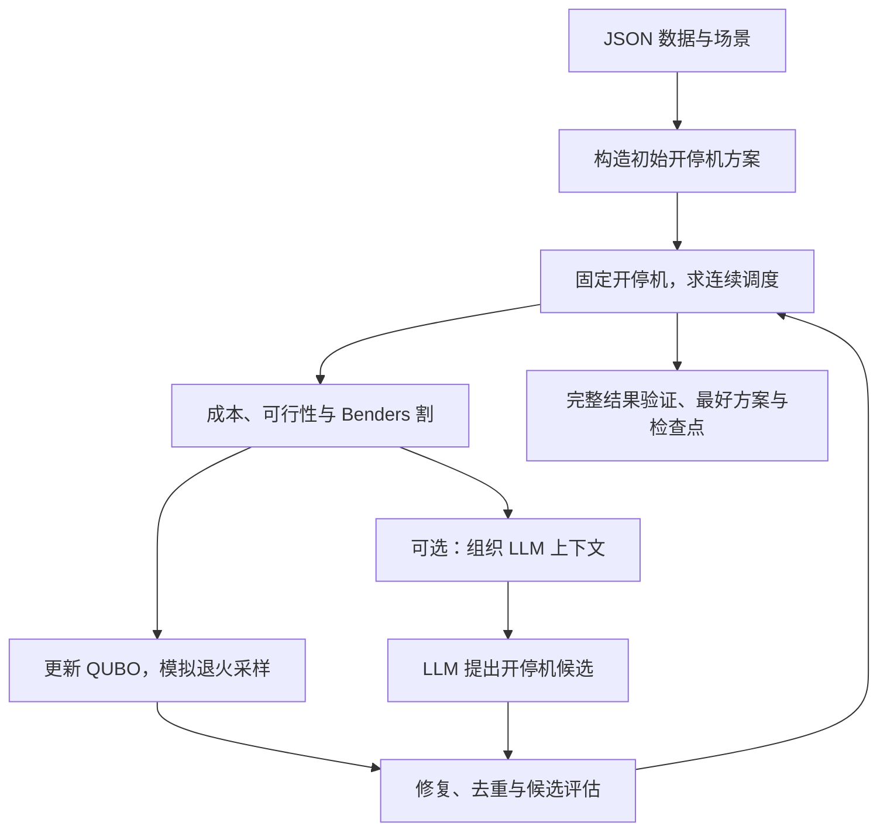

# 从 C++ 到随机机组组合：LLM-benders-SUC 项目阅读教材

面向读者：学过 C++、了解基本数据结构，尚未系统学习 Python。编写日期：2026 年 10 月 2 日。

全书包含12章，按347个源码段讲解39个Python文件的5,747行原文；配有97个测试方法的解读、4段已执行核对的实践代码，以及20道带答案的综合习题。建议使用下方目录分章阅读。

本书按“问题与数据 → Python/NumPy → 候选与约束 → 完整模型 → Benders → QUBO/SA → 主循环 → LLM → 运行与实验”的顺序讲解。最后逐个解释当前测试，并提供有答案的练习。你可以在编辑器中打开 Markdown 预览，用目录跳转；公式若未渲染，也可直接阅读相邻的文字说明。

**版本范围。** 本书依据提交 `bae3200f01a97a416a32a8f03967cce42f7052a7` 对应的当前工作区源码编写。覆盖 `suc_benders/` 全部 Python 文件、`data/rts24/convert.py` 和 `tests/` 全部 Python 文件。源码分段完整收录，行号属于编写时版本；文末有文件哈希与覆盖清单。数据文件按字段及来源讲解，历史归档按实验协议和证据结构讲解；归档中的历史源码不是当前实现，不逐行混入本书。

**怎样使用。** 每个源码段都先展示原文，再解释输入、语法、数学含义或控制流。首次出现的语法集中在第 2 章讲解，此后重点解释该段为何如此使用。导入、空行和重复的序列化样板按段解释。读每个函数时，自己写下“输入—形状—处理—输出—调用者”；遇到数学推导，先用单机三时段例子验证，再看通式。

“完全读懂”的验收标准是：能解释当前每个模块的职责，追踪一个候选如何被生成、修复、评估、反馈，手算小例子，读懂对应测试，并明确区分可行性、参考成本差和最优性证明。本书解释到项目调用外部库的边界，不包含 Gurobi 或 Kaiwu SDK 的内部源代码课程。

## 目录

1. [问题、文件地图与学习安排](#chapter-1)
2. [C++ 学生需要的 Python 与 NumPy](#chapter-2)
3. [输入数据、候选方案与离散约束](#chapter-3)
4. [完整数学模型与独立验证](#chapter-4)
5. [连续子问题、对偶与 Benders 割](#chapter-5)
6. [索引模型、QUBO 编码与模拟退火](#chapter-6)
7. [配置、结果与整个搜索循环](#chapter-7)
8. [LLM 上下文、通信与自动反馈](#chapter-8)
9. [程序入口、文件交接与运行审计](#chapter-9)
10. [原始数据转换、基线实验与历史结果](#chapter-10)
11. [把测试当成可执行的教材](#chapter-11)
12. [分级实践、习题答案与术语表](#chapter-12)
13. [源码覆盖和版本校验](#source-coverage)

<a id="chapter-1"></a>

## 第 1 章　问题、文件地图与学习安排

### 1.1 先把问题说清楚

一家电力调度机构要安排明天的发电。每台机组有最小/最大发电能力、启动与关闭能力、爬坡速度、最短开机/停机时间以及成本。负荷不能随意不满足；还要预留一定备用能力。开机太多会产生固定费用，开机太少可能无法供电。决定哪些机组在哪些小时运行，就是机组组合（Unit Commitment，UC）。

本项目考虑几个可能的负荷场景，称为随机机组组合（Stochastic Unit Commitment，SUC）。**所有场景共享开停机决策，各场景分别决定发电和备用。** 这体现两阶段思想：先作承诺，再在给定场景下调度。代码在给定整个场景负荷轨迹后优化其全部小时；它没有实现一个逐小时揭示信息的多阶段随机决策树。

默认数据有 32 台机组、24 个小时、3 个场景。场景负荷为基础负荷的 0.90、1.00、1.05 倍，概率为 0.25、0.50、0.25，备用率为 5%。这些随机场景是项目设定。系统总容量为 3405 MW，基础峰值负荷为 2850 MW，最重场景含备用的峰值为 `2850 × 1.05 × 1.05 = 3142.125 MW`。

模型把电网视为一个聚合供需系统：没有输电线路、潮流、损耗和无功约束；固定启动费用替代冷热启动费用；六台水电机组没有水量/能量预算。因此这里的“物理可行”指**满足本项目明确建模的物理约束**。

### 1.2 变量、下标和形状

|记号/代码|含义|形状或范围|
|---|---|---|
|`i`|机组索引|`0 … n_units-1`|
|`t`|时段索引|`0 … horizon-1`|
|`s`|场景索引|`0 … len(scenarios)-1`|
|`u[i,t]`|该时段是否开机|0/1，`(N,T)`|
|`v[i,t]`|该时段是否启动|0/1，`(N,T)`|
|`w[i,t]`|该时段是否关闭|0/1，`(N,T)`|
|`p[i,t]`|某场景下的发电功率|非负实数，`(N,T)`|
|`r[i,t]`|某场景下的备用容量|非负实数，`(N,T)`|
|`scenario.load`|某场景逐小时负荷|`(T,)`|
|`data.pmax` 等|机组参数|通常 `(N,)`|

小时长度在本项目中固定为 1 小时。逐小时 MW 数值求和可对应这一期间的 MWh；若把时段改成 15 分钟，成本、爬坡、最短持续时间都必须重新处理，不能只改数组长度。

### 1.3 五个部件怎样合作



图是职责关系，不是逐行执行顺序。第 7 章会区分联合场景调度和逐场景完整评估；一个候选可能经历两者。

|文件组|主要作用|读到哪一步再深究|
|---|---|---|
|`data.py`、`common.py`、`candidates.py`|输入、数组、状态规则、修复|先读|
|`full_model.py`、`validation.py`|原问题及数值结果复核|理解数学模型|
|`subproblem.py`|固定开停机后的调度、对偶、割|理解分解|
|`paper_model.py`、`master.py`、`quantum.py`|统一约束、编码、采样|理解候选搜索|
|`solver.py`、`paper_solver.py`|配置、结果、主循环|串联前面内容|
|`context.py`、`llm.py`、`advisor_feedback.py`|LLM 输入、输出、反馈|理解增强搜索|
|`subagent.py`、`astra_run.py`、`astra_audit.py`|文件协议、运行和审计|理解工程闭环|
|`full.py`、`rts24_experiment.py`|参考求解命令、基线实验|最后阅读|

`paper_` 和 `quantum` 是沿用的命名。当前主流程是全时域动态 QUBO，本地模拟退火；不是时间分块算法，也没有调用量子真机。`master.py` 并没有装下完整“主问题求解器”。

### 1.4 建议的学习节奏

每次读一个可验证的小单元：先写预测，再运行或手算，再比较。第 2—3 章以数组和状态转换为单元；第 4—6 章以一类约束或一种割为单元；第 7—10 章以一次候选评估或一次调用为单元。测试并非只能最后读，第 11 章可以随时查阅对应小节。

本章自检：为什么不能让三个场景各自选一套 `u`？答案：那会允许在知道场景后改变原本必须预先确定的承诺，得到另一个、通常更容易且更便宜的问题。

<a id="chapter-2"></a>

## 第 2 章　C++ 学生需要的 Python 与 NumPy

### 2.1 运行文件、包和模块

`.py` 文件是一个模块，带有 `__init__.py` 的目录可以组成包。执行 `python -m suc_benders` 时，Python 按包规则加载 `suc_benders/__main__.py`。本项目在其中导入 `astra_run.main` 并调用。`from .data import UCData` 中的点表示当前包；它不是磁盘上的任意相对路径拼接。

`if __name__ == "__main__":` 相当于“只有这个文件被当作运行入口时，才执行下面语句”。被别的模块导入时，函数和类会定义，但这段入口不执行。导入顶层代码本身仍会执行，所以测试文件中的加载逻辑也值得看。

从仓库根目录运行示例，原因是默认数据路径 `data/rts24/units.json` 相对于当前工作目录。`Path(__file__).resolve().parents[1]` 则从当前文件的位置推导仓库目录，两种定位方式不同。

### 2.2 基本语法与 C++ 对照

```python
def fixed_cost(u, costs):
    total = 0.0
    for i in range(len(u)):
        if u[i] == 1:
            total += costs[i]
    return total
```

`def` 定义函数；冒号后缩进形成代码块，通常用四个空格。`range(n)` 产生 0 到 n-1。变量无需写静态类型，`total` 此处绑定到浮点对象。Python 的 `and/or/not` 是短路逻辑运算；`True/False` 首字母大写。`a if condition else b` 对应 C++ 的 `condition ? a : b`，但阅读顺序不同。

`//` 是向下取整除法，不是注释；`**` 是乘方，`#` 才是行注释。`1_000_000.0` 中下划线只是为了可读性。负数整除如 `-3 // 2 == -2`，与 C++ 整数除法向零截断不同。`==` 比较值，`is` 比较是不是同一对象；检查空值常用 `x is None`。

`None` 表示没有对象/值，不是 0，也不等同于失败。`float("inf")` 是正无穷，可作为尚无可行解时的成本；`NaN` 表示非数。后面将它们转成 JSON `null` 是序列化选择，不能理解为成本变成零。

### 2.3 四种容器和解包

```python
values = [1, 0, 1]                  # list：有序、可修改
key = ("u", 2, 5, -1)              # tuple：有序、元素绑定不可改
coefficients = {key: 3.0}          # dict：键到值的映射
seen = {("a", 1), ("b", 2)}        # set：去重和成员查找
kind, unit, hour, scenario = key   # 解包，左右数量要相符
```

`list` 可联系 `vector`，但可放不同类型；`dict/set` 常用哈希查找。字典键必须可哈希，元素也可哈希的元组可作键，所以项目用四元组表示变量。NumPy 数组可变且不能直接这样用作集合键，因此候选去重先展平再转元组。

```python
rows = [i * i for i in range(4)]
positive = {k: v for k, v in coefficients.items() if v != 0}
for index, value in enumerate(values):
    print(index, value)
for probability, cost in zip([0.25, 0.75], [10, 20]):
    print(probability * cost)
```

推导式是构造容器的循环。`enumerate` 同时给索引和值；`zip` 把多个序列按位置配对，默认在最短序列结束时停止。项目很多地方依赖“场景列表与结果列表同序且同长”，不是按名字自动配对。

`sum(expression for x in sequence)` 中没有方括号，是生成器表达式，按需产生元素。`sorted(items, key=lambda x: x.cost)` 使用匿名函数选排序键。`max(choices, key=lambda item: item[:3])` 比较元组前三项，先比第一项，相同才比第二项，再比第三项。

### 2.4 引用、可变对象和复制

```python
a = [1, 2]
b = a
b[0] = 9       # a 也成为 [9, 2]
c = a.copy()
c[0] = 7       # a 不变
```

赋值绑定对象，没有自动复制容器。`list.copy()` 是浅复制：若元素自身是列表，内部仍可能共享。NumPy 数值数组的 `.copy()` 则复制数据缓冲区，适合候选方案。`dataclasses.replace(data, horizon=3)` 构造新数据类，但未替换的数组成员依然共享引用。项目修复函数主动复制，避免把原始提案改掉，从而才能计算修复前后的差异。

### 2.5 类、数据类和类型标注

```python
from dataclasses import dataclass, field

@dataclass
class Example:
    cost: float
    notes: list[str] = field(default_factory=list)
```

`@dataclass` 自动生成常用的初始化、显示和比较方法，可先看成简化的数据结构。`Example(3.0)` 会得到一个具有 `cost` 和独立 `notes` 列表的对象。`default_factory=list` 的意思是每次新建实例时调用 `list()`，避免共享同一个可变默认对象。

实例方法第一个参数 `self` 相当于显式写出的对象引用；`self.cost` 是成员。`@classmethod` 中常用 `cls`，接收类对象，测试的 `setUpClass` 用它保存共享准备数据。

`x: np.ndarray`、`-> float` 是类型标注，通常不强制运行时检查。`float | None` 表示可为浮点或空值；`Sequence[Scenario]` 表示可按序访问的一组场景；`Any` 表示未限定类型。`from __future__ import annotations` 推迟注解求值，在本项目的 Python 3.10 环境中有助于处理相互引用。

`@dataclass(frozen=True)` 阻止通常的字段重新赋值，并没有把字段内的 NumPy 数组变成只读。不要把它等同于整个对象图的 C++ 深层 `const`。

### 2.6 参数、闭包和回调

```python
def f(x, *, limit=3):
    return x[:limit]

def wrapper(*args, **kwargs):
    return f(*args, **kwargs)
```

单独的 `*` 之后参数必须用名字传入。`*args` 收集位置参数，`**kwargs` 收集关键字参数；调用时写星号则进行展开。`UCData(**mapping)` 等于用字典键逐个指定构造参数。`{**old, "reserve_fraction": 0.05}` 先展开旧字典再覆盖同名键。

```python
def outer():
    best = 100
    def improve(value):
        nonlocal best
        best = min(best, value)
    improve(80)
    return best
```

内层函数记住外层变量，称为闭包。`nonlocal` 表示重新绑定外层函数的变量；若只是 `records.append(...)`，是修改已有列表，通常不需要 `nonlocal`。`paper_solver.py` 的 `evaluate` 就靠闭包更新最好成本。`event_sink` 是可调用对象：求解器产生字典事件，运行器决定如何保存；这与 C++ 传函数对象/回调很接近。

### 2.7 异常、上下文管理和文件

`try/except` 对应异常处理，`raise ValueError(...)` 抛出异常。`except ... as exc` 捕获异常对象。`raise ... from exc` 保留因果链。`finally` 在退出时执行，进程监督器用它收尾。

```python
from pathlib import Path
import json

path = Path("data/rts24/stochastic.json")
profile = json.loads(path.read_text(encoding="utf-8"))
print(profile["reserve_fraction"])
```

`Path` 用 `/` 拼接路径；`read_text` 读字符串，`read_bytes` 读字节。JSON 对象变 `dict`，数组变 `list`，`null` 变 `None`。`json.dumps` 把对象转字符串，`json.dump` 写入文件对象。`allow_nan=False` 不允许把无穷/NaN 写成非标准 JSON 数字。

`with file.open(...) as stream:` 保证离开语句块时关闭文件，和 RAII 的资源管理目的相近。文件模式 `"x"` 表示独占新建，已存在则失败；项目用它防止同一请求被领取两次。先写 `.tmp` 再 `replace` 用于让读者看到完整文件，但它本身不是数据库事务或身份认证。

### 2.8 NumPy：每一行先问 shape

```python
import numpy as np

u = np.array([[1, 1, 0], [0, 1, 1]], dtype=int)
cost = np.array([5.0, 8.0])
print(u.shape)                       # (2, 3)
print(u.sum(axis=0))                 # [1, 2, 1]：消去机组轴
print(u.sum(axis=1))                 # [2, 2]：消去时段轴
print(cost[:, None] * u)             # [[5, 5, 0], [0, 8, 8]]
print(np.sum(cost[:, None] * u))     # 26.0
```

`axis=0` 是第一个维度：沿机组方向求和后，每个小时得到一个值；`axis=1` 沿时段求和后，每台机组得到一个值。`sum()` 不指定轴就全部求和。

`u[:,1:]` 取全部行和第二列到最后；`u[:,:-1]` 去掉最后一列；右端点不包含。`cost[:,None]` 在第二个轴插入长度 1 的维度，从 `(2,)` 变 `(2,1)`。广播从右向左比较维度，同长或其中一个为 1 才能扩展。故 `(2,1)*(2,3)` 成为 `(2,3)`；这不需要你手动复制 3 列。

`*` 是逐元素乘法，`@` 是矩阵乘法/向量内积。例如 `x @ Q @ x` 是 QUBO 能量，`beta*u` 是逐元素系数乘决策，再 `sum` 才是内积。

|表达式|用途与注意点|
|---|---|
|`np.asarray(x, dtype=float)`|把输入变为数值数组；可能共享原数据|
|`np.zeros((N,T))` / `np.ones(...)`|创建全零/全一矩阵|
|`np.zeros_like(u)`|沿用形状及默认数据类型|
|`u.astype(int)`|类型转换，不等于自动验证它原本是二进制|
|`np.rint(u)`|舍入到最近整数，半整数遵循取偶规则|
|`np.clip(u,0,1)`|截断到区间，不处理完整物理约束|
|`np.maximum(a,b)` / `np.minimum(a,b)`|逐元素最大/最小|
|`np.any(mask)` / `np.all(mask)`|是否至少一个/全部为真|
|`np.isfinite(x)`|排除 NaN 和无穷|
|`np.flatnonzero(mask)`|取为真的扁平位置|
|`reshape(-1)` / `ravel()`|展平；可能返回共享内存的视图|
|`np.column_stack((a,b))`|按列拼接；一维数组会成为一列|
|`np.stack(list_of_arrays)`|增加一个轴后堆叠|
|`np.r_[a,b,c]`|这里用于拼接多个一维数组|
|`np.ix_(rows,cols)`|构造笛卡尔积索引，取指定子矩阵|

数组布尔组合用 `(u != 0) & (u != 1)`，括号不可随意省略；`&/|/~` 在布尔数组上逐元素工作。不能用 `if array:` 代替 `np.any`，多元素数组的真假有歧义。

### 2.9 浮点数、Fraction 和容差

二进制浮点不能精确表示多数十进制小数。`Fraction("0.3")` 精确表示 3/10；`Fraction(float_value)` 精确表示**那个已存在的二进制浮点数**。项目两种写法都用了：容量格点要保持十进制输入语义；割量化要保证对实际浮点系数向下取整。

`np.isclose`/`assert_allclose` 允许容差。误差 1e-8 可能是浮点计算的正常结果；但用过大容差又可能掩盖边界错误。第 6 章会用 35 和 35.000001 的差别说明容量格点为什么不能粗暴四舍五入。

本章练习：把上面的 NumPy 示例改写成两层 C++ 循环。若能得到每小时固定成本 `[5,13,8]` 和总成本 26，再进入下一章。

### 2.10 源码里其余常见简写

|写法|读法|
|---|---|
|`f"{iteration:03d}"`|格式化字符串，把整数补零到至少三位，例如1→001|
|`f"{cost:.6f}"`|浮点数显示六位小数；仅改变显示，不改变保存的成本|
|`getattr(candidate, kind)`|kind若为"u"，取candidate.u；让同一循环处理u/v/w|
|`getattr(response,"status",200)`|属性不存在时使用默认200|
|`hasattr(value,"__dict__")`|判断对象是否具有该属性|
|`vars(obj)` / `obj.__dict__`|取得常见对象的属性映射；不是所有对象都支持|
|`mapping.get(key, default)`|键不存在时给默认；键存在但值为None时仍返回None|
|`mapping.pop(key, default)`|取出并删除键；原字典会改变|
|`next(generator, None)`|取第一个元素，无元素时给默认None|
|`_` / `_r`|普通变量名，约定表示这次不使用该值，不是特殊语法|
|`if pool:`|空列表是假，非空列表为真；不等同于NumPy数组真假|
|`config or Default()`|若config是假值则构造默认对象；or返回操作数本身|
|`a, b = b, a`|右边先求值再解包，可同时交换绑定|
|`1 << j`|左移，等于2的j次方，用于二进制权重|
|`pass`|空操作，占据语法要求的语句位置|
|`continue` / `break`|跳到本层循环下一轮／结束本层循环，不自动结束所有外层循环|

括号内相邻字符串字面量会自动拼接，所以system提示词可以拆成多行，不必逐行写加号。函数/类开头三引号字符串是文档字符串；其内容可能落后于实现，必须对照代码。`dict(total=1)` 与 `{"total":1}` 在这里等价。`range(1,4)`产生1、2、3；`range(1,1)`为空，这正是主循环用来跳过不该发生的LLM批次的方式。

`time.perf_counter()`用来算持续时间和截止点，不代表Unix时间；`time.time()`是用于记录的时间戳。`asdict(config)`递归处理数据类，`replace(config, timeout_seconds=...)`新建一个字段被覆盖的配置，两者都不会替你验证业务参数。

<a id="chapter-3"></a>

## 第 3 章　输入数据、候选方案与离散约束

### 3.1 数据不是仅仅一组数组

阅读 [units.json](../data/rts24/units.json) 时，每一个位置对应同一台机组。`pmax/pmin` 是最大/最小发电能力；`pstart/pshut` 是启动小时/关闭前一小时的出力加备用上限；`ramp_up/ramp_down` 限制相邻小时发电功率的变化。`cost_a/cost_b` 对应 `a*p²+b*p`；`cost_c` 乘开机状态，启动和关闭费用分别乘 `v/w`。

原始 `initial_duration` 有符号：正数表示已经开机若干小时，负数表示已经停机若干小时。加载后分成布尔 `initial_on` 与绝对持续时间 `initial_duration`。`initial_output` 是规划开始前的真实发电功率，第一小时爬坡必须从它出发。

场景文件的 `reserve_fraction` 会覆盖机组 JSON 中该字段。默认不传场景文件时，加载器明确构造三场景与 5% 备用；这解释了为什么 `units.json` 中保存 0 备用，默认运行仍然是 5%。

<a id="suc_benders-data-py-1"></a>

### 3.2 data.py：从 JSON 到有含义的数据对象

对应文件：[suc_benders/data.py](../suc_benders/data.py)。本节逐段覆盖第 1—211 行。代码框是当前源码原文；分段不改变其缩进关系，不能把单个片段都当成独立程序运行。

#### 第 1—12 行：导入与输入异常

```python
from __future__ import annotations

from dataclasses import dataclass
import json
from pathlib import Path
import numpy as np


class DataError(ValueError):
    """Raised when UC or scenario input is internally inconsistent."""


```

`Path/json` 负责文件与 JSON，NumPy 保存数值；`DataError` 继承 `ValueError`，让调用者能识别“输入数据不符合约定”。类体只有文档字符串也是合法 Python。

#### 第 13—41 行：两种数据类

```python
@dataclass(frozen=True)
class UCData:
    n_units: int
    horizon: int
    pmax: np.ndarray
    pmin: np.ndarray
    pstart: np.ndarray
    pshut: np.ndarray
    min_up: np.ndarray
    min_down: np.ndarray
    ramp_up: np.ndarray
    ramp_down: np.ndarray
    initial_on: np.ndarray
    initial_duration: np.ndarray
    initial_output: np.ndarray
    base_load: np.ndarray
    cost_a: np.ndarray
    cost_b: np.ndarray
    cost_c: np.ndarray
    startup_cost: np.ndarray
    shutdown_cost: np.ndarray
    reserve_fraction: float = 0.05


@dataclass(frozen=True)
class Scenario:
    name: str
    probability: float
    load: np.ndarray
```

`UCData` 汇总系统规模、机组参数、初始状态、负荷和费用；`Scenario` 保存名字、概率与负荷轨迹。冻结字段绑定有助于把输入当作参数，数组本身仍可修改。读这些字段时对照本节参数字典；除负荷为 `(T,)` 外，各机组向量主要为 `(N,)`。

#### 第 42—52 行：检查数值向量

```python

def _vector(obj: dict, key: str, n: int) -> np.ndarray:
    value = obj.get(key)
    if not isinstance(value, list) or len(value) != n:
        raise DataError(f"{key} must be a list of length {n}")
    values = np.asarray(value, dtype=float)
    if not np.all(np.isfinite(values)):
        raise DataError(f"{key} contains a non-finite value")
    return values


```

`obj.get(key)` 在字段缺失时得到 None；先要求是长度 n 的列表，再变成浮点数组，最后检查全部有限。返回数组而不是原列表，使后面广播、比较和乘法具有统一数值语义。

#### 第 53—69 行：加载规模与负荷

```python
def _load_units(data_path: Path) -> UCData:
    try:
        obj = json.loads(data_path.read_text(encoding="utf-8"))
    except (OSError, json.JSONDecodeError) as exc:
        raise DataError(f"cannot read UC data file {data_path}: {exc}") from exc

    try:
        n = int(obj["n_units"])
        horizon = int(obj["horizon"])
        base_load = np.asarray(obj["base_load"], dtype=float)
    except (KeyError, TypeError, ValueError) as exc:
        raise DataError("n_units, horizon, and base_load are required") from exc
    if n <= 0 or horizon <= 0:
        raise DataError("n_units and horizon must be positive")
    if base_load.shape != (horizon,):
        raise DataError(f"base_load must have {horizon} entries")

```

`read_text` 的 UTF-8 与 JSON 解析一起位于异常处理内，文件错误也转成 DataError。n、horizon 转整数，负荷转数组；之后验证规模为正、负荷只有一维且长度匹配。注意代码没有一个包住所有后续字段错误的通用处理器，不能声称任意坏输入都必然得到 DataError。

#### 第 70—84 行：逐项读取机组参数

```python
    pmax = _vector(obj, "pmax", n)
    pmin = _vector(obj, "pmin", n)
    pstart = _vector(obj, "pstart", n)
    pshut = _vector(obj, "pshut", n)
    ramp_up = _vector(obj, "ramp_up", n)
    ramp_down = _vector(obj, "ramp_down", n)
    cost_a = _vector(obj, "cost_a", n)
    cost_b = _vector(obj, "cost_b", n)
    cost_c = _vector(obj, "cost_c", n)
    startup_cost = _vector(obj, "startup_cost", n)
    shutdown_cost = _vector(obj, "shutdown_cost", n)
    min_up = np.asarray(obj["min_up"], dtype=int)
    min_down = np.asarray(obj["min_down"], dtype=int)
    initial_duration = _vector(obj, "initial_duration", n)

```

重复调用 `_vector` 为同一个机组轴建立对应参数。最短开停机时间直接转换为整数数组，初始持续时间走 `_vector`。这里可以练习：每一行给 UCData 的哪个字段准备输入？转换为 int 与“验证原值是整数”并非同一件事。

#### 第 85—104 行：物理范围与初始状态

```python
    if np.any(pmin < 0) or np.any(pmax < pmin):
        raise DataError("each Pmin must be non-negative and no greater than Pmax")
    if np.any(base_load < 0):
        raise DataError("base_load must be non-negative")
    if np.any(ramp_up < 0) or np.any(ramp_down < 0):
        raise DataError("ramp rates must be non-negative")
    if np.any(min_up < 1) or np.any(min_down < 1):
        raise DataError("min_up and min_down must be positive")
    if np.any(cost_a < 0) or np.any(cost_b < 0) or np.any(cost_c < 0):
        raise DataError("cost coefficients must be non-negative")

    initial_on = initial_duration > 0
    if "initial_output" in obj:
        initial_output = _vector(obj, "initial_output", n)
        if np.any(initial_output[~initial_on] != 0):
            raise DataError("offline units must have zero initial_output")
        if np.any(initial_output[initial_on] < pmin[initial_on]) or np.any(initial_output[initial_on] > pmax[initial_on]):
            raise DataError("online initial_output must lie between Pmin and Pmax")
    else:
        initial_output = np.where(initial_on, pmin, 0.0)
```

要求 Pmin≥0、Pmax≥Pmin，负荷、爬坡与 cost_a/b/c 非负，最短时间≥1；此处没有单独检查启停费用的正负。`initial_duration > 0` 得到布尔向量；离线机组初始出力必须为零，在线出力位于上下限。省略初始出力时用 `np.where(initial_on,pmin,0)` 兜底。这是数据缺省规则，不意味着真实初始出力总等于 Pmin。

#### 第 105—128 行：组装返回对象

```python
    return UCData(
        n_units=n,
        horizon=horizon,
        pmax=pmax,
        pmin=pmin,
        pstart=pstart,
        pshut=pshut,
        min_up=min_up,
        min_down=min_down,
        ramp_up=ramp_up,
        ramp_down=ramp_down,
        initial_on=initial_on,
        initial_duration=np.abs(initial_duration),
        initial_output=initial_output,
        base_load=base_load,
        cost_a=cost_a,
        cost_b=cost_b,
        cost_c=cost_c,
        startup_cost=startup_cost,
        shutdown_cost=shutdown_cost,
        reserve_fraction=float(obj.get("reserve_fraction", 0.05)),
    )


```

具名参数避免靠位置记住二十多个字段。`np.abs(initial_duration)` 把符号信息分离后保留持续时间。此处 reserve_fraction 先取机组文件值，外层加载器稍后根据场景配置替换。

#### 第 129—147 行：读取场景结构与身份

```python
def _read_scenarios(raw: object, base_load: np.ndarray, horizon: int) -> tuple[list[Scenario], float]:
    if not isinstance(raw, dict):
        raise DataError("scenario JSON root must be an object")
    reserve_fraction = float(raw.get("reserve_fraction", 0.05))
    if reserve_fraction < 0:
        raise DataError("reserve_fraction must be non-negative")
    entries = raw.get("scenarios")
    if not isinstance(entries, list) or not entries:
        raise DataError("scenarios must be a non-empty list")

    scenarios: list[Scenario] = []
    names: set[str] = set()
    probabilities: list[float] = []
    for index, entry in enumerate(entries):
        if not isinstance(entry, dict):
            raise DataError(f"scenario {index} must be an object")
        name = entry.get("name", f"scenario_{index}")
        if not isinstance(name, str) or not name or name in names:
            raise DataError(f"scenario name {name!r} is missing or duplicated")
```

场景根节点必须是字典，条目列表不能为空；备用率非负。`names` 去重场景名称，`probabilities` 用于最终总和校验。enumerate 的 index 只用于默认命名与错误说明。

#### 第 148—171 行：概率与负荷的两种表达

```python
        try:
            probability = float(entry["probability"])
        except (KeyError, TypeError, ValueError) as exc:
            raise DataError(f"probability for scenario {name!r} is required") from exc
        if not np.isfinite(probability) or probability <= 0:
            raise DataError(f"probability for scenario {name!r} must be positive")
        has_factor = "load_factor" in entry
        has_load = "load" in entry
        if has_factor == has_load:
            raise DataError(f"scenario {name!r} must specify exactly one of load_factor or load")
        if has_factor:
            factor = float(entry["load_factor"])
            if factor < 0:
                raise DataError(f"load_factor for scenario {name!r} must be non-negative")
            load = factor * base_load
        else:
            load = np.asarray(entry["load"], dtype=float)
            if load.shape != (horizon,):
                raise DataError(f"load for scenario {name!r} must have {horizon} entries")
            if np.any(load < 0) or not np.all(np.isfinite(load)):
                raise DataError(f"load for scenario {name!r} must be finite and non-negative")
        names.add(name)
        probabilities.append(probability)
        scenarios.append(Scenario(name, probability, load))
```

概率要求有限且大于零。`has_factor == has_load` 会在“两者都有”或“两者都没有”时拒绝，要求二选一。倍率乘基础负荷；显式 load 则直接作为绝对负荷且检查形状和有限性。当前倍率分支仅显式检查小于零，未全面验证所有非有限输入；阅读代码要以实际检查为准。

#### 第 172—177 行：概率必须加起来为一

```python
    total = float(sum(probabilities))
    if not np.isclose(total, 1.0, atol=1e-9, rtol=0.0):
        raise DataError(f"scenario probabilities must sum to 1; got {total:.12g}")
    return scenarios, reserve_fraction


```

`np.isclose(..., atol=1e-9, rtol=0)` 只用绝对容差。不是悄悄归一化概率，而是要求输入本身满足约定，避免错误权重被掩盖。返回场景列表和备用率两个对象。

#### 第 178—201 行：公开入口与默认场景

```python
def load_suc_data(
    data_path: str | Path = "data/rts24/units.json",
    scenario_path: str | Path | None = None,
) -> tuple[UCData, list[Scenario]]:
    """Load validated UC data and stochastic scenarios.

    A load_factor is relative to the canonical base load, while an explicit
    ``load`` array is an absolute 24-period scenario.
    """

    data_path = Path(data_path)
    units = _load_units(data_path)
    if scenario_path is None:
        entries = [
            {"name": "low", "probability": 0.25, "load_factor": 0.9},
            {"name": "base", "probability": 0.50, "load_factor": 1.0},
            {"name": "high", "probability": 0.25, "load_factor": 1.05},
        ]
        raw = {"reserve_fraction": 0.05, "scenarios": entries}
    else:
        try:
            raw = json.loads(Path(scenario_path).read_text(encoding="utf-8"))
        except (OSError, json.JSONDecodeError) as exc:
            raise DataError(f"cannot read scenario file {scenario_path}: {exc}") from exc
```

返回注解是二元组。默认路径相对运行目录；若未指定 scenario_path，直接构造 low/base/high 三条配置。若指定文件，读 JSON 后复用同一 `_read_scenarios`。因此默认与显式 stochastic 文件应相同，测试会核对。

#### 第 202—211 行：容量初筛与场景覆盖

```python
    scenarios, reserve_fraction = _read_scenarios(raw, units.base_load, units.horizon)
    available = float(np.sum(units.pmax))
    required = max(float(np.max((1.0 + reserve_fraction) * scenario.load)) for scenario in scenarios)
    if required > available + 1e-6:
        raise DataError(
            f"scenario load plus reserve exceeds total Pmax: required={required:.6g}, available={available:.6g}"
        )
    units = UCData(**{**units.__dict__, "reserve_fraction": reserve_fraction})
    return units, scenarios

```

计算所有场景中最大负荷加备用，与总 Pmax 比较；这是必要条件，不是充分条件，爬坡和最短开停机仍可能造成不可行。`UCData(**{**units.__dict__, ...})` 用旧字段创建新对象并覆盖备用率，最后返回 `(units, scenarios)`。

<a id="suc_benders-master-py-1"></a>

### 3.3 master.py 的候选与采样配置

对应文件：[suc_benders/master.py](../suc_benders/master.py)。本节逐段覆盖第 1—28 行。代码框是当前源码原文；分段不改变其缩进关系，不能把单个片段都当成独立程序运行。

#### 第 1—8 行：导入

```python
from __future__ import annotations

from dataclasses import dataclass, field
from fractions import Fraction
from math import ceil, floor, gcd, lcm

import numpy as np

```

本文件同时服务于候选数据结构和后面的精确编码。Fraction、ceil/floor、gcd/lcm 此时可以先记住用途：把带小数的线性不等式放到整数格点上，第 6 章展开。

#### 第 9—18 行：MasterCandidate

```python

@dataclass
class MasterCandidate:
    u: np.ndarray
    v: np.ndarray
    w: np.ndarray
    source: str = "quantum"
    provenance: dict = field(default_factory=dict)


```

三个矩阵代表同一开停机方案。source 是来源标签；provenance 是记录提案身份和修复过程的字典。它本身不执行可行性验证。默认字符串 quantum 是命名遗留，不表示该候选来自量子硬件。

#### 第 19—28 行：QuantumConfig

```python
@dataclass
class QuantumConfig:
    backend: str = "kaiwu-local"
    kaiwu_seed: int | None = 7
    candidate_pool_size: int = 16
    initial_temperature: float = 100.0
    alpha: float = 0.98
    cutoff_temperature: float = 0.01
    iterations_per_temperature: int = 5

```

backend 目前只能是 kaiwu-local；随机种子影响复现；candidate_pool_size 是期望保留的候选池规模。initial_temperature、alpha、cutoff_temperature、iterations_per_temperature 控制退火温度与搜索步数，实际传 SDK 的温度还会缩放。

<a id="suc_benders-common-py-1"></a>

### 3.4 common.py：依赖加载与离散可行性

对应文件：[suc_benders/common.py](../suc_benders/common.py)。本节逐段覆盖第 1—92 行。代码框是当前源码原文；分段不改变其缩进关系，不能把单个片段都当成独立程序运行。

#### 第 1—10 行：导入

```python
from __future__ import annotations

from dataclasses import dataclass
from typing import Sequence

import numpy as np

from .data import UCData


```

这里按需访问外部求解库，所以只加载数据不必立即运行 Gurobi 或 SA。Sequence 是类型说明；数组计算才由 NumPy 完成。

#### 第 11—33 行：惰性导入外部库

```python
def require_gurobi():
    try:
        import gurobipy as gp
    except ImportError as exc:  # pragma: no cover
        raise RuntimeError(
            "gurobipy is required. Install it with `python -m pip install gurobipy==13.0.1`."
        ) from exc
    return gp


def require_kaiwu():
    try:
        import kaiwu as kw
    except ImportError as exc:  # pragma: no cover
        raise RuntimeError(
            "kaiwu is required for the local simulated-annealing backend."
        ) from exc
    return kw


def get_kaiwu():
    return require_kaiwu()

```

只有调用 require_gurobi/require_kaiwu 才进行对应导入；缺失时转成有安装提示的 RuntimeError。get_kaiwu 只是转发接口，既没有激活逻辑，也没有另一个后端选择器。

#### 第 34—41 行：同名 Scenario

```python

@dataclass(frozen=True)
class Scenario:
    name: str
    probability: float
    load: np.ndarray


```

本文件又定义了一个与 data.py 字段相同的 Scenario。它们是两个不同的 Python 类，但代码主要按 `.name/.probability/.load` 使用对象，而不检查具体类身份，所以现有流程能互用。包公开导出的是 data.py 的版本；学习时以它为主。

#### 第 42—52 行：启动与关闭能力分别限制

```python
def commitment_capacity(
    data: UCData, u: np.ndarray, v: np.ndarray, w: np.ndarray
) -> np.ndarray:
    """Per-unit capacity subject to both startup and next-hour shutdown limits."""

    startup = data.pmax[:, None] * u - (data.pmax - data.pstart)[:, None] * v
    shutdown = data.pmax[:, None] * u
    shutdown[:, :-1] -= (data.pmax - data.pshut)[:, None] * w[:, 1:]
    return np.minimum(startup, shutdown)


```

startup 是 Pmax*u−(Pmax−Pstart)*v；shutdown 是 Pmax*u，并在非最后小时减去 `(Pmax−Pshut)*w[t+1]`。所以“下一小时关闭”限制“本小时末的能力”。逐元素取两者最小，再在调用处按机组求和。不能把两个折减无条件相加：若同一小时启动、下一小时关闭，上限应是两者的较小值。

#### 第 53—66 行：验证矩阵与二进制

```python
def commitment_is_feasible(
    data: UCData, scenarios: Sequence[Scenario], u: np.ndarray, v: np.ndarray, w: np.ndarray
) -> bool:
    """Check all first-stage constraints exactly, independently of QUBO penalties."""

    u = np.asarray(u)
    v = np.asarray(v)
    w = np.asarray(w)
    n, horizon = data.n_units, data.horizon
    if u.shape != (n, horizon) or v.shape != u.shape or w.shape != u.shape:
        return False
    if np.any((u != 0) & (u != 1)) or np.any((v != 0) & (v != 1)) or np.any((w != 0) & (w != 1)):
        return False

```

三矩阵必须形状 `(N,T)` 相同，元素必须恰为 0 或 1。这里只做验证，不自动舍入。不满足直接返回 False，表示离散方案不符合条件，而不是抛出求解异常。

#### 第 67—79 行：状态转换与持续时间

```python
    for i in range(n):
        prev = int(data.initial_on[i])
        for t in range(horizon):
            if u[i, t] - prev != v[i, t] - w[i, t] or v[i, t] + w[i, t] > 1:
                return False
            prev = int(u[i, t])
        if w[i, horizon - 1] != 0:
            return False
        for t in range(horizon):
            if v[i, t] and np.any(u[i, t : min(horizon, t + int(data.min_up[i]))] != 1):
                return False
            if w[i, t] and np.any(u[i, t : min(horizon, t + int(data.min_down[i]))] != 0):
                return False
```

prev 从初始状态出发，逐小时检查 `u-prev=v-w` 和 `v+w≤1`。终端规定最后小时不能发生关闭，即 w 最后一列为零；并不要求所有机组最后都在线。启动后连续 min_up 小时必须为 1，关闭后连续 min_down 小时必须为 0，超过规划末端的部分截断。

#### 第 80—86 行：初始剩余开停机时间

```python
        if data.initial_on[i]:
            remaining = max(0, int(data.min_up[i]) - int(data.initial_duration[i]))
        else:
            remaining = max(0, int(data.min_down[i]) - int(data.initial_duration[i]))
        if np.any(u[i, :remaining] != (1 if data.initial_on[i] else 0)):
            return False

```

如果起始时已在线 1 小时但 min_up 为 4，未来前三个小时仍必须在线；停机同理。切片 `u[i,:remaining]` 检查这一前缀。代码依赖输入参数在适用范围内，并不是另行引入跨日循环条件。

#### 第 87—92 行：最重场景容量检查

```python
    capacity = commitment_capacity(data, u, v, w).sum(axis=0)
    for scenario in scenarios:
        reserve = (1.0 + data.reserve_fraction) * np.asarray(scenario.load)
        if np.any(capacity + 1e-6 < reserve):
            return False
    return True
```

把启动/关闭调整后的容量按机组求和，每个场景逐小时都要覆盖 `(1+备用率)*负荷`。加 1e-6 是此处容差。通过只代表离散规则与容量必要条件通过，尚未检查逐机出力与爬坡能否共同满足负荷。

<a id="suc_benders-candidates-py-1"></a>

### 3.5 candidates.py：构造、修复与去重

对应文件：[suc_benders/candidates.py](../suc_benders/candidates.py)。本节逐段覆盖第 1—130 行。代码框是当前源码原文；分段不改变其缩进关系，不能把单个片段都当成独立程序运行。

#### 第 1—12 行：导入与分工

```python
from __future__ import annotations

import hashlib
from typing import Sequence

import numpy as np

from .common import Scenario, commitment_capacity, commitment_is_feasible
from .data import UCData
from .master import MasterCandidate


```

本模块依赖 common 的规则检查和 master 的候选容器。它不调用 Gurobi；能修复的只是开停机层面的约束，连续可行性留给后续调度。

#### 第 13—21 行：两种候选身份

```python
def commitment_key(u: np.ndarray, v: np.ndarray, w: np.ndarray) -> tuple[int, ...]:
    return tuple(np.r_[u.reshape(-1), v.reshape(-1), w.reshape(-1)].astype(int).tolist())


def commitment_hash(candidate: MasterCandidate) -> str:
    values = np.r_[candidate.u.ravel(), candidate.v.ravel(), candidate.w.ravel()]
    return hashlib.sha256(values.astype(np.uint8).tobytes()).hexdigest()


```

commitment_key 将 u、v、w 依次展平拼接为整数元组，用于内存集合/字典查找。commitment_hash 将同样顺序的值变成 uint8 字节并取 SHA-256，用于日志中的短身份。哈希表示数据指纹，不是某种优化质量分数。

#### 第 22—43 行：由 u 重建 v/w

```python
def make_candidate(
    data: UCData,
    scenarios: Sequence[Scenario],
    u: np.ndarray,
    source: str = "quantum",
) -> MasterCandidate:
    """Rebuild v/w from u and check all discrete constraints."""

    u = np.asarray(u, dtype=int).copy()
    if u.shape != (data.n_units, data.horizon):
        raise ValueError(f"u must have shape {(data.n_units, data.horizon)}")
    previous = np.column_stack((data.initial_on.astype(int), u[:, :-1]))
    v = np.maximum(u - previous, 0)
    w = np.maximum(previous - u, 0)
    return MasterCandidate(
        u=u,
        v=v,
        w=w,
        source=source,
    )


```

先复制输入，检查 `(N,T)`。column_stack 把初始状态放在第一列、u 去掉最后一列后接在后面，得到 previous。逐元素正差是启动、反向正差是关闭。此函数没有调用 commitment_is_feasible；它的文档字符串提到 check，但实际只检查形状。不能据此省略后续验证。

#### 第 44—63 行：按时间推进的状态机

```python
def _temporal_repair(data: UCData, u: np.ndarray) -> np.ndarray:
    """Repair transition, minimum up/down, and terminal-shutdown violations."""

    u = u.copy()
    for i in range(data.n_units):
        state = int(data.initial_on[i])
        duration = int(data.initial_duration[i])
        for t in range(data.horizon):
            minimum = int(data.min_up[i] if state else data.min_down[i])
            target = int(u[i, t])
            if target != state and (
                duration < minimum or (t == data.horizon - 1 and state == 1)
            ):
                target = state
            duration = duration + 1 if target == state else 1
            state = target
            u[i, t] = state
    return u


```

每台机组维护 state 和 duration。目标状态不同于当前状态时，若此前连续时长不够，或试图最后小时关闭，就保持原状态；否则接受切换。保持状态 duration 加 1，切换时置 1。该贪心修复依赖时间顺序，追求规则合法，不求最小修改次数或最小成本。

#### 第 64—81 行：备用余量与缺口

```python
def reserve_capacity(data: UCData, candidate: MasterCandidate, scenario: Scenario) -> np.ndarray:
    capacity = commitment_capacity(data, candidate.u, candidate.v, candidate.w)
    return capacity.sum(axis=0) - (1.0 + data.reserve_fraction) * scenario.load


def _reserve_deficit(
    data: UCData,
    scenarios: Sequence[Scenario],
    candidate: MasterCandidate,
) -> np.ndarray:
    """Return the worst reserve deficit over all scenarios, by period."""

    deficits = np.stack(
        [np.maximum(0.0, -reserve_capacity(data, candidate, scenario)) for scenario in scenarios]
    )
    return deficits.max(axis=0)


```

reserve_capacity 返回容量减负荷与备用需求，正数有余量、负数缺口。_reserve_deficit 对每个场景把负余量截成正缺口，再沿场景轴取最大，得到逐小时最坏缺口 `(T,)`。

#### 第 82—98 行：输入清洗与时间修复

```python
def repair_commitment(
    data: UCData,
    scenarios: Sequence[Scenario],
    u: np.ndarray,
) -> MasterCandidate | None:
    """Repair temporal rules, then add online suffixes for deficient reserves.

    The repair is deterministic and only enforces the discrete master
    constraints. Continuous feasibility remains Gurobi's responsibility.
    """

    values = np.asarray(u, dtype=float)
    if values.shape != (data.n_units, data.horizon) or not np.all(np.isfinite(values)):
        return None
    binary = np.clip(np.rint(values), 0, 1).astype(int)
    candidate = make_candidate(data, scenarios, _temporal_repair(data, binary), source="repair")

```

shape/有限性不合格就返回 None；合法数值先 rint，再 clip 到 0/1，再做时序修复和构造。这里允许将原本非二进制的数值提案修成二进制，提示词要求与实际容错不是同一层。

#### 第 99—112 行：寻找最早缺口与可开机前缀限制

```python
    for _ in range(data.n_units + 1):
        if commitment_is_feasible(data, scenarios, candidate.u, candidate.v, candidate.w):
            return candidate
        deficit = _reserve_deficit(data, scenarios, candidate)
        if not np.any(deficit > 1e-6):
            return None
        t = int(np.flatnonzero(deficit > 1e-6)[0])
        choices = []
        for i in range(data.n_units):
            start = (
                0
                if data.initial_on[i]
                else max(0, int(data.min_down[i]) - int(data.initial_duration[i]))
            )
```

至多遍历 N+1 次，每次首先检查整个离散方案。若失败却没有备用缺口，表示其他规则仍有问题，直接放弃。否则选最早不足时刻 t，依次试每台机组，把它从初始限制允许的 start 一直开到末端。

#### 第 113—130 行：试探、评分与确定性选择

```python
            trial = candidate.u.copy()
            trial[i, start:] = 1
            if np.array_equal(trial, candidate.u):
                continue
            option = make_candidate(data, scenarios, trial)
            remaining = _reserve_deficit(data, scenarios, option)
            gain = float(deficit[t] - remaining[t])
            if gain > 1e-6 and np.all(remaining <= deficit + 1e-6):
                fixed = float(
                    np.sum(data.cost_c[:, None] * option.u)
                    + np.sum(data.startup_cost[:, None] * option.v)
                    + np.sum(data.shutdown_cost[:, None] * option.w)
                )
                choices.append((gain, -fixed, -i, option))
        if not choices:
            return None
        candidate = max(choices, key=lambda item: item[:3])[3]
    return None
```

每个 trial 都从当前方案复制；必须在目标小时增加容量，且任何小时缺口都不变差才入选。choices 的排序是 `(gain, -fixed, -i)`：优先容量增益大，其次固定成本低，再次索引小。选完继续检查。此方法只尝试整段在线后缀；没有最优修复保证，也不保证找到所有存在的离散可行方案。

### 3.6 手推状态机与候选构造

假设规划前关闭，已停够最短时间，`u=[1,0,0]`。则 `previous=[0,1,0]`，`v=max(u-previous,0)=[1,0,0]`，`w=max(previous-u,0)=[0,1,0]`。若 min_up=2，原始第一小时启动后第二小时立刻关闭不合法，时序修复会推迟关闭；若关闭被推到最后一小时，又会受终端禁止关闭影响。

检查点：`source="repair"` 只是标签，不说明修复改变了几个格子。修改量要比较修复前后 u；`hamming_u=np.count_nonzero(repaired.u != raw_u)` 才是项目日志使用的差异计数。

本章练习：初始在线 1 小时、min_up=3、计划 `u=[0,0,1,1]`，时序修复输出是什么？先跟踪 state/duration，再看第 12 章答案。

<a id="chapter-4"></a>

## 第 4 章　完整数学模型与独立验证

### 4.1 从“写算法”转向“描述一个优化问题”

Gurobi 建模代码会创建符号变量和表达式。例如 `p[i,t] >= pmin[i]*u[i,t]` 此时是一个待满足的关系，`addConstr` 将它加入模型。直到 `optimize()`，求解器才搜索具体数值。不要将建模时的 Python for 循环误读成按时间顺序实际调度机组。

固定开停机成本记为 F，场景概率为 π。完整目标为：

\[
\min\; \underbrace{\sum_{i,t}(c_i u_{it}+SU_i v_{it}+SD_i w_{it})}_{F(u,v,w)}
+\sum_s\pi_s\sum_{i,t}(a_i(p^s_{it})^2+b_i p^s_{it}).
\]

`a_i≥0` 使连续部分是凸二次函数；u/v/w 是二进制，所以完整模型是混合整数凸二次规划（MIQP）。固定 u/v/w 后，是连续凸 QP。后面的“主问题松弛”才是另一种线性模型，不能把所有 Gurobi 调用统称为 LP。

### 4.2 逐类约束

1. 状态：`u[t]-u[t-1]=v[t]-w[t]`，`v[t]+w[t]≤1`；t=0 用初始状态。
2. 最短持续时间：启动后规定窗口都在线，关闭后窗口都离线；窗口在 T 截断。
3. 初始状态剩余持续时间：已经在线/离线的时间会抵扣最短要求。
4. 最小出力：`p≥Pmin*u`；p、r 非负。
5. 启动容量：`p+r≤Pmax*u−(Pmax−Pstart)*v`。
6. 关闭容量：`p+r≤Pmax*u−(Pmax−Pshut)*w[t+1]`；最后小时没有下一小时项。
7. 爬坡：`p[t]-p[t-1]≤RampUp`，`p[t-1]-p[t]≤RampDown`；t=0 用 initial_output。
8. 平衡：每场景每小时 `sum_i p[i,t]=load[t]`。
9. 备用：每场景每小时 `sum_i r[i,t]≥reserve_fraction*load[t]`。
10. 终端：`w[i,T-1]=0`。没有要求回到初始状态。

备用是尚可调动的容量，不能当成已发出的电量加入平衡。发电 p 与备用 r 共同占用容量。代码保留包括启停过程在内的相邻小时爬坡上限，并没有因为 v/w=1 就关闭爬坡约束。

### 4.3 贯穿全书的单机三时段例子

取测试中的参数：Pmax=55、Pmin=10、Pstart=45、Pshut=35，最短开停机时间均 1，爬坡上下限均 135，初始关闭且出力 0，负荷 `[30,0,0]`，无备用。成本 a=0.01、b=2、c=5、启动 3、关闭 4。

方案 `u=[1,0,0]`，`v=[1,0,0]`，`w=[0,1,0]`。第一小时同时受启动上限 45 和下一小时关闭上限 35 限制，因此容量是 **35**。用 `55-(55-45)-(55-35)=25` 是错误的重复扣减。

出力 `p=[30,0,0]`、`r=[0,0,0]` 可行。发电成本 `0.01*30²+2*30=69`；固定与启停成本 `5+3+4=12`；总成本 **81**。把首小时负荷改成 35.1 后，该单小时在线方案不可行；在这个单机例子中，后两小时负荷为零且 Pmin=10，也不能通过继续在线来补救。

<a id="suc_benders-full_model-py-1"></a>

### 4.4 full_model.py：直接写出完整问题

对应文件：[suc_benders/full_model.py](../suc_benders/full_model.py)。本节逐段覆盖第 1—170 行。代码框是当前源码原文；分段不改变其缩进关系，不能把单个片段都当成独立程序运行。

#### 第 1—12 行：依赖与类型

```python
from __future__ import annotations

from dataclasses import dataclass
import time
from typing import Any, Sequence

import numpy as np

from .common import Scenario, require_gurobi
from .data import UCData


```

dataclass 定义记录；time 测墙钟时长；Any 允许结果里携带 Gurobi 模型对象。这里导入 require_gurobi，实际构建模型才加载求解库。

#### 第 13—44 行：配置和两层结果

```python
@dataclass
class FullConfig:
    time_limit: float | None = None
    mip_gap: float = 1e-6
    output_flag: int = 1


@dataclass
class ScenarioDispatch:
    name: str
    probability: float
    p: np.ndarray
    r: np.ndarray
    fuel_cost: float


@dataclass
class FullResult:
    status: str
    objective: float
    fixed_cost: float
    expected_fuel_cost: float
    u: np.ndarray
    v: np.ndarray
    w: np.ndarray
    scenarios: list[ScenarioDispatch]
    mip_gap: float
    runtime: float
    model: Any = None
    lower_bound: float = float("-inf")


```

FullConfig 给出求解时限、MIP 相对间隙容差和输出开关。ScenarioDispatch 保存某场景 p/r 与未乘概率的 fuel_cost；FullResult 保存总目标、固定成本、加权发电成本、开停机和独立下界。`model` 保留活模型，调用者必要时应 dispose。下界默认负无穷，表示尚无有用下界。

#### 第 45—64 行：建立符号变量

```python
def solve_full(data: UCData, scenarios: Sequence[Scenario], config: FullConfig | None = None) -> FullResult:
    config = config or FullConfig()
    started = time.perf_counter()
    gp = require_gurobi()
    n, horizon = data.n_units, data.horizon
    model = gp.Model("suc_full")
    model.Params.OutputFlag = config.output_flag
    model.Params.MIPGap = config.mip_gap
    if config.time_limit is not None:
        model.Params.TimeLimit = config.time_limit

    u = model.addMVar((n, horizon), vtype=gp.GRB.BINARY, name="u")
    v = model.addMVar((n, horizon), vtype=gp.GRB.BINARY, name="v")
    w = model.addMVar((n, horizon), vtype=gp.GRB.BINARY, name="w")
    scenario_vars = []
    for scenario in scenarios:
        p = model.addMVar((n, horizon), lb=0.0, name=f"p_{scenario.name}")
        r = model.addMVar((n, horizon), lb=0.0, name=f"r_{scenario.name}")
        scenario_vars.append((scenario, p, r))

```

`config or FullConfig()` 在未传配置时构造默认对象。addMVar 一次创建矩阵变量：u/v/w 指定 BINARY，p/r 只设 lb=0，因此是连续非负。每个场景保存自己的 p/r；这里不乘概率，只分配变量。set 参数只配置求解，不会立即优化。

#### 第 65—85 行：所有场景共享的离散规则

```python
    for i in range(n):
        prev = 1.0 if data.initial_on[i] else 0.0
        for t in range(horizon):
            model.addConstr(u[i, t] - prev == v[i, t] - w[i, t])
            model.addConstr(v[i, t] + w[i, t] <= 1)
            prev = u[i, t]
        model.addConstr(w[i, horizon - 1] == 0)
        for t in range(horizon):
            for k in range(t, min(horizon, t + int(data.min_up[i]))):
                model.addConstr(u[i, k] >= v[i, t])
            for k in range(t, min(horizon, t + int(data.min_down[i]))):
                model.addConstr(u[i, k] <= 1 - w[i, t])
        if data.initial_on[i]:
            remaining = max(0, int(data.min_up[i]) - int(data.initial_duration[i]))
            for t in range(remaining):
                model.addConstr(u[i, t] == 1)
        else:
            remaining = max(0, int(data.min_down[i]) - int(data.initial_duration[i]))
            for t in range(remaining):
                model.addConstr(u[i, t] == 0)

```

逐机组写状态转换、启动关闭互斥、终端规则、最短开停机窗口、初始剩余持续时间。`prev=u[i,t]` 此时保存符号变量，用于下一条关系；不是把某个已求出的数值传到下一小时。所有这些约束只需写一次，因为 u/v/w 不依赖场景。

#### 第 86—95 行：每个场景的出力和两种容量

```python
    for scenario, p, r in scenario_vars:
        for i in range(n):
            for t in range(horizon):
                model.addConstr(p[i, t] >= data.pmin[i] * u[i, t])
                startup_capacity = data.pmax[i] * u[i, t] - (data.pmax[i] - data.pstart[i]) * v[i, t]
                shutdown_capacity = data.pmax[i] * u[i, t]
                if t + 1 < horizon:
                    shutdown_capacity -= (data.pmax[i] - data.pshut[i]) * w[i, t + 1]
                model.addConstr(p[i, t] + r[i, t] <= startup_capacity)
                model.addConstr(p[i, t] + r[i, t] <= shutdown_capacity)
```

p≥Pmin*u；启动容量和关闭容量分别加入两个约束，求解时自然同时满足两者。t+1<horizon 的判断避免越界并体现末端没有计划之外的关闭变量。r 不产生燃料费用，但占用可用发电能力。

#### 第 96—105 行：爬坡、负荷和备用

```python
                if t == 0:
                    model.addConstr(p[i, t] - data.initial_output[i] <= data.ramp_up[i])
                    model.addConstr(data.initial_output[i] - p[i, t] <= data.ramp_down[i])
                else:
                    model.addConstr(p[i, t] - p[i, t - 1] <= data.ramp_up[i])
                    model.addConstr(p[i, t - 1] - p[i, t] <= data.ramp_down[i])
        for t in range(horizon):
            model.addConstr(sum(p[i, t] for i in range(n)) == scenario.load[t])
            model.addConstr(sum(r[i, t] for i in range(n)) >= data.reserve_fraction * scenario.load[t])

```

初始时段从 initial_output 出发，其余时段连接相邻 p。每个小时再对所有机组求和，发电满足等式、备用满足不等式。这些约束不会因机组启动而取消，故总容量够也可能爬坡不足。

#### 第 106—122 行：组装目标并求解

```python
    fixed = sum(
        data.cost_c[i] * u[i, t]
        + data.startup_cost[i] * v[i, t]
        + data.shutdown_cost[i] * w[i, t]
        for i in range(n) for t in range(horizon)
    )
    expected_fuel = sum(
        scenario.probability * sum(
            data.cost_a[i] * p[i, t] * p[i, t] + data.cost_b[i] * p[i, t]
            for i in range(n) for t in range(horizon)
        )
        for scenario, p, _r in scenario_vars
    )
    model.setObjective(fixed + expected_fuel, gp.GRB.MINIMIZE)
    model.optimize()
    runtime = time.perf_counter() - started

```

fixed 是所有机组时段的 c*u+SU*v+SD*w；expected_fuel 在每场景燃料和外层乘一次概率。设最小化后调用 optimize。`runtime` 从函数开头计时，包括建模与求解，不只包含求解器内部时间。

#### 第 123—137 行：解释状态和独立下界

```python
    status = {
        gp.GRB.OPTIMAL: "OPTIMAL",
        gp.GRB.TIME_LIMIT: "TIME_LIMIT",
        gp.GRB.INFEASIBLE: "INFEASIBLE",
        gp.GRB.INF_OR_UNBD: "INF_OR_UNBD",
        gp.GRB.UNBOUNDED: "UNBOUNDED",
    }.get(model.Status, str(model.Status))
    # ObjVal is a feasible objective, even when OPTIMAL means a nonzero MIP gap.
    # Only ObjBound supplies the independent reference lower bound.
    lower_bound = float("-inf")
    if status not in {"INFEASIBLE", "INF_OR_UNBD", "UNBOUNDED"}:
        lower_bound = float(model.ObjBound)
        if abs(lower_bound) >= gp.GRB.INFINITY:
            lower_bound = float("-inf")

```

把 Gurobi 状态常量映射为文本。ObjVal 是已找到可行解的目标，ObjBound 才是完整问题的独立下界；即便状态是 OPTIMAL，也可能只是达到设置的非零 MIPGap。不可行/无界状态不读取其为有效下界；超过库的无穷界限也转回负无穷。

#### 第 138—143 行：没有 incumbent 或读取二进制解

```python
    if model.SolCount == 0:
        return FullResult(status, float("inf"), float("inf"), float("inf"), np.empty((n, horizon)), np.empty((n, horizon)), np.empty((n, horizon)), [], float("inf"), runtime, model, lower_bound)

    u_value = np.rint(np.asarray(u.X, dtype=float)).astype(int)
    v_value = np.rint(np.asarray(v.X, dtype=float)).astype(int)
    w_value = np.rint(np.asarray(w.X, dtype=float)).astype(int)
```

SolCount=0 时返回无穷成本、空场景列表；返回数组是占位，不能把它们当方案使用。若有解，用 `.X` 取数值，并对二进制值 rint 后转 int，处理求解容差造成的 0/1 附近浮点值。

#### 第 144—170 行：重算成本并返回

```python
    dispatches = []
    expected_cost = 0.0
    for scenario, p, r in scenario_vars:
        p_value = np.asarray(p.X, dtype=float)
        r_value = np.asarray(r.X, dtype=float)
        fuel = float(np.sum(data.cost_a[:, None] * p_value**2 + data.cost_b[:, None] * p_value))
        expected_cost += scenario.probability * fuel
        dispatches.append(ScenarioDispatch(scenario.name, scenario.probability, p_value, r_value, fuel))
    fixed_cost = float(
        np.sum(data.cost_c[:, None] * u_value)
        + np.sum(data.startup_cost[:, None] * v_value)
        + np.sum(data.shutdown_cost[:, None] * w_value)
    )
    return FullResult(
        status=status,
        objective=fixed_cost + expected_cost,
        fixed_cost=fixed_cost,
        expected_fuel_cost=expected_cost,
        u=u_value,
        v=v_value,
        w=w_value,
        scenarios=dispatches,
        mip_gap=float(model.MIPGap) if model.IsMIP else 0.0,
        runtime=runtime,
        model=model,
        lower_bound=lower_bound,
    )
```

从每场景 p/r 数值重新计算发电费用，再按概率加权；从 u/v/w 重算固定费用。最后用具名字段返回，避免仅把求解器 ObjVal 当成唯一可解释结果。二进制舍入后可能带来很小差异，所以参考运行器还会固定方案重求连续调度并验证。

<a id="suc_benders-validation-py-1"></a>

### 4.5 validation.py：拿到数值后重新验算

对应文件：[suc_benders/validation.py](../suc_benders/validation.py)。本节逐段覆盖第 1—55 行。代码框是当前源码原文；分段不改变其缩进关系，不能把单个片段都当成独立程序运行。

#### 第 1—14 行：把 JSON 记录适配为对象

```python
"""Independent physical and cost validation for complete SUC schedules."""
from types import SimpleNamespace

import numpy as np

from .common import commitment_is_feasible


def schedule_object(row):
    return SimpleNamespace(objective=row["objective"],
        **{k: np.asarray(row[k]) for k in ("u", "v", "w")},
        scenarios=[SimpleNamespace(name=s["name"], objective=s.get("objective", s.get("fuel_cost")),
            p=np.asarray(s["p"]), r=np.asarray(s["r"])) for s in row["scenarios"]])

```

SimpleNamespace 让字典字段可以用点访问。schedule_object 将 u/v/w/p/r 列表还原成数组，同时兼容场景成本字段 objective 和 fuel_cost。它只是格式适配，尚未判断可行。

#### 第 15—28 行：入口和容量准备

```python

def validate_schedule(data, scenarios, result):
    """Validate a complete physical schedule independently of experiment budgets."""
    if not np.isfinite(result.objective):
        return {"feasible_solution": False, "trace_valid": True}
    if not commitment_is_feasible(data, scenarios, result.u, result.v, result.w):
        raise AssertionError("returned commitment is infeasible")
    residuals = {}
    fuel = 0.0
    next_shutdown = np.column_stack((result.w[:, 1:], np.zeros(data.n_units)))
    startup_cap = data.pmax[:, None] * result.u - (data.pmax - data.pstart)[:, None] * result.v
    shutdown_cap = data.pmax[:, None] * result.u - (data.pmax - data.pshut)[:, None] * next_shutdown
    if len(result.scenarios) != len(scenarios):
        raise AssertionError("missing scenario dispatch")
```

总目标非有限时返回 feasible_solution=False；有限目标首先检查离散规则。next_shutdown 把 w 向左移动并补零，对齐“下一小时关闭”。再计算两种容量并要求场景数一致。trace_valid=True 这个返回字段不是完成了密码学审计；本函数只负责这里写出的数值检查。

#### 第 29—44 行：逐项算最大违约量

```python
    for scenario, solution in zip(scenarios, result.scenarios):
        p, r = solution.p, solution.r
        if solution.name != scenario.name or not np.all(np.isfinite(p)) or not np.all(np.isfinite(r)):
            raise AssertionError("invalid scenario dispatch")
        previous = np.column_stack((data.initial_output, p[:, :-1]))
        checks = {
            "balance": float(np.max(np.abs(p.sum(axis=0) - scenario.load))),
            "reserve": float(np.max(data.reserve_fraction * scenario.load - r.sum(axis=0))),
            "pmin": float(np.max(data.pmin[:, None] * result.u - p)),
            "startup_capacity": float(np.max(p + r - startup_cap)),
            "shutdown_capacity": float(np.max(p + r - shutdown_cap)),
            "ramp_up": float(np.max(p - previous - data.ramp_up[:, None])),
            "ramp_down": float(np.max(previous - p - data.ramp_down[:, None])),
            "nonnegative": float(max(np.max(-p), np.max(-r))),
        }
        residuals[scenario.name] = {key: max(0.0, value) for key, value in checks.items()}
```

每个场景要求名字顺序相同、p/r 有限。平衡用绝对残差；不等式计算左侧超出右侧的最大值。将负数截为零，表示有余量时违约量为零。pmin、两种容量、上下爬坡、非负性分别保存，便于定位错误。当前函数依赖传入数组具有可运算的预期形状，不能把它当成针对任意 JSON 的完整 schema 验证器。

#### 第 45—55 行：重算费用与容差验收

```python
        scenario_fuel = float(np.sum(data.cost_a[:, None] * p**2 + data.cost_b[:, None] * p))
        if abs(scenario_fuel - solution.objective) > 1e-4:
            raise AssertionError("scenario cost mismatch")
        fuel += scenario.probability * scenario_fuel
    maximum = max(value for row in residuals.values() for value in row.values())
    fixed = float(np.sum(data.cost_c[:, None] * result.u) + np.sum(data.startup_cost[:, None] * result.v)
                  + np.sum(data.shutdown_cost[:, None] * result.w))
    if maximum > 1e-5 or abs(fixed + fuel - result.objective) > 1e-4:
        raise AssertionError("dispatch or total cost validation failed")
    return {"feasible_solution": True, "trace_valid": True, "max_residual_mw": maximum,
            "scenario_residuals": residuals, "cost_residual": abs(fixed + fuel - result.objective)}
```

场景燃料成本差必须≤1e-4；最终所有物理违约量≤1e-5 MW，总成本差≤1e-4。燃料在本函数重新乘场景概率一次。返回细分残差和总成本残差，给实验审计使用。这个过程不调用优化器，它只检查已有数字。

### 4.6 可行解、上界、下界、最优性

对于最小化问题，任一可行方案的成本 U 都是最优成本的上界；一个有效松弛问题的最优值 L 可以是下界。满足 `L ≤ 最优值 ≤ U`。找到一个可行方案和证明它接近全局最优，是不同任务。

例如参考可行成本为 100，当前方案为 101，参考下界为 90：相对参考成本差是 1%，但根据下界得到的相对误差上界是 `(101-90)/90≈12.22%`。不能把前者叫作已经证明的全局最优间隙。

本章检查点：为什么 validation 要重算成本？因为输出的 `objective` 只是一个记录值，可能与 p/u/v/w 不一致；验算应从原始输入和数值方案重新出发。

<a id="chapter-5"></a>

## 第 5 章　连续子问题、对偶与 Benders 割

### 5.1 拆分的数学结构

把全部开停机变量记成向量 x=(u,v,w)，场景连续变量记成 y_s=(p_s,r_s)。固定 x 后，某场景的最低燃料成本记作 Q_s(x)。那么原问题是：

\[
\min_{x\in X}\;F(x)+Q(x),\qquad Q(x)=\sum_s\pi_sQ_s(x).
\]

X 包含离散状态规则；连续可行性仍需子问题确认。Benders 思想是不断询问一些 x 的子问题，把获得的约束信息返还给选择 x 的模型。不必一开始就把全部连续变量二进制编码进 QUBO。

### 5.2 对偶变量可以怎样理解

在一个已经最优的连续调度中，增加一小点负荷会让最优成本怎样变化？对应平衡约束的对偶变量可表达局部边际影响，常被解释为能量价格。它的单位和正负号取决于目标、约束方向和 RHS 写法。不要脱离这些约定记一句“对偶一定为正/负”。

约束的 RHS 若是 `b + Bx`，把其对偶乘子与 B 的列系数相乘并累加，可以得到 Q 对 x 的一个次梯度 g。对凸值函数，有支持平面：

\[
Q(x)\ge Q(\bar x)+g^T(x-\bar x)=\alpha+\beta^Tx,
\quad \beta=g,\quad \alpha=Q(\bar x)-g^T\bar x.
\]

这条不等式在已求点 x̄ 上取等，别处不会高于真正的最优连续成本（在相应可行域及数值容差下）。引入 θ 代表连续费用下界，加入 `θ ≥ α+βᵀx`，就是最优性割。多次求解得到多张支持平面，逐步补强下界近似。

**把对偶的正负号用一个发电例子算出来。** 为了便于手算，暂时用线性费用：负荷50，便宜机组每MW成本1、容量40u，昂贵机组每MW成本3、容量足够且始终可用。固定u=1时，便宜机组发40、昂贵机组发10，燃料成本Q(1)=70。便宜容量多给1MW，就可用便宜机组替代1MW昂贵发电，目标降低2，所以约束 `p_cheap≤40u` 的RHS边际值为−2。

RHS关于u的系数是40，因此beta=(−2)*40=−80；alpha=70−(−80)*1=150，割为 `θ≥150−80u`。u=0时它给150，恰等于全部用昂贵机组发50的费用；u=1时给70。在这个简单例子里平面恰好描述整个值函数，但一般二次调度需要多条割。若便宜机组在线固定费20，则总成本在u=0时150、u=1时90，固定费与连续费用仍要分开相加。

这也解释了索引模型为何记录sign：若原Row写成 `p_cheap−40u≤0`，bx中的系数是−40，移到RHS后才变+40。Block.dispatch使用−1乘bx把这个符号转换纳入beta，而不是直接把row系数乘Pi。

举纯数学例子：若 Q(x)=x²，在 x̄=2 的切线是 `Q(x)≥4+4(x-2)=4x-4`；x=3 时下界为 8，而真实值为 9。切线不是“预测一定等于真实成本”。项目中的 x 是多维且最终取 0/1，原理通过连续 RHS 参数化的值函数使用。

### 5.3 不可行时为何还要再求一个模型

若给定开停机根本无法供电，就没有正常的有限 Q_s(x)。项目添加非负违约/短缺变量，最小化总违约，得到 φ(x)。真实可行方案能让 φ=0，当前不可行方案通常 φ(x̄)>0。其支持平面 `α+βᵀx ≤ φ(x)` 可用于加入必要条件 `α+βᵀx≤0`，排除当前不可行点。

用于这种辅助求解的短缺变量不是允许正式方案少发电的业务功能。最优性子问题里的燃料成本与可行性辅助问题里的短缺目标也不是同一个量。

<a id="suc_benders-subproblem-py-1"></a>

### 5.4 subproblem.py：每个场景独立求解

对应文件：[suc_benders/subproblem.py](../suc_benders/subproblem.py)。本节逐段覆盖第 1—310 行。代码框是当前源码原文；分段不改变其缩进关系，不能把单个片段都当成独立程序运行。

#### 第 1—12 行：依赖

```python
from __future__ import annotations

from dataclasses import dataclass
import time
from typing import List, Tuple

import numpy as np

from .common import require_gurobi, Scenario
from .data import UCData


```

NumPy 用来保存固定决策和系数矩阵，Gurobi 通过 require_gurobi 加载。time.perf_counter 是单调计时器，用来比较总截止时间，不用于展示日历时间。

#### 第 13—28 行：ScenarioResult

```python
@dataclass
class ScenarioResult:
    feasible: bool
    status: str
    objective: float = float("inf")
    p: np.ndarray | None = None
    r: np.ndarray | None = None
    cut_alpha: float = 0.0
    cut_beta_u: np.ndarray | None = None
    cut_beta_v: np.ndarray | None = None
    cut_beta_w: np.ndarray | None = None
    balance_dual: np.ndarray | None = None
    reserve_dual: np.ndarray | None = None
    message: str = ""


```

feasible/status 说明是否成功获得可用调度；objective 仅是这个场景的燃料成本，未加固定费用、未乘场景概率。cut_alpha 与三个 beta 矩阵表示仿射割；balance_dual/reserve_dual 给后续 LLM 上下文。不可行结果中调度和经济对偶默认 None。

#### 第 29—37 行：状态名字

```python
def _status_name(gp, status: int) -> str:
    return {
        gp.GRB.OPTIMAL: "OPTIMAL",
        gp.GRB.INFEASIBLE: "INFEASIBLE",
        gp.GRB.INF_OR_UNBD: "INF_OR_UNBD",
        gp.GRB.TIME_LIMIT: "TIME_LIMIT",
    }.get(status, str(status))


```

把常用状态变成稳定字符串，其余状态用数字文本。后续程序通过状态判断时间中断不能当作完整评估。

#### 第 38—71 行：输入、模型参数和连续变量

```python
def _solve_scenario(
    data: UCData,
    scenario: Scenario,
    u_value: np.ndarray,
    v_value: np.ndarray,
    w_value: np.ndarray,
    output_flag: int = 0,
    deadline: float | None = None,
    threads: int | None = None,
) -> ScenarioResult:
    """Solve one continuous scenario and return a subgradient cut.

    The commitment-dependent coefficients are attached to every RHS record.
    Gurobi dual multipliers therefore give a subgradient in x=(u,v,w). The
    affine function is anchored at the solved point, which also avoids the
    quadratic-conjugate term needed for an exact QP dual value.
    """

    gp = require_gurobi()
    n, horizon = data.n_units, data.horizon
    model = gp.Model("suc_scenario_subproblem")
    model.Params.OutputFlag = output_flag
    if threads is not None:
        model.Params.Threads = threads
    if deadline is not None:
        if time.perf_counter() >= deadline:
            model.dispose()
            return ScenarioResult(False, "TIME_LIMIT")
        model.Params.TimeLimit = max(.001, deadline-time.perf_counter())
    p = model.addMVar((n, horizon), lb=0.0, name="p")
    r = model.addMVar((n, horizon), lb=0.0, name="r")
    records: List[Tuple[object, float, np.ndarray, np.ndarray, np.ndarray]] = []
    balance_constraints: List[object] = []
    reserve_constraints: List[object] = []
```

u_value/v_value/w_value 已经是数字数组，所以这里只建立 p/r。可选 threads 控制线程；若 deadline 已到就返回 TIME_LIMIT，否则把剩余时间传给 Gurobi。records 准备保存每个约束 RHS 对 x 的依赖；另外单独保存平衡和备用约束以提取经济对偶。

#### 第 72—83 行：嵌套 add 记录器

```python

    def add(constr, constant, cu=None, cv=None, cw=None):
        records.append(
            (
                constr,
                float(constant),
                np.zeros((n, horizon)) if cu is None else cu,
                np.zeros((n, horizon)) if cv is None else cv,
                np.zeros((n, horizon)) if cw is None else cw,
            )
        )

```

add 的 constr 已由 model.addConstr 建立；它把约束对象、常数以及 cu/cv/cw 存成元组。没有依赖的决策系数用零矩阵。这里 constant 被存下但后面最优性割用已求点锚定，未直接累加这些常数来构造 QP 对偶目标。

#### 第 84—100 行：最小出力与两类容量 RHS

```python
    for i in range(n):
        for t in range(horizon):
            cu = np.zeros((n, horizon)); cu[i, t] = -data.pmin[i]
            add(model.addConstr(-p[i, t] <= -data.pmin[i] * u_value[i, t]), 0.0, cu=cu)

            cu = np.zeros((n, horizon)); cv = np.zeros((n, horizon)); cw = np.zeros((n, horizon))
            cu[i, t] = data.pmax[i]
            cv[i, t] = -(data.pmax[i] - data.pstart[i])
            startup_rhs = data.pmax[i] * u_value[i, t] + cv[i, t] * v_value[i, t]
            add(model.addConstr(p[i, t] + r[i, t] <= startup_rhs), 0.0, cu=cu, cv=cv)

            shutdown_rhs = data.pmax[i] * u_value[i, t]
            if t + 1 < horizon:
                cw[i, t + 1] = -(data.pmax[i] - data.pshut[i])
                shutdown_rhs += cw[i, t + 1] * w_value[i, t + 1]
            add(model.addConstr(p[i, t] + r[i, t] <= shutdown_rhs), 0.0, cu=cu, cw=cw)

```

统一把最小出力写成 `-p≤-Pmin*u`，因此 cu 为负 Pmin；容量 RHS 的 cu 为 Pmax，cv/cw 是各自折减的负数。每创建一条约束就同步保存相同的 RHS 系数，这是后面 beta 正负正确的关键。

#### 第 101—115 行：爬坡与系统约束

```python
            if t == 0:
                add(model.addConstr(p[i, t] <= data.initial_output[i] + data.ramp_up[i]), data.initial_output[i] + data.ramp_up[i])
                add(model.addConstr(-p[i, t] <= data.ramp_down[i] - data.initial_output[i]), data.ramp_down[i] - data.initial_output[i])
            else:
                add(model.addConstr(p[i, t] - p[i, t - 1] <= data.ramp_up[i]), data.ramp_up[i])
                add(model.addConstr(p[i, t - 1] - p[i, t] <= data.ramp_down[i]), data.ramp_down[i])

    for t in range(horizon):
        balance = model.addConstr(sum(p[i, t] for i in range(n)) == scenario.load[t])
        reserve = model.addConstr(sum(r[i, t] for i in range(n)) >= data.reserve_fraction * scenario.load[t])
        add(balance, float(scenario.load[t]))
        add(reserve, data.reserve_fraction * scenario.load[t])
        balance_constraints.append(balance)
        reserve_constraints.append(reserve)

```

爬坡 RHS 不依赖 x，因此系数矩阵为零，仍记录约束。平衡等式和备用下界也记录，便于保存对偶和保证辅助模型方向一致。它们本身没有直接 x 系数，不直接贡献 beta，但通过最优连续解和对偶影响整个问题。

#### 第 116—129 行：目标、求解和失败分流

```python
    fuel = sum(
        data.cost_a[i] * p[i, t] * p[i, t] + data.cost_b[i] * p[i, t]
        for i in range(n) for t in range(horizon)
    )
    model.setObjective(fuel, gp.GRB.MINIMIZE)
    model.optimize()
    status = _status_name(gp, model.Status)
    if model.Status != gp.GRB.OPTIMAL or model.SolCount == 0:
        if model.Status == gp.GRB.TIME_LIMIT:
            model.dispose()
            return ScenarioResult(False, status)
        model.dispose()
        return _feasibility_cut(data, scenario, u_value, v_value, w_value, output_flag, status, deadline, threads)

```

燃料是 a*p²+b*p，不含概率。正常 OPTIMAL 才进入对偶提取；TIME_LIMIT 直接返回，没有把未完成求解当成不可行。其他非最优状态进入可行性辅助求解，因此 status 要和 feasible 一起看，不可仅凭函数被调用就推断成功。

#### 第 130—152 行：从对偶生成锚定割

```python
    beta_u = np.zeros((n, horizon)); beta_v = np.zeros((n, horizon)); beta_w = np.zeros((n, horizon))
    for constr, _constant, cu, cv, cw in records:
        pi = float(constr.Pi)
        beta_u += pi * cu
        beta_v += pi * cv
        beta_w += pi * cw
    objective = float(model.ObjVal)
    alpha = objective - float(np.sum(beta_u * u_value + beta_v * v_value + beta_w * w_value))
    return ScenarioResult(
        feasible=True,
        status=status,
        objective=objective,
        p=np.asarray(p.X, dtype=float),
        r=np.asarray(r.X, dtype=float),
        cut_alpha=alpha,
        cut_beta_u=beta_u,
        cut_beta_v=beta_v,
        cut_beta_w=beta_w,
        balance_dual=np.asarray([float(constr.Pi) for constr in balance_constraints], dtype=float),
        reserve_dual=np.asarray([float(constr.Pi) for constr in reserve_constraints], dtype=float),
    )


```

每个约束 Pi 乘对应 RHS 系数，累积 beta_u/v/w。alpha=objective−betaᵀx̄，使当前点代入恰等于已求目标。返回 p.X/r.X 及平衡/备用对偶。这里没有把概率乘到 beta 或 objective，调用者合并场景时处理概率。

#### 第 153—182 行：可行性辅助问题的接口与时间

```python
def _feasibility_cut(
    data: UCData,
    scenario: Scenario,
    u_value: np.ndarray,
    v_value: np.ndarray,
    w_value: np.ndarray,
    output_flag: int,
    original_status: str,
    deadline: float | None = None,
    threads: int | None = None,
) -> ScenarioResult:
    """Construct a Benders feasibility cut by minimizing total shortfall.

    Nonnegative shortages relax load, reserve, pmin, capacity and ramp limits.
    A unit-hour capacity shortage relaxes both startup and shutdown bounds.
    The dual supporting plane is anchored at the solved commitment.
    """

    gp = require_gurobi()
    n, horizon = data.n_units, data.horizon
    model = gp.Model("suc_scenario_feasibility")
    model.Params.OutputFlag = output_flag
    if threads is not None:
        model.Params.Threads = threads
    if deadline is not None:
        if time.perf_counter() >= deadline:
            model.dispose()
            return ScenarioResult(False, "TIME_LIMIT")
        model.Params.TimeLimit = max(.001, deadline-time.perf_counter())

```

保留 original_status，便于最终报告为什么进入辅助模型。辅助求解仍使用同一 deadline，预算耗尽返回 TIME_LIMIT；不能用一个无限时长的补救模型绕开原有时限。

#### 第 183—203 行：非负短缺变量及记录器

```python
    s_balance = model.addMVar(horizon, lb=0.0, name="s_balance")
    s_reserve = model.addMVar(horizon, lb=0.0, name="s_reserve")
    s_pmin = model.addMVar((n, horizon), lb=0.0, name="s_pmin")
    s_capacity = model.addMVar((n, horizon), lb=0.0, name="s_capacity")
    s_ramp = model.addMVar((n, horizon), lb=0.0, name="s_ramp")
    p = model.addMVar((n, horizon), lb=0.0, name="p")
    r = model.addMVar((n, horizon), lb=0.0, name="r")

    records: List[Tuple[object, float, np.ndarray, np.ndarray, np.ndarray]] = []
    zero = np.zeros((n, horizon))

    def add(constr, constant, cu=None, cv=None, cw=None):
        records.append(
            (
                constr,
                float(constant),
                zero if cu is None else cu,
                zero if cv is None else cv,
                zero if cw is None else cw,
            )
        )
```

s_balance/s_reserve 是逐小时向量，其余短缺逐机组时段建立。目标之后会最小化这些短缺总和。zero 是共享全零模板；在需要设置某个位置时使用 copy，避免污染其他约束记录。

#### 第 204—240 行：放松最小出力和容量

```python

    # Keep the same constraint orientation as the optimality subproblem so the
    # recorded x-coefficients and Gurobi dual signs remain directly reusable.
    for i in range(n):
        for t in range(horizon):
            cu = zero.copy()
            cu[i, t] = -data.pmin[i]
            add(
                model.addConstr(-p[i, t] - s_pmin[i, t] <= -data.pmin[i] * u_value[i, t]),
                0.0,
                cu=cu,
            )

            cu = zero.copy()
            cv = zero.copy()
            cw = zero.copy()
            cu[i, t] = data.pmax[i]
            cv[i, t] = -(data.pmax[i] - data.pstart[i])
            startup_rhs = data.pmax[i] * u_value[i, t] + cv[i, t] * v_value[i, t]
            add(
                model.addConstr(p[i, t] + r[i, t] - s_capacity[i, t] <= startup_rhs),
                0.0,
                cu=cu,
                cv=cv,
            )

            shutdown_rhs = data.pmax[i] * u_value[i, t]
            if t + 1 < horizon:
                cw[i, t + 1] = -(data.pmax[i] - data.pshut[i])
                shutdown_rhs += cw[i, t + 1] * w_value[i, t + 1]
            add(
                model.addConstr(p[i, t] + r[i, t] - s_capacity[i, t] <= shutdown_rhs),
                0.0,
                cu=cu,
                cw=cw,
            )

```

最小出力用减去短缺的方式放松；启动容量和关闭容量共用同一单元的 s_capacity，但仍是两条上限约束。RHS 的 cu/cv/cw 与正常子问题方向一致，便于复用支持平面构造逻辑。

#### 第 241—269 行：放松爬坡和平衡备用

```python
            if t == 0:
                add(
                    model.addConstr(p[i, t] - s_ramp[i, t] <= data.initial_output[i] + data.ramp_up[i]),
                    data.initial_output[i] + data.ramp_up[i],
                )
                add(
                    model.addConstr(-p[i, t] - s_ramp[i, t] <= data.ramp_down[i] - data.initial_output[i]),
                    data.ramp_down[i] - data.initial_output[i],
                )
            else:
                add(
                    model.addConstr(p[i, t] - p[i, t - 1] - s_ramp[i, t] <= data.ramp_up[i]),
                    data.ramp_up[i],
                )
                add(
                    model.addConstr(p[i, t - 1] - p[i, t] - s_ramp[i, t] <= data.ramp_down[i]),
                    data.ramp_down[i],
                )

    for t in range(horizon):
        add(
            model.addConstr(sum(p[i, t] for i in range(n)) + s_balance[t] == scenario.load[t]),
            float(scenario.load[t]),
        )
        add(
            model.addConstr(sum(r[i, t] for i in range(n)) + s_reserve[t] >= data.reserve_fraction * scenario.load[t]),
            data.reserve_fraction * scenario.load[t],
        )

```

上下爬坡共用对应时段 s_ramp。平衡采用 `sum(p)+s_balance=load`，这里是非负供电短缺；备用同样补短缺。它不是任意对称的等式绝对偏差松弛，阅读时以这组具体约束为准。正常可行调度可以令所有短缺为零。

#### 第 270—278 行：最小化总短缺

```python
    model.setObjective(
        s_balance.sum() + s_reserve.sum() + s_pmin.sum() + s_capacity.sum() + s_ramp.sum(),
        gp.GRB.MINIMIZE,
    )
    model.optimize()
    status = _status_name(gp, model.Status)
    if model.Status != gp.GRB.OPTIMAL or model.SolCount == 0:
        return ScenarioResult(False, f"FEASIBILITY_{status}", message="feasibility LP failed")

```

目标没有燃料项，衡量的是辅助模型违约。若辅助求解仍未最优，返回 FEASIBILITY_状态 并保留默认割字段；不能把这种结果理解成已获得有效割。

#### 第 279—299 行：可行性割

```python
    beta_u = np.zeros((n, horizon))
    beta_v = np.zeros((n, horizon))
    beta_w = np.zeros((n, horizon))
    for constr, _constant, cu, cv, cw in records:
        pi = float(constr.Pi)
        beta_u += pi * cu
        beta_v += pi * cv
        beta_w += pi * cw
    phi = float(model.ObjVal)
    alpha = phi - float(np.sum(beta_u * u_value + beta_v * v_value + beta_w * w_value))
    return ScenarioResult(
        feasible=False,
        status=original_status,
        objective=float("inf"),
        cut_alpha=alpha,
        cut_beta_u=beta_u,
        cut_beta_v=beta_v,
        cut_beta_w=beta_w,
        message=f"feasibility shortfall={phi:.6g}",
    )

```

仍通过 Pi 和 RHS 系数组 beta，用 phi 锚定 alpha。结果 feasible=False，objective=inf，因为原调度并未可行；message 记录总短缺。有效可行性割应用方式是 cut_value≤0，不是拿它当费用。

#### 第 300—310 行：公开包装与代入割

```python
def solve_scenario(*args, **kwargs) -> ScenarioResult:
    return _solve_scenario(*args, **kwargs)


def cut_value(result: ScenarioResult, u: np.ndarray, v: np.ndarray, w: np.ndarray) -> float:
    return float(
        result.cut_alpha
        + np.sum(result.cut_beta_u * u)
        + np.sum(result.cut_beta_v * v)
        + np.sum(result.cut_beta_w * w)
    )
```

solve_scenario 把任意参数原样转给内部实现。cut_value 将 alpha 加上三个矩阵内积；可用于检验原点等值和其他点的支持性。必须先知道结果确实包含完整 beta，不能对 TIME_LIMIT 结果无条件调用。

### 5.5 本项目中的两套连续模型

`subproblem.solve_scenario` 一次求一个场景，返回未乘概率的目标和经济对偶。下一章 `Block.dispatch` 一次把全部场景放进一个连续模型，概率已包含在线性/二次目标系数中。主循环用后者向 QUBO 搜索添加持久割，用前者生成完整评估、调度记录和 LLM 反馈。不要假定 subproblem 返回的所有割都直接加入当前搜索的持久割列表；要沿实际调用点确认。

本章自检：最优性割在原点等值，是否足以证明它有效？不足。符号写反的平面也能通过调 alpha 在一个点取等；还应在其他可行点验证支持性。测试因此在小问题上枚举多个方案。

<a id="chapter-6"></a>

## 第 6 章　索引模型、QUBO 编码与模拟退火

### 6.1 先把三种表示分开

1. 数组表示：u/v/w/p/r 便于物理计算和输出。
2. 索引表示：变量键为 `(kind,i,t,s)`，约束用“键→系数”字典统一保存。
3. 二进制编码：部分自由开停机变量，加上目标和松弛变量的比特，交给 QUBO/SA。

例如 `key("p",0,1,2)` 表示第 0 台机组、第 1 个时段、第 2 个场景的发电。`key("u",0,1)` 的默认 s=-1 表示它是跨场景共享变量。

Row 统一表示残差 `c+Σ a[k]x[k]≤0`，若 equality=True 则要求等于零。Cut 也是仿射表达式，但 feasible 标志区分最优性割与可行性割。Row 是原始约束；Cut 是求子问题后生成的支持平面。

### 6.2 什么是 QUBO

QUBO 的标准形式是最小化 `xᵀQx`，每个 x_j∈{0,1}。二进制变量有 x_j²=x_j，所以线性项可以放进 Q 的对角线。所谓“无约束”，是把原约束通过额外变量和惩罚写进目标，并不意味着原问题没有物理约束。

等式 `aᵀx+b=0` 可以加惩罚 `P(aᵀx+b)²`。例如互斥 v+w≤1，可用 `P*v*w`：只有 v=w=1 时惩罚正。最短开机要求 v≤u，可用 `P*v*(1-u)`。

不等式 e(x)≤0 可引入非负松弛 s，要求 e(x)+s=0，再平方惩罚。s 的上界必须足以覆盖可能的负残差；SDK 再把整数 s 编码成比特。**有限惩罚和启发式搜索不自动保证硬约束满足**，所以仍需要修复和显式验证。

### 6.3 精确容量格点与保守割量化

容量例子：两台机组容量 0.3 和 0.2。可达容量都在 0.1 的格点上。需求 0.500001 必须向上提升为 6 个格点，而不是四舍五入成 5；否则会把不足的方案误判为满足容量。代码用分母最小公倍数、整数最大公约数求精确格点。

割通常含任意浮点系数，逐项转换到极细精确格点可能使编码过大。项目把残差的每个系数和常数**向下取整**到选定格点。由于 x 是 0/1，量化后残差不会高于原残差；因此原本满足 `e(x)≤0` 的点不会因量化被排除，代价是可能接纳一些原本略微违反割的点。它是放松而不是收紧。

设有 m 个系数，误差预算 ε，则 step=ε/(m+1)，m 个系数加常数的总误差受 ε 约束。目标编码的特定系数保持精确，避免人为改变目标比特步长。

<a id="suc_benders-master-py-29"></a>

### 6.4 master.py：两种整数不等式编码

对应文件：[suc_benders/master.py](../suc_benders/master.py)。本节逐段覆盖第 29—75 行。代码框是当前源码原文；分段不改变其缩进关系，不能把单个片段都当成独立程序运行。

#### 第 29—38 行：统一整数不等式

```python

@dataclass(frozen=True)
class _IntegerInequality:
    """step * (constant + sum(coefficients[name] * bit)) <= 0."""

    coefficients: dict[str, int]
    constant: int
    step: Fraction
    rounding_error: float = 0.0

```

_IntegerInequality 表示 `step*(constant+Σcoefficients[name]*bit)≤0`。step 是正 Fraction，改变数值尺度不改变符号；rounding_error 记录量化误差界。该结构描述一条不等式，不包含求解过程。

#### 第 39—56 行：容量格点

```python

def _capacity_inequality(
    capacity: dict[str, Fraction], requirement: Fraction
) -> _IntegerInequality:
    """Encode a decimal capacity lattice exactly, including a fractional demand."""

    capacity = {name: value for name, value in capacity.items() if value}
    denominator = lcm(*(value.denominator for value in capacity.values()))
    integers = {name: int(value * denominator) for name, value in capacity.items()}
    divisor = gcd(*integers.values()) or 1
    step = Fraction(divisor, denominator)
    return _IntegerInequality(
        {name: -value // divisor for name, value in integers.items()},
        ceil(requirement / step),
        step,
    )


```

去掉零系数后，用 lcm 统一分母，再 gcd 找共同整数单位。负的系数把“容量≥需求”变成“需求−容量≤0”；常数用 ceil(requirement/step)，保留离散可达容量上的准确可行性。系数可以为负，例如启动能力折减；gcd 仍给共同格点。

#### 第 57—75 行：向下量化仿射割

```python
def _quantize_inequality(
    coefficients: dict[str, float], constant: float, error_budget: float,
    exact_coefficients: dict[str, Fraction] | None = None,
) -> _IntegerInequality:
    """Round a supporting plane down, with a bound valid for every binary point."""

    coefficients = {name: value for name, value in coefficients.items() if value}
    step = Fraction(str(error_budget)) / (len(coefficients) + 1)
    # Fractions of the actual floats keep flooring conservative even at grid edges.
    integers = {name: floor(Fraction(float(value)) / step) for name, value in coefficients.items()}
    integer_constant = floor(Fraction(float(constant)) / step)
    error = Fraction(float(constant)) - integer_constant * step
    error += sum(Fraction(float(value)) - integers[name] * step for name, value in coefficients.items())
    for name, value in (exact_coefficients or {}).items():
        integer = value / step
        if integer.denominator != 1:
            raise ValueError("exact coefficient is not on the quantization grid")
        integers[name] = int(integer)
    return _IntegerInequality(integers, integer_constant, step, float(error))
```

每个实际 float 转 Fraction 后 floor，避免浮点格点边缘错误。constant 同样下取整，累积向下偏差。exact_coefficients 必须恰落格点，否则拒绝，防止目标比特被悄悄近似。返回的 rounding_error 是全体二进制取值可用的误差上界，不是某个候选实际误差。

<a id="suc_benders-paper_model-py-1"></a>

### 6.5 paper_model.py：统一建模到 QUBO

对应文件：[suc_benders/paper_model.py](../suc_benders/paper_model.py)。本节逐段覆盖第 1—357 行。代码框是当前源码原文；分段不改变其缩进关系，不能把单个片段都当成独立程序运行。

#### 第 1—18 行：模块约定和依赖

```python
"""Indexed whole-horizon SUC rows shared by continuous dispatch and QUBO.

Rows use residual <= 0 (or == 0). Costs are in original currency units;
scenario probabilities are incorporated exactly once, at construction.
"""
from __future__ import annotations

from dataclasses import dataclass
from itertools import product
from fractions import Fraction
import math
import time

import numpy as np

from .common import require_gurobi, get_kaiwu
from .master import _capacity_inequality, _quantize_inequality

```

开头约定所有行以残差≤0/==0 表示；场景概率在建立目标系数时只乘一次。product 用于小规模二进制枚举，Fraction 用于精确容量，time 为求解时限服务。

#### 第 19—31 行：变量键、类型和名字

```python

def key(kind, i, t, s=-1):
    return (kind, i, t, s)


def binary(k):
    return k[0] in ("u", "v", "w")


def name(k):
    return "_".join(map(str, k)).replace("-", "m")


```

key 生成四元组；binary 仅看 kind 是否为 u/v/w；name 把元组用下划线连接，负号替换为 m，得到 SDK/Gurobi 可用的字符串名。变量身份本来是 tuple，字符串只是外部模型中的名称。

#### 第 32—53 行：Row 与 Cut

```python
@dataclass
class Row:
    a: dict
    c: float = 0.0
    equality: bool = False
    scale: float = 1.0
    label: str = ""

    def value(self, x):
        return self.c + sum(v * x[k] for k, v in self.a.items())


@dataclass
class Cut:
    a: dict
    c: float
    feasible: bool = True

    def value(self, x):
        return self.c + sum(v * x[k] for k, v in self.a.items())


```

两者 value 都计算常数加稀疏内积。Row 的 equality 决定比较方式，scale 用于数值尺度记录，label 标记物理类型；Cut.feasible=True 表示来自可行调度的费用支持平面。不要把 Cut.feasible 当成某个新候选已经可行的标签。

#### 第 54—70 行：索引模型目标与边界

```python
class IndexedUC:
    def __init__(self, data, scenarios):
        self.data, self.scenarios = data, scenarios
        self.bounds, self.linear, self.quadratic, self.rows = {}, {}, {}, []
        d = data
        for t in range(d.horizon):
            for i in range(d.n_units):
                for kind, cost in (("u", d.cost_c[i]), ("v", d.startup_cost[i]), ("w", d.shutdown_cost[i])):
                    k = key(kind, i, t)
                    self.bounds[k] = (0., 1.)
                    self.linear[k] = float(cost)
                for s, scenario in enumerate(scenarios):
                    for kind in ("p", "r"):
                        k = key(kind, i, t, s)
                        self.bounds[k] = (0., float(d.pmax[i]))
                        self.linear[k] = float(scenario.probability * d.cost_b[i]) if kind == "p" else 0.
                        self.quadratic[k] = float(scenario.probability * d.cost_a[i]) if kind == "p" else 0.
```

bounds 存上下界，linear 存线性费用，quadratic 存二次费用。u/v/w 的界先设为 [0,1] 并记录固定费用；p/r 按场景建键，p 的 b/a 分别乘概率，r 的费用为零。这里 bounds 没有直接指定 Gurobi 二进制类型，后续不同用途会选择不同表示。

#### 第 71—85 行：离散约束写成字典

```python
                u, v, w = (key(k, i, t) for k in ("u", "v", "w"))
                a = {u: 1., v: -1., w: 1.}
                if t:
                    a[key("u", i, t-1)] = -1.
                self.add(a, -float(d.initial_on[i]) if not t else 0., True, label="transition")
                self.add({v: 1., w: 1.}, -1., label="exclusive")
                if t == d.horizon - 1:
                    self.add({w: 1.}, equality=True, label="terminal")
                remaining = max(0, int((d.min_up if d.initial_on[i] else d.min_down)[i] - d.initial_duration[i]))
                if t < remaining:
                    self.add({u: 1.}, -float(d.initial_on[i]), True, label="initial")
                for j in range(t, min(d.horizon, t + int(d.min_up[i]))):
                    self.add({v: 1., key("u", i, j): -1.}, label="min_up")
                for j in range(t, min(d.horizon, t + int(d.min_down[i]))):
                    self.add({w: 1., key("u", i, j): 1.}, -1., label="min_down")
```

状态转移把 u/v/w 和上一时段 u 的系数放进 a；t=0 的初始状态进入常数。exclusive、terminal、initial、min_up/min_down 都转成同一残差格式。比如 `{v:1,u_future:-1}` 表示 v≤u_future。

#### 第 86—103 行：连续约束写成字典

```python
                for s in range(len(scenarios)):
                    p, r = key("p", i, t, s), key("r", i, t, s)
                    self.add({u: float(d.pmin[i]), p: -1.}, scale=d.pmax[i], label="pmin")
                    self.add({p: 1., r: 1., u: -float(d.pmax[i]), v: float(d.pmax[i]-d.pstart[i])}, scale=d.pmax[i], label="startup_capacity")
                    a = {p: 1., r: 1., u: -float(d.pmax[i])}
                    # Keep the continuous relaxation physically bounded.
                    self.add(a.copy(), scale=d.pmax[i], label="envelope")
                    if t + 1 < d.horizon:
                        a[key("w", i, t+1)] = float(d.pmax[i]-d.pshut[i])
                    self.add(a, scale=d.pmax[i], label="shutdown_capacity")
                    a = {p: 1.}
                    if t:
                        a[key("p", i, t-1, s)] = -1.
                    self.add(a, -float(d.ramp_up[i]) - (float(d.initial_output[i]) if not t else 0.), scale=d.pmax[i], label="ramp_up")
                    self.add({k: -v for k, v in a.items()}, -float(d.ramp_down[i]) + (float(d.initial_output[i]) if not t else 0.), scale=d.pmax[i], label="ramp_down")
            for s, scenario in enumerate(scenarios):
                self.add({key("p", i, t, s): 1. for i in range(d.n_units)}, -float(scenario.load[t]), True, label="balance")
                self.add({key("r", i, t, s): -1. for i in range(d.n_units)}, float(d.reserve_fraction*scenario.load[t]), label="reserve")
```

pmin、启动容量、关闭容量、爬坡、平衡与备用按上一章公式录入。envelope 显式加入 p+r≤Pmax*u，让连续表示有物理包络；对二进制且其他约束成立时它与容量上限有重叠，但在连续建模中保持明确边界。每行带 label，后续测试会按标签检查。

#### 第 104—108 行：统一追加 Row

```python

    def add(self, a, c=0., equality=False, scale=1., label=""):
        self.rows.append(Row({k: v for k, v in a.items() if v}, c, equality, float(scale), label))


```

add 去掉零系数，创建 Row 后加入 rows。默认 equality=False，c=0，因此很多简洁调用实际上是在添加“一个线性组合≤0”。scale 不会在这里改变原始系数。

#### 第 109—132 行：传播能确定的二进制变量

```python
def fixed_binary(rows):
    """Propagate only consequences of small integer hard rows, exactly."""
    fixed = {}
    small = [r for r in rows if all(binary(k) for k in r.a) and len(r.a) <= 3]
    changed = True
    while changed:
        changed = False
        for row in small:
            free = [k for k in row.a if k not in fixed]
            valid = []
            for bits in product((0, 1), repeat=len(free)):
                x = {**fixed, **dict(zip(free, bits))}
                value = row.value(x)
                if (abs(value) <= 1e-9 if row.equality else value <= 1e-9):
                    valid.append(bits)
            if not valid:
                raise ValueError("inconsistent local integer constraints")
            for j, k in enumerate(free):
                if all(v[j] == valid[0][j] for v in valid):
                    fixed[k] = valid[0][j]
                    changed = True
    return fixed


```

仅检查全是二进制键且不超过 3 个变量的小约束。已固定值代入后，枚举剩余变量所有 0/1 组合，保留满足行的组合；若某一变量在所有合法组合中值一致，就固定它。循环到没有新结论。这是局部逻辑传播，不是枚举全问题，也不会保证发现全部可固定变量。

#### 第 133—148 行：Block 组织全部时段

```python
class Block:
    def __init__(self, indexed):
        self.uc = indexed
        self.times = tuple(range(indexed.data.horizon))
        self.keys = list(indexed.bounds)
        self.bkeys = [k for k in self.keys if binary(k)]
        self.ckeys = [k for k in self.keys if not binary(k)]
        self.rows = indexed.rows
        self.integer_rows = [r for r in self.rows if all(binary(k) for k in r.a)]
        self.fixed = fixed_binary(self.integer_rows)
        self.scale = max(1., sum(abs(indexed.linear[k])*indexed.bounds[k][1] for k in self.keys)
                         + sum(indexed.quadratic.get(k, 0.)*indexed.bounds[k][1]**2 for k in self.keys))

    def discrete_feasible(self, x):
        return all((abs(r.value(x)) <= 1e-7 if r.equality else r.value(x) <= 1e-7) for r in self.integer_rows)

```

times 是全部 horizon，keys 按 bounds 的插入顺序保存；bkeys/ckeys 分开离散与连续变量；integer_rows 只含离散键。fixed 由前一函数推导。scale 从成本与上界构造正的尺度量。discrete_feasible 只检查 integer_rows，不包含完整容量和连续调度。

#### 第 149—155 行：解析成本上下界

```python
    def objective_bounds(self, costs, continuous_only=False):
        keys = self.ckeys if continuous_only else self.keys
        lo = sum(min(costs[k]*self.uc.bounds[k][0], costs[k]*self.uc.bounds[k][1]) for k in keys)
        hi = sum(max(costs[k]*self.uc.bounds[k][0], costs[k]*self.uc.bounds[k][1])
                 + self.uc.quadratic.get(k, 0.)*self.uc.bounds[k][1]**2 for k in keys)
        return lo, hi

```

对每个变量的线性项取区间最小/最大贡献，非负二次项加入上界；下界省略非负二次项仍是有效但可能很松的下界。continuous_only=True 时只估连续部分。它不是已经求到的可行解。

#### 第 156—167 行：联合调度的两轮尝试

```python
    def dispatch(self, x, costs, deadline):
        """Joint scenario convex QP: probabilities already live in costs."""
        gp = require_gurobi()
        for elastic in (False, True):
            if time.perf_counter() >= deadline:
                return None
            m = gp.Model("paper_block_feasibility" if elastic else "paper_block_dispatch")
            m.Params.OutputFlag = 0
            m.Params.Threads = 1
            m.Params.TimeLimit = max(.001, deadline-time.perf_counter())
            y = {k: m.addVar(lb=self.uc.bounds[k][0], ub=self.uc.bounds[k][1], name=name(k)) for k in self.ckeys}
            records, slacks = [], []
```

给定二进制点 x，只建立 ckeys 的连续 y。先试正常燃料目标，必要时再试 elastic 辅助模型。每次都控制剩余预算、单线程和日志。records 记录每条约束中 x 部分对 RHS 的影响。

#### 第 168—184 行：按索引行建立连续约束

```python
            for row in self.rows:
                if all(binary(k) for k in row.a):
                    continue
                bx = {k: v for k, v in row.a.items() if binary(k)}
                rhs = -row.c - sum(v*x[k] for k, v in bx.items())
                expr = gp.quicksum(v*y[k] for k, v in row.a.items() if not binary(k))
                if elastic:
                    slack = m.addVar(lb=0.)
                    slacks.append(slack)
                    c = m.addConstr(expr-slack <= rhs)
                    records.append((c, bx, -1.))
                    if row.equality:
                        c = m.addConstr(-expr-slack <= -rhs)
                        records.append((c, bx, 1.))
                else:
                    c = m.addConstr(expr == rhs) if row.equality else m.addConstr(expr <= rhs)
                    records.append((c, bx, -1.))
```

全离散行跳过，因为外层先检查。bx 保存本行离散系数；RHS=`-row.c-Σbx*x`，所以对应 x 系数符号与 row.a 相反。正常等式直接建立；elastic 时每行加一个非负 slack，等式拆成正反两个上界，共用该 slack。这里等式是对称松弛，与单场景辅助模型具体形式有所不同。

#### 第 185—205 行：目标、状态和支持平面

```python
            obj = gp.quicksum(slacks) if elastic else gp.quicksum(
                costs[k]*y[k] + self.uc.quadratic.get(k, 0.)*y[k]*y[k] for k in self.ckeys)
            m.setObjective(obj)
            m.optimize()
            if m.Status != gp.GRB.OPTIMAL:
                status = m.Status
                m.dispose()
                if not elastic and status in (gp.GRB.INFEASIBLE, gp.GRB.INF_OR_UNBD):
                    continue
                return None
            value = float(m.ObjVal)
            beta = {}
            for c, bx, sign in records:
                for k, v in bx.items():
                    beta[k] = beta.get(k, 0.) + sign*float(c.Pi)*v
            cut = Cut(beta, value-sum(v*x[k] for k, v in beta.items()), not elastic)
            point = {**x, **{k: float(v.X) for k, v in y.items()}}
            m.dispose()
            return {"feasible": not elastic, "cut": cut, "point": point,
                    "cost": value + sum(costs[k]*x[k] for k in self.bkeys), "recourse": value}
        return None
```

正常目标是已含概率的连续线性+二次成本；elastic 目标为所有 slack 之和。只有正常模型明确不可行时继续辅助求解，其他未最优情况返回 None。beta 用 `sign*Pi*bx` 累计，sign 处理 RHS 符号与反向等式；Cut 常数用当前值锚定。point 合并 x 与 y，cost 再加固定费用。elastic 返回的 cost 不是正式可行成本，使用者先看 feasible。

#### 第 206—221 行：主问题连续松弛

```python

    def relaxation(self, costs, cuts, deadline):
        gp = require_gurobi()
        if time.perf_counter() >= deadline:
            return None
        m = gp.Model("paper_master_relaxation")
        m.Params.OutputFlag = 0
        m.Params.Threads = 1
        m.Params.TimeLimit = max(.001, deadline-time.perf_counter())
        x = {k: m.addVar(lb=self.fixed.get(k, 0.), ub=self.fixed.get(k, 1.)) for k in self.bkeys}
        qlo, _ = self.objective_bounds(costs, True)
        q = m.addVar(lb=qlo)
        for row in self.integer_rows:
            expr = row.c + gp.quicksum(v*x[k] for k, v in row.a.items())
            m.addConstr(expr == 0 if row.equality else expr <= 0)
        d = self.uc.data
```

本方法的 x 变量都是 [0,1] 连续变量，固定量则上下界相等；q 表示连续成本下界，下界来自解析 qlo。只加载离散行、容量必要条件和已有割，并没有再加入原问题所有 p/r。此模型是搜索主问题的 LP 松弛。

#### 第 222—237 行：松弛中的容量与 AND 包络

```python
        for t in self.times:
            capacity = gp.LinExpr()
            for i in range(d.n_units):
                u, v = x[key("u", i, t)], x[key("v", i, t)]
                sr, dr = float(d.pmax[i]-d.pstart[i]), float(d.pmax[i]-d.pshut[i])
                capacity += float(d.pmax[i])*u-sr*v
                if t+1 in self.times:
                    w = x[key("w", i, t+1)]
                    capacity -= dr*w
                    if d.min_up[i] == 1:
                        z = m.addVar(lb=0., ub=1.)
                        m.addConstr(z <= v)
                        m.addConstr(z <= w)
                        m.addConstr(z >= v+w-1.)
                        capacity += min(sr, dr)*z
            m.addConstr(capacity >= (1.+d.reserve_fraction)*max(s.load[t] for s in self.uc.scenarios))
```

对单小时在线可能同时启动/下一小时关闭的机组（min_up=1），引入 z 模拟 v*w，并加 z≤v、z≤w、z≥v+w−1，且 z∈[0,1]。容量先扣两类折减，再加 `min(sr,dr)*z`，在整数点恢复只扣较大折减。其他 min_up>1 时离散规则排除同时发生。对全部场景取最大需求足以表达同一个容量必要条件。

#### 第 238—247 行：加入割并返回松弛最优值

```python
        for cut in cuts:
            expr = cut.c + gp.quicksum(v*x[k] for k, v in cut.a.items())
            m.addConstr(expr <= q if cut.feasible else expr <= 0)
        m.setObjective(q + gp.quicksum(costs[k]*x[k] for k in self.bkeys))
        m.optimize()
        value = float(m.ObjVal) if m.Status == gp.GRB.OPTIMAL else None
        m.dispose()
        return value


```

最优性割仿射式≤q，可行性割仿射式≤0。目标是固定费用+q。只在 OPTIMAL 时返回目标值，其他情况 None；没有把任意时限下的可行 LP 值误当作最小值下界。模型用完 dispose。

#### 第 248—255 行：编码区间向外对齐

```python
def grid_bounds(lower, upper, step):
    if not all(math.isfinite(v) for v in (lower, upper, step)) or step <= 0:
        raise ValueError("finite encoding bounds and positive step required")
    if lower > upper + 1e-5:
        raise ValueError(f"inconsistent objective bounds: {lower} > {upper}")
    return math.floor(lower/step)*step, math.ceil(upper/step)*step


```

输入必须有限、step>0，下界不能实质大于上界。floor 下界、ceil 上界，让编码格点覆盖整个区间。负数也必须向外取整，不能用截断为整数代替 floor/ceil。

#### 第 256—273 行：QUBO 自由变量与总目标编码

```python
class CompactQubo:
    def __init__(self, block, costs, cuts, lower, upper, config):
        self.block, self.costs = block, costs
        self.kw = get_kaiwu()
        self.model = self.kw.core.QuboModel()
        self.config = config
        self.fixed = block.fixed
        self.vars = {k: self.kw.core.Binary(name(k)) for k in block.bkeys if k not in self.fixed}
        self.lower, self.upper = grid_bounds(lower, upper, config.theta_step)
        steps = int(round((self.upper-self.lower)/config.theta_step))
        self.weights = []
        if steps:
            n = int(math.ceil(math.log2(steps+1)))
            self.weights = [1 << j for j in range(n-1)] + [steps-((1 << (n-1))-1)]
        self.zvars = {f"z_{j}": config.theta_step*w for j, w in enumerate(self.weights)}
        z = self.lower + sum(w*self.kw.core.Binary(n) for n, w in self.zvars.items())
        self.model.set_objective(z/block.scale)
        self.energy_unit = config.theta_step/block.scale
```

把逻辑传播固定的变量剔除，其他 bkeys 建 Binary。目标变量 z 覆盖完整成本区间，而非只代表连续费用；steps 是格点数。权重前面用 1,2,4,…，末位补足，例如 steps=5 得 [1,2,2]，覆盖 0…5。目标设为 z/block.scale；energy_unit 表示一个目标步长的归一化大小。

#### 第 274—288 行：离散规则的二次惩罚

```python
        for j, row in enumerate(block.integer_rows):
            expr = row.c + sum(v*self.bit(k) for k, v in row.a.items())
            if row.equality:
                self.penalty(expr**2, f"hard_{j}")
            elif row.label == "exclusive":
                ks = list(row.a)
                self.penalty(self.bit(ks[0])*self.bit(ks[1]), f"hard_{j}")
            elif row.label == "min_up":
                v = next(k for k in row.a if k[0] == "v")
                u = next(k for k in row.a if k[0] == "u")
                self.penalty(self.bit(v)*(1-self.bit(u)), f"hard_{j}")
            elif row.label == "min_down":
                ks = list(row.a)
                self.penalty(self.bit(ks[0])*self.bit(ks[1]), f"hard_{j}")
        self.capacity()
```

等式平方；互斥 v*w；min_up 用 v*(1-u)；min_down 对应 w*u。capacity() 添加容量格点和必要辅助变量。这里 hard 是 SDK 中约束类别和惩罚设置，后端仍做启发式能量搜索，不是自动获得可行性证明。

#### 第 289—307 行：把割转到总目标 z 并取矩阵

```python
        qlo, _ = block.objective_bounds(costs, True)
        for j, cut in enumerate([Cut({}, qlo)] + list(cuts)):
            a = dict(cut.a)
            c = cut.c
            if cut.feasible:
                for k in block.bkeys:
                    a[k] = a.get(k, 0.) + costs[k]
                c -= self.lower
            for k, v in self.fixed.items():
                c += a.pop(k, 0.)*v
            exact = {n: -Fraction(str(w)) for n, w in self.zvars.items()} if cut.feasible else None
            iq = _quantize_inequality({name(k): v for k, v in a.items()}, c,
                                      config.theta_step if cut.feasible else 1e-3, exact)
            self.inequality(iq, f"cut_{j}", block.scale if cut.feasible else config.reserve_scale)
        variables = self.model.get_variables()
        self.names = list(variables)
        indices = [variables[n] for n in self.names]
        self.matrix = np.asarray(self.model.get_matrix(), dtype=float)[np.ix_(indices, indices)]

```

最优性割原本给 Q 的下界，加上各二进制固定费用并减去编码区间 lower，得到相对 z 比特的约束。固定变量的贡献移到常数，目标比特系数精确保留，其他系数量化。最后从 SDK 变量名到矩阵索引的映射取同序子矩阵，names 决定解码顺序。

#### 第 308—317 行：读取比特和添加惩罚

```python
    def bit(self, k):
        return self.fixed[k] if k in self.fixed else self.vars[k]

    def penalty(self, expr, label):
        if isinstance(expr, (int, float, np.number)):
            if abs(expr) > 1e-8:
                raise ValueError(f"inconsistent fixed constraint {label}")
            return
        self.model.add_constraint(expr, name=label, constr_type="hard", penalty=self.config.penalty)

```

bit 在固定值与符号变量间选择。若表达式已是普通数值，非零意味着固定后矛盾，应报错；零则不必添加。否则 add_constraint 使用统一 penalty。不能对所有表达式不加区分地调用 SDK 约束接口。

#### 第 318—326 行：不等式到松弛平方

```python
    def inequality(self, iq, label, scale):
        lo = iq.constant + sum(min(0, v) for v in iq.coefficients.values())
        hi = iq.constant + sum(max(0, v) for v in iq.coefficients.values())
        if hi <= 0:
            return
        slack = self.kw.core.Integer(f"_slack_{label}", 0, -lo) if lo < 0 else 0
        expr = self.kw.core.BinaryExpression(coefficient={(k,): v for k, v in iq.coefficients.items() if v}, offset=iq.constant)
        self.penalty(((expr+slack)*float(iq.step/Fraction(str(scale))))**2, label)

```

lo/hi 通过二进制系数正负估计残差区间。若 hi≤0，对所有点都满足，直接跳过；若 lo<0，给松弛整数范围 0…-lo。残差加松弛后按原单位与 scale 缩放再平方。若无足够负空间，slack=0。

#### 第 327—352 行：精确容量编码

```python
    def capacity(self):
        d, uc = self.block.uc.data, self.block.uc
        for t in self.block.times:
            capacity = {}
            for i in range(d.n_units):
                u, v = key("u", i, t), key("v", i, t)
                pm = Fraction(str(d.pmax[i]))
                sr = pm-Fraction(str(d.pstart[i]))
                dr = pm-Fraction(str(d.pshut[i]))
                capacity[name(u)], capacity[name(v)] = pm, -sr
                if t+1 in self.block.times:
                    w = key("w", i, t+1)
                    capacity[name(w)] = -dr
                    if d.min_up[i] == 1:
                        an = f"and_{i}_{t}"
                        z = self.kw.core.Binary(an)
                        vb, wb = self.bit(v), self.bit(w)
                        self.penalty(vb*wb-2*vb*z-2*wb*z+3*z, an)
                        capacity[an] = min(sr, dr)
            req = (1+Fraction(str(d.reserve_fraction)))*max(Fraction(str(s.load[t])) for s in uc.scenarios)
            # Substitute fixed variables before recomputing the integer lattice.
            for k, v in self.fixed.items():
                req -= capacity.pop(name(k), Fraction(0))*v
            iq = _capacity_inequality(capacity, req)
            self.inequality(iq, f"reserve_{t}", self.config.reserve_scale)

```

每小时收集 Pmax*u、启动折减、下一小时关闭折减。min_up=1 时引入 AND 比特 z，惩罚 `v*w-2*v*z-2*w*z+3*z` 仅在 z=v*w 时为零；容量加回两折减较小者。先代入 fixed 再重算格点，避免把已无自由度的项带入整数编码。需求用 Fraction 按十进制构造。

#### 第 353—357 行：解码

```python
    def decode(self, bits):
        values = dict(zip(self.names, map(int, bits)))
        point = {**self.fixed, **{k: values.get(name(k), 0) for k in self.vars}}
        z = self.lower + sum(w*values.get(n, 0) for n, w in self.zvars.items())
        return point, z-sum(self.costs[k]*point[k] for k in self.block.bkeys)
```

把 bits 与 names 配对，恢复 fixed 与自由开停机变量，按权重算总成本编码 z。第二返回值是 `z−固定费用`，对应连续成本代理 θ；它不是调用连续求解得到的真实燃料成本。当前主循环通常只取返回点，不用这个代理值评估最终方案。

### 6.6 模拟退火和 Ising 的入门解释

模拟退火维护一个当前方案，尝试修改部分比特。更低能量通常接受，更高能量也可能按与温度有关的概率接受，以帮助跳出局部极小。常见形式是 `exp(-ΔE/T)`；温度逐步降低，后期更倾向保留低能量方案。这里具体采样循环由 Kaiwu SDK 执行，Python 项目配置它并处理输入输出。

Ising 变量取 {-1,+1}，普通变换是 x=(s+1)/2。Kaiwu 可能增加一个辅助自旋承接线性项，项目用 `x_i=(1+s_i*s_aux)/2` 解码，因此所有自旋一起反号不改变二进制方案。不要机械丢弃辅助自旋。

如果把 Q 整体乘 10，能量差也乘 10，温度尺度应随之考虑；否则同一组温度参数改变了搜索行为。本项目归一化矩阵，并按目标最小分辨率决定冷却终点，避免巨大约束惩罚让一单位成本差在温度中被淹没。

<a id="suc_benders-quantum-py-1"></a>

### 6.7 quantum.py：SDK 边界与解码

对应文件：[suc_benders/quantum.py](../suc_benders/quantum.py)。本节逐段覆盖第 1—53 行。代码框是当前源码原文；分段不改变其缩进关系，不能把单个片段都当成独立程序运行。

#### 第 1—20 行：唯一后端与能量单位

```python
from __future__ import annotations

import numpy as np

from .master import QuantumConfig


def solve_qubo(
    matrix: np.ndarray, config: QuantumConfig, *, energy_unit: float = 1.0
) -> list[np.ndarray]:
    """Solve a QUBO with the only implemented backend: Kaiwu local SA."""

    if config.backend != "kaiwu-local":
        raise RuntimeError(f"quantum backend {config.backend!r} is not configured; use kaiwu-local")

    from .common import get_kaiwu

    kw = get_kaiwu()
    if not np.isfinite(energy_unit) or energy_unit <= 0:
        raise ValueError("energy_unit must be finite and positive")
```

仅接受 kaiwu-local；require/get_kaiwu 在使用时加载。energy_unit 必须有限且为正，它来自一个目标编码格点的能量尺度。没有在这里选择 QPU 的分支。

#### 第 21—38 行：矩阵归一化、Ising 和温度

```python
    matrix = np.asarray(matrix, dtype=float)
    scale = max(1.0, float(np.max(np.abs(matrix))) if matrix.size else 1.0)
    normalized = matrix / scale
    ising, _ = kw.core.qubo_matrix_to_ising_matrix(normalized)
    # For the SDK's symmetric Ising matrix, a spin flip changes energy by
    # at most four times its absolute row sum. Cool to objective resolution,
    # not to a fixed fraction of the largest constraint coefficient.
    flip_scale = max(float(4.0 * np.max(np.sum(np.abs(ising), axis=1))), energy_unit / scale)
    optimizer = kw.classical.SimulatedAnnealingOptimizer(
        initial_temperature=config.initial_temperature * flip_scale,
        alpha=config.alpha,
        cutoff_temperature=config.cutoff_temperature * energy_unit / scale,
        iterations_per_t=config.iterations_per_temperature,
        size_limit=config.candidate_pool_size,
        rand_seed=config.kaiwu_seed,
        verbose=False,
    )
    spins = np.asarray(optimizer.solve(ising))
```

scale 为最大绝对矩阵元素与 1 的较大者；用 Q/scale 转 Ising。绝对行和给单自旋翻转能量尺度估计，上界因 SDK 对称矩阵约定出现系数 4。起始温度乘 flip_scale，终止温度乘 energy_unit/scale，alpha 控制降温，size_limit 控制结果池。

#### 第 39—53 行：标准化返回形状并恢复二进制

```python
    if spins.ndim == 1:
        spins = spins[None, :]

    # Kaiwu appends an auxiliary spin for linear terms; decode all spins in
    # the documented binary convention used by the prior verified project.
    n_variables = matrix.shape[0]
    binaries: list[np.ndarray] = []
    for row in spins:
        row = np.asarray(row, dtype=int).reshape(-1)
        if row.size == n_variables + 1:
            binary = ((1 + row[:n_variables] * row[-1]) // 2).astype(int)
        else:
            binary = ((row[:n_variables] + 1) // 2).astype(int)
        binaries.append(binary)
    return binaries
```

若 SDK 只返回一个一维自旋向量，先加一行维度。每行若比 Q 变量数多 1，使用末位辅助自旋乘前面的自旋；否则直接 (s+1)//2。最终返回比特数组列表，顺序要与 QUBO 模型 names 相同。

### 6.8 本章手算题

Q=diag(-1,2) 时，00、10、01、11 的能量分别是 0、-1、2、1，最优比特为 10。测试用这个小矩阵检查 SA 接口；它不能证明 SA 对任意 QUBO 都找到全局最优。

再问：为何主循环同时需要下界与可行上界？它们限定目标 z 的编码区间；区间缩小通常减少目标比特或可搜索范围。但当前实现只采用有效松弛/解析界和已评估可行成本，不把一次 SA 找到的低能量直接当认证下界。

<a id="chapter-7"></a>

## 第 7 章　配置、结果与整个搜索循环

### 7.1 先分清四类状态

|状态|变量|用途|
|---|---|---|
|已验证的最好方案|`incumbent, best, best_solutions`|成本及其完整方案|
|完整评估去重|`evaluated`|避免重复逐场景评估|
|联合调度缓存与割|`persistent_cache, persistent, infeasible_cache`|避免重复联合求解，并持续补强 QUBO|
|历史/诊断/反馈|`history, diagnostics, context_evaluations, previous_feedback`|记录过程，形成下次 LLM 输入|

这些集合有不同生命周期。联合调度做过，不等于完整评估日志已经存在；一个重复候选可以在不同缓存层命中。`incumbent` 是成本数字，`best` 是 MasterCandidate，不能混为同一个对象。

主循环存在单个全时域 Block。它保留 `blocks/pools/stitched` 等通用形式，但当前 `block_count=1`、`coupling_count=0`，没有多块协调或时间分解。

<a id="suc_benders-solver-py-1"></a>

### 7.2 solver.py：配置、结果和公开入口

对应文件：[suc_benders/solver.py](../suc_benders/solver.py)。本节逐段覆盖第 1—134 行。代码框是当前源码原文；分段不改变其缩进关系，不能把单个片段都当成独立程序运行。

#### 第 1—15 行：模块依赖

```python
from __future__ import annotations

from dataclasses import dataclass, field
import math
from typing import Callable, List, Sequence

import numpy as np

from .candidates import make_candidate
from .common import Scenario, commitment_is_feasible
from .data import UCData
from .llm import LLMConfig
from .master import MasterCandidate, QuantumConfig


```

这个文件负责接口，底部才导入 paper_solver，避免双方顶层互相导入时未完成定义。Callable 注解描述事件回调接收字典并返回 None。

#### 第 16—32 行：BendersConfig

```python
@dataclass
class BendersConfig:
    max_iterations: int = 20
    penalty: float = 1_000_000.0
    theta_step: float = 1.0
    reserve_scale: float = 100.0
    quantum_candidates: bool = True
    advisor_only: bool = False
    target_cost: float | None = None
    quantum: QuantumConfig = field(default_factory=QuantumConfig)
    llm: LLMConfig = field(default_factory=LLMConfig)
    max_candidate_evaluations: int | None = None
    time_limit_seconds: float | None = None
    stop_on_no_new_candidates: bool = True
    event_sink: Callable[[dict], None] | None = field(default=None, repr=False)


```

max_iterations 控制轮数；penalty/theta_step/reserve_scale 控制编码；quantum_candidates/advisor_only 选择是否 SA；target_cost 是绝对目标成本阈值。两个嵌套配置用 default_factory 分别创建。max_candidate_evaluations 限制完整评估数量；time_limit_seconds 是整个求解函数预算；event_sink 可选且 repr=False 只是不在自动打印中显示。

#### 第 33—49 行：IterationRecord

```python
@dataclass
class IterationRecord:
    iteration: int
    raw_candidates: int
    repaired_candidates: int
    feasible_candidates: int
    new_candidates: int
    feasible_subproblems: int
    optimality_cuts_added: int
    feasibility_cuts_added: int
    incumbent: float
    llm_candidates: int = 0
    llm_valid_candidates: int = 0
    llm_failed: bool = False
    message: str = ""


```

记录一轮提案、评估、割、最好成本以及 LLM 统计。字段名字表达接口用途，实际赋值点在主循环末尾；当前一些统计字段用 0 占位，不能把每一字段都解释为全面实测的独立计数。

#### 第 50—74 行：完整场景解和最终结果

```python
@dataclass
class ScenarioSolution:
    name: str
    probability: float
    objective: float
    p: np.ndarray
    r: np.ndarray


@dataclass
class BendersResult:
    status: str
    objective: float
    u: np.ndarray
    v: np.ndarray
    w: np.ndarray
    scenarios: List[ScenarioSolution]
    history: List[IterationRecord]
    optimality_cuts: int
    feasibility_cuts: int
    runtime: float
    message: str = ""
    diagnostics: dict = field(default_factory=dict)


```

ScenarioSolution 保存未乘概率的 objective 及 p/r，并附带场景概率；BendersResult 保存共享 u/v/w、场景结果、历史、割数量、时长、状态和 diagnostics。状态如 MAX_ITERATIONS 表示为何停，并不否定已经得到可行方案。

#### 第 75—82 行：固定成本

```python
def _fixed_cost(data: UCData, u: np.ndarray, v: np.ndarray, w: np.ndarray) -> float:
    return float(
        np.sum(data.cost_c[:, None] * u)
        + np.sum(data.startup_cost[:, None] * v)
        + np.sum(data.shutdown_cost[:, None] * w)
    )


```

三个矩阵内积分别为在线、启动、关闭费用。此函数与 context/validation 的相同公式服务不同位置，学习时可作为互相核对的公式，不需要重构它们。

#### 第 83—96 行：确定性初始候选

```python
def _construct_feasible_candidate(data: UCData, scenarios: Sequence[Scenario]) -> MasterCandidate | None:
    """Deterministic fallback: start every unit after its initial restriction."""

    n, horizon = data.n_units, data.horizon
    u = np.zeros((n, horizon), dtype=int)
    for i in range(n):
        start = 0 if data.initial_on[i] else max(0, int(data.min_down[i]) - int(data.initial_duration[i]))
        u[i, start:] = 1
    candidate = make_candidate(data, scenarios, u, source="fallback")
    if not commitment_is_feasible(data, scenarios, candidate.u, candidate.v, candidate.w):
        return None
    return candidate


```

所有机组在初始停机限制允许后尽量一直开机；初始在线者立即在线。make_candidate 重建 v/w 后用离散检查筛选；若失败返回 None。它名字包含 feasible，但这里仍只确认离散/容量条件；真正初始连续可行性由 evaluate 判定。

#### 第 97—115 行：递归清理为 JSON 可写数据

```python
def result_to_dict(result: BendersResult | dict) -> dict:
    def clean(value):
        if isinstance(value, np.ndarray):
            return clean(value.tolist())
        if isinstance(value, np.generic):
            return clean(value.item())
        if isinstance(value, float) and not math.isfinite(value):
            return None
        if isinstance(value, list):
            return [clean(item) for item in value]
        if isinstance(value, dict):
            return {key: clean(item) for key, item in value.items()}
        if hasattr(value, "__dict__"):
            return {key: clean(val) for key, val in vars(value).items()}
        return value

    return clean(result)


```

ndarray→list、NumPy 标量→Python 标量、非有限 float→None；列表/字典递归处理；有 __dict__ 的对象拆字段。这个序列化器不是任意对象都能通用序列化，例如活 Gurobi 模型应由调用者先排除。

#### 第 116—134 行：接口检查与转发

```python
def solve_benders(
    data: UCData,
    scenarios: list[Scenario],
    config: BendersConfig | None = None,
) -> BendersResult:
    """Run dynamic whole-horizon SA with optional LLM advice."""
    config = config or BendersConfig()
    if config.target_cost is not None and (not math.isfinite(config.target_cost) or config.target_cost <= 0):
        raise ValueError("target_cost must be positive and finite")
    if config.advisor_only and (not config.llm.enabled or config.quantum_candidates):
        raise ValueError("advisor_only requires LLM enabled and SA disabled")
    if not config.quantum_candidates and not config.advisor_only:
        raise ValueError("enable SA or select advisor_only")
    if config.time_limit_seconds is not None and config.time_limit_seconds <= 0:
        raise ValueError("time limit must be positive")
    if config.max_candidate_evaluations is not None and config.max_candidate_evaluations < 1:
        raise ValueError("max_candidate_evaluations must be positive or None")
    from .paper_solver import solve_paper
    return solve_paper(data, scenarios, config)
```

验证 target_cost 正且有限，advisor_only 必须 LLM 开启且 SA 关闭，普通模式必须启用 SA；时间和评估上限须正。然后局部导入 solve_paper 并返回其结果。CLI 另有参数验证，因此直接构造配置与命令行运行的检查范围并不完全相同。

### 7.3 主循环的精确阅读路线

先读初始化、`available()`、`evaluate()`；再读外层循环与 `local_evaluate()`；接着追一次 SA；最后加入 LLM 分支与收尾。不要第一遍就同时追所有 diagnostics 字段。

`available()` 只是若干检查点之一。当前同步 SDK 调用不会被它从内部立即打断；返回之后再判断截止。因此结果中单独记录 `time_limit_overshoot`，截止后取得的候选不应算作预算内成果。

主循环伪代码如下，帮助你定位完整源码各段：

```text
加载索引约束，建立一个覆盖全时域的 Block
构造初始候选，进行完整场景评估
每一轮：
    把当前最好方案和保留点送入联合调度缓存
    若启用 SA：求主问题松弛，更新目标区间，建立 QUBO，采样
    对 SA 样本：恢复开停机，修复，联合调度，累积割
    若启用 LLM：先完成 SA 候选完整评估，再判断触发条件
        每次调用前重建上下文
        对 LLM 候选做联合调度及完整评估，生成自动反馈
    从候选池产生完整候选，再修复/评估并记录本轮
根据目标、取消、时间、评估上限、无新候选等条件收尾
```

这是当前启发式 Benders 搜索流程，不是“精确求整数主问题直到上下界闭合”的教科书标准实现。停止条件中没有一般性的“算法认证 gap 小于 ε”分支；参考目标模式是根据独立参考可行成本判断。

<a id="suc_benders-paper_solver-py-1"></a>

### 7.4 paper_solver.py：逐段走完整个循环

对应文件：[suc_benders/paper_solver.py](../suc_benders/paper_solver.py)。本节逐段覆盖第 1—353 行。代码框是当前源码原文；分段不改变其缩进关系，不能把单个片段都当成独立程序运行。

#### 第 1—20 行：依赖关系

```python
"""Dynamic whole-horizon SA search with validated LLM candidates."""
from __future__ import annotations

from dataclasses import replace
import math
import time
from itertools import count

import numpy as np

from .candidates import repair_commitment, commitment_key, make_candidate, commitment_hash
from .advisor_feedback import summarize, call_due
from .subagent import cancelled, publish
from .context import LLMContextInput, CandidateEvaluation, build_llm_context
from .llm import ask_llm_for_candidates
from .paper_model import IndexedUC, Block, CompactQubo, key
from .quantum import solve_qubo
from .subproblem import solve_scenario


```

候选模块负责修复，paper_model 负责行与 QUBO，quantum 负责采样；context/llm/feedback 负责建议。subagent 的 cancelled/publish 提供取消信号与文件反馈。solve_scenario 用于完整评估，不是 QUBO 采样器。

#### 第 21—33 行：计时和事件闭包

```python
def solve_paper(data, scenarios, config):
    from .solver import BendersResult, IterationRecord, ScenarioSolution, _construct_feasible_candidate, _fixed_cost

    started = time.perf_counter()
    deadline = started + (config.time_limit_seconds if config.time_limit_seconds is not None else float("inf"))
    sa_calls = 0

    def emit(kind, **payload):
        if config.event_sink is not None:
            config.event_sink({"kind": kind, "elapsed_seconds": time.perf_counter()-started,
                               "sa_calls": sa_calls, **payload})

    emit("started", deadline_clock=deadline)
```

配置相对时限转换为绝对 deadline，未限时就是 inf。emit 在 event_sink 存在时发送字典，并统一附 elapsed_seconds 与当前 SA 调用数。`**payload` 将具体事件字段展开；它不会自行写日志，写到哪里由运行器回调决定。

#### 第 34—56 行：持久状态

```python
    uc = IndexedUC(data, scenarios)
    blocks = [Block(uc)]
    diagnostics = {"evaluations": [], "proposals": [], "sampling": [], "iterations": [],
                   "llm_calls": [], "outer": [], "local_evaluations": [],
                   "timings": {k: 0. for k in ("qubo", "annealing", "relaxation", "local_dispatch", "repair", "subproblems", "llm", "context")}}
    timings = diagnostics["timings"]
    incumbent, best, best_solutions = float("inf"), None, []
    evaluated = set()
    history = []
    optimality_count = feasibility_count = 0
    reliable_lower = -float("inf")
    total_local = 0
    persistent = [[] for _ in blocks]
    persistent_cache = [{} for _ in blocks]
    infeasible_cache = [set() for _ in blocks]
    previous_points = [[] for _ in blocks]
    best_results = []
    context_evaluations = []

    previous_feedback = None
    llm_calls = stalled = 0
    if config.llm.schedule not in {"fixed", "stagnation", "stagnation_burst"} or (config.llm.max_calls is not None and config.llm.max_calls < 0):
        raise ValueError("invalid LLM schedule or call limit")
```

创建 IndexedUC 与一个 Block。incumbent=inf，best=None，表示尚无可行最好解。persistent 保存各块割，persistent_cache 保存联合调度结果，infeasible_cache 记联合不可行点；previous_points 保留候选供下轮。diagnostics 中若干空列表是现存字段，不代表每一轮都会填它们。LLM schedule 只允许三种调度名，纯 SA 也携带一个默认 LLMConfig。

#### 第 57—60 行：是否继续

```python

    def available():
        return not (config.target_cost is not None and incumbent < config.target_cost) and not cancelled(config.llm) and time.perf_counter() < deadline and (config.max_candidate_evaluations is None or len(evaluated) < config.max_candidate_evaluations)

```

只有尚未严格低于 target_cost、未取消、未到截止且完整评估数未达上限时返回 True。len(evaluated) 并不是所有 Gurobi 调用次数：联合调度调用另计，逐场景可能每方案多次调用。

#### 第 61—81 行：evaluate：去重并逐场景调度

```python
    def evaluate(candidate, outer):
        nonlocal incumbent, best, best_solutions, best_results
        if candidate is None or not available():
            return False
        signature = commitment_key(candidate.u, candidate.v, candidate.w)
        if signature in evaluated:
            return False
        before = incumbent
        phase = time.perf_counter()
        results = []
        for scenario in scenarios:
            if time.perf_counter() >= deadline:
                return False
            emit("dispatch_start", scope="full", scenario=scenario.name)
            results.append(solve_scenario(data, scenario, candidate.u, candidate.v, candidate.w,
                                         deadline=deadline, threads=1))
        elapsed = time.perf_counter()-phase
        timings["subproblems"] += elapsed
        # An interrupted solve is not a complete statistical evaluation.
        if time.perf_counter() >= deadline or any(r.status.startswith("TIME_LIMIT") or "TIME_LIMIT" in r.status for r in results):
            return False
```

None 候选或不允许继续时立刻返回；signature 是 u/v/w 展平元组，已完整评估过则跳过。每场景检查时限，发出 dispatch_start(scope=full)，单线程求 solve_scenario。完成所有场景后还检查截止和 TIME_LIMIT 状态，部分工作不计成完整统计评估。

#### 第 82—97 行：evaluate：费用、物理校验、最好解

```python
        evaluated.add(signature)
        feasible = all(r.feasible for r in results)
        fixed = _fixed_cost(data, candidate.u, candidate.v, candidate.w)
        fuel = sum(s.probability*r.objective for s, r in zip(scenarios, results)) if feasible else float("inf")
        objective = fixed+fuel
        solutions = [ScenarioSolution(s.name, s.probability, r.objective, r.p, r.r) for s, r in zip(scenarios, results)] if feasible else []
        if feasible and (config.event_sink is not None or config.target_cost is not None):
            from .validation import validate_schedule
            from types import SimpleNamespace
            validate_schedule(data, scenarios, SimpleNamespace(objective=objective, u=candidate.u,
                              v=candidate.v, w=candidate.w, scenarios=solutions))
        if time.perf_counter() >= deadline:
            return False
        if objective < incumbent:
            incumbent, best = objective, candidate
            best_solutions, best_results = solutions, results
```

完整求解结束后记 evaluated；全部场景 feasible 才计算概率加权燃料并组装 solutions，否则目标 inf。**只有配置 event_sink 或 target_cost 时，此处额外调用 validate_schedule**；CLI 设置事件回调，因此其正常路径有独立验证，直接用默认 API 并非每次都调用该验证器。目标更低才更新 incumbent/best/best_results。

#### 第 98—109 行：evaluate：为日志与上下文留记录

```python
        context_evaluations.append(CandidateEvaluation(candidate.source, objective, fixed, fuel,
            {s.name:r.objective for s,r in zip(scenarios, results)}, feasible, 0, 0, None))
        diagnostics["evaluations"].append({"iteration": outer, "evaluation_count": len(evaluated),
            "elapsed_seconds": time.perf_counter()-started, "cache_hit": False, "source": candidate.source,
            "feasible": feasible, "objective": objective, "incumbent_before": before, "incumbent": incumbent,
            "improved": incumbent < before, "fixed_cost": fixed, "expected_fuel_cost": fuel,
            "commitment_hash": commitment_hash(candidate), "commitment_id": str(signature), "u": candidate.u, "v": candidate.v, "w": candidate.w,
            "subproblem_seconds": elapsed, "sa_calls": sa_calls})
        emit("evaluation", **{k:v for k,v in diagnostics["evaluations"][-1].items() if k != "elapsed_seconds"},
             scenarios=solutions)
        return True

```

CandidateEvaluation 放入费用和场景结果摘要；diagnostics 还记录 raw u/v/w、来源、哈希、前后最好成本、是否改进、耗时。emit 的 evaluation 额外带完整场景解，便于持久化检查点。这里某些上下文字段如 hamming/cut 数量是 None/0 占位，不能推断已计算相应指标。

#### 第 110—129 行：初始评估与每轮准备

```python
    seed = _construct_feasible_candidate(data, scenarios)
    evaluate(seed, 0)
    status = "MAX_ITERATIONS"
    for outer in (count(1) if config.target_cost is not None else range(1, config.max_iterations+1)):
        if not available():
            break
        if config.advisor_only and config.llm.max_calls is not None and llm_calls >= config.llm.max_calls:
            status = "LLM_CALL_LIMIT"
            break
        sa_before = incumbent
        round_advice = []
        costs = uc.linear
        current = best if best is not None else seed
        if current is None:
            status = "NO_FEASIBLE_SOLUTION"
            break
        seed_point = {key(kind, i, t): int(getattr(current, kind)[i, t])
                      for kind in ("u", "v", "w") for i in range(data.n_units) for t in range(data.horizon)}
        pools, lower_bounds = [], []
        before_count, before_opt, before_feas = len(evaluated), optimality_count, feasibility_count
```

初始候选先 evaluate，外层轮次在 target_cost 模式用 count(1) 不限轮，否则 range 到 max_iterations。无 SA 模式用调用上限停止；current 取 best，尚无则取 seed。seed_point 把矩阵转 tuple-key 字典，作为联合调度起点。

#### 第 130—140 行：块级缓存与目标区间

```python
        for b, block in enumerate(blocks):
            if not available():
                break
            cuts = persistent[b]
            cache = persistent_cache[b]
            pool = [r for r in cache.values() if r["feasible"]]
            analytic_lo, analytic_hi = block.objective_bounds(costs)
            lb, ub = analytic_lo, analytic_hi
            if pool:
                ub = min(ub, min(r["cost"] for r in pool))

```

cuts/cache 直接引用持久容器，所以追加会影响后续轮次。pool 从缓存里筛出可行联合调度；解析 bounds 给 lo/hi，再用已可行 pool 最低费用压低 ub。这里 lb 每轮从解析值开始，随后用 LP 再加强。

#### 第 141—166 行：local_evaluate：联合调度、缓存和割

```python
            def local_evaluate(x, inner, origin):
                nonlocal ub, total_local, optimality_count, feasibility_count
                signature = tuple(x[k] for k in block.bkeys)
                if signature in cache or signature in infeasible_cache[b] or not available() or not block.discrete_feasible(x):
                    return
                phase = time.perf_counter()
                emit("dispatch_start", scope="block", block=b, origin=origin)
                result = block.dispatch(x, costs, deadline)
                timings["local_dispatch"] += time.perf_counter()-phase
                if result is None:
                    return
                total_local += 1
                cache[signature] = result
                cuts.append(result["cut"])
                if result["feasible"]:
                    optimality_count += 1
                    ub = min(ub, result["cost"])
                    pool.append(result)
                else:
                    feasibility_count += 1
                    infeasible_cache[b].add(signature)
                diagnostics["local_evaluations"].append({"outer": outer, "block": b, "inner": inner,
                    "origin": origin,
                    "feasible": result["feasible"], "cost": result["cost"] if result["feasible"] else None,
                    "local_evaluation_count": total_local, "elapsed_seconds": time.perf_counter()-started})

```

闭包更新 ub、total_local 和两类割计数。先排除已缓存、已知不可行、不允许继续或违反纯离散行的点。Block.dispatch 成功返回才记局部评估，并把其 cut 加入持久列表；可行点降低 ub 且进入 pool，不可行点记缓存。这个层次的结果已含各场景概率。

#### 第 167—182 行：先评估保留点，再求 LP 下界

```python
            local_evaluate({k: seed_point[k] for k in block.bkeys}, 0, "incumbent_projection")
            for point in previous_points[b]:
                local_evaluate(point, 0, "previous_sa")
            for inner in range(1, (0 if config.advisor_only else 1)+1):
                if not available():
                    break
                lp_value = None
                lp_seconds = 0.
                phase = time.perf_counter()
                lp_value = block.relaxation(costs, cuts, deadline)
                lp_seconds = time.perf_counter()-phase
                timings["relaxation"] += lp_seconds
                if lp_value is not None:
                    lb = max(lb, lp_value-1e-5)
                if not available():
                    break
```

当前最好方案和上一轮保留点先进入 local_evaluate，缓存避免重复。inner 循环在 SA 模式只执行一次，在 advisor_only 模式为零次。relaxation 的最优值减 1e-5 再与解析 lb 取 max，是为数值误差保留余量。

#### 第 183—202 行：构建 QUBO 并同步采样

```python
                phase = time.perf_counter()
                master = CompactQubo(block, costs, cuts,
                                     lb, ub, config)
                build_seconds = time.perf_counter()-phase
                timings["qubo"] += build_seconds
                if not available():
                    break
                qconfig = config.quantum
                phase = time.perf_counter()
                sa_calls += 1
                emit("sa_start", iteration=outer, bits=len(master.names))
                try:
                    binaries = solve_qubo(master.matrix, qconfig, energy_unit=master.energy_unit)
                except Exception as exc:
                    emit("sa_end", status="failed", error=type(exc).__name__)
                    raise
                emit("sa_end", status="completed")
                sampling_seconds = time.perf_counter()-phase
                timings["annealing"] += sampling_seconds
                decoded = [master.decode(bits)[0] for bits in binaries]
```

先用 lb/ub/cuts 创建 CompactQubo，记录建模耗时；然后 SA 调用计数加一，发送开始/完成事件。SDK 抛异常时记录 failed 后继续抛出，不把失败伪装成空候选。返回 bits 通过 master.decode 恢复索引决策。

#### 第 203—214 行：采样诊断

```python
                bit_count = len(master.names)
                diagnostics["sampling"].append({"iteration": outer, "block": b, "inner": inner,
                    "bits": bit_count, "decision_bits": len(master.vars)+len(master.weights),
                    "commitment_bits": len(master.vars), "objective_bits": len(master.weights),
                    "auxiliary_bits": bit_count-len(master.vars)-len(master.weights),
                    "density": float(np.count_nonzero(master.matrix)/master.matrix.size) if master.matrix.size else 0.,
                    "raw_candidates": len(decoded), "raw_discrete_feasible": sum(block.discrete_feasible(x) for x in decoded),
                    "unique_uvw": len({tuple(x[k] for k in block.bkeys) for x in decoded}),
                    "lower": master.lower, "upper": master.upper, "lp_lower": lp_value,
                    "lp_status": "OPTIMAL" if lp_value is not None else "UNAVAILABLE",
                    "lp_seconds": lp_seconds, "build_seconds": build_seconds, "sampling_seconds": sampling_seconds,
                    "cuts": len(cuts), "elapsed_seconds": time.perf_counter()-started})
```

记录全部比特数、开停机比特、目标比特、辅助比特、Q 稠密度、原始离散可行样本数、唯一 uvw 数、LP 值和编码区间、割数量与耗时。原始样本数、唯一方案数、修复后方案数、完整评估数是不同指标。

#### 第 215—227 行：修复每个 SA 样本

```python
                for x in decoded:
                    raw_u = np.array([[x[key("u", i, t)] for t in range(data.horizon)] for i in range(data.n_units)])
                    phase = time.perf_counter()
                    repaired = repair_commitment(data, scenarios, raw_u)
                    timings["repair"] += time.perf_counter()-phase
                    diagnostics["proposals"].append({"outer": outer, "origin": "sa", "raw_u": raw_u,
                        "hamming_u": int(np.count_nonzero(repaired.u != raw_u)) if repaired else None,
                        "accepted": repaired is not None})
                    if repaired is None:
                        continue
                    x = {key(kind, i, t): int(getattr(repaired, kind)[i, t]) for kind in ("u", "v", "w")
                         for i in range(data.n_units) for t in range(data.horizon)}
                    local_evaluate(x, inner, "sa")
```

从解码结果只提 raw_u，用确定性修复重建整个候选。即便原始 v/w 取值有矛盾，修复会依据 u 重新生成。诊断保留原始 u、改动数量与是否修复成功；成功后重新建 x 并联合调度，加入可行池和割。

#### 第 228—245 行：LLM 前先完成 SA 结果评估

```python
            if config.llm.enabled and available():
                # Complete SA evaluations first: LLM sees measured full-horizon feedback.
                base_for_llm = []
                for entry in sorted(pool, key=lambda r: r["cost"])[:config.quantum.candidate_pool_size]:
                    if not available():
                        break
                    u = np.array([[entry["point"][key("u", i, t)] for t in range(data.horizon)] for i in range(data.n_units)])
                    candidate = make_candidate(data, scenarios, u, source="pool" if config.advisor_only else "sa")
                    evaluate(candidate, outer)
                    base_for_llm.append(candidate)
                due, stalled = call_due(config.llm.schedule, sa_before, incumbent, stalled, llm_calls)
                if not config.advisor_only:
                    emit("sa_round_validated", iteration=outer, incumbent_before=sa_before,
                         incumbent=incumbent, stalled=stalled, llm_due=due)
                burst_size = 3 if config.llm.schedule == "stagnation_burst" else 1
                for batch_index in range(1, burst_size+1 if config.advisor_only or due else 1):
                    if not available() or (config.llm.max_calls is not None and llm_calls >= config.llm.max_calls):
                        break
```

仅在 LLM 开启且允许继续时进入。把 pool 按联合费用排序，截断后转候选，先调用 evaluate 取得真实完整反馈，然后 call_due 比较本轮 SA 前后的 incumbent。固定/停滞模式最多单次，burst 最多三次；当前无 SA 模式仍用相同调用分支。

#### 第 246—258 行：每次 LLM 调用重建上下文

```python
                    phase = time.perf_counter()
                    context = build_llm_context(data, scenarios, LLMContextInput(
                        incumbent=best, incumbent_results=best_results, base_evaluations=context_evaluations[-16:],
                        candidate_evaluations=context_evaluations,
                        history=history))
                    context["block_cut_count"] = len(cuts)
                    if config.llm.enhanced_feedback:
                        context["previous_call_feedback"] = previous_feedback
                    baseline_u = best.u.copy() if best is not None else None
                    baseline_row = next((r for r in reversed(diagnostics["evaluations"]) if best is not None and r["commitment_hash"] == commitment_hash(best)), None)
                    baseline_cost = dict(total=baseline_row["objective"], fixed=baseline_row["fixed_cost"], expected_fuel=baseline_row["expected_fuel_cost"]) if baseline_row else None
                    prior_ids = {r["commitment_hash"] for r in diagnostics["evaluations"]}
                    timings["context"] += time.perf_counter()-phase
```

每次都使用最新 best/best_results 与最近评估历史构造 context，再加持久割数量；增强反馈时附 previous_call_feedback。baseline_u/cost 固定为本次调用前的最好方案，prior_ids 保存调用前已评估身份，便于区分新改进与缓存命中。

#### 第 259—274 行：预算、调用编号和请求

```python
                    phase = time.perf_counter()
                    emit("llm_start", iteration=outer, call_index=llm_calls+1, batch_index=batch_index)
                    llm_calls += 1
                    call_index = llm_calls if config.llm.schedule == "stagnation_burst" else outer
                    timeout = config.llm.timeout_seconds
                    if math.isfinite(deadline):
                        remaining = max(.001, deadline-time.perf_counter())
                        timeout = remaining if timeout is None else min(timeout, remaining)
                    advice = ask_llm_for_candidates(data, scenarios, call_index, base_for_llm, best,
                        replace(config.llm, timeout_seconds=timeout,
                                max_retries=1, collect_diagnostics=True), context=context)
                    round_advice.append(advice)
                    timings["llm"] += time.perf_counter()-phase-advice.diagnostics.get("repair_seconds", 0.)
                    timings["repair"] += advice.diagnostics.get("repair_seconds", 0.)
                    diagnostics["llm_calls"].append(advice.diagnostics)
                    emit("llm_end", diagnostics=advice.diagnostics)
```

发出 llm_start 后立即增加调用计数，所以失败也消耗额度。burst 用全局调用编号作为目录号，其他策略用外层轮次。实际 timeout 是剩余总时限与配置单次时限的较小值；未指定的单次时限在有总时限时也被限制。replace 强制此次 max_retries=1、collect_diagnostics=True，解释了类默认值与主循环行为的区别。

#### 第 275—286 行：LLM 候选进入相同的两层评估

```python
                    for candidate in advice.candidates:
                        if not available():
                            break
                        x = {key(kind, i, t):int(getattr(candidate, kind)[i,t]) for kind in ("u","v","w")
                             for i in range(data.n_units) for t in range(data.horizon)}
                        local_evaluate(x, 1, "llm")
                        local_result = cache.get(tuple(x[k] for k in block.bkeys))
                        for proposal in advice.diagnostics.get("proposals", []):
                            if proposal.get("commitment_id") == commitment_hash(candidate):
                                proposal["local_dispatch_completed"] = local_result is not None
                                proposal["local_feasible"] = local_result["feasible"] if local_result else None
                        evaluate(candidate, outer)
```

建议逐个处理：转 x，local_evaluate 共享割与缓存，给提案诊断补 local_dispatch_completed/local_feasible，然后 evaluate 做完整评估。达到目标或时限后会在下一检查点停止剩余候选，不要求把这批全部算完。LLM 来源没有免除验证。

#### 第 287—295 行：调用反馈与批次状态

```python
                    previous_feedback = summarize(advice, baseline_u, baseline_cost, diagnostics["evaluations"], prior_ids)
                    advice.diagnostics["feedback"] = previous_feedback
                    emit("llm_feedback", feedback=previous_feedback)
                    if config.llm.api_format == "codex_subagent":
                        from pathlib import Path
                        call_dir = Path(config.llm.exchange_dir) / "calls" / f"{call_index:03d}"
                        publish(call_dir / "feedback.json", previous_feedback)
                if round_advice:
                    stalled = 0
```

summarize 根据真实评估生成 previous_feedback；写入诊断和事件，Astra 额外保存 feedback.json。只要本轮发生过调用，stalled 清零，包括失败的调用。burst 的三次调用之间不插 SA，但每次前都会重新读到更新后的最好解与反馈。

#### 第 296—318 行：池截断、最终候选与下界记录

```python
            if not pool:
                break
            pool.sort(key=lambda r: r["cost"])
            pool = pool[:config.quantum.candidate_pool_size]
            pools.append(pool)
            lower_bounds.append(lb)
            previous_points[b] = [{k: result["point"][k] for k in block.bkeys} for result in pool]
            persistent[b] = cuts
        if len(pools) != len(blocks) or not available():
            break
        reliable_lower = max(reliable_lower, sum(lower_bounds))
        for rank in range(max(len(pool) for pool in pools)):
            if not available():
                break
            stitched = {k: v for pool in pools for k, v in pool[min(rank, len(pool)-1)]["point"].items()}
            u = np.array([[stitched[key("u", i, t)] for t in range(data.horizon)] for i in range(data.n_units)], dtype=int)
            phase = time.perf_counter()
            candidate = repair_commitment(data, scenarios, u)
            timings["repair"] += time.perf_counter()-phase
            diagnostics["proposals"].append({"outer": outer, "rank": rank, "raw_u": u,
                "hamming_u": int(np.count_nonzero(candidate.u != u)) if candidate else None,
                "accepted": candidate is not None})
            evaluate(candidate, outer)
```

池为空则无法继续；否则按费用截取保存，保留点供下轮缓存使用。完整块池齐全且仍可继续才更新 reliable_lower。stitched 在当前只有一块时是把该点复制成联合字典，随后再次取 u、修复、evaluate。重复会在评估缓存被跳过。没有额外多块价格协调。

#### 第 319—330 行：轮次摘要与无新候选停止

```python
        reported_lower = None if config.advisor_only else reliable_lower
        diagnostics["outer"].append({"outer": outer, "reliable_lower": reported_lower,
            "elapsed_seconds": time.perf_counter()-started})
        history.append(IterationRecord(outer, sum(len(p) for p in pools), 0, len(evaluated)-before_count,
            len(evaluated)-before_count, 0, optimality_count-before_opt, feasibility_count-before_feas, incumbent,
            llm_candidates=sum(advice.raw_count for advice in round_advice),
            llm_valid_candidates=sum(advice.valid_count for advice in round_advice),
            llm_failed=any(advice.failed for advice in round_advice)))
        emit("iteration", iteration=outer, incumbent=incumbent, reliable_lower=reported_lower, timings=dict(timings))
        if len(evaluated) == before_count and config.stop_on_no_new_candidates:
            status = "NO_NEW_CANDIDATES"
            break
```

记录 reported_lower；无 SA 模式隐藏下界。IterationRecord 中部分计数字段当前传 0，应以详细 diagnostics 理解实际发生了什么。若本轮没有新增完整评估且 stop_on_no_new_candidates=True，状态 NO_NEW_CANDIDATES；CLI 会把该开关设 False，让固定预算继续。

#### 第 331—353 行：最终状态、诊断与返回

```python
    if config.target_cost is not None and incumbent < config.target_cost:
        status = "TARGET_REACHED"
    elif cancelled(config.llm):
        status = "CANCELLED"
    elif time.perf_counter() >= deadline:
        status = "TIME_LIMIT"
    elif config.max_candidate_evaluations is not None and len(evaluated) >= config.max_candidate_evaluations:
        status = "EVALUATION_LIMIT"
    if best is None:
        status = "NO_FEASIBLE_SOLUTION" if status not in {"TIME_LIMIT", "CANCELLED"} else status
    runtime = time.perf_counter()-started
    diagnostics.update(evaluation_count=len(evaluated), local_evaluation_count=total_local,
                       elapsed_seconds=runtime, time_limit_overshoot=max(0., time.perf_counter()-deadline),
                       reliable_lower=reliable_lower, block_count=len(blocks), coupling_count=0)
    diagnostics["sa_calls"] = sa_calls
    diagnostics["llm_call_count"] = llm_calls
    if config.advisor_only:
        diagnostics["reliable_lower"] = None
    timings["other"] = max(0., runtime-sum(timings.values()))
    empty = np.empty((0, 0), dtype=int)
    return BendersResult(status, incumbent, best.u if best else empty, best.v if best else empty,
                         best.w if best else empty, best_solutions, history, optimality_count,
                         feasibility_count, runtime, diagnostics=diagnostics)
```

最终状态按目标达到、取消、时限、评估上限依次覆盖；无最好解时进一步标记 NO_FEASIBLE_SOLUTION（保留时限/取消）。保存总调用数、局部/完整评估数和超时量。无 SA 不报告 reliable_lower。没有方案则返回空矩阵与 inf 成本，有方案则即使中断也返回已完成的最好结果。

### 7.5 跟踪一次候选：建议画一张纸上表

对同一方案记录六列：原始 u、修复后 u、联合缓存是否命中、联合结果/割、完整缓存是否命中、是否刷新最好成本。这样你能看出为什么“生成 16 个样本”不会必然产生 16 次完整评估。

例如两个不同 raw_u 被修复成同一个 u，重建的 v/w 也一样，因此它们身份相同。第二个提案可以引用已有结果，但不能算成第二次新改进。这一点在 LLM feedback 的 duplicate/cache_hit/refreshed_incumbent 三个字段中分别表达。

本章检查点：在目标模式中，若初始候选已经严格低于 target_cost，会发生什么？evaluate 保存它，外层第一次 available 检查就停止，最终状态 TARGET_REACHED；无需调用一次 SA 或 LLM 来“凑轮数”。

<a id="chapter-8"></a>

## 第 8 章　LLM 上下文、通信与自动反馈

### 8.1 LLM 在本项目中的任务

LLM 输入是机组参数、场景、目前方案、真实调度/费用摘要、局部边际信息和之前反馈，输出候选 u 矩阵。程序据此重建 v/w、修复、求调度并验证。模型不直接决定 p/r，也不提供被程序无条件相信的成本或割。

这一层有三个不同的失败概念：HTTP/文件调用失败、返回格式不合法、候选修复/调度失败。一次 HTTP 成功可以没有有效候选；候选尚未评估则可行性未知。反馈中 True/False/None 分别是可行、不可行、未知，不能把 None 当 False。

先快速看 `build_llm_context` 的返回字段总表，再从文件开头阅读各辅助函数。context 的数组索引主要从 0 开始，而人类可读反馈区间通过 changes 转为从 1 开始；必须看字段定义，不要把两种编号混用。

### 8.2 减开机估计为什么只是启发式

燃料函数 f(p)=a*p²+b*p 的导数是 `2*a*p+b`，表示出力附近增加一点发电的边际成本。若系统边际价格为 λ，把该机组当前平均出力 p 转移给系统，粗略燃料变化估为 `p*(λ-(2*a*p+b))`；再减去固定在线费用 c，得到 estimated_total_change。

这是一阶局部估计，未精确重求关机后的调度，也未完整包含启停改变和跨小时约束。即使估计为负，也只表示值得尝试；真正收益由候选评估得到。另需注意 `E[p²]` 一般不等于 `(E[p])²`，实际燃料费用必须先逐场景算二次项再加权；代码的真实成本路径按这一顺序实现。

<a id="suc_benders-context-py-1"></a>

### 8.3 context.py：把求解结果变成模型可读信息

对应文件：[suc_benders/context.py](../suc_benders/context.py)。本节逐段覆盖第 1—468 行。代码框是当前源码原文；分段不改变其缩进关系，不能把单个片段都当成独立程序运行。

#### 第 1—13 行：依赖

```python
from __future__ import annotations

from dataclasses import dataclass, field
from typing import Any, Mapping, Sequence

import numpy as np

from .common import Scenario, commitment_capacity
from .data import UCData
from .master import MasterCandidate
from .subproblem import ScenarioResult


```

上下文由数据、候选、ScenarioResult 组合，不直接调用求解器。Any/Mapping/Sequence 为接口标注。

#### 第 14—36 行：两种输入记录

```python
@dataclass
class CandidateEvaluation:
    source: str
    total_cost: float
    fixed_cost: float
    expected_fuel_cost: float
    scenario_costs: dict[str, float]
    feasible: bool
    optimality_cuts: int
    feasibility_cuts: int
    hamming_to_incumbent: int | None


@dataclass
class LLMContextInput:
    incumbent: MasterCandidate | None
    incumbent_results: Sequence[ScenarioResult]
    base_evaluations: Sequence[CandidateEvaluation]
    candidate_evaluations: Sequence[CandidateEvaluation]
    history: Sequence[Any]
    infeasible_diagnostics: Sequence[Mapping[str, Any]] = field(default_factory=list)


```

CandidateEvaluation 保存某候选总费、固定/燃料分解、场景费用与可行性等；LLMContextInput 把当前最好候选、对应逐场景结果、基础候选评估、全部候选评估和历史打包。infeasible_diagnostics 默认独立空列表，当前主循环通常没有填入详细失败原因。

#### 第 37—51 行：递归三位小数

```python
def _round3(value: Any) -> Any:
    if isinstance(value, dict):
        return {key: _round3(item) for key, item in value.items()}
    if isinstance(value, list):
        return [_round3(item) for item in value]
    if isinstance(value, tuple):
        return [_round3(item) for item in value]
    if isinstance(value, (float, np.floating)):
        value = float(value)
        return round(value, 3) if np.isfinite(value) else None
    if isinstance(value, (int, np.integer)):
        return int(value)
    return value


```

字典、列表、元组递归处理，浮点只在发给 LLM 的摘要层保留三位，无穷/NaN 转 None。整数保留整数。这不会改变优化模型的原始精度。此函数并不自动处理任意 ndarray，后续辅助函数会先 tolist。

#### 第 52—72 行：费用基本组件

```python
def _fixed_cost(data: UCData, incumbent: MasterCandidate) -> float:
    return float(
        np.sum(data.cost_c[:, None] * incumbent.u)
        + np.sum(data.startup_cost[:, None] * incumbent.v)
        + np.sum(data.shutdown_cost[:, None] * incumbent.w)
    )


def _scenario_costs(results: Sequence[ScenarioResult], scenarios: Sequence[Scenario]) -> dict[str, float]:
    return {
        scenario.name: float(result.objective)
        for scenario, result in zip(scenarios, results)
    }


def _expected_fuel(results: Sequence[ScenarioResult], scenarios: Sequence[Scenario]) -> float:
    return float(
        sum(scenario.probability * result.objective for scenario, result in zip(scenarios, results))
    )


```

固定费用公式与求解器相同；scenario_costs 以场景名映射未加权费用；expected_fuel 按概率加权。zip 依赖输入列表顺序匹配。

#### 第 73—94 行：基础候选摘要

```python
def _base_candidate_rows(
    evaluations: Sequence[CandidateEvaluation],
    incumbent_total: float | None,
) -> list[dict]:
    rows = []
    for evaluation in sorted(evaluations, key=lambda item: item.total_cost)[:10]:
        rows.append(
            {
                "id": len(rows),
                "source": evaluation.source,
                "total_cost": evaluation.total_cost,
                "fixed_cost": evaluation.fixed_cost,
                "expected_fuel_cost": evaluation.expected_fuel_cost,
                "better_than_incumbent": (
                    incumbent_total is not None and evaluation.total_cost < incumbent_total
                ),
                "hamming_to_incumbent": evaluation.hamming_to_incumbent,
            }
        )
    return rows


```

按 total_cost 排序取前 10 条，给局部 id、来源、费用分解以及是否严格好于当前 incumbent。这个 id 只是摘要行序号，不是全局 commitment_hash。hamming 字段可能为 None，因为主循环未必计算过它。

#### 第 95—106 行：场景对偶

```python
def _scenario_duals(results: Sequence[ScenarioResult]) -> dict:
    balance = [
        result.balance_dual.tolist() if result.balance_dual is not None else []
        for result in results
    ]
    reserve = [
        result.reserve_dual.tolist() if result.reserve_dual is not None else []
        for result in results
    ]
    return {"balance": balance, "reserve": reserve}


```

balance/reserve 各形成场景×小时的嵌套列表；没有对偶时保留空列表，不伪造零价格。它们来自未乘概率的单场景子问题。

#### 第 107—125 行：候选比较摘要

```python
def _candidate_comparison_rows(
    evaluations: Sequence[CandidateEvaluation],
) -> list[dict]:
    rows = []
    for evaluation in sorted(evaluations, key=lambda item: item.total_cost)[:10]:
        rows.append(
            {
                "source": evaluation.source,
                "total_cost": evaluation.total_cost,
                "fixed_cost": evaluation.fixed_cost,
                "expected_fuel_cost": evaluation.expected_fuel_cost,
                "hamming_to_incumbent": evaluation.hamming_to_incumbent,
                "feasible": evaluation.feasible,
                "optimality_cuts": evaluation.optimality_cuts,
            }
        )
    return rows


```

同样取费用最小的十条，但加入可行性与割数量等接口字段。字段存在不表示调用者一定有真实数据填入；要结合主循环构造 CandidateEvaluation 的位置。

#### 第 126—153 行：调度汇总

```python
def _scenario_dispatch_summary(
    data: UCData,
    scenarios: Sequence[Scenario],
    incumbent: MasterCandidate | None,
    results: Sequence[ScenarioResult],
) -> list[dict]:
    rows = []
    for scenario, result in zip(scenarios, results):
        p = np.asarray(result.p, dtype=float) if result.p is not None else None
        r = np.asarray(result.r, dtype=float) if result.r is not None else None
        marginal_count = 0
        if p is not None and incumbent is not None:
            at_min = np.isclose(p, data.pmin[:, None], atol=1e-5)
            at_max = np.isclose(p, data.pmax[:, None], atol=1e-5)
            marginal_count = int(np.sum((at_min | at_max) & (incumbent.u == 1)))
        rows.append(
            {
                "scenario": scenario.name,
                "total_generation": float(np.sum(p)) if p is not None else 0.0,
                "total_reserve": float(np.sum(r)) if r is not None else 0.0,
                "startup_count": int(np.sum(incumbent.v)) if incumbent is not None else 0,
                "shutdown_count": int(np.sum(incumbent.w)) if incumbent is not None else 0,
                "marginal_unit_count": marginal_count,
            }
        )
    return rows


```

统计各场景总发电、总备用、启停次数。marginal_unit_count 的具体实现是统计在线且 p 接近 Pmin/Pmax 的“机组-小时格子”，并非严格经济学意义上的边际机组数量，也不是去重机组数。它用名义 Pmax 而不是启动/关闭有效容量作比较，读取输出时要按实现理解。

#### 第 154—167 行：备用余量

```python
def _reserve_margin(
    data: UCData,
    scenarios: Sequence[Scenario],
    incumbent: MasterCandidate | None,
) -> list[list[float]]:
    if incumbent is None:
        return [[] for _ in scenarios]
    capacity = commitment_capacity(data, incumbent.u, incumbent.v, incumbent.w).sum(axis=0)
    return [
        (capacity - (1.0 + data.reserve_fraction) * scenario.load).tolist()
        for scenario in scenarios
    ]


```

用调整后的开停机容量减去每场景负荷+备用，输出每场景逐小时余量。它描述第一阶段容量余量，不是解中 r 的直接合计，也不检查可达爬坡。无 incumbent 时给每场景空行。

#### 第 168—197 行：对偶幅值排序

```python
def _tight_constraints(
    scenarios: Sequence[Scenario],
    results: Sequence[ScenarioResult],
) -> list[dict]:
    rows = []
    for scenario, result in zip(scenarios, results):
        if result.balance_dual is not None:
            for period, dual in enumerate(result.balance_dual):
                rows.append(
                    {
                        "type": "balance",
                        "scenario": scenario.name,
                        "period": period,
                        "dual": float(dual),
                    }
                )
        if result.reserve_dual is not None:
            for period, dual in enumerate(result.reserve_dual):
                rows.append(
                    {
                        "type": "reserve",
                        "scenario": scenario.name,
                        "period": period,
                        "dual": float(dual),
                    }
                )
    rows.sort(key=lambda row: abs(row["dual"]), reverse=True)
    return rows[:20]


```

把平衡和备用对偶各小时展成记录，按绝对值降序取 20。名字 tight_constraints 容易让人以为在逐条检查约束 slack；实际这里排序的是这两类对偶，不能代表所有机组约束的严格紧性清单。

#### 第 198—218 行：最近轮次历史

```python
def _iteration_history_rows(history: Sequence[Any]) -> list[dict]:
    rows = []
    previous = None
    for record in list(history)[-5:]:
        incumbent = float(record.incumbent)
        improvement = 0.0 if previous is None else max(0.0, previous - incumbent)
        rows.append(
            {
                "iteration": int(record.iteration),
                "incumbent": incumbent,
                "improvement": improvement,
                "optimality_cuts": int(record.optimality_cuts_added),
                "feasibility_cuts": int(record.feasibility_cuts_added),
                "new_candidates": int(record.new_candidates),
                "llm_failures": 1 if record.llm_failed else 0,
            }
        )
        previous = incumbent
    return rows


```

只保留最近五条，改善量用前一条记录的 incumbent 减当前值且截非负。该窗口第一条 improvement=0，原因是函数没有带进窗口之前一条；不能据此断言那一轮没有历史改善。

#### 第 219—243 行：机组边际费用

```python
def _unit_marginal_cost(
    data: UCData,
    scenarios: Sequence[Scenario],
    results: Sequence[ScenarioResult],
) -> list[dict]:
    if not results:
        return []
    expected_p = sum(
        scenario.probability * np.asarray(result.p, dtype=float)
        for scenario, result in zip(scenarios, results)
    )
    current_p = expected_p.mean(axis=1)
    rows = []
    for i in range(data.n_units):
        rows.append(
            {
                "unit": i,
                "at_pmin": float(2.0 * data.cost_a[i] * data.pmin[i] + data.cost_b[i]),
                "at_current_p": float(2.0 * data.cost_a[i] * current_p[i] + data.cost_b[i]),
                "at_pmax": float(2.0 * data.cost_a[i] * data.pmax[i] + data.cost_b[i]),
            }
        )
    return rows


```

先按场景概率求期望出力矩阵，再沿小时平均得到每台机组 current_p；分别计算 Pmin、平均出力、Pmax 处的导数 2ap+b。这是费用曲线摘要，不是当前整个调度问题的总成本导数。

#### 第 244—274 行：逐机组真实费用分解

```python
def _unit_cost_decomposition(
    data: UCData,
    scenarios: Sequence[Scenario],
    incumbent: MasterCandidate | None,
    results: Sequence[ScenarioResult],
) -> list[dict]:
    if incumbent is None or not results:
        return []
    rows = []
    for i in range(data.n_units):
        fuel = float(
            sum(
                scenario.probability * np.sum(
                    data.cost_a[i] * np.asarray(result.p)[i] ** 2
                    + data.cost_b[i] * np.asarray(result.p)[i]
                )
                for scenario, result in zip(scenarios, results)
            )
        )
        rows.append(
            {
                "unit": i,
                "fixed_cost": float(np.sum(data.cost_c[i] * incumbent.u[i])),
                "startup_cost": float(np.sum(data.startup_cost[i] * incumbent.v[i])),
                "shutdown_cost": float(np.sum(data.shutdown_cost[i] * incumbent.w[i])),
                "fuel_cost": fuel,
            }
        )
    return rows


```

每个场景先算该机组全部小时 a*p²+b*p，再乘概率求和，保持二次费用的正确期望。固定/启动/关闭分别用 incumbent 矩阵计数，四部分可汇总对齐总费用。

#### 第 275—295 行：上下文入口：当前成本

```python
def build_llm_context(
    data: UCData,
    scenarios: Sequence[Scenario],
    context_input: LLMContextInput,
) -> dict:
    """Build the compact P0/P1 context injected into the LLM prompt."""

    incumbent = context_input.incumbent
    results = context_input.incumbent_results
    fixed = _fixed_cost(data, incumbent) if incumbent is not None else None
    expected_fuel = _expected_fuel(results, scenarios) if results else None
    total = fixed + expected_fuel if fixed is not None and expected_fuel is not None else None
    incumbent_cost = None
    if total is not None:
        incumbent_cost = {
            "total": total,
            "fixed": fixed,
            "expected_fuel": expected_fuel,
            "scenario_fuel": _scenario_costs(results, scenarios),
        }

```

从 incumbent 和对应 results 计算固定/期望燃料/总费；没有足够数据时 incumbent_cost=None。不要把 None 解读为零成本。scenario_fuel 保存逐场景未加权费用供解释。

#### 第 296—326 行：上下文入口：组织所有字段

```python
    return _round3(
        {
            "incumbent_cost": incumbent_cost,
            "base_candidates": _base_candidate_rows(
                context_input.base_evaluations, total
            ),
            "scenario_duals": _scenario_duals(results),
            "candidate_comparison": _candidate_comparison_rows(
                context_input.candidate_evaluations
            ),
            "scenario_dispatch_summary": _scenario_dispatch_summary(data, scenarios, incumbent, results),
            "reserve_margin": _reserve_margin(data, scenarios, incumbent),
            "tight_constraints": _tight_constraints(scenarios, results),
            "infeasible_diagnostics": list(context_input.infeasible_diagnostics)[:20],
            "iteration_history": _iteration_history_rows(context_input.history),
            "unit_marginal_cost": _unit_marginal_cost(data, scenarios, results),
            "unit_cost_decomposition": _unit_cost_decomposition(
                data, scenarios, incumbent, results
            ),
            "unit_hour_decommit_gradient": _unit_hour_decommit_gradient(
                data, scenarios, incumbent, results, limit=60
            ),
            "top_decommit_opportunities": _unit_hour_decommit_gradient(
                data, scenarios, incumbent, results, limit=20
            ),
            "hourly_commitment_profile": _hourly_commitment_profile(data, incumbent),
            "peaker_usage": _peaker_usage(data, incumbent),
        }
    )


```

把上述辅助结果装成一个字典，控制摘要条数；减开机表分别截 60 和 20 条，小时概况默认 24 条。最后统一 _round3，仅压缩提示词数字。它不会把参考解或 reference cost 自动放进提示词。

#### 第 327—339 行：期望出力

```python
def _expected_outputs(
    scenarios: Sequence[Scenario], results: Sequence[ScenarioResult]
) -> np.ndarray | None:
    """Probability-weighted output, shape (units, horizon)."""

    if not results:
        return None
    return sum(
        scenario.probability * np.asarray(result.p, dtype=float)
        for scenario, result in zip(scenarios, results)
    )


```

没有结果返回 None；有结果则对每场景 p 矩阵按概率加权，形状仍是 `(N,T)`，没有沿机组/时间求和。

#### 第 340—360 行：系统边际价格

```python
def _system_price(
    scenarios: Sequence[Scenario], results: Sequence[ScenarioResult]
) -> np.ndarray | None:
    """Probability-weighted energy price from the balance duals, shape (horizon,)."""

    usable = [
        (scenario, result)
        for scenario, result in zip(scenarios, results)
        if result.balance_dual is not None
    ]
    if not usable:
        return None
    weight = sum(scenario.probability for scenario, _ in usable)
    if weight <= 0:
        return None
    return sum(
        scenario.probability * np.asarray(result.balance_dual, dtype=float)
        for scenario, result in usable
    ) / weight


```

只使用具有 balance_dual 的场景，然后按它们的概率重新归一化。全部场景可用时权重和为 1；部分缺失时这是可用场景条件下的摘要，不能假定仍是原始全部场景的精确经济统计。

#### 第 361—397 行：完整减开机估计表

```python
def _decommit_gradient_rows(
    data: UCData,
    scenarios: Sequence[Scenario],
    incumbent: MasterCandidate | None,
    results: Sequence[ScenarioResult],
) -> list[dict]:
    """Full per-(unit, hour) decommitment gradient table (untruncated)."""

    output = _expected_outputs(scenarios, results)
    price = _system_price(scenarios, results)
    if incumbent is None or output is None or price is None:
        return []

    rows = []
    for i in range(data.n_units):
        for t in range(data.horizon):
            if not incumbent.u[i, t]:
                continue
            p_mw = float(output[i, t])
            marginal = float(2.0 * data.cost_a[i] * p_mw + data.cost_b[i])
            fuel_change = p_mw * (float(price[t]) - marginal)
            rows.append(
                {
                    "unit": i,
                    "period": t,
                    "fixed_saving": float(data.cost_c[i]),
                    "output_mw": p_mw,
                    "unit_marginal_cost": marginal,
                    "system_price": float(price[t]),
                    "estimated_fuel_change": fuel_change,
                    "estimated_total_change": -float(data.cost_c[i]) + fuel_change,
                }
            )
    rows.sort(key=lambda row: row["estimated_total_change"])
    return rows


```

遍历所有在线格子，取期望出力和加权系统价格，计算边际费用、粗略燃料变化、固定节省和估计总变化。按 estimated_total_change 从小到大排序，最负值最先推荐。没有进行新的 dispatch，不含具体启停事件变动费用，也没有给可行证书。

#### 第 398—410 行：截断接口

```python
def _unit_hour_decommit_gradient(
    data: UCData,
    scenarios: Sequence[Scenario],
    incumbent: MasterCandidate | None,
    results: Sequence[ScenarioResult],
    *,
    limit: int = 12,
) -> list[dict]:
    """Truncated view of the decommitment gradient for the LLM prompt."""

    return _decommit_gradient_rows(data, scenarios, incumbent, results)[:limit]


```

关键字参数 limit 默认 12，但 build_llm_context 明确分别传 60 和 20。该方法只是对完整估计表切片；完整表覆盖所有在线格子。

#### 第 411—441 行：逐小时开机概况

```python
def _hourly_commitment_profile(
    data: UCData,
    incumbent: MasterCandidate | None,
    *,
    limit: int = 24,
) -> list[dict]:
    """Per-hour on-count and fixed cost, exposing over-commitment in the tail."""

    if incumbent is None:
        return []
    rows = []
    for t in range(min(limit, data.horizon)):
        units_on = np.flatnonzero(incumbent.u[:, t]).tolist()
        hourly_fixed = float(np.sum(data.cost_c[units_on])) if units_on else 0.0
        hourly_fixed += float(
            np.sum(data.startup_cost * incumbent.v[:, t])
        )
        hourly_fixed += float(
            np.sum(data.shutdown_cost * incumbent.w[:, t])
        )
        rows.append(
            {
                "period": t,
                "units_on": len(units_on),
                "unit_ids": units_on,
                "hourly_fixed_cost": hourly_fixed,
            }
        )
    return rows


```

flatnonzero 得在线机组索引；当小时固定费用还加入启动和关闭事件。因此即便 units_on=0，某小时仍可能因关闭有成本。period/unit_ids 保持从 0 开始，与人类编号需区别。

#### 第 442—468 行：机组角色摘要

```python
def _peaker_usage(data: UCData, incumbent: MasterCandidate | None) -> list[dict]:
    """Per-unit on-hours and role, so the LLM can see which units are peakers."""

    if incumbent is None:
        return []
    rows = []
    for i in range(data.n_units):
        on_hours = int(incumbent.u[i].sum())
        if on_hours >= data.horizon:
            role = "base"
        elif on_hours <= 0.5 * data.horizon:
            role = "peaker"
        else:
            role = "mid_merit"
        rows.append(
            {
                "unit": i,
                "on_hours": on_hours,
                "cost_c": float(data.cost_c[i]),
                "startup_cost": float(data.startup_cost[i]),
                "pmax": float(data.pmax[i]),
                "pmin": float(data.pmin[i]),
                "role": role,
                "cost_per_on_hour": float(data.cost_c[i] + data.startup_cost[i] / max(1, on_hours)),
            }
        )
    return rows
```

按在线时长分类：全时段在线为 base，不超过半天为 peaker，其余 mid_merit。这是对当前方案的启发式标签，不是原始设备类别。cost_per_on_hour 是 c+启动单次费用/max(1,on_hours)，并没有乘实际启动次数，也不等于该机组真实平均总成本。

<a id="suc_benders-llm-py-1"></a>

### 8.4 llm.py：提示词、请求和候选解析

对应文件：[suc_benders/llm.py](../suc_benders/llm.py)。本节逐段覆盖第 1—418 行。代码框是当前源码原文；分段不改变其缩进关系，不能把单个片段都当成独立程序运行。

#### 第 1—22 行：导入和日志

```python
from __future__ import annotations

from dataclasses import dataclass, field
import json
import logging
import os
import time
from typing import Sequence
from urllib.error import HTTPError, URLError
from urllib.request import ProxyHandler, Request, build_opener

import numpy as np

from .candidates import commitment_hash, commitment_key, make_candidate, repair_commitment
from .common import Scenario, commitment_is_feasible
from .data import UCData
from .master import MasterCandidate


LOGGER = logging.getLogger(__name__)


```

标准库 urllib 执行 HTTP，json 编解码，logging 记录调用状态；候选模块负责统一修复，防止不同传输方式走不同的物理处理逻辑。LOGGER 按模块名创建。

#### 第 23—55 行：配置与建议返回值

```python
@dataclass
class LLMConfig:
    enabled: bool = False
    max_candidates: int = 4
    timeout_seconds: float | None = 180.0
    temperature: float | None = 0.2
    # Reasoning models (e.g. deepseek-reasoner) spend part of this budget on
    # hidden reasoning tokens before emitting any text, so the default is sized
    # for those models rather than for a plain chat completion.
    max_tokens: int | None = 65536
    reasoning_effort: str | None = "max"
    max_retries: int = 3
    retry_backoff_seconds: float = 30.0
    api_format: str = "chat_completions"
    base_url: str | None = None
    model: str | None = None
    collect_diagnostics: bool = False
    exchange_dir: str | None = None
    enhanced_feedback: bool = False
    schedule: str = "fixed"
    max_calls: int | None = None


@dataclass
class LLMAdviceResult:
    candidates: list[MasterCandidate]
    raw_count: int = 0
    valid_count: int = 0
    failed: bool = False
    message: str = ""
    diagnostics: dict = field(default_factory=dict)


```

LLMConfig 默认 enabled=False、最多4候选、180秒单次时限、temperature=.2、max_tokens=65536、max_retries=3；这只是类默认。当前 CLI 会覆盖为无限单次时限、max_tokens=None、单次尝试，HTTP 还设 temperature=None。LLMAdviceResult 分别记录原始数量、有效数量、失败标志和诊断。

#### 第 56—77 行：系统提示词的业务边界

```python
def _prompt(
    data: UCData,
    scenarios: Sequence[Scenario],
    iteration: int,
    incumbent: MasterCandidate | None,
    base_candidates: list[MasterCandidate],
    max_candidates: int,
    context: dict | None = None,
) -> tuple[str, str]:
    system = (
        "You are a stochastic unit-commitment heuristic advisor. You propose binary "
        "on/off schedules only; you are not the optimizer. Never invent dispatch, "
        "theta, dual cuts, load, costs, or constraints. Return JSON only with a "
        "candidates array. Every proposal will be independently validated. "
        "Use context.unit_hour_decommit_gradient and context.top_decommit_opportunities "
        "to identify possible savings. These gradients are local estimates, NOT measured "
        "savings or feasibility certificates. Consider removing entire ON blocks or "
        "trimming their ends, accounting for startup/shutdown costs, minimum up/down "
        "times, initial conditions, ramping and all scenarios. Turning units ON or "
        "substituting units is allowed when beneficial. No measured decommitment ladder "
        "is required. Minimize total expected cost, not the number of ON hours."
    )
```

要求只给开停机矩阵，不能编造调度、成本和割；鼓励根据减开机估计考虑整段删除、修剪两端或机组替代，并考虑时间和所有场景约束。这些字符串是项目发送给模型的业务数据；本教材在解释它们，不把它们当当前写作任务指令。

#### 第 78—109 行：用户提示词的输入数据

```python
    body = {
        "task": "Suggest diverse feasible-looking first-stage commitment schedules.",
        "iteration": iteration,
        "horizon": data.horizon,
        "units": data.n_units,
        "reserve_fraction": data.reserve_fraction,
        "scenarios": [
            {
                "name": scenario.name,
                "probability": scenario.probability,
                "load": scenario.load.tolist(),
            }
            for scenario in scenarios
        ],
        "pmin": data.pmin.tolist(),
        "pmax": data.pmax.tolist(),
        "pstart": data.pstart.tolist(),
        "pshut": data.pshut.tolist(),
        "ramp_up": data.ramp_up.tolist(),
        "ramp_down": data.ramp_down.tolist(),
        "initial_output": data.initial_output.tolist(),
        "min_up": data.min_up.tolist(),
        "min_down": data.min_down.tolist(),
        "initial_on": data.initial_on.astype(int).tolist(),
        "initial_duration": data.initial_duration.tolist(),
        "startup_cost": data.startup_cost.tolist(),
        "shutdown_cost": data.shutdown_cost.tolist(),
        "cost_a": data.cost_a.tolist(),
        "cost_b": data.cost_b.tolist(),
        "cost_c": data.cost_c.tolist(),
        "incumbent_u": incumbent.u.tolist() if incumbent is not None else None,
        "base_u": [candidate.u.tolist() for candidate in base_candidates[:max_candidates]],
```

body 把场景、机组参数、初始状态、成本和 incumbent_u/base_u 转成 JSON 可写列表。base_u 只截最多候选数。所有单位与时间序列顺序应与加载器一致；模型返回相同 `(N,T)` 形状。

#### 第 110—135 行：输出格式与提示规则

```python
        "output_schema": {
            "candidates": [
                {
                    "name": "short_label",
                    "reason": "brief",
                    "u": "units x horizon binary matrix",
                }
            ]
        },
        "rules": [
            "Do not repeat base schedules",
            "Use only 0/1 values",
            "Consider turning OFF redundant unit-hours or substituting cheaper units",
            "Target shoulder hours and the low-load tail of the horizon, where "
            "peaking units are commonly over-committed",
            "Trim the ends of an ON block before removing its middle",
            "Never turn a unit OFF if that would violate reserve or minimum up/down",
            "Return at most the requested number of candidates",
            "Do not include markdown fences",
        ],
        "requested_candidates": max_candidates,
    }
    if context is not None:
        body["context"] = context
    return system, json.dumps(body, separators=(",", ":"), allow_nan=False)

```

output_schema 是示例说明，不是运行时 JSON Schema 验证器。rules 鼓励不重复、用0/1、考虑关机节省、限制候选数。若有 context 则嵌入；json.dumps 压缩分隔符且禁止 NaN，以得到 system/user 两个字符串。

#### 第 136—150 行：设置优先级

```python

def llm_settings(config: LLMConfig) -> tuple[str, str]:
    """Resolve non-secret settings for both the client and experiment manifest."""
    if config.api_format in {"chat_completions", "responses"}:
        base = os.getenv("LLM_BASE_URL") or os.getenv("ANTHROPIC_BASE_URL")
        model = os.getenv("LLM_MODEL") or os.getenv("ANTHROPIC_MODEL")
    else:
        base = os.getenv("ANTHROPIC_BASE_URL") or os.getenv("LLM_BASE_URL")
        model = os.getenv("ANTHROPIC_MODEL") or os.getenv("LLM_MODEL")
    return (
        (config.base_url or base or "https://api.deepseek.com").rstrip("/"),
        (config.model or model or "deepseek-flash").strip(),
    )


```

显式 config 的 base_url/model 优先，其次按 api_format 对两组环境变量排序，最后使用默认地址/模型名。rstrip 去掉末尾斜杠，以便追加路径。这里所讲是当前代码约定，不保证任意外部服务都兼容这些参数。

#### 第 151—171 行：调用准备与认证来源

```python
def ask_llm_for_candidates(
    data: UCData,
    scenarios: Sequence[Scenario],
    iteration: int,
    base_candidates: list[MasterCandidate],
    incumbent: MasterCandidate | None,
    config: LLMConfig,
    context: dict | None = None,
) -> LLMAdviceResult:
    started = time.perf_counter()
    if config.api_format == "codex_subagent":
        api_key = ""
    elif config.api_format in {"chat_completions", "responses"}:
        api_key = (os.getenv("LLM_API_KEY") or os.getenv("ANTHROPIC_AUTH_TOKEN") or "").strip()
    else:
        api_key = (os.getenv("ANTHROPIC_AUTH_TOKEN") or os.getenv("LLM_API_KEY") or "").strip()
    record = {
        "iteration": iteration, "api_format": config.api_format,
        "attempts": [], "proposals": [], "repair_seconds": 0.0,
    }

```

Astra 文件模式不读 API 密钥；HTTP 模式按格式选择环境变量。record 初始化诊断。该函数本身不以 config.enabled 为入口开关；是否调用它主要由上层控制，因此直接调用时要自己理解配置用途。

#### 第 172—194 行：scrub 和统一 finish

```python
    def scrub(value):
        if isinstance(value, str):
            return value.replace(api_key, "[REDACTED]") if api_key else value
        if isinstance(value, dict):
            return {key: scrub(item) for key, item in value.items()}
        if isinstance(value, list):
            return [scrub(item) for item in value]
        return value

    def finish(candidates=None, raw_count=0, *, failed=False, message="ok"):
        candidates = candidates or []
        record.update(
            failed=failed, message=message, raw_count=raw_count,
            valid_count=len(candidates), elapsed_seconds=time.perf_counter() - started,
        )
        LOGGER.info("LLM iteration=%s attempts=%s valid=%s failed=%s elapsed=%.2fs message=%s",
                    iteration, len(record["attempts"]), len(candidates), failed,
                    record["elapsed_seconds"], scrub(message))
        return LLMAdviceResult(
            candidates, raw_count, len(candidates), failed, scrub(message),
            scrub(record) if config.collect_diagnostics else {},
        )

```

scrub 递归替换当前 api_key 字符串，防止该密钥被回显到日志；它不是任意秘密的通用检测器。finish 更新数量/时间/状态，打印简要日志，再返回 LLMAdviceResult；collect_diagnostics=False 时不给完整诊断。所有正常失败路径尽量汇到这里，减少返回结构不一致。

#### 第 195—214 行：检查设置、构造提示词、Astra 分支

```python
    if not api_key and config.api_format != "codex_subagent":
        return finish(message="LLM_API_KEY is not set")
    if config.api_format not in {"messages", "chat_completions", "responses", "codex_subagent"}:
        return finish(failed=True, message="unsupported api_format")

    base_url, model = llm_settings(config)
    try:
        system, user = _prompt(
            data, scenarios, iteration, incumbent, base_candidates,
            int(config.max_candidates), context,
        )
    except (TypeError, ValueError, OverflowError) as exc:
        return finish(failed=True, message=type(exc).__name__)

    if config.api_format == "codex_subagent":
        from .subagent import exchange
        content, transport = exchange(config, iteration, system, user)
        record.update(transport)
        if content is None:
            return finish(failed=True, message=transport["status"])
```

HTTP 无密钥时返回空建议但 failed=False；未知格式则 failed=True。提示词序列化错误转失败。codex_subagent 使用 exchange 写文件并等待回执；没有内容时按 transport 状态返回失败；随后与 HTTP 共用候选解析逻辑。

#### 第 215—249 行：三种 HTTP 请求体

```python
    else:
        if config.api_format == "chat_completions":
            endpoint = base_url + "/chat/completions"
            payload = {
                "model": model, "stream": False,
                "messages": [
                    {"role": "system", "content": system},
                    {"role": "user", "content": user},
                ],
            }
            headers = {"Authorization": "Bearer " + api_key}
            if config.reasoning_effort is not None:
                payload["reasoning_effort"] = config.reasoning_effort
        elif config.api_format == "responses":
            endpoint = base_url + "/responses"
            payload = {
                "model": model,
                "stream": False, "store": False,
                "input": [
                    {"role": "system", "content": system},
                    {"role": "user", "content": user},
                ],
            }
            if config.max_tokens is not None:
                payload["max_output_tokens"] = int(config.max_tokens)
            headers = {"Authorization": "Bearer " + api_key}
            if config.reasoning_effort is not None:
                payload["reasoning"] = {"effort": config.reasoning_effort}
        else:
            endpoint = base_url + "/messages"
            payload = {
                "model": model, "system": system,
                "messages": [{"role": "user", "content": user}],
            }
            headers = {"x-api-key": api_key, "anthropic-version": "2023-06-01"}
```

chat_completions 使用 messages 和 /chat/completions；responses 使用 input、/responses、store=False，并把 token 参数叫 max_output_tokens，推理参数放 reasoning；messages 把 system 放顶层并使用 x-api-key 头。它们是不同 wire format，不只是更换 URL。

#### 第 250—269 行：可选参数、先落盘再发请求

```python
        if config.max_tokens is not None and config.api_format != "responses":
            payload["max_tokens"] = int(config.max_tokens)
        if config.temperature is not None:
            payload["temperature"] = float(config.temperature)
        headers.update({"Content-Type": "application/json", "Accept": "application/json"})
        request = Request(
            endpoint, data=json.dumps(payload).encode("utf-8"),
            headers=headers, method="POST",
        )
        if config.collect_diagnostics:
            record.update(endpoint=endpoint, requested_model=model, request=payload)
            if config.exchange_dir:
                from pathlib import Path
                from .subagent import publish
                call_dir = Path(config.exchange_dir) / "calls" / f"{iteration:03d}"
                call_dir.mkdir(parents=True, exist_ok=True)
                publish(call_dir / "request.json", scrub(payload))
                (call_dir / "system.txt").write_bytes(scrub(system).encode("utf-8"))
                (call_dir / "user.txt").write_bytes(scrub(user).encode("utf-8"))
        direct_opener = build_opener(ProxyHandler({}))
```

max_tokens/temperature 只有非 None 才发送，None 表示不覆盖服务默认值，不表示服务没有上限。请求体 JSON 编码成 UTF-8 字节；认证头不记入请求体。诊断开启且有 exchange_dir 时先保存 request/system/user 文件，再真正发请求；ProxyHandler({}) 显式不用代理配置。

#### 第 270—283 行：尝试次数和响应读取

```python
        attempts = max(1, int(config.max_retries))
        raw = None
        for attempt in range(attempts):
            LOGGER.info("LLM request iteration=%s attempt=%s model=%s", iteration, attempt + 1, model)
            attempt_started = time.perf_counter()
            attempt_record = {"attempt": attempt + 1}
            record["attempts"].append(attempt_record)
            try:
                timeout = None if config.timeout_seconds is None else float(config.timeout_seconds)
                with direct_opener.open(request, timeout=timeout) as response:
                    attempt_record["status_code"] = getattr(response, "status", 200)
                    raw = json.loads(response.read().decode("utf-8"))
                attempt_record["elapsed_seconds"] = time.perf_counter() - attempt_started
                break
```

attempts=max(1,max_retries)，这个字段在当前实现里表示最多总尝试数，不是“首次以外再重试多少次”。timeout=None 会传给 opener；响应全部读入后再 JSON 解析，非流式。每次尝试独立记录耗时和状态码。

#### 第 284—312 行：HTTP 与网络错误

```python
            except HTTPError as exc:
                attempt_record.update(
                    status_code=exc.code, elapsed_seconds=time.perf_counter() - attempt_started,
                )
                if config.collect_diagnostics:
                    try:
                        attempt_record["error_body"] = exc.read(4096).decode("utf-8", errors="replace")
                    except OSError:
                        pass
                if (exc.code == 429 or 500 <= exc.code < 600) and attempt + 1 < attempts:
                    time.sleep(float(config.retry_backoff_seconds) * (attempt + 1))
                    continue
                return finish(failed=True, message=f"HTTP {exc.code}")
            except (URLError, TimeoutError, ConnectionError, OSError) as exc:
                attempt_record.update(
                    error_type=type(exc).__name__,
                    elapsed_seconds=time.perf_counter() - attempt_started,
                )
                if attempt + 1 < attempts:
                    time.sleep(float(config.retry_backoff_seconds) * (attempt + 1))
                    continue
                return finish(failed=True, message=type(exc).__name__)
            except (KeyError, TypeError, ValueError) as exc:
                attempt_record.update(
                    error_type=type(exc).__name__,
                    elapsed_seconds=time.perf_counter() - attempt_started,
                )
                return finish(failed=True, message="invalid_response_json")

```

429/5xx 和网络超时类错误在还有额度时按次数线性退避，其他错误直接失败。当前主循环强制 attempts=1，所以这些 retry 分支通常不发生。无效响应 JSON 返回 invalid_response_json；记录 error_body 最多读4096字节，输出前经过 scrub。

#### 第 313—348 行：从协议响应取文本

```python
        if config.collect_diagnostics:
            record["response"] = raw
    try:
        if config.api_format != "codex_subagent":
            if not isinstance(raw, dict):
                raise ValueError("response root must be an object")
            record["usage"] = raw.get("usage")
            record["returned_model"] = raw.get("model")
            if config.api_format == "chat_completions":
                choice = raw["choices"][0]
                content = choice["message"].get("content") or ""
                stop = choice.get("finish_reason")
            elif config.api_format == "responses":
                status = raw.get("status")
                stop = (raw.get("incomplete_details") or {}).get("reason") or status
                record.update(response_status=status, stop_reason=stop)
                if status != "completed":
                    message = "truncated" if stop == "max_output_tokens" else f"response_{status or 'missing_status'}"
                    return finish(failed=True, message=message)
                content = "".join(
                    block.get("text", "") for item in raw.get("output", [])
                    if isinstance(item, dict) and item.get("type") == "message"
                    for block in item.get("content", [])
                    if isinstance(block, dict) and block.get("type") == "output_text"
                )
            else:
                content = "".join(
                    block.get("text", "") for block in raw.get("content", [])
                    if isinstance(block, dict) and block.get("type") == "text"
                )
                stop = raw.get("stop_reason")
            record["stop_reason"] = stop
            if stop in {"length", "max_tokens"}:
                return finish(failed=True, message="truncated")
            if not isinstance(content, str) or not content.strip():
                return finish(failed=True, message="empty_content")
```

记录返回模型和 usage。Chat 从首个 choice 取 message.content；Responses 要求 status=completed，拼接 message 中 output_text，忽略 reasoning 类型；Messages 拼接 text 块。长度截断或空内容判失败，不能把可解析但未完成的响应当完整结果。

#### 第 349—363 行：解析候选 JSON

```python
        content = content.strip().removeprefix("```json").removesuffix("```").strip()
        parsed = json.loads(content)
        if isinstance(parsed, list):
            entries = parsed
        elif isinstance(parsed, dict):
            entries = parsed.get("candidates", [])
        else:
            raise ValueError("response root must be an object or list")
        if not isinstance(entries, list):
            raise ValueError("candidates is not a list")
    except json.JSONDecodeError:
        return finish(failed=True, message="invalid_candidate_json")
    except (KeyError, IndexError, AttributeError, TypeError, ValueError) as exc:
        return finish(failed=True, message=str(exc)[:200])

```

strip 后只处理特定的 ```json 开头和 ``` 结尾，再 json.loads。根可以是候选列表，或带 candidates 字段的字典；candidates 必须为列表。解析/结构错误在这里返回失败，尚未进入具体方案修复。

#### 第 364—380 行：逐提案身份与矩阵检查

```python
    output: list[MasterCandidate] = []
    seen = {commitment_key(candidate.u, candidate.v, candidate.w) for candidate in base_candidates}
    for index, entry in enumerate(entries[: int(config.max_candidates)]):
        proposal = {"proposal_id": f"{record.get('call_id', f'llm:{iteration}')}:{index}", "origin": "llm"}
        if config.collect_diagnostics:
            record["proposals"].append(proposal)
        if not isinstance(entry, dict):
            proposal["outcome"] = "invalid_entry"
            continue
        try:
            raw_u = np.asarray(entry.get("u"), dtype=float)
        except (TypeError, ValueError):
            proposal["outcome"] = "invalid_matrix"
            continue
        if raw_u.shape != (data.n_units, data.horizon):
            proposal["outcome"] = "invalid_shape"
            continue
```

seen 先包含 base_candidates 的身份；遍历仅限返回列表前 max_candidates 项，后面的即便更好也不继续捞取。每个条目必须是字典，u 能转浮点数组且 shape=(N,T)。每个失败原因写 outcome 并跳过，不导致同批其他提案都被丢弃。

#### 第 381—403 行：记录原始合法性并统一修复

```python
        if config.collect_diagnostics:
            proposal["raw_u"] = raw_u.tolist()
            binary = bool(np.all(np.isfinite(raw_u)) and np.all((raw_u == 0) | (raw_u == 1)))
            proposal["raw_binary"] = binary
            raw_candidate = make_candidate(data, scenarios, raw_u) if binary else None
            proposal["raw_discrete_feasible"] = bool(
                raw_candidate is not None and commitment_is_feasible(
                    data, scenarios, raw_candidate.u, raw_candidate.v, raw_candidate.w,
                )
            )
        repair_started = time.perf_counter()
        repaired = repair_commitment(data, scenarios, raw_u)
        record["repair_seconds"] += time.perf_counter() - repair_started
        proposal["repair_attempted"] = True
        if repaired is None:
            proposal["outcome"] = "repair_failed"
            continue
        repaired.source = "llm"
        repaired.provenance = {
            "origin": "llm", "proposal_id": proposal["proposal_id"],
            "repair_attempted": True,
            "repair_changed": bool(np.any(repaired.u != raw_u)),
        }
```

只有原始数据全为有限0/1才构造 raw_candidate 并检查离散可行性。无论原始是否二进制，后续都调用 repair_commitment；修复成功后标 source=llm，并记录 proposal_id 与是否改动，修复时间独立计量。

#### 第 404—418 行：修复后身份、去重与返回

```python
        if config.collect_diagnostics:
            proposal.update(
                commitment_id=commitment_hash(repaired),
                repaired_u=repaired.u.tolist(), repaired_discrete_feasible=True,
                hamming_u=int(np.count_nonzero(repaired.u != raw_u)),
                repair_changed=repaired.provenance["repair_changed"],
            )
        key = commitment_key(repaired.u, repaired.v, repaired.w)
        if key in seen:
            proposal["outcome"] = "duplicate"
            continue
        seen.add(key)
        output.append(repaired)
        proposal["outcome"] = "accepted"
    return finish(output, len(entries), failed=not output and config.api_format == "codex_subagent", message="no_valid_candidates" if not output and config.api_format == "codex_subagent" else "ok")
```

诊断保存修复矩阵、哈希、变化格数。身份命中 seen 就标 duplicate，不进入 output；否则 accepted 表示已通过这层修复筛选，**不代表连续调度已可行**。Astra 模式没有任何有效候选时标 failed，HTTP 模式空输出通常仍按调用成功返回，阅读统计时要区分。

<a id="suc_benders-advisor_feedback-py-1"></a>

### 8.5 advisor_feedback.py：调用时机与真实反馈

对应文件：[suc_benders/advisor_feedback.py](../suc_benders/advisor_feedback.py)。本节逐段覆盖第 1—58 行。代码框是当前源码原文；分段不改变其缩进关系，不能把单个片段都当成独立程序运行。

#### 第 1—13 行：停滞计数与触发

```python
"""Measured proposal feedback, generated without another model call."""
import numpy as np


def call_due(schedule, before, after, stalled, calls):
    """Update SA stagnation; the caller resets it only after an actual call."""
    if schedule not in {"fixed", "stagnation", "stagnation_burst"}:
        raise ValueError("unknown LLM schedule")
    improvement = (before-after)/max(abs(before), 1e-12) if np.isfinite(before) else 0.
    stalled = 0 if improvement >= .0005 else stalled+1
    return schedule == "fixed" or (schedule == "stagnation" and calls == 0) or stalled >= 3, stalled


```

改善率=(before-after)/max(abs(before),1e-12)，before 非有限则按0。达到 .0005 即0.05%会清零，否则 stalled+1。fixed 总触发；stagnation 首次额外触发；两种停滞模式在计数≥3时触发。该函数不自行在调用后清零，主循环负责。

#### 第 14—32 行：合并连续改动区间

```python
def changes(before, after):
    if before is None or after is None:
        return []
    before, after = np.asarray(before), np.asarray(after)
    if before.shape != after.shape:
        return []
    rows = []
    for i in range(len(before)):
        for t in np.flatnonzero(before[i] != after[i]):
            old, new = float(before[i, t]), float(after[i, t])
            if not np.isfinite(old) or not np.isfinite(new):
                continue
            if rows and rows[-1]["unit"] == i+1 and rows[-1]["end_hour"] == t and rows[-1]["from"] == old and rows[-1]["to"] == new:
                rows[-1]["end_hour"] = int(t+1)
            else:
                rows.append(dict(unit=i+1, start_hour=int(t+1), end_hour=int(t+1), **{"from": old, "to": new}))
    return rows


```

缺数据/形状不一致返回空。按机组、小时找差异，跳过非有限值；若紧邻上一小时且 from/to 相同就延伸区间。输出机组和小时均从1开始，end_hour 包含末端。raw_u 可以为非二进制，所以 from/to 存浮点。

#### 第 33—50 行：提案与测量记录关联

```python
def summarize(advice, baseline_u, baseline, evaluations, previous_ids):
    measured = {r["commitment_hash"]: r for r in evaluations}
    rows = []
    for p in advice.diagnostics.get("proposals", []):
        identity = p.get("commitment_id")
        r = measured.get(identity)
        cached = identity in previous_ids or p.get("outcome") == "duplicate"
        row = dict(proposal_id=p["proposal_id"], commitment_id=identity,
                   proposed_changes=changes(baseline_u, p.get("raw_u")),
                   repair_changes=changes(p.get("raw_u"), p.get("repaired_u")),
                   repair_bits=p.get("hamming_u"), outcome=p.get("outcome"),
                   duplicate=cached, cache_hit=bool(cached and r),
                   continuous_dispatch_completed=bool(r or p.get("local_dispatch_completed")),
                   local_feasible=p.get("local_feasible"),
                   validation_completed=r is not None, feasible=r["feasible"] if r else None,
                   repair_reason=None, infeasibility_reason=None,
                   baseline_cost=baseline, costs=None, cost_change=None,
                   refreshed_incumbent=bool(r and r["improved"] and not cached))
```

measured 以 commitment_hash 查完整评估，previous_ids 指调用前已存在身份。反馈同时保存“相对调用前最好方案的提案改动”和“修复造成的改动”。local_feasible 可能已知但完整 validation_completed 仍False；feasible 用 None 表达尚无完整验证。repair_reason/infeasibility_reason 当前保持 None，不由模型事后编造。

#### 第 51—58 行：成本变化与改进标志

```python
        if r and r["feasible"]:
            costs = dict(total=r["objective"], fixed=r["fixed_cost"], expected_fuel=r["expected_fuel_cost"])
            row["costs"] = costs
            if baseline is not None:
                row["cost_change"] = {k: costs[k]-baseline[k] for k in costs}
        rows.append(row)
    return dict(call_id=advice.diagnostics.get("call_id"), failed=advice.failed,
                message=advice.message, proposals=rows)
```

只有完整可行记录才填 costs；cost_change 是本次调用前 baseline 的差，负数表示降低。refreshed_incumbent 还要求不是重复缓存，否则不能重复算功劳。返回 call_id/failed/message 和全部提案的反馈表；不再额外调用一次 LLM 来写评价。

### 8.6 三种触发策略的逐轮例子

假设所有 SA 轮次都没有显著改善，调用均正常完成且额度充足：fixed 在 1、2、3…轮调用；stagnation 在第1轮首次调用，然后第4、7…轮；stagnation_burst 在第3轮连续调用3次，然后第6轮再连续3次。burst 内每次都先验证并更新反馈，再构造下一次输入。

如果某轮改善恰好 0.05%，算“足够改善”，停滞清零。如果目标在某次调用的第一个候选就达到，剩余候选与本批剩余调用不必执行。未知可行性和没有执行的调用都不能被计作失败的数学证据。

本章自检：estimated_total_change 为 -100，但 cost_change.total 为 +20，矛盾吗？不矛盾。前者是局部启发估计，后者是修复、完整调度后相对调用前基准的真实变化。

<a id="chapter-9"></a>

## 第 9 章　程序入口、文件交接与运行审计

### 9.1 两条 LLM 传输路径

HTTP 路径由 llm.py 发请求、收响应。Astra 路径则是文件协议：求解程序写请求并等待，外部调度者领取请求、启动指定模型任务、等待完成、写回执。**普通 Python 进程不会自行创建 Codex 子代理。** 本章只解释这一运行协议，学习或执行测试无需启动真实代理。

一次 Astra 调用目录的文件顺序通常是：

```text
system.txt / user.txt / request.json
        ↓ 外部调度者 claim
dispatch.json
        ↓ 模型提交候选
candidates.json
        ↓ 外部调度者 receipt
receipt.json
        ↓ 求解器读取并检查
consumed.json
        ↓ 完整评估后
feedback.json
```

receipt 不是模型自行宣布完成就等价成立：代码记录实际 agent_id、调用身份和输入/输出哈希。哈希检测字节变化，不证明候选的业务质量；可行性另由求解和验证检查。

<a id="suc_benders-subagent-py-1"></a>

### 9.2 subagent.py：文件交换协议

对应文件：[suc_benders/subagent.py](../suc_benders/subagent.py)。本节逐段覆盖第 1—112 行。代码框是当前源码原文；分段不改变其缩进关系，不能把单个片段都当成独立程序运行。

#### 第 1—17 行：固定模型与字节哈希

```python
"""File exchange for Codex-controlled Astra calls. No model or HTTP client."""
from __future__ import annotations

import hashlib
import json
from pathlib import Path
import time
import uuid


MODEL = "gpt-6-astra"


def sha(path):
    return hashlib.sha256(Path(path).read_bytes()).hexdigest()


```

MODEL 是当前协议指定的模型名。sha 对 read_bytes 的原始字节做 SHA-256，因此换行和编码改变也会改变指纹；它不把 JSON 解析成对象后再比较语义。

#### 第 18—28 行：原子发布与取消文件

```python
def publish(path, value):
    path = Path(path)
    temporary = path.with_name(path.name + ".tmp")
    temporary.write_text(json.dumps(value, ensure_ascii=False, allow_nan=False, indent=2), encoding="utf-8")
    temporary.replace(path)


def cancelled(config):
    return bool(config.exchange_dir and (Path(config.exchange_dir) / "cancel.json").exists())


```

publish 先向同目录 `.tmp` 写标准 JSON，再替换正式路径，避免读取半个 JSON。它不创建父目录。cancelled 只检查 exchange_dir 下 cancel.json 是否存在，内容可为空对象。

#### 第 29—39 行：交换入口校验

```python
def exchange(config, iteration, system, user):
    if not config.exchange_dir:
        raise ValueError("codex_subagent requires exchange_dir")
    if config.model not in {None, MODEL} or config.reasoning_effort != "max" or not 1 <= config.max_candidates <= 4:
        raise ValueError("codex_subagent requires gpt-6-astra/max and 1-4 candidates")
    root = Path(config.exchange_dir)
    run = json.loads((root / "run.json").read_text(encoding="utf-8"))
    call = root / "calls" / f"{iteration:03d}"
    call.mkdir(parents=True, exist_ok=False)
    started = time.perf_counter()
    deadline = started + config.timeout_seconds if config.timeout_seconds is not None else float("inf")
```

要求有交换目录、指定 Astra/max 配置且最多1—4候选。读取根 run.json，独占创建 calls/轮号 目录；已经存在则失败，避免重用调用。deadline 是本次等待时限，None 表示无限。

#### 第 40—51 行：先写提示词和请求

```python
    call_id = f"{run['run_id']}:{iteration}"
    record = dict(call_id=call_id, transport="codex_subagent", http_requests=0,
                  requested_model=MODEL, reasoning_effort="max", usage=None,
                  effective_temperature=None, max_output_tokens_override=None)
    for name, content in (("system.txt", system), ("user.txt", user)):
        (call / name).write_bytes(content.encode("utf-8"))
    hashes = {name: sha(call / name) for name in ("system.txt", "user.txt")}
    publish(call / "request.json", dict(run_id=run["run_id"], call_id=call_id,
            iteration=iteration, model=MODEL, reasoning_effort="max", fork_turns="none",
            max_candidates=config.max_candidates, input_sha256=hashes,
            created_at=time.time(), status="pending"))
    print(f"WAIT_SUBAGENT {call.resolve()}", flush=True)
```

call_id 由 run_id 和调用编号组成。record 声明此路径 http_requests=0、usage 未知；system/user 以 UTF-8 写字节后算哈希，request 保存模型配置、身份与输入指纹。打印 WAIT_SUBAGENT 并 flush，给外部调度者及时看到。

#### 第 52—73 行：等待、取消优先与回执核对

```python
    while True:
        status = "cancelled" if cancelled(config) else "deadline" if time.perf_counter() >= deadline else None
        if status:
            break
        receipt_path = call / "receipt.json"
        if receipt_path.exists():
            receipt = json.loads(receipt_path.read_text(encoding="utf-8"))
            expected = dict(run_id=run["run_id"], call_id=call_id, model=MODEL,
                            reasoning_effort="max", input_sha256=hashes)
            if any(receipt.get(k) != v for k, v in expected.items()) or any(sha(call / k) != v for k, v in hashes.items()):
                raise ValueError("subagent receipt/input integrity mismatch")
            if receipt.get("status") not in {"completed", "failed"} or not receipt.get("agent_id"):
                raise ValueError("invalid subagent receipt")
            status = receipt["status"]
            record["receipt"] = receipt
            if status == "completed":
                output = call / "candidates.json"
                if sha(output) != receipt.get("output_sha256"):
                    raise ValueError("subagent output integrity mismatch")
                content = output.read_text(encoding="utf-8")
                break
            break
```

每轮先检查取消或 deadline，再查看 receipt，因此取消信号能拒绝已经到达但尚未消费的结果。核对调用身份、模型、输入哈希以及输入文件当前实际字节；还要求回执状态有效且 agent_id 非空。completed 时进一步核对 candidates 哈希再读取内容。

#### 第 74—85 行：结束交换并初始化运行

```python
        time.sleep(.2)
    record.update(status=status, agent_wait_seconds=time.perf_counter()-started)
    publish(call / "consumed.json", record)
    return (content if status == "completed" else None), record


def initialize(root, manifest):
    root = Path(root)
    root.mkdir(parents=True, exist_ok=False)
    publish(root / "run.json", dict(manifest, run_id=uuid.uuid4().hex, created_at=time.time()))


```

等待时 sleep(.2)，结果/失败/取消/超时确定后写 consumed.json，把请求标成已消费。initialize 独占创建根目录并写 run_id(UUID) 与时间；已有目录不能无声覆盖。time.time 是记录日历时间戳，等待预算用 perf_counter。

#### 第 86—101 行：领取请求

```python
def claim(root, iteration):
    """Reserve one dispatch and return its program-generated agent instruction."""
    root = Path(root).resolve()
    call = root / "calls" / f"{iteration:03d}"
    request = json.loads((call / "request.json").read_text(encoding="utf-8"))
    if (root / "cancel.json").exists() or (call / "consumed.json").exists() or (call / "receipt.json").exists():
        raise ValueError("call is closed")
    with (call / "dispatch.json").open("x", encoding="utf-8") as stream:
        json.dump(dict(call_id=request["call_id"], claimed_at=time.time()), stream)
    return (f"Read ONLY {call / 'system.txt'} and {call / 'user.txt'}. "
            f"Follow those business instructions. Write the final candidate JSON to {call / 'candidates.json'}. "
            "Use file-reading and file-writing tools only. Do not read other files or reference results, "
            "invoke solvers or external APIs, execute optimization code, or create other agents. "
            "Do not modify feedback or receipt files. Report completion after writing the JSON.")


```

先确认请求没有取消、消费或回执，再用 open("x") 独占创建 dispatch.json。返回程序生成的外部代理任务文本，其中限制可读/可写文件与业务行为；这个函数不调用代理工具。本书只解释字符串内容，不执行任何调度。

#### 第 102—112 行：发布完成回执

```python
def receipt(root, iteration, agent_id, status):
    """Called by Codex after waiting for the actual agent to finish."""
    call = Path(root) / "calls" / f"{iteration:03d}"
    if (call / "consumed.json").exists() or (call / "receipt.json").exists():
        raise ValueError("call is closed")
    request = json.loads((call / "request.json").read_text(encoding="utf-8"))
    value = {k: request[k] for k in ("run_id", "call_id", "model", "reasoning_effort", "input_sha256")}
    value.update(agent_id=agent_id, status=status, completed_at=time.time())
    if status == "completed":
        value["output_sha256"] = sha(call / "candidates.json")
    publish(call / "receipt.json", value)
```

若已消费或已有回执就拒绝；复制请求的身份字段，再记录真实 agent_id、状态和完成时间；completed 时为候选文件算输出哈希。由外部调度者在等待代理完成后调用，详细约定见现有 docs/astra-module.md。

<a id="suc_benders-__init__-py-1"></a>

### 9.3 __init__.py：包的公开名字

对应文件：[suc_benders/__init__.py](../suc_benders/__init__.py)。本节逐段覆盖第 1—12 行。代码框是当前源码原文；分段不改变其缩进关系，不能把单个片段都当成独立程序运行。

#### 第 1—12 行：重导出接口

```python
from .data import Scenario, UCData, load_suc_data, DataError
from .common import commitment_is_feasible, get_kaiwu, require_gurobi

__all__ = [
    "Scenario",
    "UCData",
    "DataError",
    "load_suc_data",
    "commitment_is_feasible",
    "get_kaiwu",
    "require_gurobi",
]
```

从 data/common 导入常用名字，使用户可以写 `from suc_benders import load_suc_data`。__all__ 定义星号导入时的公开列表，不是权限机制。这里公开的 Scenario 来自 data.py。导入包只会执行这些顶层导入和定义，不自动开始求解。

<a id="suc_benders-__main__-py-1"></a>

### 9.4 __main__.py：python -m 的起点

对应文件：[suc_benders/__main__.py](../suc_benders/__main__.py)。本节逐段覆盖第 1—4 行。代码框是当前源码原文；分段不改变其缩进关系，不能把单个片段都当成独立程序运行。

#### 第 1—4 行：转到统一运行器

```python
from .astra_run import main

if __name__ == "__main__":
    main()
```

`python -m suc_benders` 执行该模块，把 astra_run.main 作为入口。这个文件仅四行；真正参数解析在下一文件。被导入用于测试时，__name__ 不是 __main__，因此不会自动启动运行。

<a id="suc_benders-astra_run-py-1"></a>

### 9.5 astra_run.py：参数、输出和参考目标

对应文件：[suc_benders/astra_run.py](../suc_benders/astra_run.py)。本节逐段覆盖第 1—149 行。代码框是当前源码原文；分段不改变其缩进关系，不能把单个片段都当成独立程序运行。

#### 第 1—15 行：导入

```python
"""Run with fresh Codex Astra subagents or an explicit Chat Completions endpoint."""
from dataclasses import asdict
import argparse
import json
import os
from pathlib import Path
import time

from .data import load_suc_data
from .llm import LLMConfig
from .master import QuantumConfig
from .solver import BendersConfig, solve_benders, result_to_dict
from .subagent import initialize, publish, sha


```

argparse 解析命令行，asdict 将配置数据类递归转普通字典，Path 处理运行目录。initialize/publish/sha 用于建立证据文件，solve_benders 是统一算法入口。

#### 第 16—31 行：参数定义

```python
def main():
    parser = argparse.ArgumentParser(description=__doc__)
    parser.add_argument("--data", default="data/rts24/units.json")
    parser.add_argument("--scenario-file")
    parser.add_argument("--seed", type=int, default=7)
    parser.add_argument("--rounds", type=int, default=2)
    parser.add_argument("--output-dir", required=True)
    parser.add_argument("--time-limit-seconds", type=float)
    parser.add_argument("--max-llm-calls", type=int)
    parser.add_argument("--original-feedback", action="store_true")
    parser.add_argument("--http-base-url", help="Use Chat Completions; requires --http-model and LLM_API_KEY")
    parser.add_argument("--http-model")
    parser.add_argument("--strategy", choices=("sa", "fixed", "stagnation", "stagnation_burst", "llm"), default="fixed")
    parser.add_argument("--target-reference-gap", type=float,
                        help="Run until strictly below this relative Gurobi reference difference; ignores rounds")
    args = parser.parse_args()
```

data 默认 RTS-24，rounds 默认2，output-dir 必填。strategy 默认 fixed，因此初学者在普通终端想独立运行纯 SA 必须明确 `--strategy sa`。http-base-url 与 http-model 选择自动 HTTP 路径；target-reference-gap 是相对参考成本阈值，而不是算法 LP 下界间隙。

#### 第 32—41 行：启动前检查

```python
    if bool(args.http_base_url) != bool(args.http_model):
        parser.error("HTTP base URL and model must be supplied together")
    if args.http_base_url and not os.getenv("LLM_API_KEY", "").strip():
        parser.error("HTTP runs require LLM_API_KEY in the environment")
    if args.rounds < 1 or (args.time_limit_seconds is not None and args.time_limit_seconds <= 0):
        parser.error("rounds and time limit must be positive")
    if args.max_llm_calls is not None and args.max_llm_calls < 0:
        parser.error("max LLM calls must be nonnegative")
    if args.target_reference_gap is not None and (not 0 < args.target_reference_gap < 1 or args.time_limit_seconds is not None or args.max_llm_calls is not None):
        parser.error("target gap must be in (0,1) and cannot be combined with time/call limits")
```

HTTP 地址和模型必须同时提供，HTTP 模式进程环境中 LLM_API_KEY 非空；轮数/时限/调用数要合法。目标模式要求 gap∈(0,1)，不能同时配置总时限或调用上限。参数检查失败用 parser.error 结束，未创建运行目录。

#### 第 42—56 行：由策略构造配置

```python
    data, scenarios = load_suc_data(args.data, args.scenario_file)
    root = Path(args.output_dir).resolve()
    llm = LLMConfig(enabled=args.strategy != "sa", api_format="codex_subagent", model="gpt-6-astra",
                    reasoning_effort="max", max_tokens=None, timeout_seconds=None,
                    max_retries=1, collect_diagnostics=True, exchange_dir=str(root),
                    enhanced_feedback=not args.original_feedback, max_calls=args.max_llm_calls,
                    schedule=args.strategy if args.strategy in {"stagnation", "stagnation_burst"} else "fixed")
    if args.http_base_url:
        llm.api_format = "chat_completions"
        llm.base_url, llm.model = args.http_base_url, args.http_model
        llm.temperature = None
    config = BendersConfig(max_iterations=args.rounds,
        advisor_only=args.strategy == "llm", quantum_candidates=args.strategy != "llm",
        stop_on_no_new_candidates=False, time_limit_seconds=args.time_limit_seconds,
        quantum=QuantumConfig(kaiwu_seed=args.seed, candidate_pool_size=16), llm=llm)
```

读数据，再创建默认 Astra 文件配置：模型与推理努力固定、max_tokens=None、timeout=None、一次尝试、诊断开启。HTTP 覆盖格式/地址/模型并不设温度。llm 策略开启 advisor_only 且关闭 SA；sa 策略关闭 LLM。Benders 配置禁用无新候选提前停止，SA 池16、种子来自参数。

#### 第 57—64 行：冻结运行信息和源码

```python
    initialize(root, dict(arguments=vars(args), configuration=asdict(config),
        inputs={args.data: sha(args.data), **({args.scenario_file: sha(args.scenario_file)} if args.scenario_file else {})},
        sources={str(p): sha(p) for p in Path(__file__).parent.glob("*.py")}))
    import shutil
    source = root / "source"
    source.mkdir()
    for path in Path(__file__).parent.glob("*.py"):
        shutil.copy2(path, source / path.name)
```

initialize 写参数、配置、输入/源码哈希，要求新目录；再复制当前包内所有 .py 到 source 子目录。这便于以后知道“当时运行的是哪版代码”。如果显式传场景文件才会把该文件放入 inputs 映射；默认场景定义则被源码快照固定。

#### 第 65—80 行：独立参考求解及原始结果

```python
    reference = None
    if args.target_reference_gap is not None:
        import gurobipy as gp
        from .full_model import solve_full, FullConfig
        from .validation import validate_schedule, schedule_object
        gp.setParam("Threads", 1)
        gp.setParam("Seed", args.seed)
        full = solve_full(data, scenarios, FullConfig(time_limit=600, mip_gap=1e-6, output_flag=0))
        reference = result_to_dict({k: v for k, v in vars(full).items() if k != "model"})
        publish(root / "reference-raw.json", reference)
        full.model.dispose()
        # Re-solve dispatch with the rounded binary decisions fixed, using the
        # same continuous models and physical tolerances as candidate evaluation.
        from .subproblem import solve_scenario
        checked = [solve_scenario(data, s, full.u, full.v, full.w,
                    deadline=time.perf_counter()+60, threads=1) for s in scenarios]
```

仅 target-reference-gap 非空时求完整模型，单线程、同种子、MIPGap=1e-6、600秒。排除活 model 后序列化为 reference-raw.json，再 dispose。之后用舍入后的 u/v/w 固定连续重求，每个场景单独至多60秒；这些是参考验证，不是启发式搜索的时间预算。

#### 第 81—95 行：参考成本复核与停止阈值

```python
        if not all(r.feasible for r in checked):
            raise ValueError("reference fixed commitment is not feasible")
        reference["raw_objective"] = reference["objective"]
        reference["expected_fuel_cost"] = sum(s.probability*r.objective for s, r in zip(scenarios, checked))
        reference["objective"] = reference["fixed_cost"] + reference["expected_fuel_cost"]
        reference["scenarios"] = result_to_dict([dict(name=s.name, probability=s.probability,
            p=r.p, r=r.r, fuel_cost=r.objective) for s, r in zip(scenarios, checked)])
        validation = validate_schedule(data, scenarios, schedule_object(reference))
        publish(root / "reference.json", reference)
        publish(root / "reference-validation.json", validation)
        config.target_cost = reference["objective"] * (1 + args.target_reference_gap)
        manifest = json.loads((root / "run.json").read_text(encoding="utf-8"))
        manifest["configuration"] = asdict(config)
        publish(root / "run.json", manifest)
        print(f"REFERENCE cost={reference['objective']} lower={reference['lower_bound']} target_strictly_below={config.target_cost}", flush=True)
```

必须所有重求场景可行，重新计算期望燃料和总目标，物理验证通过后保存 reference.json 与验证文件。target_cost=参考可行成本*(1+gap)，保存更新配置。搜索阶段只收到绝对阈值用于停止；参考 u/p 不交给 LLM 当候选。

#### 第 96—119 行：运行状态、事件流和 HTTP 调用目录

```python
    started = time.perf_counter()
    publish(root / "state.json", dict(status="running"))
    http_call = None
    with (root / "events.jsonl").open("a", encoding="utf-8", buffering=1) as stream:
        def event(row):
            nonlocal http_call
            serialized = result_to_dict(row)
            if args.http_base_url:
                if row["kind"] == "llm_start":
                    call_number = row['call_index'] if config.llm.schedule == "stagnation_burst" else row['iteration']
                    http_call = root / "calls" / f"{call_number:03d}"
                    http_call.mkdir(parents=True, exist_ok=False)
                    publish(http_call / "started.json", serialized)
                    print(f"HTTP_LLM_START call={row['call_index']} round={row['iteration']}", flush=True)
                elif row["kind"] == "llm_end":
                    diagnostics = serialized["diagnostics"]
                    publish(http_call / "diagnostics.json", diagnostics)
                    if "request" in diagnostics:
                        publish(http_call / "request.json", diagnostics["request"])
                        for message in diagnostics["request"]["messages"]:
                            name = "system.txt" if message["role"] == "system" else "user.txt"
                            (http_call / name).write_bytes(message["content"].encode("utf-8"))
                    if "response" in diagnostics:
                        publish(http_call / "response.json", diagnostics["response"])
```

开始启发式搜索计时，state=running，events.jsonl 行缓冲追加。内部 event 用 nonlocal http_call 跟踪当前调用目录。llm_start 建独立目录写 started.json；llm_end 保存诊断、请求和响应；HTTP 输入实际也在 llm.py 发送前落盘，这里是结束时的持久化补充。

#### 第 120—129 行：反馈、比较与最好检查点

```python
                elif row["kind"] == "llm_feedback":
                    publish(http_call / "feedback.json", serialized["feedback"])
            if reference is not None and row["kind"] == "evaluation" and row["feasible"]:
                serialized["reference_difference"] = row["objective"] / reference["objective"] - 1
                print(f"EVALUATED round={row['iteration']} cost={row['objective']:.6f} reference_difference={100*serialized['reference_difference']:.6f}%", flush=True)
            stream.write(json.dumps(serialized, ensure_ascii=False, allow_nan=False)+"\n")
            if row["kind"] == "evaluation" and row["improved"]:
                publish(root / "best-checkpoint.json", serialized)
            if row["kind"] == "iteration":
                print(f"ROUND {row['iteration']} objective={row['incumbent']}", flush=True)
```

llm_feedback 保存自动反馈。若有参考，对每个可行完整评估算 objective/reference−1 并打印。所有事件写一行 JSON；只有 evaluation 且 improved 才覆盖 best-checkpoint.json，因此中断仍可找到已验证最好方案。iteration 只打印轮摘要。

#### 第 130—149 行：求解、正常结果与异常现场

```python
        config.event_sink = event
        try:
            result = solve_benders(data, scenarios, config)
            publish(root / "result.json", result_to_dict(result))
            if reference is not None:
                publish(root / "comparison.json", dict(reference_cost=reference["objective"],
                    reference_lower_bound=reference["lower_bound"], objective=result.objective,
                    reference_difference=result.objective/reference["objective"]-1,
                    requested_difference=args.target_reference_gap,
                    target_reached=result.objective < config.target_cost,
                    reference_runtime=reference["runtime"], solver_runtime=result.runtime))
            publish(root / "state.json", dict(status=result.status, elapsed_seconds=time.perf_counter()-started))
        except BaseException as exc:
            publish(root / "state.json", dict(status="interrupted" if isinstance(exc, KeyboardInterrupt) else "failed",
                    error_type=type(exc).__name__, elapsed_seconds=time.perf_counter()-started))
            raise


if __name__ == "__main__":
    main()
```

设置 config.event_sink 后调用 solve_benders；正常返回保存 result/state，目标模式另存 comparison。BaseException 包括 KeyboardInterrupt；中断/失败写状态并重新抛出，不冒充正常结束。最后的入口保护让 python -m suc_benders.astra_run 也可启动同一 main。

<a id="suc_benders-full-py-1"></a>

### 9.6 full.py：独立参考的简洁命令

对应文件：[suc_benders/full.py](../suc_benders/full.py)。本节逐段覆盖第 1—35 行。代码框是当前源码原文；分段不改变其缩进关系，不能把单个片段都当成独立程序运行。

#### 第 1—8 行：依赖

```python
from __future__ import annotations

import argparse

from .data import load_suc_data
from .full_model import FullConfig, solve_full


```

只需要加载器和完整模型求解器，与 LLM 通信无关。

#### 第 9—23 行：参数到完整模型

```python
def main() -> None:
    parser = argparse.ArgumentParser(description="Solve the RTS-24 UC/SUC reference with Gurobi")
    parser.add_argument("--data", default="data/rts24/units.json")
    parser.add_argument("--scenario-file", default=None)
    parser.add_argument("--time-limit", type=float, default=None)
    parser.add_argument("--mip-gap", type=float, default=1e-6)
    parser.add_argument("--quiet", action="store_true")
    args = parser.parse_args()

    units, scenarios = load_suc_data(args.data, args.scenario_file)
    result = solve_full(
        units,
        scenarios,
        FullConfig(time_limit=args.time_limit, mip_gap=args.mip_gap, output_flag=0 if args.quiet else 1),
    )
```

解析数据/场景、求解时限、MIP gap 和安静模式；加载数据后构造 FullConfig 并 solve_full。没有指定 scenario-file 时仍是默认三场景。quiet 只降低求解日志，不改变模型。

#### 第 24—35 行：打印可解释结果

```python
    print(f"status={result.status}")
    print(f"objective={result.objective:.6f}")
    print(f"lower_bound={result.lower_bound:.6f}")
    print(f"fixed_cost={result.fixed_cost:.6f}")
    print(f"expected_fuel_cost={result.expected_fuel_cost:.6f}")
    print(f"mip_gap={result.mip_gap:.6g}")
    print(f"mip_gap_tolerance={args.mip_gap:.6g}")
    print(f"runtime_seconds={result.runtime:.3f}")


if __name__ == "__main__":
    main()
```

分别输出 status、objective、lower_bound、固定/期望燃料费用、实际 gap、设置的 gap 容差和总时长。reference 的可行值和下界分列，避免把同一个数字同时当成上下界。此命令主要打印结果，不自动建立完整实验目录。

<a id="suc_benders-astra_audit-py-1"></a>

### 9.7 astra_audit.py：核对文件交接证据

对应文件：[suc_benders/astra_audit.py](../suc_benders/astra_audit.py)。本节逐段覆盖第 1—52 行。代码框是当前源码原文；分段不改变其缩进关系，不能把单个片段都当成独立程序运行。

#### 第 1—8 行：离线工具依赖

```python
"""Offline audit of Astra exchanges and measured candidate feedback."""
import argparse
import json
from pathlib import Path

from .subagent import sha, publish


```

只用 JSON、路径与 hash/publish，不调用模型或优化器。

#### 第 9—19 行：加载逐次调用文件

```python
def audit(root):
    root = Path(root)
    events = [json.loads(line) for line in (root / "events.jsonl").read_text(encoding="utf-8").splitlines()]
    rows = []
    previous = None
    for call in sorted((root / "calls").glob("*")):
        request = json.loads((call / "request.json").read_text(encoding="utf-8"))
        receipt = json.loads((call / "receipt.json").read_text(encoding="utf-8"))
        consumed = json.loads((call / "consumed.json").read_text(encoding="utf-8"))
        feedback = json.loads((call / "feedback.json").read_text(encoding="utf-8"))
        user = json.loads((call / "user.txt").read_text(encoding="utf-8"))
```

完整解析 events.jsonl，按目录排序读 request/receipt/consumed/feedback/user。它预期调用文件齐全，不能把它当成自动修复所有中断目录的工具。

#### 第 20—29 行：身份、指纹与跨次反馈

```python
        assert request["call_id"] == receipt["call_id"] == consumed["call_id"] == feedback["call_id"]
        assert request["model"] == receipt["model"] == "gpt-6-astra"
        assert request["reasoning_effort"] == receipt["reasoning_effort"] == "max"
        assert receipt["agent_id"] and consumed["http_requests"] == 0
        assert all(sha(call / name) == value for name, value in request["input_sha256"].items())
        assert receipt["input_sha256"] == request["input_sha256"]
        if receipt["status"] == "completed":
            assert sha(call / "candidates.json") == receipt["output_sha256"]
        if "previous_call_feedback" in user["context"]:
            assert user["context"]["previous_call_feedback"] == previous
```

断言 call_id 一致、模型和配置符合协议、agent_id 非空、HTTP次数为零，重新计算输入/输出哈希。若下一次提示词带 previous_call_feedback，必须逐对象等于前次真实反馈。这里用 Python assert，执行审计应使用普通模式，不用会禁用断言的 python -O。

#### 第 30—38 行：逐调用统计

```python
        proposals = feedback["proposals"]
        rows.append(dict(call_id=request["call_id"], agent_id=receipt["agent_id"],
            wait_seconds=consumed["agent_wait_seconds"], proposed=len(proposals),
            completed=sum(p["validation_completed"] for p in proposals),
            feasible=sum(p["feasible"] is True for p in proposals),
            duplicates=sum(p["duplicate"] for p in proposals),
            improvements=sum(p["refreshed_incumbent"] for p in proposals),
            repair_bits=[p["repair_bits"] for p in proposals]))
        previous = feedback
```

统计已完整验证、明确可行、重复和真正刷新最好解的提案。`p["feasible"] is True` 特别区分 None；wait_seconds 是等待交接的整个时间，不是纯模型推理时间。

#### 第 39—52 行：最终审计摘要与入口

```python
    result = json.loads((root / "result.json").read_text(encoding="utf-8"))
    summary = dict(audit_passed=True, calls=rows, objective=result["objective"], status=result["status"],
        sa_calls=sum(e["kind"] == "sa_start" for e in events),
        completed_rounds=sum(e["kind"] == "iteration" for e in events),
        continuous_dispatch_calls=sum(e["kind"] == "dispatch_start" for e in events),
        elapsed_seconds=result["runtime"], http_requests=0)
    publish(root / "audit.json", summary)
    return summary


if __name__ == "__main__":
    parser = argparse.ArgumentParser(description=__doc__)
    parser.add_argument("directory")
    print(json.dumps(audit(parser.parse_args().directory), indent=2))
```

从 result.json 取最终目标/状态，从事件统计 SA开始、完整轮次和 dispatch调用数，写 audit.json。该审计主要核对交接协议；完整物理验证由 validation 和实验物理审计承担，不能仅凭 audit_passed 推断所有数值约束已重新计算。

### 9.8 运行结果目录如何读

|文件|建议问的问题|
|---|---|
|`run.json`|输入是什么？配置是什么？源码与输入哈希是什么？|
|`events.jsonl`|每个事件何时发生？调用数和评估数如何变化？|
|`best-checkpoint.json`|最后一次完整验证的最好方案及其成本是什么？|
|`result.json`|正常返回了什么状态、最终方案和诊断？|
|`state.json`|进程是运行、完成、中断还是失败？|
|`reference-raw.json/reference.json`|参考原始结果和固定开停机重算后结果是否一致？|
|`comparison.json`|参考可行成本差、独立下界、目标是否达到？|
|`calls/NNN/`|本次输入、原始建议、修复、验证、反馈能否逐项关联？|

`events.jsonl` 是每行一个 JSON，不是一个大 JSON 数组；读取通常是逐行 json.loads。中断可能只写出最后一行的一部分。基线 reader 容忍最后一行不完整，但 Astra 审计采用直接逐行解析，两者容错行为不同。

本章检查点：为什么输出目录要求不存在？避免把两次运行的事件、请求编号和结果混在一起，破坏身份与哈希证据。下一次实验使用新目录即可。

<a id="chapter-10"></a>

## 第 10 章　原始数据转换、基线实验与历史结果

### 10.1 当前输入从哪里来

[数据说明](../data/rts24/README.md) 和 [provenance.json](../data/rts24/provenance.json) 给出来源。MATPOWER 的 case24 文件提供机组上下限、二次费用和固定启停费；UC 数据提供逐母线逐小时负荷、初始出力/状态、持续时间、爬坡与启停能力。转换器在本地读取固定版本文件，不联网下载，也不运行 MATLAB。

原始机组 ID 中 15 是同步调相机，被排除；输出索引变成连续 0…31，因此“数组第15个元素”和“原始15号机组”不是同一件事。provenance 保留映射。UC 源声明漏写小时15，但完整负荷表包含它，转换器据24小时完整表构造数据，并记录修正。

baseMVA=100 用于把相应 UC 标幺功率转 MW；MATPOWER 费用已经按 MW，不再对其二次项乱乘缩放。转换器用 Decimal 汇总十进制输入，减少在生成规范 JSON 前的累积误差。

<a id="data-rts24-convert-py-1"></a>

### 10.2 convert.py：固定来源到可复现输入

对应文件：[data/rts24/convert.py](../data/rts24/convert.py)。本节逐段覆盖第 1—139 行。代码框是当前源码原文；分段不改变其缩进关系，不能把单个片段都当成独立程序运行。

#### 第 1—25 行：固定来源元数据

```python
"""Rebuild the RTS-24 derived inputs from pinned, local public source files."""
from __future__ import annotations

import argparse
from decimal import Decimal
import hashlib
import json
from pathlib import Path
import re

ROOT = Path(__file__).resolve().parent
SOURCES = {
    "case24_ieee_rts.m": {
        "url": "https://raw.githubusercontent.com/MATPOWER/matpower/8b326f00d496864ed81169f7e684568fc1f7006d/data/case24_ieee_rts.m",
        "commit": "8b326f00d496864ed81169f7e684568fc1f7006d",
        "sha256": "a383a9001fd03ab54b2bc590364a71119fd07e82ab814adfd824ce08f9eb26ce",
    },
    "RTS79_ucacopf.dat": {
        "url": "https://raw.githubusercontent.com/anyacastillo/ucacopf/001cf29dc2e9b3d26e71146f82db35fa379b4dca/RTS79_ucacopf.dat",
        "commit": "001cf29dc2e9b3d26e71146f82db35fa379b4dca",
        "sha256": "ed1aad8c7a2736edfa411d7a3e45c550e8e5a9e5879224db4e18c529253446eb",
    },
}


```

ROOT 基于脚本位置；SOURCES 保存原始文件名、固定提交 URL 和 SHA-256。URL 是来源引用，convert 实际读取 source_dir 内本地文件。改变原始字节必须先解释来源变化，不能绕过指纹检查仍称同一基准。

#### 第 26—36 行：提取 MATPOWER 矩阵和 UC 表

```python
def matrix(text, name):
    body = re.search(r"mpc\." + name + r"\s*=\s*\[(.*?)\];", text, re.S).group(1)
    body = re.sub(r"%[^\n]*", "", body)
    return [[Decimal(v) for v in row.split()] for row in body.split(";") if row.strip()]


def table(text, header):
    body = next(part for part in text.split(";") if header in part)
    return [line.split() for line in body.split(":=", 1)[1].strip().splitlines()]


```

matrix 用正则匹配 `mpc.name=[...];`，re.S 使点可跨行；去 `%` 注释后按分号分行，用 Decimal 读数。table 在分号分段中找指定表头，取 := 后的行。它们面向固定格式文件，不是通用 MATLAB/AMPL 解析器。

#### 第 37—52 行：字节验证、机组对齐和规模

```python
def convert(source_dir=ROOT / "source"):
    source = {}
    for name, info in SOURCES.items():
        raw = (source_dir / name).read_bytes()
        if hashlib.sha256(raw).hexdigest() != info["sha256"]:
            raise ValueError(f"source fingerprint mismatch: {name}")
        source[name] = raw.decode("utf-8")
    mp, uc = source["case24_ieee_rts.m"], source["RTS79_ucacopf.dat"]
    generators, costs = matrix(mp, "gen"), matrix(mp, "gencost")
    records = table(uc, "PowerGeneratedT0")
    ids = [int(row[0]) for row in records]
    expected = [i + 1 for i, row in enumerate(generators) if row[8] > 0]
    if ids != expected or len(ids) != 32:
        raise ValueError("UC and MATPOWER generator IDs do not match")
    base = Decimal(re.search(r"param baseMVA := (.*?);", uc).group(1))
    horizon = int(re.search(r"param NumTimePeriods := (.*?);", uc).group(1))
```

逐源文件先 hash 再 UTF-8 解码；读取 gen/gencost 和 UC机组记录，要求ID序列与 Pmax>0 的 MATPOWER机组一致且为32台。读 baseMVA 与 horizon，后面按这些量转换。

#### 第 53—64 行：负荷完整性与输出字段容器

```python
    declared = [int(v) for v in re.search(r"set TimePeriod := (.*?);", uc).group(1).split()]
    demands = {(int(b), int(t)): Decimal(v) for b, t, v in table(uc, "TimePeriod Demand")}
    buses = [int(v) for v in re.search(r"set Bus := (.*?);", uc).group(1).split()]
    if len(demands) != len(buses) * horizon or set(demands) != {(b, t) for b in buses for t in range(1, horizon + 1)}:
        raise ValueError("incomplete hourly bus demand")
    if horizon != 24 or sorted(set(range(1, 25)) - set(declared)) != [15]:
        raise ValueError("unexpected source time-period declarations")
    load = [float(base * sum(demands[b, t] for b in buses)) for t in range(1, horizon + 1)]
    data = {"n_units": len(ids), "horizon": horizon, "base_load": load, "reserve_fraction": 0.0}
    fields = ("pmax", "pmin", "pstart", "pshut", "min_up", "min_down", "ramp_up", "ramp_down",
              "initial_duration", "initial_output", "cost_a", "cost_b", "cost_c", "startup_cost", "shutdown_cost")
    data.update({key: [] for key in fields})
```

负荷以 `(bus,time)` 为字典键，检查恰好所有母线×24小时都有记录；确认源声明仅漏15小时这一已知情况。用 Decimal 在每小时加总再乘 base，创建机组字段空列表。机组 JSON 中备用率设0，随机 profile 单独覆盖。

#### 第 65—83 行：逐台转换物理量和费用

```python
    mapping = []
    for row in records:
        ident = int(row[0])
        g, c = generators[ident - 1], costs[ident - 1]
        values = [Decimal(v) for v in row]
        if (g[9], g[8]) != (values[3] * base, values[4] * base):
            raise ValueError(f"capacity mismatch for generator {ident}")
        if c[0] != 2 or c[3] != 3:
            raise ValueError("expected quadratic MATPOWER cost")
        duration, up, down = values[2], values[5], values[6]
        if any(v != int(v) for v in (duration, up, down)):
            raise ValueError("expected integer hourly durations")
        item = dict(pmax=g[8], pmin=g[9], pstart=min(g[8], base * values[9]),
                    pshut=min(g[8], base * values[10]), min_up=int(up), min_down=int(down),
                    ramp_up=base * values[7], ramp_down=base * values[8],
                    initial_duration=int(duration), initial_output=base * values[1],
                    cost_a=c[4], cost_b=c[5], cost_c=c[6], startup_cost=c[1], shutdown_cost=c[2])
        for key, value in item.items():
            data[key].append(float(value) if isinstance(value, Decimal) else value)
```

按 source ID 索引 MATPOWER 行，核对 UC 容量乘 base 后相符，要求二次费用形式及整数持续时间。pstart/pshut 用 min(Pmax,原值) 截到额定上限。duration 保留正负，供加载器分离；费用直接取 MATPOWER 列，不做功率单位的二次缩放。

#### 第 84—92 行：母线映射和全局校验

```python
        uc_bus = next(int(m.group(1)) for m in re.finditer(r"set ThermalGeneratorsAtBus\[(\d+)\] :=([^;]+);", uc)
                      if ident in [int(v) for v in m.group(2).split()])
        if uc_bus != int(g[0]) + 100:
            raise ValueError(f"bus mapping mismatch for generator {ident}")
        mapping.append({"index": len(mapping), "source_generator_id": ident, "matpower_bus": int(g[0]),
                        "uc_bus": uc_bus, "raw_startup_limit_MW": float(base * values[9]),
                        "raw_shutdown_limit_MW": float(base * values[10])})
    if sum(data["pmax"]) != 3405 or max(load) != 2850:
        raise ValueError("unexpected RTS capacity or peak demand")
```

从 UC ThermalGeneratorsAtBus 找源机组归属，核对与 MATPOWER母线加100的编号映射。保存输出索引、源ID和原始启停能力，最后核对总容量3405与峰值2850，防止生成错算例。

#### 第 93—120 行：来源说明与两种 profile

```python
    provenance = {
        "name": "IEEE RTS-24 derived copperplate UC/SUC (fixed startup costs)",
        "sources": SOURCES, "generator_mapping": mapping,
        "field_sources": {
            "pmin,pmax": "MATPOWER gen columns 10,9 (MW); cross-checked against UC data times baseMVA",
            "cost_a,cost_b,cost_c": "MATPOWER gencost columns 5,6,7; evaluated on MW, no scaling",
            "startup_cost,shutdown_cost": "MATPOWER gencost columns 2,3; fixed dollars per event",
            "min_up,min_down": "UC MinimumUpTime, MinimumDownTime; hours",
            "ramp_up,ramp_down": "UC NominalRampUpLimit, NominalRampDownLimit times baseMVA; MW per hourly step",
            "pstart,pshut": "min(Pmax, UC StartupCapacityLimit/ShutdownCapacity times baseMVA)",
            "initial_duration": "UC UnitOnT0State; signed hours",
            "initial_output": "UC PowerGeneratedT0 times baseMVA; MW",
            "base_load": "sum UC Demand over all 24 buses times baseMVA; Decimal arithmetic",
            "reserve_fraction": "UC ReserveRequirement is zero; stochastic profile overrides to project assumption 0.05",
        },
        "source_corrections": ["TimePeriod omits hour 15; use NumTimePeriods=24 and the complete 24-by-24 Demand table.",
                               "Exclude generator 15 (synchronous condenser) despite its presence in the UC ThermalGenerator declaration."],
        "model_choices": ["Aggregate bus loads; omit network, reactive power and contingencies.",
                          "Use MATPOWER fixed startup costs instead of UC StartupCosts/StartupLags.",
                          "Six U50 hydro units are dispatchable units without water or energy budgets.",
                          "Retain project ramp and terminal rules; this is not a reproduction of UC+ACOPF."],
    }
    deterministic = {"reserve_fraction": 0.0, "scenarios": [{"name": "base", "probability": 1.0, "load_factor": 1.0}]}
    stochastic = {"reserve_fraction": 0.05, "scenarios": [
        {"name": name, "probability": prob, "load_factor": factor}
        for name, prob, factor in (("low", .25, .9), ("base", .5, 1.), ("high", .25, 1.05))]}
    return {"units.json": data, "deterministic.json": deterministic,
            "stochastic.json": stochastic, "provenance.json": provenance}
```

provenance逐字段记录来源、修正和模型选择。deterministic为概率1、无备用；stochastic为三倍率、三概率和5%备用。返回四个文件名到数据对象的字典，此时尚未写磁盘。

#### 第 121—139 行：校验模式和生成模式

```python


def main():
    parser = argparse.ArgumentParser(description=__doc__)
    parser.add_argument("--check", action="store_true", help="Verify generated files without writing")
    args = parser.parse_args()
    for name, value in convert().items():
        content = json.dumps(value, indent=2, ensure_ascii=False, allow_nan=False) + "\n"
        path = ROOT / name
        if args.check:
            if path.read_text(encoding="utf-8") != content:
                raise ValueError(f"generated file mismatch: {name}")
        else:
            path.write_text(content, encoding="utf-8", newline="\n")
    print("RTS-24 conversion verified" if args.check else "RTS-24 inputs generated")


if __name__ == "__main__":
    main()
```

main 将四份对象按同样 JSON 排版转字符串。--check 比较现有文本字节表示对应的字符串，不写文件；普通执行则写 UTF-8 和 LF 换行。学习时优先 --check，确认数据来源链无需重跑求解。

### 10.3 基线为何单独写一个运行器

研究实验需要固定数据、种子、预算、线程、流程顺序和验收办法，否则“改进来自算法还是来自额外预算”难以判断。当前基线先串行完成确定性与随机两组 SA，再求两组独立参考；不向 SA 反馈参考开停机。每组只执行协议规定的一次运行。

SA 的600秒是端到端求解预算；参考 Gurobi 的600秒是优化器求解时限，建模/序列化/固定方案验证另计。二者不是完全相同的计时定义，报告明确区分。

<a id="suc_benders-rts24_experiment-py-1"></a>

### 10.4 rts24_experiment.py：基线监督和验收

对应文件：[suc_benders/rts24_experiment.py](../suc_benders/rts24_experiment.py)。本节逐段覆盖第 1—254 行。代码框是当前源码原文；分段不改变其缩进关系，不能把单个片段都当成独立程序运行。

#### 第 1—26 行：运行环境依赖

```python
"""One-shot, serial RTS-24 baseline validation; no LLM or automatic reruns."""
from __future__ import annotations

import argparse
from dataclasses import asdict
import hashlib
import importlib.metadata
import json
import os
from pathlib import Path
import platform
import subprocess
import sys
import time

import numpy as np

from .validation import validate_schedule, schedule_object
from .data import load_suc_data
from .full_model import FullConfig, solve_full
from .llm import LLMConfig
from .master import QuantumConfig
from .solver import BendersConfig, result_to_dict, solve_benders
from .subproblem import solve_scenario


```

subprocess 用子进程隔离每个实验，importlib.metadata 记录包版本，platform/sys 记录环境。结果和物理验证复用已有实现，避免另起一套不一致公式。

#### 第 27—47 行：JSON 原子写入和事件读取

```python
def write_json(path: Path, value) -> None:
    path.parent.mkdir(parents=True, exist_ok=True)
    temporary = path.with_suffix(path.suffix + ".tmp")
    temporary.write_text(json.dumps(result_to_dict(value), ensure_ascii=False, indent=2, allow_nan=False) + "\n", encoding="utf-8")
    temporary.replace(path)


def read_events(path):
    rows = []
    if not path.exists():
        return rows
    lines = path.read_text(encoding="utf-8").splitlines()
    for index, line in enumerate(lines):
        try:
            rows.append(json.loads(line))
        except json.JSONDecodeError:
            if index != len(lines)-1:
                raise
    return rows


```

write_json 自动建父目录、调用 result_to_dict 清理数值，再写临时文件替换。read_events 逐行解析，只忽略最后一行的 JSON 解码错误；中间一行坏了会抛出，防止无声跳过历史证据。

#### 第 48—68 行：固定配置与读文件工具

```python
ROOT = Path(__file__).resolve().parents[1]
CASE = ROOT / "data/rts24"
PROFILES = ("deterministic", "stochastic")
BUDGET = 600.0


def configuration():
    return BendersConfig(max_iterations=3,
        time_limit_seconds=BUDGET,
        stop_on_no_new_candidates=False,
        quantum=QuantumConfig(kaiwu_seed=7, candidate_pool_size=16), llm=LLMConfig(enabled=False))


def read(path):
    return json.loads(path.read_text(encoding="utf-8"))


def hash_file(path):
    return hashlib.sha256(path.read_bytes()).hexdigest()


```

ROOT/CASE 从脚本位置确定；两个 profile 固定，BUDGET=600。configuration设最多3轮、固定种子7、池16、LLM关闭且不因重复提前停止。read/hash_file 为后面审计服务。

#### 第 69—83 行：SA worker

```python
def worker(directory, profile, strategy):
    import gurobipy as gp
    gp.setParam("Threads", 1)
    gp.setParam("Seed", 7)
    data, scenarios = load_suc_data(CASE / "units.json", CASE / f"{profile}.json")
    if strategy == "sa":
        with (directory / "events.jsonl").open("w", encoding="utf-8", buffering=1) as stream:
            def event(row):
                stream.write(json.dumps(result_to_dict(row), allow_nan=False) + "\n")
                stream.flush()
                if row["kind"] == "started":
                    write_json(directory / "ready.json", {"deadline": row["deadline_clock"]})
            config = configuration()
            config.event_sink = event
            write_json(directory / "result.json", solve_benders(data, scenarios, config))
```

单线程、种子7，按 profile 加载输入。SA 分支建立 events流，started事件到达时发布 ready.json 中的绝对deadline，供外部监督器判断。把 event_sink 装入配置后求解并保存 result。

#### 第 84—106 行：参考 worker 与固定方案复核

```python
    else:
        started = time.perf_counter()
        write_json(directory / "ready.json", {"started": started})
        result = solve_full(data, scenarios, FullConfig(time_limit=BUDGET, mip_gap=1e-4, output_flag=1))
        payload = {k: v for k, v in vars(result).items() if k != "model"}
        payload["solver_runtime_seconds"] = result.model.Runtime
        payload["wall_seconds"] = time.perf_counter() - started
        write_json(directory / "result.json", payload)
        # Independent continuous re-solves are validation, outside the reference budget.
        if np.isfinite(result.objective):
            checked = [solve_scenario(data, s, result.u, result.v, result.w,
                deadline=time.perf_counter() + 60, threads=1) for s in scenarios]
            recost = result.fixed_cost + sum(s.probability * r.objective for s, r in zip(scenarios, checked))
            write_json(directory / "fixed_dispatch_check.json", {
                "all_feasible": all(r.feasible for r in checked),
                "full_objective": result.objective, "recomputed_objective": recost,
                "difference": abs(recost - result.objective),
                "tolerance": 1e-3 + 1e-7 * abs(result.objective),
                "scenario_statuses": [r.status for r in checked],
                "result_sha256": hash_file(directory / "result.json"),
            })


```

参考分支求完整模型，保存可行目标、下界及内部/墙钟耗时；若有有限方案，逐场景固定 u/v/w 重算成本，记录误差、允许容差和原结果hash。这些连续重求只验证，不改善参考开停机方案。

#### 第 107—119 行：监督器创建进程

```python
def supervise(directory, profile, strategy):
    directory.mkdir(parents=True)
    write_json(directory / "state.json", {"status": "running"})
    env = os.environ.copy()
    env.update({k: "1" for k in ("OMP_NUM_THREADS", "OPENBLAS_NUM_THREADS", "MKL_NUM_THREADS")})
    env["PYTHONUNBUFFERED"] = "1"
    start = time.perf_counter()
    with (directory / "console.log").open("w", encoding="utf-8") as log:
        process = subprocess.Popen([sys.executable, "-m", "suc_benders.rts24_experiment",
            "--worker", strategy, "--profile", profile, "--output-dir", str(directory)],
            cwd=ROOT, env=env, stdout=log, stderr=subprocess.STDOUT)
        reason = "completed"
        try:
```

建立独立目录、运行状态和日志，复制环境并把 BLAS/OpenMP 等线程数设1，PYTHONUNBUFFERED使输出及时。用 sys.executable 启动同一 Python 的 --worker 子模式，stdout/stderr 合并到 console.log。

#### 第 120—147 行：监督器时限与退出处理

```python
            while process.poll() is None:
                ready = directory / "ready.json"
                elapsed = time.perf_counter() - start
                if not ready.exists() and elapsed >= 60:
                    reason = "startup_timeout"
                    break
                if ready.exists() and strategy == "sa" and time.perf_counter() >= read(ready)["deadline"]:
                    reason = "time_limit"
                    break
                # Gurobi has its own 600s solve limit; allow modeling, serialization
                # and at most three 60s fixed-dispatch validation solves afterwards.
                if elapsed >= 900:
                    reason = "worker_timeout"
                    break
                time.sleep(.2)
        except KeyboardInterrupt:
            reason = "interrupted"
            raise
        finally:
            if process.poll() is None:
                process.terminate()
            process.wait(timeout=10)
            if reason == "completed" and process.returncode != 0:
                reason = "failed"
            write_json(directory / "state.json", {"status": reason, "exitcode": process.returncode,
                "wall_seconds": time.perf_counter() - start})
    print(f"{profile}/{strategy}: {reason}", flush=True)

```

启动60秒未ready视为启动超时；SA超其绝对deadline停止；总墙钟900秒兜底给参考建模和验证留空间。finally 中若仍运行则 terminate，再 wait 获取退出码和原因，写 state。此监督器能终止进程，与单进程内部检查点的时限机制不同。

#### 第 148—168 行：审计源码和预算内候选

```python

def audit(directory):
    manifest = read(directory / "manifest.json")
    for name, digest in manifest["source_sha256"].items():
        if hash_file(ROOT / name) != digest:
            raise ValueError(f"audit source mismatch: {name}")
    report = {"passed": True, "profiles": {}, "protocol": manifest["protocol"]}
    for profile in PROFILES:
        data, scenarios = load_suc_data(CASE / "units.json", CASE / f"{profile}.json")
        sa_dir, ref_dir = directory / profile / "sa", directory / profile / "reference"
        events = read_events(sa_dir / "events.jsonl")
        candidates = [e for e in events if e["kind"] == "evaluation" and e["feasible"]
                      and e["objective"] is not None and e["elapsed_seconds"] <= BUDGET]
        checks = [validate_schedule(data, scenarios, schedule_object(e)) for e in candidates]
        best = min(candidates, key=lambda e: e["objective"]) if candidates else None
        ref = read(ref_dir / "result.json") if (ref_dir / "result.json").exists() else None
        ref_check = validate_schedule(data, scenarios, schedule_object(ref)) if ref and ref["objective"] is not None else None
        consistency = read(ref_dir / "fixed_dispatch_check.json") if (ref_dir / "fixed_dispatch_check.json").exists() else None
        consistent = bool(consistency and consistency["all_feasible"] and consistency["difference"] is not None
                          and consistency["difference"] <= consistency["tolerance"]
                          and consistency["result_sha256"] == hash_file(ref_dir / "result.json"))
```

先核对当前文件与 manifest哈希相符；再只选预算内、明确可行且有目标的 evaluation，逐个 validate_schedule。参考若存在也验证，并核对固定调度复核结果的误差与结果文件hash。历史源码已变时，这个审计会拒绝用当前版冒充旧版。

#### 第 169—193 行：验收条件与统计

```python
        completed_sa = sum(e["kind"] == "sa_end" and e["status"] == "completed" and e["elapsed_seconds"] <= BUDGET for e in events)
        completed_rounds = sum(e["kind"] == "iteration" and e["elapsed_seconds"] <= BUDGET for e in events)
        sa_result = read(sa_dir / "result.json") if (sa_dir / "result.json").exists() else None
        # Diagnostics verify that returned samples went through decoding and repair.
        processed = bool(sa_result and any(p.get("origin") == "sa" for p in sa_result["diagnostics"]["proposals"]))
        states = {"sa": read(sa_dir / "state.json"), "reference": read(ref_dir / "state.json")}
        passed = bool(best and ref_check and consistent and completed_sa and processed
                      and states["sa"]["status"] in ("completed", "time_limit")
                      and states["reference"]["status"] == "completed"
                      and not any(e["kind"] == "llm_start" for e in events))
        bound = ref.get("lower_bound") if ref else None
        if best and bound is not None and bound > best["objective"] + 1e-3:
            raise AssertionError("reference lower bound exceeds validated SA cost")
        row = {"passed": passed, "states": states, "sa_completed": completed_sa,
            "completed_rounds": completed_rounds, "samples_processed": processed,
            "validated_candidates": len(checks), "sa_objective": best["objective"] if best else None,
            "reference_objective": ref["objective"] if ref else None, "reference_lower_bound": bound,
            "reference_status": ref["status"] if ref else None, "reference_mip_gap": ref["mip_gap"] if ref else None,
            "max_residual_mw": max((c["max_residual_mw"] for c in checks + ([ref_check] if ref_check else [])), default=None),
            "fixed_dispatch_check": consistency,
            "relative_reference_cost_difference": best["objective"] / ref["objective"] - 1 if best and ref and ref["objective"] else None,
            "certified_relative_error_bound": (best["objective"] - bound) / bound if best and bound and bound > 0 else None,
            "sa_reliable_lower": sa_result["diagnostics"].get("reliable_lower") if sa_result else None}
        report["profiles"][profile] = row
        report["passed"] &= passed
```

需要至少一个可行最佳方案、有效参考、固定调度一致、至少一次完整SA调用且样本经过处理、状态合理、事件中没有LLM。比较参考下界不得高于已验证SA成本。统计完成轮次/调用数、最大物理残差、可行参考差和基于独立下界的误差上界。

#### 第 194—217 行：输出审计和报告

```python
    write_json(directory / "audit.json", report)
    lines = ["# IEEE RTS-24 派生无网络 UC/SUC：基线验证", "",
        "32 台机组、24 小时。固定启停费用；无网络、冷热启动或水电能量约束。",
        "三场景倍率、概率及 5% 备用是项目设定，不是 IEEE 原始数据。", "",
        f"验收：{'通过' if report['passed'] else '未通过'}。运行源码提交：`{manifest['commit']}`。", "",
        "|配置|SA 完整轮次/调用|SA 可行成本|Gurobi 可行成本|参考成本差|认证误差上界|",
        "|---|---:|---:|---:|---:|---:|"]
    def number(value, percent=False):
        return "未获得" if value is None else (f"{100*value:.6f}%" if percent else f"{value:.6f}")
    for name, row in report["profiles"].items():
        lines.append(f"|{name}|{row['completed_rounds']}/{row['sa_completed']}|{number(row['sa_objective'])}|"
                     f"{number(row['reference_objective'])}|{number(row['relative_reference_cost_difference'], True)}|"
                     f"{number(row['certified_relative_error_bound'], True)}|")
    lines += ["", "参考成本差 = SA成本 / Gurobi可行成本 − 1；认证误差上界 = (SA成本 − Gurobi下界) / Gurobi下界。",
        "认证依赖 Gurobi 的数值容差与下界，不是 SA 独立证明。完整下界、状态、MIP gap、残差与成本复核见 audit.json。", "",
        "每个配置仅一次 SA（种子7、动态整时域、候选池16、最多3轮/600秒）及一次独立 Gurobi参考",
        "（单线程、种子7、求解时限600秒、MIPGap=1e-4）。先完成全部 SA，再求参考，不反馈参考解。",
        "SA保留确定性初始化与修复，关闭LLM、独立减开机和随机候选；无量子真机。",
        "SA使用端到端截止时间；Gurobi的600秒是求解时限，建模与输出开销另计。固定方案连续重求解仅用于验收。",
        "这是单种子的接入验证，不作速度、精度优势或替代求解器结论；没有为改善成绩追加运行。", ""]
    (directory / "report.md").write_text("\n".join(lines), encoding="utf-8")
    return report


```

把每profile结果保存audit.json，并生成中文表格 report.md。number 为 None 显示未获得，避免未知值当0。报告明确当前只是单种子接入验证，不据此宣称速度或质量普遍优势；计时定义、参考认证来源也写出。

#### 第 218—235 行：命令入口分流

```python
def main():
    parser = argparse.ArgumentParser(description=__doc__)
    parser.add_argument("--output-dir", required=True)
    parser.add_argument("--audit-only", action="store_true")
    parser.add_argument("--worker", choices=("sa", "reference"), help=argparse.SUPPRESS)
    parser.add_argument("--profile", choices=PROFILES, help=argparse.SUPPRESS)
    args = parser.parse_args()
    directory = Path(args.output_dir).resolve()
    if args.worker:
        worker(directory, args.profile, args.worker)
        return
    if args.audit_only:
        if not audit(directory)["passed"]:
            raise SystemExit("baseline acceptance failed")
        return
    if directory.exists():
        raise ValueError("output directory must be new; use --audit-only for saved runs")
    subprocess.run([sys.executable, str(CASE / "convert.py"), "--check"], check=True)
```

--worker 为内部模式，--audit-only只审计现有目录；正常新运行拒绝已有目录，之后先运行数据 convert --check。两个隐藏参数用于同一脚本内部的worker角色，普通用户不必手工填。

#### 第 236—254 行：冻结实验并串行执行

```python
    if subprocess.check_output(["git", "status", "--porcelain"], cwd=ROOT).strip():
        raise ValueError("commit source changes before running the baseline")
    paths = sorted((ROOT / "suc_benders").glob("*.py")) + sorted((ROOT / "tests").glob("*.py"))
    paths += [p for p in CASE.rglob("*") if p.is_file() and "__pycache__" not in p.parts]
    hashes = {p.relative_to(ROOT).as_posix(): hash_file(p) for p in paths}
    protocol = {"sa": asdict(configuration()), "reference": asdict(FullConfig(time_limit=BUDGET, mip_gap=1e-4)),
                "reference_threads": 1, "reference_seed": 7, "order": [f"{p}/{s}" for s in ("sa", "reference") for p in PROFILES]}
    write_json(directory / "manifest.json", {"commit": subprocess.check_output(["git", "rev-parse", "HEAD"], cwd=ROOT).decode().strip(),
        "source_sha256": hashes, "protocol": protocol, "python": sys.version, "platform": platform.platform(),
        "packages": {p: importlib.metadata.version(p) for p in ("numpy", "scipy", "gurobipy", "kaiwu")}})
    for strategy in ("sa", "reference"):
        for profile in PROFILES:
            supervise(directory / profile / strategy, profile, strategy)
    if not audit(directory)["passed"]:
        raise SystemExit("baseline acceptance failed; keep evidence and do not publish a release")


if __name__ == "__main__":
    main()
```

要求 git status干净且代码已提交，再对源码、测试、数据做hash，记录提交与包版本和固定顺序。遍历策略外层、profile内层，所以先全部SA后全部reference。最后审计不通过以非零退出。学习新增教材后工作区有文档变更时，这条基线命令也会受干净工作区检查影响；不必为了阅读教材立即运行基线。

### 10.5 三份历史归档应该怎样读

先读各目录 README 和 report，再看 protocol/manifest、summary/comparison、物理审计、原始事件。需要复现具体运行时，使用归档中的源码快照和对应环境；本书的当前源码解释不能替代历史版本。

|归档|记录的主要结果|可得出的结论范围|
|---|---|---|
|[SA 基线](../experiments/rts24-baseline-20261002/README.md)|两profile三轮完成；参考可行成本差约46.89%和32.70%|输入、搜索、参考与验证链在该协议下完成|
|[Astra burst](../experiments/rts24-sa-llm-burst-20261002/README.md)|5次SA、2次LLM；成本889097.785912，参考差0.455455%|该次运行达到严格0.5%目标，第二次其余提案未验证|
|[DeepSeek burst](../experiments/rts24-deepseek-burst-20261002/README.md)|成本907432.581261，参考差2.527027%；用户中断|未达到修改后的目标，最终未完成调用的信息应保留未知|

DeepSeek归档记录一次中途门槛修订为≤1%，它是历史监督协议变更；当前通用 target_cost 比较仍是严格 `<`。不要把归档修改泛化为当前入口语义。

`checksums.json` 检查文件字节，`protocol*.json` 说明当时规则，`physical-audit.json` 检查数值，`comparison*.json` 比较指标，它们不是互相替代的同一种证明。历史回归通过数量也属于对应版本，不能拿来宣称当前源码刚运行了相同数量的测试。

`results/` 是本地产生运行结果的位置，不是算法源码。`.env` 可能包含本地连接配置；程序这里通过 os.getenv 读取**进程环境**，没有自动 dotenv 加载器。本书不读取或展示该文件，理解项目不需要把凭据抄入教材。

本章练习：如果相同输入和配置、不同源码得到不同结果，应该先检查哪份证据？先查源码提交和 source_sha256，再查环境、随机种子、协议与实际事件，不要先把差异都归因于随机性。

<a id="chapter-11"></a>

## 第 11 章　把测试当成可执行的教材

### 11.1 unittest 的基本读法

测试通常包含“准备输入→调用被测代码→断言行为”三段。`class ... (unittest.TestCase)` 继承测试基类，`test_`开头的方法会被发现并执行；`setUp`在每个方法前运行，`@classmethod setUpClass`在整个类前运行一次；`addCleanup/addClassCleanup`登记清理。

|测试语句|含义|
|---|---|
|`self.assertEqual(a,b)`|要求值相等|
|`self.assertIs(a,b)`|要求同一对象，例如同一个入口函数|
|`assertTrue/assertFalse`|要求布尔条件成立/不成立|
|`assertIsNone`|要求是未知/缺失值 None|
|`assertAlmostEqual(...,places=5)`|按小数位比较浮点差异|
|`np.testing.assert_array_equal`|逐元素严格相等|
|`np.testing.assert_allclose`|按指定绝对/相对容差近似相等|
|`with self.assertRaises(ValueError)`|下面操作应抛指定异常|
|`with self.subTest(...)`|把同一方法内的参数案例分开报告|

`tempfile.TemporaryDirectory()`用临时目录隔离输出；with结束或cleanup时清理。`patch("模块.名字")`临时替换代码查找该名字的位置。例如paper_solver已用from导入solve_qubo，测试应patch `suc_benders.paper_solver.solve_qubo`，而不是只替换它最初定义模块中的函数。

`return_value`指定假返回值；`side_effect`可设异常、一个回调或按次返回的列表；`wraps=真实函数`在记录调用的同时执行真实逻辑。模拟HTTP响应不代表发生了真实网络请求。`call_count/call_args/call_args_list`用于检查次数、参数和顺序。

### 11.2 如何分层看证据

纯数组测试验证局部规则；枚举小问题测试检查全部小规模组合；模型一致性测试核对两种数学实现；mock集成测试检查控制流；真实小规模SA测试检查SDK接入。没有任何一个单独测试可以证明完整算法在所有数据上都全局最优。

下面按学习路线给出全部测试源码与逐方法讲解。每段通常对应一个测试方法，其内部局部模拟类一并解释；导入和测试类声明作为准备段列出。你可以按需跳到刚学模块的测试，再回正文。

<a id="tests-test_candidates-py-1"></a>

### 11.3 候选构造与修复

对应文件：[tests/test_candidates.py](../tests/test_candidates.py)。本节逐段覆盖第 1—41 行。代码框是当前源码原文；分段不改变其缩进关系，不能把单个片段都当成独立程序运行。

#### 第 1—17 行：setUpClass

```python
import unittest
from pathlib import Path

import numpy as np

from suc_benders import load_suc_data
from suc_benders.candidates import make_candidate, repair_commitment
from suc_benders.common import commitment_is_feasible


ROOT = Path(__file__).resolve().parents[1]


class CandidateTests(unittest.TestCase):
    @classmethod
    def setUpClass(cls):
        cls.units, cls.scenarios = load_suc_data(ROOT / "data/rts24/units.json")
```

本段还包含本文件的导入和首个定义。unittest提供断言，NumPy提供数组，项目导入指向被测模块；若有ROOT则从测试文件定位仓库。

类级准备加载默认32×24数据；这些测试用数组和离散修复，不进行真实外部模型请求。

#### 第 18—26 行：test_repair_invalid_input_without_mutation

```python

    def test_repair_invalid_input_without_mutation(self):
        raw = np.zeros((self.units.n_units, self.units.horizon), dtype=int)
        repaired = repair_commitment(self.units, self.scenarios, raw)
        self.assertIsNotNone(repaired)
        self.assertTrue(
            commitment_is_feasible(self.units, self.scenarios, repaired.u, repaired.v, repaired.w)
        )
        self.assertTrue(np.all(raw == 0))
```

从全零32×24开机表修复，要求返回离散可行方案且原raw仍全零。它同时检验修复能处理容量不足，以及copy确实避免修改调用者输入。

#### 第 27—30 行：test_repair_rejects_bad_shape

```python

    def test_repair_rejects_bad_shape(self):
        self.assertIsNone(repair_commitment(self.units, self.scenarios, np.zeros((1, 1))))
        self.assertIsNone(repair_commitment(self.units, self.scenarios, np.full((self.units.n_units, self.units.horizon), np.nan)))
```

错误的1×1形状与包含NaN的正确形状都返回None。区别“形状存在”与“数值合法”；拒绝发生在尝试物理修复前。

#### 第 31—37 行：test_make_candidate_rebuilds_transitions

```python

    def test_make_candidate_rebuilds_transitions(self):
        u = np.zeros((self.units.n_units, self.units.horizon), dtype=int)
        candidate = make_candidate(self.units, self.scenarios, u)
        previous = np.column_stack((self.units.initial_on.astype(int), candidate.u[:, :-1]))
        np.testing.assert_array_equal(candidate.u - previous, candidate.v - candidate.w)
        np.testing.assert_array_equal(candidate.v + candidate.w <= 1, np.ones_like(candidate.v, dtype=bool))
```

给全零u，构造previous后逐元素检查u−previous=v−w以及v+w≤1。即使原本在线机组在首小时关闭，差分也要与initial_on一致。该测试没有要求全零方案可行。

#### 第 38—41 行：直接执行测试的入口

```python


if __name__ == "__main__":
    unittest.main()
```

文件末尾的入口保护调用unittest.main；被测试发现器导入时不执行这段。推荐从仓库根目录用 `python -m unittest tests.test_candidates -v` 运行，确保包导入路径正确。依赖Gurobi/Kaiwu的测试需要相应安装与可用许可；mock测试不会替你验证真实外部服务。

<a id="tests-test_capacity-py-1"></a>

### 11.4 单机例子和割的枚举验证

对应文件：[tests/test_capacity.py](../tests/test_capacity.py)。本节逐段覆盖第 1—82 行。代码框是当前源码原文；分段不改变其缩进关系，不能把单个片段都当成独立程序运行。

#### 第 1—26 行：one_hour_data

```python
import itertools
import unittest
from dataclasses import replace

import numpy as np

from suc_benders.candidates import make_candidate, reserve_capacity
from suc_benders.common import commitment_capacity, commitment_is_feasible
from suc_benders.context import _reserve_margin
from suc_benders.data import Scenario, UCData
from suc_benders.full_model import FullConfig, solve_full
from suc_benders.subproblem import cut_value, solve_scenario


def one_hour_data():
    return UCData(
        n_units=1, horizon=3,
        pmax=np.array([55.]), pmin=np.array([10.]),
        pstart=np.array([45.]), pshut=np.array([35.]),
        min_up=np.array([1]), min_down=np.array([1]),
        ramp_up=np.array([135.]), ramp_down=np.array([135.]),
        initial_on=np.array([False]), initial_duration=np.array([1.]),
        initial_output=np.array([0.]), base_load=np.array([30., 0., 0.]),
        cost_a=np.array([.01]), cost_b=np.array([2.]), cost_c=np.array([5.]),
        startup_cost=np.array([3.]), shutdown_cost=np.array([4.]), reserve_fraction=0.,
    )
```

本段还包含本文件的导入和首个定义。unittest提供断言，NumPy提供数组，项目导入指向被测模块；若有ROOT则从测试文件定位仓库。

这是全书手算数据的实际构造函数：虽然名字含 one_hour，horizon=3，只有首小时有负荷，故是“只在线一小时”的三时段例子。逐字段对照第4章：35MW有效容量、69燃料费用、12固定启停费用。它不调用求解器，可被其他测试复用。

#### 第 27—52 行：test_one_hour_startup_shutdown_capacity

```python


class CapacityTests(unittest.TestCase):
    def test_one_hour_startup_shutdown_capacity(self):
        data = one_hour_data()
        for demand, expected in ((30., True), (35., True), (35.1, False)):
            with self.subTest(demand=demand):
                scenario = Scenario("one_hour", 1., np.array([demand, 0., 0.]))
                candidate = make_candidate(data, [scenario], np.array([[1, 0, 0]]))
                np.testing.assert_allclose(commitment_capacity(
                    data, candidate.u, candidate.v, candidate.w), [[35., 0., 0.]])
                self.assertEqual(commitment_is_feasible(
                    data, [scenario], candidate.u, candidate.v, candidate.w), expected)
                margin = reserve_capacity(data, candidate, scenario)
                np.testing.assert_allclose(margin, [35. - demand, 0., 0.])
                np.testing.assert_allclose(_reserve_margin(data, [scenario], candidate), [margin])
                sub = solve_scenario(data, scenario, candidate.u, candidate.v, candidate.w)
                self.assertEqual(sub.feasible, expected)
                full = solve_full(data, [scenario], FullConfig(output_flag=0))
                self.assertEqual(np.isfinite(full.objective), expected)
                if expected:
                    np.testing.assert_allclose(sub.p, [scenario.load], atol=1e-6)
                    np.testing.assert_array_equal(full.u, candidate.u)
                    self.assertAlmostEqual(full.expected_fuel_cost, sub.objective, places=5)
                else:
                    self.assertGreater(cut_value(sub, candidate.u, candidate.v, candidate.w), 0.)
```

同一单小时在线方案分别服务30、35、35.1负荷，预期前两者可行，最后不可行。逐层检查common容量、候选余量、context余量、单场景QP和完整MIQP。容量应35而非25；不可行点的可行性割应严格大于0。

#### 第 53—78 行：test_split_capacity_cut_validity_on_all_small_commitments

```python

    def test_split_capacity_cut_validity_on_all_small_commitments(self):
        original = one_hour_data()
        vectors = {key: np.repeat(value, 2) for key, value in vars(original).items()
                   if isinstance(value, np.ndarray) and key != "base_load"}
        data = replace(original, **vectors, n_units=2)
        scenario = Scenario("tiny", 1., data.base_load)
        records = []
        for bits in itertools.product((0, 1), repeat=6):
            candidate = make_candidate(data, [scenario], np.array(bits).reshape(2, 3))
            if np.any(candidate.w[:, -1]):
                continue
            result = solve_scenario(data, scenario, candidate.u, candidate.v, candidate.w)
            records.append((candidate, result))
        feasible = [(c, r) for c, r in records if r.feasible]
        self.assertTrue(feasible)
        self.assertTrue(any(not r.feasible for _, r in records))
        for candidate, result in records:
            at_origin = cut_value(result, candidate.u, candidate.v, candidate.w)
            if result.feasible:
                self.assertAlmostEqual(at_origin, result.objective, places=5)
            else:
                self.assertGreater(at_origin, 1e-6)
            for other, dispatch in feasible:
                value = cut_value(result, other.u, other.v, other.w)
                self.assertLessEqual(value, (dispatch.objective if result.feasible else 0.) + 1e-5)
```

复制为两台机组并枚举6个u比特，共64种基础组合；跳过末小时关闭后逐个求调度。最优性割在源点等值，在所有可行点不超过真实燃料费；可行性割在源点为正，在所有可行点≤0。它比仅检查原点相等更强。

#### 第 79—82 行：直接执行测试的入口

```python


if __name__ == "__main__":
    unittest.main()
```

文件末尾的入口保护调用unittest.main；被测试发现器导入时不执行这段。推荐从仓库根目录用 `python -m unittest tests.test_capacity -v` 运行，确保包导入路径正确。依赖Gurobi/Kaiwu的测试需要相应安装与可用许可；mock测试不会替你验证真实外部服务。

<a id="tests-test_model-py-1"></a>

### 11.5 离散检查、子问题和端到端

对应文件：[tests/test_model.py](../tests/test_model.py)。本节逐段覆盖第 1—84 行。代码框是当前源码原文；分段不改变其缩进关系，不能把单个片段都当成独立程序运行。

#### 第 1—18 行：setUpClass

```python
import unittest
from pathlib import Path
import numpy as np

from suc_benders import Scenario, load_suc_data
from suc_benders.common import commitment_is_feasible
from suc_benders.master import QuantumConfig
from suc_benders.solver import BendersConfig, solve_benders
from suc_benders.subproblem import solve_scenario, cut_value


ROOT = Path(__file__).resolve().parents[1]


class FeasibilityTests(unittest.TestCase):
    @classmethod
    def setUpClass(cls):
        cls.units, cls.scenarios = load_suc_data(ROOT / "data/rts24/units.json")
```

本段还包含本文件的导入和首个定义。unittest提供断言，NumPy提供数组，项目导入指向被测模块；若有ROOT则从测试文件定位仓库。

准备默认RTS-24数据；SubproblemTests另外建立全在线u、首时段启动v和全零w，后续方法复用同一固定方案。

#### 第 19—26 行：test_all_on_is_discrete_feasible

```python

    def test_all_on_is_discrete_feasible(self):
        n, h = self.units.n_units, self.units.horizon
        u = np.ones((n, h), dtype=int)
        v = np.zeros_like(u)
        w = np.zeros_like(u)
        v[:, 0] = 1 - self.units.initial_on.astype(int)
        self.assertTrue(commitment_is_feasible(self.units, self.scenarios, u, v, w))
```

所有机组全时段在线，首小时v为1−initial_on，其余v/w为零，要求离散规则和容量检查通过。这是默认数据的一个初始化基准，不单独证明其连续调度可行。

#### 第 27—35 行：test_bad_shape_and_binary_rejected

```python

    def test_bad_shape_and_binary_rejected(self):
        n, h = self.units.n_units, self.units.horizon
        u = np.ones((n, h), dtype=int)
        v = np.zeros_like(u)
        w = np.zeros_like(u)
        self.assertFalse(commitment_is_feasible(self.units, self.scenarios, u[:-1], v, w))
        u[0, 0] = 2
        self.assertFalse(commitment_is_feasible(self.units, self.scenarios, u, v, w))
```

先让u少一行，再让一个格子为2，均应返回False。检验形状和二进制检查不能被后续广播或整数转换悄悄绕过。

#### 第 36—46 行：setUpClass

```python


class SubproblemTests(unittest.TestCase):
    @classmethod
    def setUpClass(cls):
        cls.units, cls.scenarios = load_suc_data(ROOT / "data/rts24/units.json")
        n, h = cls.units.n_units, cls.units.horizon
        cls.u = np.ones((n, h), dtype=int)
        cls.v = np.zeros_like(cls.u)
        cls.w = np.zeros_like(cls.u)
        cls.v[:, 0] = 1 - cls.units.initial_on.astype(int)
```

准备默认RTS-24数据；SubproblemTests另外建立全在线u、首时段启动v和全零w，后续方法复用同一固定方案。

#### 第 47—55 行：test_feasible_scenario_dispatch_and_cut

```python

    def test_feasible_scenario_dispatch_and_cut(self):
        scenario = self.scenarios[1]
        result = solve_scenario(self.units, scenario, self.u, self.v, self.w)
        self.assertTrue(result.feasible)
        self.assertEqual(result.status, "OPTIMAL")
        np.testing.assert_allclose(np.sum(result.p, axis=0), scenario.load, atol=1e-5)
        self.assertGreaterEqual(np.sum(result.r, axis=0).min(), self.units.reserve_fraction * scenario.load.min() - 1e-5)
        self.assertAlmostEqual(cut_value(result, self.u, self.v, self.w), result.objective, places=5)
```

固定默认全在线方案求base场景；检查成功、逐小时平衡、备用，并将割代回原点要求等于该场景目标。这里备用断言是总量最小值的较弱检查，完整逐小时残差由其他验证覆盖，不能夸大一个断言的证明范围。

#### 第 56—62 行：test_infeasible_scenario_returns_feasibility_cut

```python

    def test_infeasible_scenario_returns_feasibility_cut(self):
        scenario = Scenario("impossible", 1.0, np.full(self.units.horizon, self.units.pmax.sum() + 1.0))
        result = solve_scenario(self.units, scenario, self.u, self.v, self.w)
        self.assertFalse(result.feasible)
        self.assertTrue(np.isfinite(result.cut_alpha))
        self.assertTrue(np.all(np.isfinite(result.cut_beta_u)))
```

构造每小时负荷超过系统总Pmax的场景，要求不可行结果且alpha/beta有限。它检查辅助割的返回形式；割对所有可行点的有效性另由枚举小问题测试。

#### 第 63—68 行：setUpClass

```python


class EndToEndTests(unittest.TestCase):
    @classmethod
    def setUpClass(cls):
        cls.units, cls.scenarios = load_suc_data(ROOT / "data/rts24/units.json")
```

准备默认RTS-24数据；SubproblemTests另外建立全在线u、首时段启动v和全零w，后续方法复用同一固定方案。

#### 第 69—80 行：test_two_iteration_rts24_run

```python

    def test_two_iteration_rts24_run(self):
        config = BendersConfig(
            max_iterations=2,
            quantum=QuantumConfig(initial_temperature=20, alpha=0.9, cutoff_temperature=0.1, iterations_per_temperature=2, candidate_pool_size=4),
        )
        result = solve_benders(self.units, self.scenarios, config)
        self.assertIn(result.status, {"MAX_ITERATIONS", "NO_NEW_CANDIDATES"})
        self.assertTrue(np.isfinite(result.objective))
        self.assertTrue(commitment_is_feasible(self.units, self.scenarios, result.u, result.v, result.w))
        self.assertEqual(len(result.scenarios), 3)
        self.assertGreaterEqual(result.optimality_cuts + result.feasibility_cuts, 1)
```

用较小退火配置运行最多两轮真实RTS-24，要求有有限目标、三个场景、离散可行方案和至少一条割。允许轮数完成或无新候选停止，不要求SA每次严格改善，也不证明全局最优。此测试需要真实Gurobi和Kaiwu。

#### 第 81—84 行：直接执行测试的入口

```python


if __name__ == "__main__":
    unittest.main()
```

文件末尾的入口保护调用unittest.main；被测试发现器导入时不执行这段。推荐从仓库根目录用 `python -m unittest tests.test_model -v` 运行，确保包导入路径正确。依赖Gurobi/Kaiwu的测试需要相应安装与可用许可；mock测试不会替你验证真实外部服务。

<a id="tests-test_full_model-py-1"></a>

### 11.6 完整参考模型

对应文件：[tests/test_full_model.py](../tests/test_full_model.py)。本节逐段覆盖第 1—81 行。代码框是当前源码原文；分段不改变其缩进关系，不能把单个片段都当成独立程序运行。

#### 第 1—19 行：setUpClass

```python
import unittest

import numpy as np

from suc_benders.data import Scenario
from tests.test_capacity import one_hour_data
from suc_benders.full_model import FullConfig, solve_full
from suc_benders.subproblem import solve_scenario


class FullModelTests(unittest.TestCase):
    @classmethod
    def setUpClass(cls):
        cls.units = one_hour_data()
        cls.scenarios = [Scenario("low", .25, .9*cls.units.base_load),
                         Scenario("base", .5, cls.units.base_load),
                         Scenario("high", .25, 1.05*cls.units.base_load)]
        cls.result = solve_full(cls.units, cls.scenarios, FullConfig(output_flag=0, mip_gap=1e-4))
        cls.addClassCleanup(cls.result.model.dispose)
```

本段还包含本文件的导入和首个定义。unittest提供断言，NumPy提供数组，项目导入指向被测模块；若有ROOT则从测试文件定位仓库。

类级准备单机三时段的三场景完整模型，概率.25/.5/.25，调用真实Gurobi；注册dispose清理活模型。

#### 第 20—27 行：test_full_model_objective_decomposition

```python

    def test_full_model_objective_decomposition(self):
        self.assertEqual(self.result.status, "OPTIMAL")
        self.assertAlmostEqual(
            self.result.objective,
            self.result.fixed_cost + self.result.expected_fuel_cost,
            places=5,
        )
```

要求小完整模型达到设置的OPTIMAL状态，并核对总目标=固定费用+期望燃料。OPTIMAL仍按配置的MIP容差含义解释。

#### 第 28—40 行：test_full_model_commitment_is_feasible

```python

    def test_full_model_commitment_is_feasible(self):
        from suc_benders.common import commitment_is_feasible

        self.assertTrue(
            commitment_is_feasible(
                self.units,
                self.scenarios,
                self.result.u,
                self.result.v,
                self.result.w,
            )
        )
```

把完整求解器输出u/v/w交给独立离散检查器。两种实现互相核对，防止建模遗漏状态/容量规则。

#### 第 41—45 行：test_reference_bound_uses_objbound_even_with_nonzero_mip_gap

```python

    def test_reference_bound_uses_objbound_even_with_nonzero_mip_gap(self):
        self.assertTrue(np.isfinite(self.result.lower_bound))
        self.assertEqual(self.result.lower_bound, self.result.model.ObjBound)
        self.assertLessEqual(self.result.lower_bound, self.result.objective + 1e-6)
```

下界必须等于活模型ObjBound且不超过可行成本；不是把ObjVal复制成下界。即使MIPGap设置非零，这个区别也必须保持。

#### 第 46—53 行：test_reference_timeout_without_incumbent

```python

    def test_reference_timeout_without_incumbent(self):
        result = solve_full(self.units, self.scenarios, FullConfig(time_limit=0, output_flag=0))
        self.assertEqual(result.status, "TIME_LIMIT")
        self.assertEqual(result.objective, float("inf"))
        self.assertEqual(result.scenarios, [])
        self.assertEqual(result.mip_gap, float("inf"))
        self.assertFalse(np.isnan(result.lower_bound))
```

把完整模型TimeLimit设0，要求TIME_LIMIT、inf目标、空场景列表和非NaN下界。没有可行解时不得从未赋值的变量读取一套看似真实调度。

#### 第 54—77 行：test_scenario_subproblems_match_full_model

```python

    def test_scenario_subproblems_match_full_model(self):
        import gurobipy as gp

        fixed = self.result.model.fixed()
        self.addCleanup(fixed.dispose)
        fixed.Params.OutputFlag = 0
        fixed.optimize()
        self.assertEqual(fixed.Status, gp.GRB.OPTIMAL)
        expected_fuel = 0.0
        for scenario in self.scenarios:
            sub = solve_scenario(self.units, scenario, self.result.u, self.result.v, self.result.w)
            self.assertTrue(sub.feasible)
            p = np.array([
                [fixed.getVarByName(f"p_{scenario.name}[{i},{t}]").X
                 for t in range(self.units.horizon)]
                for i in range(self.units.n_units)
            ])
            fuel = np.sum(self.units.cost_a[:, None] * p ** 2 + self.units.cost_b[:, None] * p)
            np.testing.assert_allclose(sub.objective, fuel, rtol=1e-8, atol=1e-4)
            expected_fuel += scenario.probability * sub.objective
        np.testing.assert_allclose(
            self.result.fixed_cost + expected_fuel, fixed.ObjVal, rtol=1e-8, atol=1e-4,
        )
```

将完整模型的整数变量固定后重求连续部分；逐场景从活模型按名字取p并算燃料，与solve_scenario比对，再核对加权总目标。固定后比较避开整数舍入和未完全闭合MIP间隙带来的差异。

#### 第 78—81 行：直接执行测试的入口

```python


if __name__ == "__main__":
    unittest.main()
```

文件末尾的入口保护调用unittest.main；被测试发现器导入时不执行这段。推荐从仓库根目录用 `python -m unittest tests.test_full_model -v` 运行，确保包导入路径正确。依赖Gurobi/Kaiwu的测试需要相应安装与可用许可；mock测试不会替你验证真实外部服务。

<a id="tests-test_qubo_encoding-py-1"></a>

### 11.7 整数格点与保守量化

对应文件：[tests/test_qubo_encoding.py](../tests/test_qubo_encoding.py)。本节逐段覆盖第 1—59 行。代码框是当前源码原文；分段不改变其缩进关系，不能把单个片段都当成独立程序运行。

#### 第 1—24 行：minimum_penalty

```python
import itertools
import unittest
from fractions import Fraction

import numpy as np

from suc_benders.master import _capacity_inequality, _quantize_inequality


def minimum_penalty(expression, fixed):
    """Enumerate the SDK expression's remaining bits, independently of our encoder."""
    free = sorted({name for term in expression.coefficient for name in term} - fixed.keys())
    if len(free) > 15:
        raise AssertionError("test constraint is too large to enumerate")
    indices = np.arange(1 << len(free))
    values = dict(fixed)
    values.update({name: (indices >> k) & 1 for k, name in enumerate(free)})
    energies = np.full(len(indices), float(expression.offset))
    for term, coefficient in expression.coefficient.items():
        product = coefficient
        for name in term:
            product = product * values[name]
        energies += product
    return float(energies.min())
```

本段还包含本文件的导入和首个定义。unittest提供断言，NumPy提供数组，项目导入指向被测模块；若有ROOT则从测试文件定位仓库。

独立枚举某条SDK表达式尚未固定的比特：从单项式键收集自由名，最多15位，生成0…2^n−1并移位取bit，再逐项计算多项式。取最小值相当于在固定开停机情况下让所有辅助位尽力满足约束。这样测试编码的语义，不依赖被测编码器自行声称正确。

#### 第 25—36 行：test_decimal_capacity_grid_preserves_every_binary_feasibility

```python


class QuboEncodingTests(unittest.TestCase):
    def test_decimal_capacity_grid_preserves_every_binary_feasibility(self):
        capacity = {"a": Fraction("0.3"), "b": Fraction("0.2"), "c": Fraction("0.1")}
        for demand in (Fraction("0.5"), Fraction("0.500001"), Fraction("0")):
            encoded = _capacity_inequality(capacity, demand)
            for bits in itertools.product((0, 1), repeat=3):
                assignment = dict(zip(capacity, bits))
                actual = sum(value * assignment[key] for key, value in capacity.items()) >= demand
                residual = encoded.constant + sum(value * assignment[key] for key, value in encoded.coefficients.items())
                self.assertEqual(residual <= 0, actual)
```

容量0.3/0.2/0.1，需求分别0.5、0.500001和0，枚举全部8种组合。用Fraction直接计算原不等式真假，再与整数编码残差比较，要求完全一致，尤其不把0.500001圆成0.5。

#### 第 37—55 行：test_quantized_cuts_only_relax_and_respect_error_budget

```python

    def test_quantized_cuts_only_relax_and_respect_error_budget(self):
        coefficients = {"a": -.123456789, "b": .234567891, "c": -1e-14}
        for budget in (1., .001):
            exact = {"theta": -Fraction(str(budget))}
            encoded = _quantize_inequality(coefficients, .1987654321, budget, exact)
            self.assertLessEqual(encoded.rounding_error, budget)
            for bits in itertools.product((0, 1), repeat=4):
                assignment = dict(zip(("a", "b", "c", "theta"), bits))
                original = Fraction(.1987654321)
                original += sum(Fraction(value) * assignment[key] for key, value in coefficients.items())
                original += exact["theta"] * assignment["theta"]
                rounded = encoded.step * (encoded.constant + sum(
                    value * assignment[key] for key, value in encoded.coefficients.items()
                ))
                self.assertLessEqual(rounded, original)
                self.assertLessEqual(float(original - rounded), budget)
                if original <= 0:
                    self.assertLessEqual(rounded, 0)
```

对含正负浮点系数的割、两种误差预算，枚举连目标比特在内的16种组合。要求量化残差≤原残差、误差不超预算、原可行点仍可行。目标比特系数保持精确，验证的是单侧保守量化方向。

#### 第 56—59 行：直接执行测试的入口

```python


if __name__ == "__main__":
    unittest.main()
```

文件末尾的入口保护调用unittest.main；被测试发现器导入时不执行这段。推荐从仓库根目录用 `python -m unittest tests.test_qubo_encoding -v` 运行，确保包导入路径正确。依赖Gurobi/Kaiwu的测试需要相应安装与可用许可；mock测试不会替你验证真实外部服务。

<a id="tests-test_paper-py-1"></a>

### 11.8 索引模型、紧凑编码和缓存

对应文件：[tests/test_paper.py](../tests/test_paper.py)。本节逐段覆盖第 1—182 行。代码框是当前源码原文；分段不改变其缩进关系，不能把单个片段都当成独立程序运行。

#### 第 1—23 行：candidate_point

```python
import itertools
import time
import unittest
from dataclasses import replace
from unittest.mock import patch

import gurobipy as gp
import numpy as np

from suc_benders.candidates import make_candidate
from suc_benders.common import commitment_is_feasible
from suc_benders.data import Scenario
from suc_benders.master import QuantumConfig
from suc_benders.paper_model import IndexedUC, Block, CompactQubo, key, binary, name, grid_bounds
from suc_benders.solver import BendersConfig, solve_benders
from suc_benders.subproblem import solve_scenario
from tests.test_capacity import one_hour_data
from tests.test_qubo_encoding import minimum_penalty


def candidate_point(c):
    return {key(kind, i, t): int(getattr(c, kind)[i, t]) for kind in ("u", "v", "w")
            for i in range(c.u.shape[0]) for t in range(c.u.shape[1])}
```

本段还包含本文件的导入和首个定义。unittest提供断言，NumPy提供数组，项目导入指向被测模块；若有ROOT则从测试文件定位仓库。

把候选三个矩阵变成 key(kind,i,t)→0/1 的字典，供 Block 使用。这里按每个矩阵自身 shape 遍历，保留机组/时间索引。它是表示转换，不改变任何决策。

#### 第 24—29 行：setUp

```python


class PaperModelTests(unittest.TestCase):
    def setUp(self):
        self.data = one_hour_data()
        self.scenarios = [Scenario("tiny", 1., self.data.base_load)]
```

每个方法前新建单机三时段数据和一个概率1场景，让不同测试的replace不会相互污染字段。

#### 第 30—41 行：test_full_horizon_preserves_initial_and_cross_hour_constraints

```python

    def test_full_horizon_preserves_initial_and_cross_hour_constraints(self):
        data = replace(self.data, horizon=5, base_load=np.array([30., 30., 30., 0., 0.]),
            min_up=np.array([4]), min_down=np.array([3]),
            initial_on=np.array([True]), initial_duration=np.array([1.]))
        uc = IndexedUC(data, [Scenario("tiny", 1., data.base_load)])
        block = Block(uc)
        self.assertEqual(block.times, (0, 1, 2, 3, 4))
        self.assertEqual([k[2] for row in block.rows if row.label == "terminal" for k in row.a], [4])
        self.assertEqual([k[2] for row in block.rows if row.label == "initial" for k in row.a], [0, 1, 2])
        self.assertTrue(any(row.label == "min_up" and
            max(k[2] for k in row.a)-min(k[2] for k in row.a) >= 3 for row in block.rows))
```

把小数据改成5时段、min_up=4、初始在线1小时；检查Block覆盖全部时段、末时段只有终端行、前三时段初始固定，以及存在跨度至少3的最短开机行。防止全时域约束被错误切短。

#### 第 42—54 行：test_one_hour_capacity_penalty_preserves_separate_limits

```python

    def test_one_hour_capacity_penalty_preserves_separate_limits(self):
        for demand, feasible in ((35., True), (35.000001, False)):
            data = replace(self.data, base_load=np.array([demand, 0., 0.]))
            scenarios = [Scenario("tiny", 1., data.base_load)]
            uc = IndexedUC(data, scenarios)
            candidate = make_candidate(data, scenarios, np.array([[1, 0, 0]]))
            for scale in (1., 100.):
                master = CompactQubo(Block(uc), uc.linear, [], 0., 500., BendersConfig(reserve_scale=scale))
                values = {name(k): value for k, value in candidate_point(candidate).items()}
                values.update({"and_0_0": 1, "and_0_1": 0})
                penalty = minimum_penalty(master.model.hard_constraints_made["reserve_0"].constraint_expr, values)
                self.assertEqual(penalty < 1e-12, feasible)
```

对35与35.000001的边界需求、两种reserve_scale，固定候选及AND辅助位，枚举剩余松弛比特最小惩罚。零惩罚应恰好对应容量可行；scale变化不能改变物理边界。

#### 第 55—67 行：test_all_binary_rows_equal_original_discrete_rules

```python


    def test_all_binary_rows_equal_original_discrete_rules(self):
        d = replace(self.data, base_load=np.zeros(3))
        ss = [Scenario("zero", 1., d.base_load)]
        uc = IndexedUC(d, ss)
        rows = [r for r in uc.rows if all(binary(k) for k in r.a)]
        ks = [k for k in uc.bounds if binary(k)]
        for bits in itertools.product((0, 1), repeat=len(ks)):
            x = dict(zip(ks, bits))
            arrays = [np.array([[x[key(kind, 0, t)] for t in range(3)]]) for kind in ("u", "v", "w")]
            valid = all(abs(r.value(x)) < 1e-7 if r.equality else r.value(x) < 1e-7 for r in rows)
            self.assertEqual(valid, commitment_is_feasible(d, ss, *arrays))
```

把负荷设0排除容量影响，枚举一机三小时全部u/v/w共9位，比较索引integer_rows与common检查结果。它检验原始离散规则转换为稀疏行后没有变义。

#### 第 68—97 行：test_joint_qp_matches_original_and_cuts_support_every_feasible_point

```python

    def test_joint_qp_matches_original_and_cuts_support_every_feasible_point(self):
        uc = IndexedUC(self.data, self.scenarios)
        block = Block(uc)
        records = []
        for bits in itertools.product((0, 1), repeat=3):
            candidate = make_candidate(self.data, self.scenarios, np.array([bits]))
            x = candidate_point(candidate)
            if not block.discrete_feasible(x):
                continue
            result = block.dispatch(x, uc.linear, time.perf_counter()+30)
            original = solve_scenario(self.data, self.scenarios[0], candidate.u, candidate.v, candidate.w)
            self.assertEqual(result["feasible"], original.feasible)
            if original.feasible:
                self.assertAlmostEqual(result["recourse"], original.objective, places=5)
                for row in uc.rows:
                    self.assertLessEqual(abs(row.value(result["point"])) if row.equality else row.value(result["point"]), 1e-5)
            records.append((x, result))
        feasible = [(x, r) for x, r in records if r["feasible"]]
        self.assertTrue(feasible)
        for x, result in records:
            cut = result["cut"]
            if result["feasible"]:
                self.assertAlmostEqual(cut.value(x), result["recourse"], places=5)
            else:
                self.assertGreater(cut.value(x), 1e-5)
            for xx, rr in feasible:
                self.assertLessEqual(cut.value(xx), (rr["recourse"] if cut.feasible else 0.)+1e-5)
        lb = block.relaxation(uc.linear, [r["cut"] for _, r in records], time.perf_counter()+30)
        self.assertLessEqual(lb, min(r["cost"] for _, r in feasible)+1e-5)
```

枚举单机u，过滤纯离散不合法方案，对比Block联合QP与单场景QP的可行性和燃料费用；检查所有行残差和所有割在全部可行点的支持性；最后LP下界不得高于枚举最优可行成本。

#### 第 98—113 行：test_compact_integer_penalties_and_fixed_decoding

```python


    def test_compact_integer_penalties_and_fixed_decoding(self):
        uc = IndexedUC(self.data, self.scenarios)
        block = Block(uc)
        config = BendersConfig()
        master = CompactQubo(block, uc.linear, [], 0., 500., config)
        ks = [k for k in block.bkeys if k not in block.fixed]
        for bits in itertools.product((0, 1), repeat=len(ks)):
            x = {**block.fixed, **dict(zip(ks, bits))}
            values = {name(k): v for k, v in x.items()}
            energy = sum(minimum_penalty(c.constraint_expr, values) for label, c in master.model.hard_constraints_made.items() if label.startswith("hard_"))
            self.assertEqual(abs(energy) < 1e-7, block.discrete_feasible(x))
        decoded, theta = master.decode(np.zeros(len(master.names), dtype=int))
        self.assertTrue(all(decoded[k] == v for k, v in block.fixed.items()))
        self.assertAlmostEqual(theta+sum(uc.linear[k]*decoded[k] for k in block.bkeys), master.lower)
```

枚举未被逻辑传播固定的开停机位，独立求每个hard惩罚最小值，要求零能量与纯离散规则等价。再用全零自由比特解码，固定变量应保持，θ加固定费用应恢复编码下界。

#### 第 114—129 行：test_negative_and_zero_width_encoding

```python

    def test_negative_and_zero_width_encoding(self):
        self.assertEqual(grid_bounds(-3., -3., 1.), (-3., -3.))
        lo, hi = grid_bounds(-9.2, -2.4, 1.)
        self.assertLessEqual(lo, -9.2)
        self.assertGreaterEqual(hi, -2.4)
        uc = IndexedUC(self.data, self.scenarios)
        block = Block(uc)
        master = CompactQubo(block, uc.linear, [], -9.2, -2.4, BendersConfig())
        zero_width = CompactQubo(block, uc.linear, [], -3., -3., BendersConfig())
        self.assertEqual(zero_width.weights, [])
        possible = {master.lower+sum(w*b for w, b in zip(master.zvars.values(), bits))
                    for bits in itertools.product((0, 1), repeat=len(master.weights))}
        self.assertEqual(possible, set(np.arange(master.lower, master.upper+1)))
        with self.assertRaises(ValueError):
            grid_bounds(5, 3, 1)
```

测试负数区间向外取整、零宽区间不需要目标位、枚举权重能覆盖每个格点，反向区间应抛错。避免只在正下界且宽区间时正确。

#### 第 130—137 行：test_scenario_probabilities_are_applied_once

```python

    def test_scenario_probabilities_are_applied_once(self):
        scenarios = [Scenario("a", .2, self.data.base_load), Scenario("b", .8, self.data.base_load)]
        uc = IndexedUC(self.data, scenarios)
        c = make_candidate(self.data, scenarios, np.array([[1, 0, 0]]))
        r = Block(uc).dispatch(candidate_point(c), uc.linear, time.perf_counter()+30)
        expected = solve_scenario(self.data, scenarios[0], c.u, c.v, c.w)
        self.assertAlmostEqual(r["recourse"], expected.objective, places=5)
```

两个场景负荷相同，概率.2/.8，联合QP期望费用应等于任一单场景未加权费用。若概率重复乘或遗漏，通常不会满足这项不变量。

#### 第 138—160 行：test_whole_horizon_search_uses_only_continuous_gurobi_models

```python

    def test_whole_horizon_search_uses_only_continuous_gurobi_models(self):
        self.data = replace(self.data, base_load=np.full(3, 30.))
        self.scenarios = [Scenario("tiny", 1., self.data.base_load)]
        original = gp.Model.optimize
        seen = []
        def guard(m, *args, **kwargs):
            m.update()
            self.assertTrue(all(v.VType == gp.GRB.CONTINUOUS for v in m.getVars()))
            seen.append(m.ModelName)
            return original(m, *args, **kwargs)
        config = BendersConfig(
            max_iterations=2,
            time_limit_seconds=20, max_candidate_evaluations=40,
            quantum=QuantumConfig(candidate_pool_size=2, alpha=.8, iterations_per_temperature=1))
        with patch.object(gp.Model, "optimize", guard), \
             patch("suc_benders.full_model.solve_full", side_effect=AssertionError("reference")), \
             patch("suc_benders.paper_solver.ask_llm_for_candidates", side_effect=AssertionError("LLM")):
            result = solve_benders(self.data, self.scenarios, config)
        self.assertIn("paper_master_relaxation", seen)
        self.assertTrue(np.isfinite(result.objective))
        self.assertTrue(commitment_is_feasible(self.data, self.scenarios, result.u, result.v, result.w))
        self.assertEqual(result.diagnostics["evaluation_count"], len(result.diagnostics["evaluations"]))
```

包装每次Gurobi optimize，检查全部变量类型是CONTINUOUS，同时禁止调用独立full_model和LLM。真实运行小SA，确认出现主问题松弛且得到有限可行结果。证明该搜索路径没有暗中借整数Gurobi求候选；不适用于独立参考分支。

#### 第 161—178 行：test_whole_horizon_reuses_local_evaluations_at_unchanged_prices

```python

    def test_whole_horizon_reuses_local_evaluations_at_unchanged_prices(self):
        vectors = {k: np.repeat(v, 2) for k, v in vars(self.data).items()
                   if isinstance(v, np.ndarray) and k != "base_load"}
        d = replace(self.data, **vectors, n_units=2, base_load=np.full(3, 30.))
        ss = [Scenario("tiny", 1., d.base_load)]
        config = BendersConfig(
                               max_iterations=3, time_limit_seconds=20.)
        # First round adds a cheaper one-unit schedule, forcing a second round.
        # Subsequent samples repeat it; both old and new seeds must hit cache.
        def repeat_seed(master, bits):
            c = make_candidate(d, ss, np.array([[1, 1, 1], [0, 0, 0]]))
            return candidate_point(c), 0.
        with patch.object(CompactQubo, "decode", repeat_seed):
            result = solve_benders(d, ss, config)
        self.assertGreaterEqual(len(result.history), 2)
        self.assertEqual(result.diagnostics["local_evaluation_count"], 2)
        self.assertEqual(result.optimality_cuts, 2)
```

把每次SA解码替成同一更便宜单机在线方案，跨至少两轮重复当前/旧种子。联合评估与最优性割应仅2次，说明持久缓存避免重复求解和重复加割。

#### 第 179—182 行：直接执行测试的入口

```python


if __name__ == "__main__":
    unittest.main()
```

文件末尾的入口保护调用unittest.main；被测试发现器导入时不执行这段。推荐从仓库根目录用 `python -m unittest tests.test_paper -v` 运行，确保包导入路径正确。依赖Gurobi/Kaiwu的测试需要相应安装与可用许可；mock测试不会替你验证真实外部服务。

<a id="tests-test_quantum-py-1"></a>

### 11.9 模拟退火后端

对应文件：[tests/test_quantum.py](../tests/test_quantum.py)。本节逐段覆盖第 1—46 行。代码框是当前源码原文；分段不改变其缩进关系，不能把单个片段都当成独立程序运行。

#### 第 1—16 行：test_auxiliary_spin_sign_does_not_change_binary_solution

```python
import unittest
from unittest.mock import patch

import numpy as np

from suc_benders.master import QuantumConfig
from suc_benders.quantum import solve_qubo


class QuantumSolverTests(unittest.TestCase):
    def test_auxiliary_spin_sign_does_not_change_binary_solution(self):
        spins = np.array([[1, -1, 1], [-1, 1, -1]])
        with patch("kaiwu.classical.SimulatedAnnealingOptimizer.solve", return_value=spins):
            solutions = solve_qubo(np.diag([-1.0, 2.0]), QuantumConfig())
        for solution in solutions:
            np.testing.assert_array_equal(solution, [1, 0])
```

本段还包含本文件的导入和首个定义。unittest提供断言，NumPy提供数组，项目导入指向被测模块；若有ROOT则从测试文件定位仓库。

模拟SDK返回两组整体反号的自旋含辅助位；两者都必须解码为[1,0]。它检查辅助自旋约定，不测试退火搜索。

#### 第 17—25 行：test_local_annealing_finds_small_qubo_minimum

```python

    def test_local_annealing_finds_small_qubo_minimum(self):
        matrix = np.diag([-1.0, 2.0])
        solutions = solve_qubo(matrix, QuantumConfig(
            initial_temperature=10, alpha=0.8, cutoff_temperature=0.01,
            iterations_per_temperature=10, candidate_pool_size=4,
        ))
        self.assertTrue(solutions)
        self.assertEqual(min(float(row @ matrix @ row) for row in solutions), -1.0)
```

真实调用小SA求Q=diag(-1,2)，至少有样本且池中最小xᵀQx为-1。四种解可手算，从而验证矩阵转换与后端接入。

#### 第 26—37 行：test_temperature_units_follow_matrix_and_objective_scaling

```python

    def test_temperature_units_follow_matrix_and_objective_scaling(self):
        matrix = np.array([[-3., 2.], [2., 5.]])
        temperatures = []
        for factor in (1., 1e9):
            with patch("kaiwu.classical.SimulatedAnnealingOptimizer") as optimizer:
                optimizer.return_value.solve.return_value = np.ones((1, 3), dtype=int)
                solve_qubo(matrix * factor, QuantumConfig(), energy_unit=.25 * factor)
                temperatures.append(optimizer.call_args.kwargs)
        self.assertAlmostEqual(temperatures[0]["initial_temperature"], temperatures[1]["initial_temperature"])
        self.assertAlmostEqual(temperatures[0]["cutoff_temperature"], temperatures[1]["cutoff_temperature"])
        self.assertAlmostEqual(temperatures[0]["cutoff_temperature"], .01 * .25 / 5.)
```

将Q与energy_unit同时放大1e9，用Mock捕获优化器构造参数，起止温度应保持相同；终温还应等于.01*.25/5。此测试验证单位缩放，未执行真实采样。

#### 第 38—42 行：test_invalid_objective_energy_unit_is_rejected

```python

    def test_invalid_objective_energy_unit_is_rejected(self):
        for value in (0., -1., float("nan")):
            with self.assertRaises(ValueError):
                solve_qubo(np.eye(2), QuantumConfig(), energy_unit=value)
```

energy_unit为0、负数或NaN都应ValueError，防止无意义的归一化和温度设置。

#### 第 43—46 行：直接执行测试的入口

```python


if __name__ == "__main__":
    unittest.main()
```

文件末尾的入口保护调用unittest.main；被测试发现器导入时不执行这段。推荐从仓库根目录用 `python -m unittest tests.test_quantum -v` 运行，确保包导入路径正确。依赖Gurobi/Kaiwu的测试需要相应安装与可用许可；mock测试不会替你验证真实外部服务。

<a id="tests-test_llm_context-py-1"></a>

### 11.10 上下文结构与接线

对应文件：[tests/test_llm_context.py](../tests/test_llm_context.py)。本节逐段覆盖第 1—204 行。代码框是当前源码原文；分段不改变其缩进关系，不能把单个片段都当成独立程序运行。

#### 第 1—28 行：setUpClass

```python
import json
import unittest
from pathlib import Path
from unittest.mock import patch

import numpy as np

from suc_benders import load_suc_data, Scenario
from suc_benders.candidates import make_candidate
from suc_benders.context import build_llm_context, CandidateEvaluation, LLMContextInput
from suc_benders.llm import LLMAdviceResult, LLMConfig, _prompt
from suc_benders.master import QuantumConfig
from suc_benders.solver import BendersConfig, solve_benders
from suc_benders.subproblem import solve_scenario


ROOT = Path(__file__).resolve().parents[1]


class ScenarioDualTests(unittest.TestCase):
    @classmethod
    def setUpClass(cls):
        cls.units, cls.scenarios = load_suc_data(ROOT / "data/rts24/units.json")
        n, h = cls.units.n_units, cls.units.horizon
        cls.u = np.ones((n, h), dtype=int)
        cls.v = np.zeros_like(cls.u)
        cls.w = np.zeros_like(cls.u)
        cls.v[:, 0] = 1 - cls.units.initial_on.astype(int)
```

本段还包含本文件的导入和首个定义。unittest提供断言，NumPy提供数组，项目导入指向被测模块；若有ROOT则从测试文件定位仓库。

按测试类准备数据；涉及对偶的类还构造全在线u及其正确启停v/w。方法内需要真实子问题时才求解；提示词结构测试可只使用假摘要。

#### 第 29—38 行：test_feasible_scenario_returns_duals

```python

    def test_feasible_scenario_returns_duals(self):
        result = solve_scenario(self.units, self.scenarios[1], self.u, self.v, self.w)
        self.assertTrue(result.feasible)
        self.assertIsNotNone(result.balance_dual)
        self.assertIsNotNone(result.reserve_dual)
        self.assertEqual(result.balance_dual.shape, (24,))
        self.assertEqual(result.reserve_dual.shape, (24,))
        self.assertTrue(np.all(np.isfinite(result.balance_dual)))
        self.assertTrue(np.all(np.isfinite(result.reserve_dual)))
```

固定全在线base场景，要求平衡/备用对偶均存在、形状24且有限。其经济解释建立在成功连续最优解上。

#### 第 39—45 行：test_infeasible_scenario_keeps_duals_none

```python

    def test_infeasible_scenario_keeps_duals_none(self):
        impossible = Scenario("impossible", 1.0, np.full(24, self.units.pmax.sum() + 1.0))
        result = solve_scenario(self.units, impossible, self.u, self.v, self.w)
        self.assertFalse(result.feasible)
        self.assertIsNone(result.balance_dual)
        self.assertIsNone(result.reserve_dual)
```

负荷超过容量，要求feasible=False且经济对偶None；不可用辅助短缺模型的乘子冒充正常发电市场价格。

#### 第 46—51 行：setUpClass

```python


class PromptContextTests(unittest.TestCase):
    @classmethod
    def setUpClass(cls):
        cls.units, cls.scenarios = load_suc_data(ROOT / "data/rts24/units.json")
```

按测试类准备数据；涉及对偶的类还构造全在线u及其正确启停v/w。方法内需要真实子问题时才求解；提示词结构测试可只使用假摘要。

#### 第 52—71 行：test_prompt_contains_context

```python

    def test_prompt_contains_context(self):
        context = {
            "incumbent_cost": {"total": 1.0},
            "base_candidates": [],
            "scenario_duals": {"balance": [[0.0]], "reserve": [[0.0]]},
        }
        _system, user = _prompt(
            self.units,
            self.scenarios,
            1,
            None,
            [],
            4,
            context,
        )
        body = json.loads(user)
        self.assertIn("context", body)
        self.assertEqual(body["context"], context)
        self.assertIn("candidates", body["output_schema"])
```

构造一个小context传入_prompt，反解析user JSON后要求该对象原样嵌入，并保留候选输出schema。验证提示词接线，不调用模型。

#### 第 72—77 行：setUpClass

```python


class SolverContextIntegrationTests(unittest.TestCase):
    @classmethod
    def setUpClass(cls):
        cls.units, cls.scenarios = load_suc_data(ROOT / "data/rts24/units.json")
```

按测试类准备数据；涉及对偶的类还构造全在线u及其正确启停v/w。方法内需要真实子问题时才求解；提示词结构测试可只使用假摘要。

#### 第 78—127 行：test_solver_passes_p0_p1_context_to_llm

```python

    def test_solver_passes_p0_p1_context_to_llm(self):
        captured = {}

        def fake_ask_llm(*args, **kwargs):
            captured["context"] = kwargs.get("context")
            return LLMAdviceResult([], 0, 0, False, "ok")

        with patch("suc_benders.paper_solver.ask_llm_for_candidates", side_effect=fake_ask_llm), \
             patch("suc_benders.paper_solver.solve_qubo", return_value=[]):
            result = solve_benders(
                self.units,
                self.scenarios,
                BendersConfig(
                    max_iterations=1,
                    quantum=QuantumConfig(
                        initial_temperature=20,
                        alpha=0.9,
                        cutoff_temperature=0.1,
                        iterations_per_temperature=2,
                        candidate_pool_size=4,
                    ),
                    llm=LLMConfig(enabled=True),
                ),
            )
        self.assertTrue(np.isfinite(result.objective))
        self.assertIn("context", captured)
        context = captured["context"]
        for key in (
            "incumbent_cost",
            "base_candidates",
            "scenario_duals",
            "candidate_comparison",
            "scenario_dispatch_summary",
            "reserve_margin",
            "tight_constraints",
            "infeasible_diagnostics",
            "iteration_history",
            "unit_marginal_cost",
            "unit_cost_decomposition",
        ):
            self.assertIn(key, context)
        self.assertEqual(len(context["scenario_duals"]["balance"]), 3)
        self.assertEqual(len(context["scenario_duals"]["reserve"]), 3)
        self.assertEqual(len(context["reserve_margin"]), 3)
        self.assertLessEqual(len(context["base_candidates"]), 10)
        self.assertLessEqual(len(context["candidate_comparison"]), 10)
        self.assertLessEqual(len(context["tight_constraints"]), 20)
        self.assertLessEqual(len(context["infeasible_diagnostics"]), 20)
        self.assertLessEqual(len(context["iteration_history"]), 5)
```

替换SA为空、LLM为捕获参数的假函数，运行真实连续评估；检查传来的context包含费用、对偶、余量和历史等字段以及各自截断上限。它检验主循环确实把测量结果送到提示构造层。

#### 第 128—145 行：test_llm_disabled_path_remains_local

```python

    def test_llm_disabled_path_remains_local(self):
        result = solve_benders(
            self.units,
            self.scenarios,
            BendersConfig(
                max_iterations=1,
                quantum=QuantumConfig(
                    initial_temperature=20,
                    alpha=0.9,
                    cutoff_temperature=0.1,
                    iterations_per_temperature=2,
                    candidate_pool_size=4,
                ),
            ),
        )
        self.assertTrue(np.isfinite(result.objective))
        self.assertGreaterEqual(result.optimality_cuts, 1)
```

默认LLM关闭，使用真实较小退火配置运行一轮，要求有限目标和至少一条最优性割。这是无LLM路径的集成验证，需要求解依赖。

#### 第 146—151 行：setUpClass

```python


class ContextBuilderTests(unittest.TestCase):
    @classmethod
    def setUpClass(cls):
        cls.units, cls.scenarios = load_suc_data(ROOT / "data/rts24/units.json")
```

按测试类准备数据；涉及对偶的类还构造全在线u及其正确启停v/w。方法内需要真实子问题时才求解；提示词结构测试可只使用假摘要。

#### 第 152—200 行：test_context_values_are_rounded_and_finite

```python

    def test_context_values_are_rounded_and_finite(self):
        incumbent = make_candidate(
            self.units,
            self.scenarios,
            np.ones((self.units.n_units, self.units.horizon), dtype=int),
            source="incumbent",
        )
        incumbent.v[:, 0] = 1 - self.units.initial_on.astype(int)
        results = [
            solve_scenario(self.units, scenario, incumbent.u, incumbent.v, incumbent.w)
            for scenario in self.scenarios
        ]
        evaluation = CandidateEvaluation(
            source="incumbent",
            total_cost=123.456789,
            fixed_cost=23.456789,
            expected_fuel_cost=100.0,
            scenario_costs={scenario.name: 100.0 for scenario in self.scenarios},
            feasible=True,
            optimality_cuts=1,
            feasibility_cuts=0,
            hamming_to_incumbent=0,
        )
        context = build_llm_context(
            self.units,
            self.scenarios,
            LLMContextInput(
                incumbent=incumbent,
                incumbent_results=results,
                base_evaluations=[evaluation],
                candidate_evaluations=[evaluation],
                history=[],
                infeasible_diagnostics=[],
            ),
        )
        fixed = float(
            np.sum(self.units.cost_c[:, None] * incumbent.u)
            + np.sum(self.units.startup_cost[:, None] * incumbent.v)
            + np.sum(self.units.shutdown_cost[:, None] * incumbent.w)
        )
        expected_fuel = sum(
            scenario.probability * result.objective
            for scenario, result in zip(self.scenarios, results)
        )
        self.assertEqual(context["incumbent_cost"]["total"], round(fixed + expected_fuel, 3))
        self.assertEqual(context["base_candidates"][0]["total_cost"], 123.457)
        self.assertEqual(len(context["unit_marginal_cost"]), self.units.n_units)
        self.assertEqual(len(context["unit_cost_decomposition"]), self.units.n_units)
```

求默认全在线方案各场景，加入123.456789的模拟评估；context应显示123.457、真实总费三位小数，并为每台机组产生边际成本/成本分解。测试数值摘要，不改变原求解精度。

#### 第 201—204 行：直接执行测试的入口

```python


if __name__ == "__main__":
    unittest.main()
```

文件末尾的入口保护调用unittest.main；被测试发现器导入时不执行这段。推荐从仓库根目录用 `python -m unittest tests.test_llm_context -v` 运行，确保包导入路径正确。依赖Gurobi/Kaiwu的测试需要相应安装与可用许可；mock测试不会替你验证真实外部服务。

<a id="tests-test_decommit_context-py-1"></a>

### 11.11 减开机估计与成本守恒

对应文件：[tests/test_decommit_context.py](../tests/test_decommit_context.py)。本节逐段覆盖第 1—202 行。代码框是当前源码原文；分段不改变其缩进关系，不能把单个片段都当成独立程序运行。

#### 第 1—33 行：setUpClass

```python
import unittest
from pathlib import Path

import numpy as np

from suc_benders import load_suc_data
from suc_benders.candidates import make_candidate
from suc_benders.context import (
    LLMContextInput,
    CandidateEvaluation,
    build_llm_context,
    _decommit_gradient_rows,
)
from suc_benders.llm import _prompt
from suc_benders.subproblem import solve_scenario


ROOT = Path(__file__).resolve().parents[1]


class DecommitGradientTests(unittest.TestCase):
    @classmethod
    def setUpClass(cls):
        cls.units, cls.scenarios = load_suc_data(ROOT / "data/rts24/units.json")
        n, h = cls.units.n_units, cls.units.horizon
        cls.incumbent = make_candidate(
            cls.units, cls.scenarios, np.ones((n, h), dtype=int), source="incumbent"
        )
        cls.incumbent.v[:, 0] = 1 - cls.units.initial_on.astype(int)
        cls.results = [
            solve_scenario(cls.units, sc, cls.incumbent.u, cls.incumbent.v, cls.incumbent.w)
            for sc in cls.scenarios
        ]
```

本段还包含本文件的导入和首个定义。unittest提供断言，NumPy提供数组，项目导入指向被测模块；若有ROOT则从测试文件定位仓库。

加载默认数据，构造全在线候选，真实求三个场景的连续调度供整个类复用；减少重复求解并保持相同成本与对偶基准。

#### 第 34—56 行：test_gradient_rows_cover_all_on_cells

```python

    def test_gradient_rows_cover_all_on_cells(self):
        context = build_llm_context(
            self.units,
            self.scenarios,
            LLMContextInput(
                incumbent=self.incumbent,
                incumbent_results=self.results,
                base_evaluations=[],
                candidate_evaluations=[],
                history=[],
            ),
        )
        rows = context["unit_hour_decommit_gradient"]
        expected_on = int(self.incumbent.u.sum())
        # The prompt view is capped; the map must cover every ON cell.
        self.assertLessEqual(len(rows), 60)
        gradient = _decommit_gradient_rows(
            self.units, self.scenarios, self.incumbent, self.results
        )
        self.assertEqual(len(gradient), expected_on)
        for row in gradient:
            self.assertEqual(int(self.incumbent.u[row["unit"], row["period"]]), 1)
```

完整_decommit_gradient_rows应逐一覆盖所有在线格子，而提示词unit_hour_decommit_gradient最多60条。分别检查原表覆盖与发送时截断，避免把短提示词误判成漏算。

#### 第 57—76 行：test_marginal_cost_formula_matches

```python

    def test_marginal_cost_formula_matches(self):
        context = build_llm_context(
            self.units,
            self.scenarios,
            LLMContextInput(
                incumbent=self.incumbent,
                incumbent_results=self.results,
                base_evaluations=[],
                candidate_evaluations=[],
                history=[],
            ),
        )
        rows = context["unit_hour_decommit_gradient"]
        self.assertTrue(rows)
        for row in rows:
            i = int(row["unit"])
            expected = 2.0 * self.units.cost_a[i] * row["output_mw"] + self.units.cost_b[i]
            # Context values are rounded to 3 decimals by design.
            self.assertAlmostEqual(row["unit_marginal_cost"], expected, places=2)
```

对提示中每行按2*a*p+b重算边际费用，考虑三位舍入以两位精度比对。该测试检查导数公式和索引对齐。

#### 第 77—95 行：test_total_change_decomposition

```python

    def test_total_change_decomposition(self):
        context = build_llm_context(
            self.units,
            self.scenarios,
            LLMContextInput(
                incumbent=self.incumbent,
                incumbent_results=self.results,
                base_evaluations=[],
                candidate_evaluations=[],
                history=[],
            ),
        )
        raw = {(row["unit"], row["period"]): row for row in _decommit_gradient_rows(
            self.units, self.scenarios, self.incumbent, self.results)}
        for row in context["unit_hour_decommit_gradient"]:
            original = raw[row["unit"], row["period"]]
            expected = -original["fixed_saving"] + original["estimated_fuel_change"]
            self.assertEqual(row["estimated_total_change"], round(expected, 3))
```

用未舍入完整表算−fixed_saving+estimated_fuel_change，再round到3位，与提示表比较。先计算后舍入，不能拿分别舍入的分项要求无限精确相加。

#### 第 96—109 行：test_top_opportunities_capped_at_20

```python

    def test_top_opportunities_capped_at_20(self):
        context = build_llm_context(
            self.units,
            self.scenarios,
            LLMContextInput(
                incumbent=self.incumbent,
                incumbent_results=self.results,
                base_evaluations=[],
                candidate_evaluations=[],
                history=[],
            ),
        )
        self.assertLessEqual(len(context["top_decommit_opportunities"]), 20)
```

构造真实上下文，要求top_decommit_opportunities≤20。这个测试检查提示长度约定，不证明这20条一定改善真实成本。

#### 第 110—128 行：test_peaker_usage_roles

```python

    def test_peaker_usage_roles(self):
        context = build_llm_context(
            self.units,
            self.scenarios,
            LLMContextInput(
                incumbent=self.incumbent,
                incumbent_results=self.results,
                base_evaluations=[],
                candidate_evaluations=[],
                history=[],
            ),
        )
        roles = context["peaker_usage"]
        self.assertEqual(len(roles), self.units.n_units)
        for row in roles:
            self.assertIn(row["role"], {"base", "mid_merit", "peaker"})
            if row["on_hours"] >= self.units.horizon:
                self.assertEqual(row["role"], "base")
```

每台机组有一条角色摘要且标签属于base/mid_merit/peaker；全时段在线必须base。角色由当前在线时长产生，不是读取设备技术类型。

#### 第 129—146 行：test_hourly_profile_exposes_over_commitment

```python

    def test_hourly_profile_exposes_over_commitment(self):
        context = build_llm_context(
            self.units,
            self.scenarios,
            LLMContextInput(
                incumbent=self.incumbent,
                incumbent_results=self.results,
                base_evaluations=[],
                candidate_evaluations=[],
                history=[],
            ),
        )
        profile = context["hourly_commitment_profile"]
        self.assertEqual(len(profile), self.units.horizon)
        for t, row in enumerate(profile):
            self.assertEqual(row["period"], t)
            self.assertEqual(row["units_on"], int(self.incumbent.u[:, t].sum()))
```

要求每个时段都出现，period和u[:,t].sum对齐，验证小时索引与在线计数。

#### 第 147—173 行：test_prompt_carries_decommit_fields

```python

    def test_prompt_carries_decommit_fields(self):
        context = build_llm_context(
            self.units,
            self.scenarios,
            LLMContextInput(
                incumbent=self.incumbent,
                incumbent_results=self.results,
                base_evaluations=[],
                candidate_evaluations=[
                    CandidateEvaluation("decommit", 590000.0, 110000.0, 480000.0, {}, True, 1, 0, 5)
                ],
                history=[],
            ),
        )
        _system, user = _prompt(
            self.units, self.scenarios, 1, self.incumbent, [], 4, context
        )
        for field in (
            "unit_hour_decommit_gradient",
            "top_decommit_opportunities",
            "hourly_commitment_profile",
            "peaker_usage",
        ):
            self.assertIn(field, user)
        self.assertIn("removing entire ON blocks", _system)
        self.assertIn("NOT measured", _system)
```

构造含模拟候选评估的context，要求四个减开机相关字段进入user提示，system明确提到整段移除和NOT measured。这条测试保存“估计不等于实测”的提示约定。

#### 第 174—198 行：test_cost_decomposition_conserves_scenario_and_shutdown_costs

```python

    def test_cost_decomposition_conserves_scenario_and_shutdown_costs(self):
        from suc_benders.context import _hourly_commitment_profile, _unit_cost_decomposition
        from suc_benders.data import Scenario
        from tests.test_capacity import one_hour_data

        data = one_hour_data()
        scenarios = [Scenario("low", .25, np.array([15., 0., 0.])),
                     Scenario("high", .75, np.array([30., 0., 0.]))]
        incumbent = make_candidate(data, scenarios, np.array([[1, 0, 0]]))
        results = [solve_scenario(data, s, incumbent.u, incumbent.v, incumbent.w)
                   for s in scenarios]
        rows = _unit_cost_decomposition(data, scenarios, incumbent, results)
        expected_fuel = sum(s.probability * r.objective for s, r in zip(scenarios, results))
        self.assertAlmostEqual(sum(row["fuel_cost"] for row in rows), expected_fuel, places=7)
        self.assertEqual(rows[0]["shutdown_cost"], 4.)
        profile = _hourly_commitment_profile(data, incumbent)
        self.assertEqual(profile[1]["units_on"], 0)
        self.assertEqual(profile[1]["hourly_fixed_cost"], 4.)
        fixed = sum(row["fixed_cost"] + row["startup_cost"] + row["shutdown_cost"] for row in rows)
        self.assertEqual(sum(row["hourly_fixed_cost"] for row in profile), fixed)
        context = build_llm_context(data, scenarios, LLMContextInput(
            incumbent, results, [], [], [],
        ))
        self.assertEqual(context["incumbent_cost"]["total"], round(fixed + expected_fuel, 3))
```

用两种不同负荷与概率，核对逐机燃料汇总等于期望场景费用；第2小时已关机但要付关闭费用4，小时汇总不能丢它。最后核对整个context总成本。

#### 第 199—202 行：直接执行测试的入口

```python


if __name__ == "__main__":
    unittest.main()
```

文件末尾的入口保护调用unittest.main；被测试发现器导入时不执行这段。推荐从仓库根目录用 `python -m unittest tests.test_decommit_context -v` 运行，确保包导入路径正确。依赖Gurobi/Kaiwu的测试需要相应安装与可用许可；mock测试不会替你验证真实外部服务。

<a id="tests-test_llm-py-1"></a>

### 11.12 LLM协议与响应解析

对应文件：[tests/test_llm.py](../tests/test_llm.py)。本节逐段覆盖第 1—255 行。代码框是当前源码原文；分段不改变其缩进关系，不能把单个片段都当成独立程序运行。

#### 第 1—26 行：setUpClass

```python
import unittest
from pathlib import Path
from unittest.mock import Mock, patch
import json

import numpy as np

from suc_benders import load_suc_data
from suc_benders.candidates import repair_commitment
from suc_benders.llm import LLMConfig, ask_llm_for_candidates


ROOT = Path(__file__).resolve().parents[1]


class LLMAdvisorTests(unittest.TestCase):
    @classmethod
    def setUpClass(cls):
        cls.units, cls.scenarios = load_suc_data(ROOT / "data/rts24/units.json")
        cls.base = [
            repair_commitment(
                cls.units,
                cls.scenarios,
                np.zeros((cls.units.n_units, cls.units.horizon), dtype=int),
            )
        ]
```

本段还包含本文件的导入和首个定义。unittest提供断言，NumPy提供数组，项目导入指向被测模块；若有ROOT则从测试文件定位仓库。

加载RTS-24，把全零开机表修复为基础候选，后续HTTP解析测试可检查与base去重。

#### 第 27—40 行：test_missing_key_is_safe

```python

    def test_missing_key_is_safe(self):
        with patch.dict("os.environ", {}, clear=True):
            result = ask_llm_for_candidates(
                self.units,
                self.scenarios,
                1,
                self.base,
                None,
                LLMConfig(enabled=True, api_format="messages"),
            )
        self.assertEqual(result.candidates, [])
        self.assertFalse(result.failed)
        self.assertEqual(result.message, "LLM_API_KEY is not set")
```

清空进程环境，调用messages模式；应返回空候选、failed=False及明确缺密钥信息。测试这一层的软失败约定，CLI的HTTP启动参数检查则更严格。

#### 第 41—70 行：test_invalid_json_is_rejected

```python

    def test_invalid_json_is_rejected(self):
        class Response:
            def read(self):
                return b'{"content":[{"type":"text","text":"{bad"}]}'

            def __enter__(self):
                return self

            def __exit__(self, *args):
                return None

        class Opener:
            def open(self, *args, **kwargs):
                return Response()

        with patch.dict("os.environ", {"LLM_API_KEY": "test-key"}), patch(
            "suc_benders.llm.build_opener", return_value=Opener()
        ):
            result = ask_llm_for_candidates(
                self.units,
                self.scenarios,
                1,
                self.base,
                None,
                LLMConfig(enabled=True, api_format="messages"),
            )
        self.assertTrue(result.failed)
        self.assertEqual(result.candidates, [])
        self.assertNotIn("test-key", result.message)
```

假HTTP响应外壳合法，但文本是坏JSON；要求failed=True、无候选且错误信息不包含假密钥。局部Response类实现with需要的进入/退出接口。

#### 第 71—100 行：test_list_root_response_is_accepted

```python

    def test_list_root_response_is_accepted(self):
        class Response:
            def read(self):
                content = '[{"name":"ok","u":' + json.dumps([[0] * 24 for _ in range(32)]) + '}]'
                return json.dumps({"content":[{"type":"text","text":content}]}).encode()

            def __enter__(self):
                return self

            def __exit__(self, *args):
                return None

        class Opener:
            def open(self, *args, **kwargs):
                return Response()

        with patch.dict("os.environ", {"LLM_API_KEY": "test-key"}), patch(
            "suc_benders.llm.build_opener", return_value=Opener()
        ):
            result = ask_llm_for_candidates(
                self.units,
                self.scenarios,
                1,
                self.base,
                None,
                LLMConfig(enabled=True, api_format="messages"),
            )
        self.assertFalse(result.failed)
        self.assertEqual(result.raw_count, 1)
```

返回JSON根直接为候选数组，要求raw_count=1且不视为调用失败。全零u会修复后可能与base重复，所以测试并不要求一定有有效新候选。

#### 第 101—132 行：test_ragged_matrix_is_discarded_not_fatal

```python

    def test_ragged_matrix_is_discarded_not_fatal(self):
        class Response:
            def read(self):
                ragged = [[0, 1], [0, 1, 0]]
                content = json.dumps({"candidates": [{"name": "ragged", "u": ragged}]})
                return json.dumps({"content": [{"type": "text", "text": content}]}).encode()

            def __enter__(self):
                return self

            def __exit__(self, *args):
                return None

        class Opener:
            def open(self, *args, **kwargs):
                return Response()

        with patch.dict("os.environ", {"LLM_API_KEY": "test-key"}), patch(
            "suc_benders.llm.build_opener", return_value=Opener()
        ):
            result = ask_llm_for_candidates(
                self.units,
                self.scenarios,
                1,
                self.base,
                None,
                LLMConfig(enabled=True, api_format="messages"),
            )
        # Malformed proposal is dropped; the call itself is not a failure.
        self.assertFalse(result.failed)
        self.assertEqual(result.candidates, [])
```

返回各行长度不同的u，np.asarray无法形成正常数值矩阵；丢弃该提案但HTTP调用层failed=False。格式层次和提案层次需分别统计。

#### 第 133—164 行：test_invalid_shape_is_discarded

```python

    def test_invalid_shape_is_discarded(self):
        class Response:
            def read(self):
                content = '{"candidates":[{"name":"bad","u":[[1,2]]}]}'
                return json.dumps({"content":[{"type":"text","text":content}]}).encode()

            def __enter__(self):
                return self

            def __exit__(self, *args):
                return None

        class Opener:
            def open(self, *args, **kwargs):
                return Response()

        with patch.dict("os.environ", {"LLM_API_KEY": "test-key"}), patch(
            "suc_benders.llm.build_opener", return_value=Opener()
        ):
            result = ask_llm_for_candidates(
                self.units,
                self.scenarios,
                1,
                self.base,
                None,
                LLMConfig(enabled=True, api_format="messages"),
            )
        self.assertFalse(result.failed)
        self.assertEqual(result.candidates, [])
        self.assertEqual(result.raw_count, 1)
        self.assertEqual(result.valid_count, 0)
```

返回[[1,2]]这样的错误形状，要求原始提案数1、有效数0、候选空而调用不失败。证明raw_count与valid_count不同。

#### 第 165—183 行：responses_call

```python

    def responses_call(self, raw, max_tokens=65536):
        response = Mock()
        response.status = 200
        response.read.return_value = json.dumps(raw).encode()
        response.__enter__ = Mock(return_value=response)
        response.__exit__ = Mock(return_value=False)
        opener = Mock()
        opener.open.return_value = response
        with patch.dict("os.environ", {
            "LLM_API_KEY": "test-key", "ANTHROPIC_AUTH_TOKEN": "other-key",
        }, clear=True), patch("suc_benders.llm.build_opener", return_value=opener):
            result = ask_llm_for_candidates(
                self.units, self.scenarios, 1, [], None,
                LLMConfig(api_format="responses", base_url="https://example.invalid/v1",
                          model="test-model", timeout_seconds=None, max_retries=1,
                          collect_diagnostics=True, max_tokens=max_tokens),
            )
        return result, opener
```

构造Mock上下文管理HTTP响应，用假密钥隔离环境，替换build_opener后调用真实解析/修复函数。返回result与opener，后面的测试既检查候选结果，也能检查实际构造的URL、头和请求体。example.invalid并未被真实访问。

#### 第 184—212 行：test_responses_payload_and_output_text

```python

    def test_responses_payload_and_output_text(self):
        content = json.dumps({"candidates": [{"u": [[0] * 24 for _ in range(32)]}]})
        raw = {"status": "completed", "model": "test-model",
               "usage": {"input_tokens": 5, "output_tokens": 10}, "output": [
                   {"type": "reasoning", "summary": [{"text": "not candidate JSON"}]},
                   {"type": "message", "role": "assistant", "content": [
                       {"type": "output_text", "text": content[:20]},
                       {"type": "output_text", "text": content[20:]},
                   ]},
               ]}
        result, opener = self.responses_call(raw)
        self.assertFalse(result.failed)
        self.assertEqual(result.valid_count, 1)
        request = opener.open.call_args.args[0]
        self.assertEqual(request.full_url, "https://example.invalid/v1/responses")
        self.assertEqual(request.get_header("Authorization"), "Bearer test-key")
        payload = json.loads(request.data)
        self.assertEqual([x["role"] for x in payload["input"]], ["system", "user"])
        self.assertEqual(payload["max_output_tokens"], 65536)
        self.assertEqual(payload["reasoning"], {"effort": "max"})
        self.assertNotIn("messages", payload)
        self.assertNotIn("max_tokens", payload)
        self.assertFalse(payload["stream"])
        self.assertFalse(payload["store"])
        self.assertIsNone(opener.open.call_args.kwargs["timeout"])
        self.assertEqual(opener.open.call_count, 1)
        self.assertEqual(result.diagnostics["usage"], raw["usage"])
        self.assertNotIn("test-key", json.dumps(result.diagnostics))
```

Responses响应同时带reasoning和拆成两段的output_text，解析只拼接后者得到候选。捕获请求检查/responses、Bearer优先密钥、input角色、max_output_tokens和reasoning结构，以及不发送messages/max_tokens。还检查usage保存和诊断脱敏。

#### 第 213—222 行：test_responses_can_use_provider_output_limit

```python

    def test_responses_can_use_provider_output_limit(self):
        raw = {"status": "completed", "output": [{"type": "message", "content": [
            {"type": "output_text", "text": '{"candidates":[]}'}]}]}
        result, opener = self.responses_call(raw, max_tokens=None)
        self.assertFalse(result.failed)
        payload = json.loads(opener.open.call_args.args[0].data)
        self.assertNotIn("max_output_tokens", payload)
        self.assertNotIn("max_tokens", payload)
        self.assertEqual(opener.open.call_count, 1)
```

配置max_tokens=None，Responses请求中不能出现max_output_tokens或max_tokens；只调用一次。None的意义是让服务使用其自身默认，不是承诺无限生成。

#### 第 223—236 行：test_responses_rejects_incomplete_even_with_parseable_text

```python

    def test_responses_rejects_incomplete_even_with_parseable_text(self):
        for reason, message in (("max_output_tokens", "truncated"),
                                ("content_filter", "response_incomplete")):
            with self.subTest(reason=reason):
                raw = {"status": "incomplete", "incomplete_details": {"reason": reason},
                       "output": [{"type": "message", "content": [
                           {"type": "output_text", "text": '{"candidates":[]}'},
                       ]}]}
                result, opener = self.responses_call(raw)
                self.assertTrue(result.failed)
                self.assertEqual(result.message, message)
                self.assertEqual(result.candidates, [])
                self.assertEqual(opener.open.call_count, 1)
```

即使返回文本是完整JSON，只要Responses状态incomplete，就分别按输出上限或其他原因标失败，不接受候选。它把协议完成状态作为独立条件。

#### 第 237—251 行：test_responses_failure_empty_and_invalid_json

```python

    def test_responses_failure_empty_and_invalid_json(self):
        cases = [
            ({"status": "failed", "error": {"message": "test-key"}}, "response_failed"),
            ({"status": "completed", "output": []}, "empty_content"),
            ({"status": "completed", "output": [{"type": "message", "content": [
                {"type": "output_text", "text": "{bad"}]}]}, "invalid_candidate_json"),
        ]
        for raw, message in cases:
            with self.subTest(message=message):
                result, opener = self.responses_call(raw)
                self.assertTrue(result.failed)
                self.assertEqual(result.message, message)
                self.assertEqual(opener.open.call_count, 1)
                self.assertNotIn("test-key", json.dumps(result.diagnostics))
```

表驱动分别覆盖failed、completed但空output、completed但候选文本坏JSON；要求对应信息、一次调用且无假密钥泄露。

#### 第 252—255 行：直接执行测试的入口

```python


if __name__ == "__main__":
    unittest.main()
```

文件末尾的入口保护调用unittest.main；被测试发现器导入时不执行这段。推荐从仓库根目录用 `python -m unittest tests.test_llm -v` 运行，确保包导入路径正确。依赖Gurobi/Kaiwu的测试需要相应安装与可用许可；mock测试不会替你验证真实外部服务。

<a id="tests-test_astra_module-py-1"></a>

### 11.13 Astra交接、反馈和停止规则

对应文件：[tests/test_astra_module.py](../tests/test_astra_module.py)。本节逐段覆盖第 1—264 行。代码框是当前源码原文；分段不改变其缩进关系，不能把单个片段都当成独立程序运行。

#### 第 1—25 行：setUp

```python
import json
import io
from dataclasses import replace
from pathlib import Path
import tempfile
import unittest
from unittest.mock import patch

import numpy as np

from suc_benders.llm import LLMConfig, LLMAdviceResult, ask_llm_for_candidates
from suc_benders.subagent import initialize, exchange, publish, receipt, claim
from suc_benders.advisor_feedback import summarize, changes, call_due
from suc_benders.data import Scenario
from tests.test_capacity import one_hour_data


class AstraModuleTests(unittest.TestCase):
    def setUp(self):
        self.temp = tempfile.TemporaryDirectory()
        self.addCleanup(self.temp.cleanup)
        self.root = Path(self.temp.name) / "run"
        initialize(self.root, {})
        self.config = LLMConfig(enabled=True, api_format="codex_subagent", exchange_dir=str(self.root),
            timeout_seconds=None, collect_diagnostics=True)
```

本段还包含本文件的导入和首个定义。unittest提供断言，NumPy提供数组，项目导入指向被测模块；若有ROOT则从测试文件定位仓库。

每个测试建立独立临时运行目录并initialize，配置codex_subagent、无限单次时限和诊断；sleep随后会被替换成测试响应函数，不启动真实代理。

#### 第 26—34 行：respond

```python

    def respond(self, status="completed", corrupt=False):
        call = self.root / "calls/001"
        self.assertTrue((call / "system.txt").exists())
        self.assertTrue((call / "user.txt").exists())
        publish(call / "candidates.json", {"candidates": [{"u": [[1, 1, 1]]}]})
        receipt(self.root, 1, "actual-test-agent", status)
        if corrupt:
            (call / "candidates.json").write_text("{}")
```

测试用外部代理替身：检查提示词已写好，再写候选并调用receipt；可选择失败回执或在回执后篡改输出。配合替换sleep回调，等待循环无需真实代理即可得到响应并验证指纹流程。

#### 第 35—48 行：test_transport_success_no_http_and_no_reuse

```python

    def test_transport_success_no_http_and_no_reuse(self):
        with patch("suc_benders.subagent.time.sleep", side_effect=lambda _: self.respond()), patch(
                "suc_benders.llm.build_opener", side_effect=AssertionError("HTTP forbidden")):
            data = one_hour_data()
            result = ask_llm_for_candidates(data, [Scenario("tiny", 1., data.base_load)], 1, [], None, self.config)
        self.assertEqual(result.valid_count, 1)
        self.assertFalse(result.failed)
        self.assertEqual(result.diagnostics["http_requests"], 0)
        self.assertTrue(result.candidates[0].provenance["proposal_id"].startswith(result.diagnostics["call_id"]))
        with self.assertRaises(FileExistsError):
            exchange(self.config, 1, "system", "user")
        with self.assertRaises(ValueError):
            receipt(self.root, 1, "again", "completed")
```

把sleep替成写文件回执，禁止HTTP opener，运行真实Astra交换与候选解析；要求有效候选、http_requests=0且proposal关联call_id。再次交换同编号应FileExistsError，再写回执应拒绝。

#### 第 49—54 行：test_failed_receipt_is_consumed

```python

    def test_failed_receipt_is_consumed(self):
        with patch("suc_benders.subagent.time.sleep", side_effect=lambda _: self.respond("failed")):
            content, record = exchange(self.config, 1, "system", "user")
        self.assertIsNone(content)
        self.assertEqual(record["status"], "failed")
```

模拟外部任务failed回执，exchange返回None内容和failed状态，结束等待并记录消费；没有把失败当作还可重复领取的请求。

#### 第 55—59 行：test_output_integrity_stops

```python

    def test_output_integrity_stops(self):
        with patch("suc_benders.subagent.time.sleep", side_effect=lambda _: self.respond(corrupt=True)):
            with self.assertRaisesRegex(ValueError, "integrity"):
                exchange(self.config, 1, "system", "user")
```

回执已记录候选hash后篡改candidates.json，exchange必须抛integrity错误，拒绝与回执不符的内容。

#### 第 60—67 行：test_input_integrity_stops

```python

    def test_input_integrity_stops(self):
        def respond(_):
            self.respond()
            (self.root / "calls/001/user.txt").write_text("changed")
        with patch("suc_benders.subagent.time.sleep", side_effect=respond):
            with self.assertRaisesRegex(ValueError, "integrity"):
                exchange(self.config, 1, "system", "user")
```

模型回执完成后修改user.txt，输入当前字节不再匹配请求记录，必须停止。结果不能假装来自原始提示。

#### 第 68—76 行：test_cancel_rejects_ready_result

```python

    def test_cancel_rejects_ready_result(self):
        def respond(_):
            self.respond()
            publish(self.root / "cancel.json", {})
        with patch("suc_benders.subagent.time.sleep", side_effect=respond):
            content, record = exchange(self.config, 1, "system", "user")
        self.assertIsNone(content)
        self.assertEqual(record["status"], "cancelled")
```

同次等待回调先写完成回执再写cancel，循环先检查cancel，因此不消费候选文本，返回cancelled。它明确了取消与就绪结果同时出现的优先级。

#### 第 77—84 行：test_deadline_closes_request

```python

    def test_deadline_closes_request(self):
        self.config.timeout_seconds = 0
        content, record = exchange(self.config, 1, "system", "user")
        self.assertIsNone(content)
        self.assertEqual(record["status"], "deadline")
        with self.assertRaises(ValueError):
            receipt(self.root, 1, "late", "failed")
```

单次时限0会立即关闭交换并标deadline；随后迟到receipt被拒绝。测试无需真实等待。

#### 第 85—96 行：test_dispatch_claim_is_exclusive

```python

    def test_dispatch_claim_is_exclusive(self):
        def respond(_):
            task = claim(self.root, 1)
            self.assertIn("candidates.json", task)
            with self.assertRaises(FileExistsError):
                claim(self.root, 1)
            self.respond()
        with patch("suc_benders.subagent.time.sleep", side_effect=respond):
            exchange(self.config, 1, "system", "user")
        with self.assertRaises(ValueError):
            claim(self.root, 1)
```

首次claim返回指定candidates文件的任务文本；同请求二次claim因dispatch.json已存在失败；交换完成后再claim因请求关闭失败。独占新建和状态检查各保护一个阶段。

#### 第 97—115 行：test_feedback_costs_repair_duplicates_and_unknown

```python

    def test_feedback_costs_repair_duplicates_and_unknown(self):
        proposals = [dict(proposal_id=str(i), commitment_id=str(i), raw_u=[[0, 0, 0]],
                          repaired_u=[[0, 1, 0]], hamming_u=1, outcome="accepted") for i in range(4)]
        records = [dict(commitment_hash=str(i), feasible=i != 2, objective=90+i*20,
                        fixed_cost=40, expected_fuel_cost=50+i*20, improved=i == 0) for i in range(3)]
        baseline = dict(total=100, fixed=50, expected_fuel=50)
        advice = LLMAdviceResult([], diagnostics=dict(proposals=proposals))
        rows = summarize(advice, [[1, 1, 1]], baseline, records, {"1"})["proposals"]
        self.assertEqual(rows[0]["cost_change"]["total"], -10)
        self.assertTrue(rows[0]["refreshed_incumbent"])
        self.assertEqual(rows[0]["repair_changes"], [dict(unit=1, start_hour=2, end_hour=2, **{"from": 0., "to": 1.})])
        self.assertTrue(rows[1]["cache_hit"])
        self.assertEqual(rows[1]["cost_change"]["total"], 10)
        self.assertFalse(rows[2]["feasible"])
        self.assertIsNone(rows[2]["costs"])
        self.assertFalse(rows[3]["validation_completed"])
        self.assertIsNone(rows[3]["feasible"])
        self.assertEqual(changes([[1, 1, 1]], [[0, 0, 1]])[0]["end_hour"], 2)
```

构造四提案：改进、已缓存更差方案、不可行、未评估。核对成本变化−10/+10、修复区间从1编号、缓存命中以及未评估feasible=None；changes还要合并相邻相同修改。

#### 第 116—142 行：test_two_round_feedback_is_automatic

```python

    def test_two_round_feedback_is_automatic(self):
        from suc_benders.solver import BendersConfig, solve_benders
        from suc_benders.master import QuantumConfig
        data = replace(one_hour_data(), base_load=np.full(3, 30.))
        scenarios = [Scenario("tiny", 1., data.base_load)]
        self.config.enhanced_feedback = True
        cfg = BendersConfig(
            max_iterations=2, stop_on_no_new_candidates=False, llm=self.config,
            quantum=QuantumConfig(candidate_pool_size=1))
        def respond(_):
            for call in sorted((self.root / "calls").iterdir()):
                if (call / "receipt.json").exists():
                    continue
                request = json.loads((call / "request.json").read_text())
                publish(call / "candidates.json", {"candidates": [{"u": [[1, 1, 1]]}]})
                receipt(self.root, request["iteration"], "test-agent", "completed")
        with patch("suc_benders.paper_solver.solve_qubo", return_value=[]), patch(
                "suc_benders.subagent.time.sleep", side_effect=respond), patch(
                "suc_benders.llm.build_opener", side_effect=AssertionError("HTTP forbidden")):
            result = solve_benders(data, scenarios, cfg)
        feedback = json.loads((self.root / "calls/001/feedback.json").read_text())
        second = json.loads((self.root / "calls/002/user.txt").read_text())
        self.assertEqual(second["context"]["previous_call_feedback"], feedback)
        self.assertEqual(result.diagnostics["sa_calls"], 2)
        self.assertTrue(feedback["proposals"][0]["cache_hit"])
        self.assertTrue(feedback["proposals"][0]["validation_completed"])
```

运行两轮固定调用，假文件代理返回相同方案。第二次user.context.previous_call_feedback必须等于第一次真实feedback；重复方案引用缓存且validation_completed=True。没有额外模型写反馈。

#### 第 143—166 行：test_same_candidate_has_same_repair_in_http_and_subagent

```python

    def test_same_candidate_has_same_repair_in_http_and_subagent(self):
        data = one_hour_data()
        scenarios = [Scenario("tiny", 1., data.base_load)]
        content = json.dumps({"candidates": [{"u": [[0, 0, 0]]}]})
        response = {"choices": [{"message": {"content": content}, "finish_reason": "stop"}]}
        class Opener:
            def open(self, *args, **kwargs):
                return io.BytesIO(json.dumps(response).encode())
        with patch.dict("os.environ", {"LLM_API_KEY": "test"}), patch(
                "suc_benders.llm.build_opener", return_value=Opener()):
            legacy = ask_llm_for_candidates(data, scenarios, 1, [], None,
                LLMConfig(api_format="chat_completions", collect_diagnostics=True))
        def respond(_):
            (self.root / "calls/001/candidates.json").write_text(content)
            receipt(self.root, 1, "test-agent", "completed")
        with patch("suc_benders.subagent.time.sleep", side_effect=respond):
            modern = ask_llm_for_candidates(data, scenarios, 1, [], None, self.config)
        self.assertEqual(legacy.valid_count, modern.valid_count)
        self.assertGreater(modern.valid_count, 0)
        for a, b in zip(legacy.candidates, modern.candidates):
            np.testing.assert_array_equal(a.u, b.u)
            np.testing.assert_array_equal(a.v, b.v)
            np.testing.assert_array_equal(a.w, b.w)
```

把同一全零u分别通过假HTTP与文件Astra通道输入，逐矩阵比较修复后的u/v/w完全相同，防止传输路径影响业务修复规则。

#### 第 167—180 行：test_cancel_preserves_completed_best

```python

    def test_cancel_preserves_completed_best(self):
        from suc_benders.solver import BendersConfig, solve_benders
        data = replace(one_hour_data(), base_load=np.full(3, 30.))
        def event(row):
            if row["kind"] == "evaluation":
                publish(self.root / "cancel.json", {})
        cfg = BendersConfig(
            llm=self.config, event_sink=event)
        with patch("suc_benders.paper_solver.solve_qubo", side_effect=AssertionError("cancelled")):
            result = solve_benders(data, [Scenario("tiny", 1., data.base_load)], cfg)
        self.assertEqual(result.status, "CANCELLED")
        self.assertTrue(np.isfinite(result.objective))
        self.assertGreater(result.u.size, 0)
```

在第一条完整evaluation事件发生时发布cancel，并把任何SA调用设为错误；最终CANCELLED但仍有有限目标和非空最好方案，说明取消不丢已完成成果。

#### 第 181—191 行：test_stagnation_threshold_and_reset

```python

    def test_stagnation_threshold_and_reset(self):
        self.assertTrue(call_due("stagnation", 100., 90., 0, 0)[0])
        stalled = 0
        for expected in (False, False, True):
            due, stalled = call_due("stagnation", 100., 100., stalled, 1)
            self.assertEqual(due, expected)
        due, stalled = call_due("stagnation", 100., 99., stalled, 1)
        self.assertFalse(due)
        self.assertEqual(stalled, 0)
        self.assertTrue(call_due("fixed", 100., 90., 0, 1)[0])
```

直接检查首次stagnation调用、连续三轮无改善才触发、显著改善重置，以及fixed总触发。它是无需网络或SA的调度函数测试。

#### 第 192—208 行：test_stagnation_failed_calls_reset_and_limit

```python

    def test_stagnation_failed_calls_reset_and_limit(self):
        from suc_benders.solver import BendersConfig, solve_benders
        data = replace(one_hour_data(), base_load=np.full(3, 30.))
        calls = []
        def fail(*args, **kwargs):
            calls.append(args[2])
            return LLMAdviceResult([], failed=True, message="failed", diagnostics={"proposals": []})
        cfg = BendersConfig(
            max_iterations=8, stop_on_no_new_candidates=False,
            llm=LLMConfig(enabled=True, schedule="stagnation", max_calls=2))
        with patch("suc_benders.paper_solver.solve_qubo", return_value=[]), patch(
                "suc_benders.paper_solver.ask_llm_for_candidates", side_effect=fail):
            result = solve_benders(data, [Scenario("tiny", 1., data.base_load)], cfg)
        self.assertEqual(calls, [1, 4])
        self.assertEqual(result.diagnostics["sa_calls"], 8)
        self.assertEqual(result.diagnostics["llm_call_count"], 2)
```

假LLM每次失败，最多两次调用；八轮无改善时应在第1、4轮调用，之后SA继续到8轮。失败消耗额度并重置停滞，不会每轮无限重试。

#### 第 209—236 行：test_advisor_only_has_no_sa_or_integer_optimizer

```python

    def test_advisor_only_has_no_sa_or_integer_optimizer(self):
        import gurobipy as gp
        from suc_benders.solver import BendersConfig, solve_benders
        from suc_benders.candidates import make_candidate
        data = replace(one_hour_data(), base_load=np.full(3, 30.))
        scenarios = [Scenario("tiny", 1., data.base_load)]
        candidate = make_candidate(data, scenarios, np.ones((1, 3), dtype=int), source="llm")
        cfg = BendersConfig(
            advisor_only=True, quantum_candidates=False, max_iterations=4,
            stop_on_no_new_candidates=False, llm=LLMConfig(enabled=True, max_calls=2))
        optimize = gp.Model.optimize
        def guard(model, *args, **kwargs):
            model.update()
            self.assertTrue(all(v.VType == gp.GRB.CONTINUOUS for v in model.getVars()))
            return optimize(model, *args, **kwargs)
        with patch("suc_benders.paper_solver.solve_qubo", side_effect=AssertionError("SA forbidden")), patch(
                "suc_benders.paper_solver.ask_llm_for_candidates", return_value=LLMAdviceResult([candidate])), patch.object(gp.Model, "optimize", guard):
            result = solve_benders(data, scenarios, cfg)
        self.assertEqual(result.diagnostics["sa_calls"], 0)
        self.assertEqual(result.diagnostics["llm_call_count"], 2)
        self.assertIsNone(result.diagnostics["reliable_lower"])
        self.assertEqual(result.status, "LLM_CALL_LIMIT")
        from suc_benders.subproblem import solve_scenario
        from suc_benders.solver import _fixed_cost
        expected = solve_scenario(data, scenarios[0], candidate.u, candidate.v, candidate.w).objective
        expected += _fixed_cost(data, candidate.u, candidate.v, candidate.w)
        self.assertAlmostEqual(result.objective, expected)
```

禁用任何SA，拦截Gurobi确认全为连续变量，假LLM返回一个候选。达到两次调用上限后LLM_CALL_LIMIT，sa_calls=0、reliable_lower=None，真实总成本要等于固定费用加子问题费用。

#### 第 237—260 行：test_target_is_strict_and_overrides_round_limit

```python

    def test_target_is_strict_and_overrides_round_limit(self):
        from suc_benders.solver import BendersConfig, solve_benders, _fixed_cost
        from suc_benders.candidates import make_candidate
        from suc_benders.subproblem import solve_scenario
        data = one_hour_data()
        vectors = {k: np.repeat(v, 2) for k, v in vars(data).items()
                   if isinstance(v, np.ndarray) and k != "base_load"}
        data = replace(data, **vectors, n_units=2, base_load=np.full(3, 30.))
        scenarios = [Scenario("tiny", 1., data.base_load)]
        initial = make_candidate(data, scenarios, np.ones((2, 3), dtype=int))
        cost = _fixed_cost(data, initial.u, initial.v, initial.w) + solve_scenario(
            data, scenarios[0], initial.u, initial.v, initial.w).objective
        candidate = make_candidate(data, scenarios, np.array([[1, 1, 1], [0, 0, 0]]), source="llm")
        cfg = BendersConfig(
            max_iterations=1, stop_on_no_new_candidates=False, target_cost=cost,
            llm=LLMConfig(enabled=True))
        with patch("suc_benders.paper_solver.solve_qubo", return_value=[]), patch(
                "suc_benders.paper_solver.ask_llm_for_candidates",
                side_effect=[LLMAdviceResult([]), LLMAdviceResult([candidate])]):
            result = solve_benders(data, scenarios, cfg)
        self.assertEqual(result.status, "TARGET_REACHED")
        self.assertLess(result.objective, cost)
        self.assertEqual(result.diagnostics["sa_calls"], 2)
```

把target设为初始方案恰好相等的费用，max_iterations=1，第一次LLM不给候选、第二次给更好方案。应继续第二轮并严格低于目标才TARGET_REACHED，说明相等不停且目标模式覆盖轮数。

#### 第 261—264 行：直接执行测试的入口

```python


if __name__ == "__main__":
    unittest.main()
```

文件末尾的入口保护调用unittest.main；被测试发现器导入时不执行这段。推荐从仓库根目录用 `python -m unittest tests.test_astra_module -v` 运行，确保包导入路径正确。依赖Gurobi/Kaiwu的测试需要相应安装与可用许可；mock测试不会替你验证真实外部服务。

<a id="tests-test_burst-py-1"></a>

### 11.14 停滞批次调用

对应文件：[tests/test_burst.py](../tests/test_burst.py)。本节逐段覆盖第 1—127 行。代码框是当前源码原文；分段不改变其缩进关系，不能把单个片段都当成独立程序运行。

#### 第 1—33 行：setUp

```python
import json
import tempfile
import unittest
from dataclasses import replace
from pathlib import Path
from unittest.mock import patch

import numpy as np

from suc_benders.advisor_feedback import call_due
from suc_benders.validation import validate_schedule
from suc_benders.candidates import make_candidate
from suc_benders.data import Scenario
from suc_benders.llm import LLMAdviceResult, LLMConfig
from suc_benders.solver import BendersConfig, _fixed_cost, solve_benders
from suc_benders.subagent import initialize, publish, receipt
from suc_benders.subproblem import solve_scenario
from tests.test_capacity import one_hour_data


class BurstTests(unittest.TestCase):
    def setUp(self):
        original = one_hour_data()
        vectors = {k: np.repeat(v, 3) for k, v in vars(original).items()
                   if isinstance(v, np.ndarray) and k != "base_load"}
        vectors["cost_c"] = np.full(3, 50.)
        self.data = replace(original, **vectors, n_units=3, base_load=np.full(3, 30.))
        self.scenarios = [Scenario("tiny", 1., self.data.base_load)]
        self.candidates = [make_candidate(self.data, self.scenarios,
            np.array([[1, 1, 1]] * n + [[0, 0, 0]] * (3-n)), source="llm") for n in (3, 2, 1)]
        self.config = BendersConfig(
            max_iterations=6, stop_on_no_new_candidates=False,
            llm=LLMConfig(enabled=True, schedule="stagnation_burst", enhanced_feedback=True))
```

本段还包含本文件的导入和首个定义。unittest提供断言，NumPy提供数组，项目导入指向被测模块；若有ROOT则从测试文件定位仓库。

把单机参数复制为3台，并把每台固定在线费提高到50；准备3台、2台、1台全时在线候选，形成可预测降本序列；配置6轮burst和增强反馈。

#### 第 34—41 行：test_first_burst_requires_three_consecutive_insufficient_rounds

```python

    def test_first_burst_requires_three_consecutive_insufficient_rounds(self):
        stalled = 0
        for expected in (False, False, True):
            due, stalled = call_due("stagnation_burst", 2000., 2000., stalled, 0)
            self.assertEqual(due, expected)
        # Exactly 0.05% improvement is sufficient and clears stagnation.
        self.assertEqual(call_due("stagnation_burst", 2000., 1999., stalled, 0), (False, 0))
```

直接调用call_due，前三次无改善返回False/False/True；2000降到1999恰好0.05%，必须清零而不触发。burst没有首次调用特例。

#### 第 42—56 行：test_failed_burst_returns_to_three_sa_rounds_and_respects_call_limit

```python

    def test_failed_burst_returns_to_three_sa_rounds_and_respects_call_limit(self):
        events = []
        self.config.event_sink = events.append
        self.config.max_iterations = 9
        self.config.llm.max_calls = 4
        with patch("suc_benders.paper_solver.solve_qubo", return_value=[]), patch(
                "suc_benders.paper_solver.ask_llm_for_candidates",
                return_value=LLMAdviceResult([], failed=True)) as ask:
            result = solve_benders(self.data, self.scenarios, self.config)
        self.assertEqual([call.args[2] for call in ask.call_args_list], [1, 2, 3, 4])
        self.assertEqual([e["iteration"] for e in events if e["kind"] == "llm_start"], [3, 3, 3, 6])
        self.assertEqual([e["stalled"] for e in events if e["kind"] == "sa_round_validated"],
                         [1, 2, 3, 1, 2, 3, 1, 2, 3])
        self.assertEqual(result.diagnostics["sa_calls"], 9)
```

假LLM总失败，9轮SA、LLM上限4。前三次在第3轮连续发生，第4次在第6轮；调用编号为1/2/3/4，停滞按1/2/3重复。失败仍消耗本批配额。

#### 第 57—85 行：test_each_burst_input_uses_validated_best_and_previous_feedback

```python

    def test_each_burst_input_uses_validated_best_and_previous_feedback(self):
        events = []
        self.config.event_sink = events.append
        with tempfile.TemporaryDirectory() as temporary:
            root = Path(temporary) / "run"
            initialize(root, {})
            self.config.llm = replace(self.config.llm, api_format="codex_subagent",
                exchange_dir=str(root), timeout_seconds=None)
            def respond(_):
                for call in sorted((root / "calls").iterdir()):
                    if (call / "receipt.json").exists():
                        continue
                    index = int(call.name)
                    candidate = self.candidates[min(index, 2)]
                    publish(call / "candidates.json", {"candidates": [{"u": candidate.u.tolist()}]})
                    receipt(root, index, f"test-agent-{index}", "completed")
            with patch("suc_benders.paper_solver.solve_qubo", return_value=[]), patch(
                    "suc_benders.subagent.time.sleep", side_effect=respond):
                result = solve_benders(self.data, self.scenarios, self.config)
            for index in range(2, 7):
                user = json.loads((root / f"calls/{index:03d}/user.txt").read_text())
                feedback = json.loads((root / f"calls/{index-1:03d}/feedback.json").read_text())
                self.assertEqual(user["context"]["previous_call_feedback"], feedback)
                self.assertEqual(user["incumbent_u"], self.candidates[min(index-1, 2)].u.tolist())
            self.assertEqual(result.diagnostics["llm_call_count"], 6)
            self.assertEqual(result.diagnostics["sa_calls"], 6)
            self.assertEqual([e["kind"] for e in events if e["kind"] in {"sa_start", "llm_start"}],
                             (["sa_start"] * 3 + ["llm_start"] * 3) * 2)
```

三台机组高固定费用，假Astra逐次建议从3台减到2台再1台；每次输入必须采用最新已验证最好u和上一feedback。事件顺序严格为3次SA再3次LLM的批次，批内没有SA。

#### 第 86—108 行：test_target_stops_inside_any_call_without_finishing_batch_or_candidates

```python

    def test_target_stops_inside_any_call_without_finishing_batch_or_candidates(self):
        initial = self.candidates[0]
        cost = _fixed_cost(self.data, initial.u, initial.v, initial.w) + solve_scenario(
            self.data, self.scenarios[0], initial.u, initial.v, initial.w).objective
        # At exactly the target cost (reference * 1.005) search must continue.
        self.config.target_cost = cost
        self.config.max_iterations = 1
        for position in (1, 2, 3):
            with self.subTest(position=position):
                answers = [LLMAdviceResult([]) for _ in range(position-1)]
                answers.append(LLMAdviceResult(self.candidates[1:]))
                with patch("suc_benders.paper_solver.solve_qubo", return_value=[]), patch(
                        "suc_benders.paper_solver.ask_llm_for_candidates", side_effect=answers) as ask, patch(
                        "suc_benders.validation.validate_schedule", wraps=validate_schedule) as validate:
                    result = solve_benders(self.data, self.scenarios, self.config)
                self.assertEqual(result.status, "TARGET_REACHED")
                self.assertEqual(ask.call_count, position)
                self.assertEqual(result.diagnostics["sa_calls"], 3)
                self.assertEqual(result.diagnostics["evaluation_count"], 2)
                self.assertEqual(validate.call_count, 2)
                np.testing.assert_array_equal(result.u, self.candidates[1].u)
                self.assertLess(result.objective, cost)
```

分别让达标候选出现在burst第1、2、3次调用，每次回答里还放一个后续候选。目标模式应立即在首个达标候选后停，完整评估数只含初始与达标两个，验证器也恰调用两次。

#### 第 109—123 行：test_sa_candidate_reaching_target_prevents_llm_dispatch

```python

    def test_sa_candidate_reaching_target_prevents_llm_dispatch(self):
        from suc_benders.paper_model import key
        candidate = self.candidates[1]
        point = {key(kind, i, t): int(getattr(candidate, kind)[i, t])
                 for kind in ("u", "v", "w") for i in range(3) for t in range(3)}
        self.config.target_cost = 600.
        with patch("suc_benders.paper_solver.solve_qubo", return_value=[[]]), patch(
                "suc_benders.paper_solver.CompactQubo.decode", return_value=(point, None)), patch(
                "suc_benders.paper_solver.ask_llm_for_candidates", side_effect=AssertionError("already reached")):
            result = solve_benders(self.data, self.scenarios, self.config)
        self.assertEqual(result.status, "TARGET_REACHED")
        self.assertEqual(result.diagnostics["sa_calls"], 1)
        self.assertEqual(result.diagnostics["llm_call_count"], 0)
        np.testing.assert_array_equal(result.u, candidate.u)
```

把一次SA解码固定成达标方案，并让LLM调用一旦发生就报错；最终TARGET_REACHED、SA1次、LLM0次，证明SA验证后的目标检查先于LLM调度。

#### 第 124—127 行：直接执行测试的入口

```python


if __name__ == "__main__":
    unittest.main()
```

文件末尾的入口保护调用unittest.main；被测试发现器导入时不执行这段。推荐从仓库根目录用 `python -m unittest tests.test_burst -v` 运行，确保包导入路径正确。依赖Gurobi/Kaiwu的测试需要相应安装与可用许可；mock测试不会替你验证真实外部服务。

<a id="tests-test_dynamic_solver-py-1"></a>

### 11.15 动态集成、预算和共享缓存

对应文件：[tests/test_dynamic_solver.py](../tests/test_dynamic_solver.py)。本节逐段覆盖第 1—140 行。代码框是当前源码原文；分段不改变其缩进关系，不能把单个片段都当成独立程序运行。

#### 第 1—25 行：configuration

```python
import json
import tempfile
import unittest
from dataclasses import replace
from pathlib import Path
from unittest.mock import patch

import numpy as np
import gurobipy as gp

from suc_benders.candidates import make_candidate
from suc_benders.data import Scenario
from suc_benders.rts24_experiment import read_events
from suc_benders.llm import LLMConfig, LLMAdviceResult, ask_llm_for_candidates
from suc_benders.paper_model import CompactQubo
from suc_benders.solver import BendersConfig, solve_benders
from tests.test_capacity import one_hour_data
from tests.test_paper import candidate_point


def configuration(seed, strategy, rounds=50):
    return BendersConfig(max_iterations=rounds, stop_on_no_new_candidates=False,
        llm=LLMConfig(enabled=strategy == "sa_llm", api_format="chat_completions",
            base_url="https://api.deepseek.com", model="deepseek-flash", timeout_seconds=None,
            max_retries=1, collect_diagnostics=True))
```

本段还包含本文件的导入和首个定义。unittest提供断言，NumPy提供数组，项目导入指向被测模块；若有ROOT则从测试文件定位仓库。

构造动态集成测试所需配置：允许重复轮次、HTTP格式、无单次等待上限、单次尝试并收集诊断。strategy决定是否启用LLM；函数参数seed在当前实现里没有被赋给QuantumConfig，因此不能仅凭调用传了7就认为这里设置了种子。

#### 第 26—44 行：test_fixed_rounds_do_not_stop_on_duplicates_and_remove_llm_timeout

```python


class DynamicSolverTests(unittest.TestCase):
    def test_fixed_rounds_do_not_stop_on_duplicates_and_remove_llm_timeout(self):
        data=replace(one_hour_data(),base_load=np.full(3,30.))
        ss=[Scenario("tiny",1.,data.base_load)]
        events=[]
        config=replace(configuration(7,"sa_llm",rounds=3),event_sink=events.append)
        def advise(*args, **kwargs):
            self.assertIsNone(args[5].timeout_seconds)
            return LLMAdviceResult([])
        with patch("suc_benders.paper_solver.solve_qubo",return_value=[]) as sa, \
             patch("suc_benders.paper_solver.ask_llm_for_candidates",side_effect=advise) as llm:
            solve_benders(data,ss,config)
        self.assertEqual(sa.call_count,3)
        self.assertEqual(llm.call_count,3)
        self.assertEqual(sum(e['kind']=='iteration' for e in events),3)
        self.assertIsNone(config.time_limit_seconds)
        self.assertFalse(config.stop_on_no_new_candidates)
```

SA固定返回空，LLM假函数检查timeout=None；三轮都要执行并输出iteration，说明禁用无新候选早停后按轮数继续。

#### 第 45—55 行：test_unlimited_http_timeout_and_no_retry_on_server_error

```python

    def test_unlimited_http_timeout_and_no_retry_on_server_error(self):
        data=one_hour_data()
        with patch.dict("os.environ",{"LLM_API_KEY":"SECRET"}), \
             patch("suc_benders.llm.build_opener") as opener:
            opener.return_value.open.side_effect=ConnectionError()
            result=ask_llm_for_candidates(data,[Scenario("tiny",1.,data.base_load)],1,[],None,
                                         configuration(7,"sa_llm",rounds=50).llm)
        self.assertTrue(result.failed)
        self.assertIsNone(opener.return_value.open.call_args.kwargs['timeout'])
        self.assertEqual(opener.return_value.open.call_count,1)
```

假opener抛ConnectionError，配置单次尝试且timeout=None；要求failed且open恰一次、参数timeout仍None。名称提到server error，具体触发是连接异常。

#### 第 56—62 行：test_partial_last_event_is_ignored

```python


    def test_partial_last_event_is_ignored(self):
        with tempfile.TemporaryDirectory() as directory:
            p = Path(directory)/"events.jsonl"
            p.write_text('{"kind":"sa_start"}\n{"ki', encoding="utf-8")
            self.assertEqual(read_events(p), [{"kind":"sa_start"}])
```

写一条完整JSONL再写半条最后行，read_events只返回完整第一条；这验证基线日志恢复的特定容错。

#### 第 63—84 行：test_requested_api_settings_and_scrubbing

```python

    def test_requested_api_settings_and_scrubbing(self):
        d = one_hour_data()
        ss = [Scenario("tiny", 1., d.base_load)]
        captured = {}
        class Response:
            status = 200
            def __enter__(self): return self
            def __exit__(self, *args): pass
            def read(self):
                return json.dumps({"model":"test", "choices":[{"finish_reason":"stop",
                    "message":{"content":'{"candidates":[]}', "reasoning_content":"SECRET"}}]}).encode()
        class Opener:
            def open(self, request, timeout):
                captured.update(json.loads(request.data))
                return Response()
        with patch.dict("os.environ", {"LLM_API_KEY":"SECRET"}), patch("suc_benders.llm.build_opener", return_value=Opener()):
            r = ask_llm_for_candidates(d, ss, 1, [], None, configuration(7,"sa_llm").llm)
        self.assertFalse(r.failed)
        self.assertEqual(captured["reasoning_effort"], "max")
        self.assertEqual(captured["max_tokens"], 65536)
        self.assertNotIn("SECRET", json.dumps(r.diagnostics))
```

捕获Chat请求，假响应reasoning_content回显SECRET；测试配置仍用类默认65536 token、reasoning_effort=max，诊断中SECRET被替换。这与CLI不设token上限的配置是不同调用方式。

#### 第 85—92 行：test_no_retry_on_timeout

```python

    def test_no_retry_on_timeout(self):
        d = one_hour_data()
        with patch.dict("os.environ", {"LLM_API_KEY":"SECRET"}), patch("suc_benders.llm.build_opener") as opener:
            opener.return_value.open.side_effect = TimeoutError()
            result = ask_llm_for_candidates(d, [Scenario("tiny",1.,d.base_load)], 1, [], None, configuration(7,"sa_llm").llm)
        self.assertTrue(result.failed)
        self.assertEqual(opener.return_value.open.call_count, 1)
```

单次尝试配置遇TimeoutError，要求失败且只发一次请求，避免在实验协议内暗自扩大调用预算。

#### 第 93—126 行：test_dynamic_llm_candidates_share_cuts_and_validation

```python

    def test_dynamic_llm_candidates_share_cuts_and_validation(self):
        data = one_hour_data()
        vectors = {k:np.repeat(v,2) for k,v in vars(data).items() if isinstance(v,np.ndarray) and k != "base_load"}
        data = replace(data, **vectors, n_units=2, base_load=np.full(3, 30.))
        scenarios = [Scenario("tiny",1.,data.base_load)]
        seed = make_candidate(data, scenarios, np.ones((2,3),dtype=int), source="fallback")
        proposal = make_candidate(data, scenarios, np.array([[1,1,1],[0,0,0]]), source="llm")
        events, contexts = [], []
        def advise(*args, **kwargs):
            contexts.append(kwargs["context"])
            self.assertGreater(args[5].timeout_seconds, 180)
            self.assertLessEqual(args[5].timeout_seconds, 300)
            return LLMAdviceResult([proposal, proposal])
        config = replace(configuration(7,"sa_llm"), max_iterations=2,
                         time_limit_seconds=400, llm=replace(configuration(7,"sa_llm").llm, timeout_seconds=300), event_sink=events.append)
        optimize = gp.Model.optimize
        def continuous(model, *args, **kwargs):
            model.update()
            self.assertTrue(all(v.VType == gp.GRB.CONTINUOUS for v in model.getVars()))
            return optimize(model,*args,**kwargs)
        with patch("suc_benders.solver._construct_feasible_candidate",return_value=seed), \
             patch("suc_benders.paper_solver.solve_qubo",return_value=[np.array([])]), \
             patch.object(CompactQubo,"decode",return_value=(candidate_point(seed),0.)), \
             patch("suc_benders.paper_solver.ask_llm_for_candidates",side_effect=advise), \
             patch.object(gp.Model,"optimize",continuous):
            result = solve_benders(data,scenarios,config)
        self.assertTrue(contexts)
        self.assertNotIn("decommit_ladder",contexts[0])
        self.assertEqual(sum(e["kind"]=="evaluation" and e["source"]=="llm" for e in events),1)
        self.assertEqual(result.diagnostics["local_evaluation_count"],2)
        self.assertEqual(result.optimality_cuts,2)
        self.assertEqual(int(result.u.sum()),3)
        self.assertEqual(result.diagnostics["sa_calls"],sum(e["kind"]=="sa_start" for e in events))
```

两台小机组，固定初始全开和更便宜单机方案，假LLM重复返回后者；检查单次timeout受剩余预算约束，Gurobi只用连续变量，LLM完整评估只计一次、局部评估与割共两次，最后只开一台。

#### 第 127—136 行：test_no_new_candidates_keeps_running_until_deadline

```python

    def test_no_new_candidates_keeps_running_until_deadline(self):
        data=replace(one_hour_data(),base_load=np.full(3,30.))
        ss=[Scenario("tiny",1.,data.base_load)]
        events=[]
        config=replace(configuration(7,"sa",rounds=100000),time_limit_seconds=.3,event_sink=events.append)
        with patch("suc_benders.paper_solver.solve_qubo",return_value=[]):
            result=solve_benders(data,ss,config)
        self.assertEqual(result.status,"TIME_LIMIT")
        self.assertGreater(sum(e["kind"]=="sa_start" for e in events),1)
```

将SA返回空，轮数设很大、总时限.3秒、允许无新候选继续；要求TIME_LIMIT且实际开始超过一次SA。它检验时限控制，但极慢/高负载机器上的严格调用数断言可能具有计时敏感性。

#### 第 137—140 行：直接执行测试的入口

```python


if __name__ == "__main__":
    unittest.main()
```

文件末尾的入口保护调用unittest.main；被测试发现器导入时不执行这段。推荐从仓库根目录用 `python -m unittest tests.test_dynamic_solver -v` 运行，确保包导入路径正确。依赖Gurobi/Kaiwu的测试需要相应安装与可用许可；mock测试不会替你验证真实外部服务。

<a id="tests-test_http_burst-py-1"></a>

### 11.16 HTTP运行器与发送前记录

对应文件：[tests/test_http_burst.py](../tests/test_http_burst.py)。本节逐段覆盖第 1—87 行。代码框是当前源码原文；分段不改变其缩进关系，不能把单个片段都当成独立程序运行。

#### 第 1—45 行：test_optional_sampling_parameters_and_redacted_diagnostics

```python
import io
import json
from pathlib import Path
import tempfile
import unittest
from unittest.mock import patch

from suc_benders import astra_run
from suc_benders.data import Scenario
from suc_benders.llm import LLMConfig, ask_llm_for_candidates
from tests.test_capacity import one_hour_data
from tests.test_interfaces import research_result


class HTTPBurstTests(unittest.TestCase):
    def test_optional_sampling_parameters_and_redacted_diagnostics(self):
        data = one_hour_data()
        payloads = []
        class Opener:
            def open(self, request, timeout):
                payloads.append(json.loads(request.data))
                self_test.assertEqual(request.get_header("Authorization"), "Bearer test-secret")
                self_test.assertEqual(request.full_url, "https://api.deepseek.com/chat/completions")
                self_test.assertIsNone(timeout)
                saved = Path(temporary.name) / "calls/001/request.json"
                self_test.assertEqual(json.loads(saved.read_text()), payloads[-1])
                self_test.assertTrue((saved.parent / "system.txt").exists())
                self_test.assertTrue((saved.parent / "user.txt").exists())
                return io.BytesIO(json.dumps(dict(model="deepseek-flash", echoed="test-secret",
                    choices=[dict(message=dict(content='{"candidates":[]}'), finish_reason="stop")],
                    usage=dict(total_tokens=42))).encode())
        self_test = self
        temporary = tempfile.TemporaryDirectory()
        self.addCleanup(temporary.cleanup)
        config = LLMConfig(api_format="chat_completions", base_url="https://api.deepseek.com",
            model="deepseek-flash", temperature=None, max_tokens=None, timeout_seconds=None,
            max_retries=1, collect_diagnostics=True, exchange_dir=temporary.name)
        with patch.dict("os.environ", {"LLM_API_KEY": "test-secret"}), patch(
                "suc_benders.llm.build_opener", return_value=Opener()):
            result = ask_llm_for_candidates(data, [Scenario("tiny", 1., data.base_load)], 1, [], None, config)
        self.assertNotIn("max_tokens", payloads[0])
        self.assertNotIn("temperature", payloads[0])
        self.assertEqual(payloads[0]["reasoning_effort"], "max")
        self.assertEqual(result.diagnostics["usage"], {"total_tokens": 42})
        self.assertNotIn("test-secret", json.dumps(result.diagnostics))
```

本段还包含本文件的导入和首个定义。unittest提供断言，NumPy提供数组，项目导入指向被测模块；若有ROOT则从测试文件定位仓库。

假HTTP opener在被调用瞬间检查request/system/user已落盘，并捕获认证头/URL/timeout；配置None时不发送温度或token上限，usage保留、回显假密钥脱敏。这专门验证“先保存请求再发出”。

#### 第 46—75 行：test_cli_preserves_burst_settings_and_saves_http_calls

```python

    def test_cli_preserves_burst_settings_and_saves_http_calls(self):
        with tempfile.TemporaryDirectory() as temporary:
            root = Path(temporary) / "run"
            args = ["astra_run", "--output-dir", str(root), "--strategy", "stagnation_burst",
                    "--http-base-url", "https://api.deepseek.com", "--http-model", "deepseek-flash"]
            def solve(data, scenarios, config):
                self.assertEqual(config.llm.schedule, "stagnation_burst")
                self.assertEqual(config.llm.api_format, "chat_completions")
                self.assertEqual(config.llm.model, "deepseek-flash")
                self.assertEqual(config.llm.max_retries, 1)
                self.assertTrue(config.llm.enhanced_feedback)
                self.assertIsNone(config.llm.max_tokens)
                self.assertIsNone(config.llm.timeout_seconds)
                self.assertIsNone(config.llm.temperature)
                self.assertEqual(config.quantum.kaiwu_seed, 7)
                self.assertEqual(config.quantum.candidate_pool_size, 16)
                request = dict(messages=[dict(role="system", content="system"), dict(role="user", content="user")])
                config.event_sink(dict(kind="llm_start", call_index=1, iteration=3, batch_index=1))
                config.event_sink(dict(kind="llm_end", diagnostics=dict(request=request, response={"id": "test"})))
                config.event_sink(dict(kind="llm_feedback", feedback={"proposals": []}))
                return research_result()
            with patch.dict("os.environ", {"LLM_API_KEY": "test-secret"}), patch(
                    "sys.argv", args), patch.object(astra_run, "solve_benders", side_effect=solve):
                astra_run.main()
            call = root / "calls/001"
            self.assertEqual((call / "system.txt").read_text(), "system")
            self.assertEqual(json.loads((call / "response.json").read_text()), {"id": "test"})
            self.assertEqual(json.loads((call / "feedback.json").read_text()), {"proposals": []})
            self.assertNotIn("test-secret", (root / "run.json").read_text())
```

替换solve_benders，检查CLI构造burst/HTTP/增强反馈/种子与池大小等设置，并人工发llm_start/end/feedback事件。运行结束检查对应文件内容与run.json不含假密钥，真实模型没有被调用。

#### 第 76—83 行：test_incomplete_http_settings_fail_before_starting

```python

    def test_incomplete_http_settings_fail_before_starting(self):
        for extra in (["--http-model", "deepseek-flash"],
                      ["--http-base-url", "https://api.deepseek.com"],
                      ["--http-base-url", "https://api.deepseek.com", "--http-model", "deepseek-flash"]):
            with patch.dict("os.environ", {}, clear=True), patch("sys.argv", ["astra_run", "--output-dir", "unused", *extra]), patch.object(
                    astra_run, "initialize", side_effect=AssertionError("must reject before starting")), self.assertRaises(SystemExit):
                astra_run.main()
```

分别只传模型、只传URL、两者有但无密钥，要求SystemExit且initialize绝不能执行，避免留下看似已启动的实验目录。

#### 第 84—87 行：直接执行测试的入口

```python


if __name__ == "__main__":
    unittest.main()
```

文件末尾的入口保护调用unittest.main；被测试发现器导入时不执行这段。推荐从仓库根目录用 `python -m unittest tests.test_http_burst -v` 运行，确保包导入路径正确。依赖Gurobi/Kaiwu的测试需要相应安装与可用许可；mock测试不会替你验证真实外部服务。

<a id="tests-test_interfaces-py-1"></a>

### 11.17 包入口与当前接口

对应文件：[tests/test_interfaces.py](../tests/test_interfaces.py)。本节逐段覆盖第 1—72 行。代码框是当前源码原文；分段不改变其缩进关系，不能把单个片段都当成独立程序运行。

#### 第 1—20 行：research_result

```python
import contextlib
import io
import json
from pathlib import Path
import tempfile
from types import SimpleNamespace
import unittest
from unittest.mock import patch

import numpy as np

from suc_benders import astra_run, full
from suc_benders.solver import BendersConfig, BendersResult


def research_result(objective=120.0):
    return BendersResult(
        "MAX_ITERATIONS", objective, np.ones((1, 1), dtype=int),
        np.zeros((1, 1), dtype=int), np.zeros((1, 1), dtype=int), [], [], 0, 0, 2.0,
    )
```

本段还包含本文件的导入和首个定义。unittest提供断言，NumPy提供数组，项目导入指向被测模块；若有ROOT则从测试文件定位仓库。

构造一个极简BendersResult占位，供CLI测试隔离真实优化。它没有完整物理场景，仅用于检验参数和文件输出；不能把它作为物理可行例子。

#### 第 21—26 行：test_package_entry_uses_current_runner

```python


class InterfaceTests(unittest.TestCase):
    def test_package_entry_uses_current_runner(self):
        from suc_benders.__main__ import main
        self.assertIs(main, astra_run.main)
```

导入__main__.main，要求与astra_run.main是同一个函数对象。验证默认命令确实指向当前运行器。

#### 第 27—42 行：test_default_input_and_strategies

```python

    def test_default_input_and_strategies(self):
        for strategy in ("sa", "fixed", "stagnation", "stagnation_burst", "llm"):
            with self.subTest(strategy=strategy), tempfile.TemporaryDirectory() as directory:
                root = Path(directory) / "run"
                with patch("sys.argv", ["suc_benders", "--output-dir", str(root), "--strategy", strategy]), \
                     patch.object(astra_run, "solve_benders", return_value=research_result()) as solve:
                    astra_run.main()
                data, scenarios, config = solve.call_args.args
                self.assertEqual((data.n_units, data.horizon), (32, 24))
                self.assertEqual(len(scenarios), 3)
                self.assertEqual(config.quantum_candidates, strategy != "llm")
                self.assertEqual(config.llm.enabled, strategy != "sa")
                self.assertEqual(config.advisor_only, strategy == "llm")
                self.assertEqual(config.llm.api_format, "codex_subagent")
                self.assertEqual(json.loads((root / "result.json").read_text())["objective"], 120.0)
```

遍历五种策略，mock求解后核对默认32×24三场景、SA与LLM开关和advisor_only映射、文件模式，以及结果JSON保存的模拟费用。测试参数路由，不检验这些假结果的物理可行性。

#### 第 43—55 行：test_retired_options_are_rejected_before_running

```python

    def test_retired_options_are_rejected_before_running(self):
        for args in (["--master-encoding", "legacy"], ["--decomposition", "temporal"],
                     ["--no-decommit"], ["--suite", "attribution"]):
            with self.subTest(args=args), patch("sys.argv", ["suc_benders", "--output-dir", "unused", *args]), \
                 patch.object(astra_run, "solve_benders") as solve, \
                 contextlib.redirect_stderr(io.StringIO()), self.assertRaises(SystemExit) as raised:
                astra_run.main()
            self.assertEqual(raised.exception.code, 2)
            solve.assert_not_called()
        for key in ("master_encoding", "decomposition", "decommit_candidates", "random_candidates"):
            with self.subTest(key=key), self.assertRaises(TypeError):
                BendersConfig(**{key: True})
```

旧master/decomposition/decommit/suite参数都应argparse错误退出码2且不启动求解；旧BendersConfig关键字应TypeError。它保护当前精简接口，不允许历史参数默默失效。

#### 第 56—68 行：test_full_cli_uses_rts24_and_reports_reference_bound

```python

    def test_full_cli_uses_rts24_and_reports_reference_bound(self):
        result = SimpleNamespace(status="TIME_LIMIT", objective=100., lower_bound=90.,
            fixed_cost=20., expected_fuel_cost=80., mip_gap=.1, runtime=1.)
        with patch("sys.argv", ["full", "--quiet", "--time-limit", "1"]), \
             patch.object(full, "solve_full", return_value=result) as solve, \
             contextlib.redirect_stdout(io.StringIO()) as output:
            full.main()
        data, scenarios, config = solve.call_args.args
        self.assertEqual((data.n_units, data.horizon, len(scenarios)), (32, 24, 3))
        self.assertEqual(config.time_limit, 1.)
        self.assertIn("objective=100.000000", output.getvalue())
        self.assertIn("lower_bound=90.000000", output.getvalue())
```

用TIME_LIMIT但有可行值100和下界90的假结果，验证full CLI用默认RTS-24三场景、接受时限参数并同时打印两种数值。

#### 第 69—72 行：直接执行测试的入口

```python


if __name__ == "__main__":
    unittest.main()
```

文件末尾的入口保护调用unittest.main；被测试发现器导入时不执行这段。推荐从仓库根目录用 `python -m unittest tests.test_interfaces -v` 运行，确保包导入路径正确。依赖Gurobi/Kaiwu的测试需要相应安装与可用许可；mock测试不会替你验证真实外部服务。

<a id="tests-test_rts24-py-1"></a>

### 11.18 数据转换、默认输入和实验验收

对应文件：[tests/test_rts24.py](../tests/test_rts24.py)。本节逐段覆盖第 1—179 行。代码框是当前源码原文；分段不改变其缩进关系，不能把单个片段都当成独立程序运行。

#### 第 1—34 行：test_default_data_matches_explicit_stochastic_profile

```python
import importlib.util
import json
from pathlib import Path
import tempfile
import unittest
from unittest.mock import patch

import numpy as np

from suc_benders.data import DataError, load_suc_data
from suc_benders.full_model import FullConfig, solve_full
from suc_benders.subproblem import solve_scenario
from suc_benders import rts24_experiment as experiment
from suc_benders.rts24_experiment import write_json
from suc_benders.data import Scenario
from tests.test_capacity import one_hour_data

ROOT = Path(__file__).resolve().parents[1]
CASE = ROOT / "data/rts24"
spec = importlib.util.spec_from_file_location("rts24_convert", CASE / "convert.py")
converter = importlib.util.module_from_spec(spec)
spec.loader.exec_module(converter)


class RTS24DataTests(unittest.TestCase):
    def test_default_data_matches_explicit_stochastic_profile(self):
        default, scenarios = load_suc_data()
        explicit, expected = load_suc_data(CASE / "units.json", CASE / "stochastic.json")
        self.assertEqual((default.n_units, default.horizon), (32, 24))
        np.testing.assert_array_equal(default.initial_output, explicit.initial_output)
        self.assertEqual(default.reserve_fraction, explicit.reserve_fraction)
        for actual, target in zip(scenarios, expected):
            self.assertEqual((actual.name, actual.probability), (target.name, target.probability))
            np.testing.assert_array_equal(actual.load, target.load)
```

本段还包含本文件的导入和首个定义。unittest提供断言，NumPy提供数组，项目导入指向被测模块；若有ROOT则从测试文件定位仓库。

分别加载默认配置和显式stochastic.json，检查32×24、初始出力、备用率以及逐场景名字/概率/负荷完全一致。它防止默认配置与正式文件悄悄分叉。

#### 第 35—47 行：test_invalid_scenario_profiles_are_rejected

```python

    def test_invalid_scenario_profiles_are_rejected(self):
        profile = json.loads((CASE / "stochastic.json").read_text(encoding="utf-8"))
        for invalid in ({"probability": .24}, {"load_factor": None, "load": [1, 2]},
                        {"load": [1] * 24}):
            with self.subTest(invalid=invalid), tempfile.TemporaryDirectory() as directory:
                scenario = {**profile["scenarios"][0], **invalid}
                if scenario.get("load_factor") is None:
                    scenario.pop("load_factor", None)
                path = Path(directory) / "scenarios.json"
                path.write_text(json.dumps({**profile, "scenarios": [scenario, *profile["scenarios"][1:]]}), encoding="utf-8")
                with self.assertRaises(DataError):
                    load_suc_data(CASE / "units.json", path)
```

在临时文件中分别制造概率总和不为1、显式负荷长度错误、倍率与显式负荷同时存在三类错误，要求DataError。每个subTest只改变一类输入，避免错误原因互相遮盖。

#### 第 48—65 行：test_pinned_conversion_and_mapping

```python

    def test_pinned_conversion_and_mapping(self):
        generated = converter.convert()
        for name, body in generated.items():
            self.assertEqual(json.loads((CASE / name).read_text(encoding="utf-8")), body)
        data = generated["units.json"]
        self.assertEqual((data["n_units"], data["horizon"]), (32, 24))
        self.assertEqual(sum(data["pmax"]), 3405)
        self.assertEqual(max(data["base_load"]), 2850)
        self.assertEqual(data["base_load"][14], 2850)
        self.assertAlmostEqual(sum(data["initial_output"]), 3023.3)
        self.assertEqual(data["ramp_up"][0], 180)
        self.assertEqual(data["pstart"][0], 20)
        self.assertEqual(data["cost_a"][2], .014142)
        self.assertEqual(data["startup_cost"], [1500] * 32)
        mapping = generated["provenance.json"]["generator_mapping"]
        self.assertEqual([r["source_generator_id"] for r in mapping], list(range(1, 15)) + list(range(16, 34)))
        self.assertEqual(mapping[14]["matpower_bus"], 15)
```

离线转换四份输入，与已保存JSON逐对象比较；再验证容量3405、峰值2850、小时15未丢失、初始出力合计、具体爬坡/启动能力/费用，以及源ID跳过15。数值断言把单位转换与机组映射变成可核对要求。

#### 第 66—73 行：test_modified_source_is_rejected

```python

    def test_modified_source_is_rejected(self):
        with tempfile.TemporaryDirectory() as directory:
            path = Path(directory)
            for name in converter.SOURCES:
                (path / name).write_bytes((CASE / "source" / name).read_bytes() + b"\n")
            with self.assertRaisesRegex(ValueError, "fingerprint mismatch"):
                converter.convert(path)
```

复制原始来源并仅追加一个换行，要求fingerprint mismatch。说明校验的是文件字节，不只是解析后的数学数据相同。测试在临时目录操作，不改真实来源。

#### 第 74—84 行：test_profiles

```python

    def test_profiles(self):
        data, base = load_suc_data(CASE / "units.json", CASE / "deterministic.json")
        self.assertEqual(data.reserve_fraction, 0)
        self.assertEqual(len(base), 1)
        data, stochastic = load_suc_data(CASE / "units.json", CASE / "stochastic.json")
        self.assertEqual(data.reserve_fraction, .05)
        self.assertEqual([s.probability for s in stochastic], [.25, .5, .25])
        self.assertAlmostEqual(max(stochastic[2].load) * 1.05, 3142.125)
        self.assertEqual(data.initial_output[2], 76)
        self.assertNotEqual(data.initial_output[2], data.pmin[2])
```

显式确定性只有一个场景且备用0；显式随机有三种概率且备用5%，最高需求含备用为3142.125。还验证某机组初始出力76不等于Pmin，防止退回错误的初始出力假设。

#### 第 85—107 行：test_explicit_initial_output_validation_and_default

```python

    def test_explicit_initial_output_validation_and_default(self):
        obj = json.loads((ROOT / "data/rts24/units.json").read_text(encoding="utf-8"))
        obj.pop("initial_output")
        with tempfile.TemporaryDirectory() as directory:
            path = Path(directory) / "units.json"
            path.write_text(json.dumps(obj), encoding="utf-8")
            default, _ = load_suc_data(path)
            np.testing.assert_array_equal(default.initial_output, default.pmin)
            for invalid in ([], [float("nan")] * obj["n_units"], [float("inf")] * obj["n_units"],
                            [0] * obj["n_units"], [9999] * obj["n_units"]):
                path.write_text(json.dumps({**obj, "initial_output": invalid}), encoding="utf-8")
                with self.assertRaises(DataError):
                    load_suc_data(path)
            obj["initial_duration"][0] = -8
            initial = obj["pmin"].copy()
            path.write_text(json.dumps({**obj, "initial_output": initial}), encoding="utf-8")
            with self.assertRaisesRegex(DataError, "offline"):
                load_suc_data(path)
            initial[0] = 0
            path.write_text(json.dumps({**obj, "initial_output": initial}), encoding="utf-8")
            actual, _ = load_suc_data(path)
            np.testing.assert_array_equal(actual.initial_output, initial)
```

删除initial_output测试默认在线机组取Pmin，再分别输入空向量、NaN、inf、越界出力检查拒绝。随后把一台机组设为初始离线，验证其初始出力必须为0。每轮重写临时JSON，原数据保持不动。

#### 第 108—125 行：test_initial_output_affects_first_hour_in_both_models

```python

    def test_initial_output_affects_first_hour_in_both_models(self):
        obj = dict(n_units=1, horizon=1, pmin=[10], pmax=[100], pstart=[100], pshut=[100],
                   min_up=[1], min_down=[1], ramp_up=[5], ramp_down=[5], initial_duration=[1],
                   base_load=[80], cost_a=[.01], cost_b=[2], cost_c=[3], startup_cost=[0], shutdown_cost=[0])
        with tempfile.TemporaryDirectory() as directory:
            path, scenario_path = Path(directory) / "units.json", Path(directory) / "scenarios.json"
            scenario_path.write_text(json.dumps({"reserve_fraction": 0, "scenarios": [
                {"name": "base", "probability": 1, "load_factor": 1}]}), encoding="utf-8")
            for explicit in (False, True):
                path.write_text(json.dumps({**obj, **({"initial_output": [80]} if explicit else {})}), encoding="utf-8")
                data, scenarios = load_suc_data(path, scenario_path)
                full = solve_full(data, scenarios, FullConfig(output_flag=0))
                sub = solve_scenario(data, scenarios[0], np.ones((1, 1)), np.zeros((1, 1)), np.zeros((1, 1)))
                self.assertEqual(sub.feasible, explicit)
                self.assertEqual(np.isfinite(full.objective), explicit)
                if explicit:
                    self.assertAlmostEqual(full.objective, sub.objective + 3, places=5)
```

构造单机单小时、负荷80、爬坡限5的例子。缺省初始出力10无法爬到80；显式初始80则可行。完整MIQP和固定方案QP必须给同样可行性，并在可行时差一个固定在线费用3。

#### 第 126—134 行：test_fixed_protocol

```python


class RTS24ProtocolTests(unittest.TestCase):
    def test_fixed_protocol(self):
        config = experiment.configuration()
        self.assertEqual((config.max_iterations, config.time_limit_seconds), (3, 600))
        self.assertEqual((config.quantum.kaiwu_seed, config.quantum.candidate_pool_size), (7, 16))
        self.assertFalse(config.llm.enabled)
        self.assertTrue(config.quantum_candidates)
```

检查基线配置确实是3轮/600秒、种子7、池16、LLM关闭、SA开启。它验证实验约定，不验证优化质量。

#### 第 135—141 行：test_existing_directory_never_starts_another_run

```python

    def test_existing_directory_never_starts_another_run(self):
        with tempfile.TemporaryDirectory() as directory, patch("sys.argv", ["rts24", "--output-dir", directory]), \
                patch.object(experiment, "supervise") as supervise:
            with self.assertRaisesRegex(ValueError, "must be new"):
                experiment.main()
            supervise.assert_not_called()
```

把已存在临时目录传给基线main，要求在supervise被调用前抛错。这样不会把已有实验覆盖成一次看似干净的新运行。

#### 第 142—175 行：test_audit_rejects_late_candidates_and_corrupt_dispatch

```python

    def test_audit_rejects_late_candidates_and_corrupt_dispatch(self):
        data = one_hour_data()
        scenarios = [Scenario("base", 1, data.base_load)]
        row = dict(objective=81., u=[[1, 0, 0]], v=[[1, 0, 0]], w=[[0, 1, 0]],
                   scenarios=[dict(name="base", objective=69., p=[[30., 0, 0]], r=[[0., 0, 0]])])
        with tempfile.TemporaryDirectory() as directory, \
                patch.object(experiment, "load_suc_data", return_value=(data, scenarios)):
            root = Path(directory)
            write_json(root / "manifest.json", {"source_sha256": {}, "commit": "test", "protocol": {}})
            for profile in experiment.PROFILES:
                sa, ref = root / profile / "sa", root / profile / "reference"
                write_json(sa / "state.json", {"status": "completed"})
                write_json(ref / "state.json", {"status": "completed"})
                write_json(sa / "result.json", {**row, "diagnostics": {"proposals": [{"origin": "sa"}]}})
                write_json(ref / "result.json", {**row, "status": "OPTIMAL", "mip_gap": 0, "lower_bound": 80})
                write_json(ref / "fixed_dispatch_check.json", {"all_feasible": True, "difference": 0, "tolerance": .001,
                    "result_sha256": experiment.hash_file(ref / "result.json")})
                events = [dict(kind="sa_end", status="completed", elapsed_seconds=1),
                          dict(kind="iteration", elapsed_seconds=3),
                          dict(kind="evaluation", feasible=True, elapsed_seconds=2, **row)]
                (sa / "events.jsonl").write_text("\n".join(json.dumps(e) for e in events), encoding="utf-8")
            report = experiment.audit(root)
            self.assertTrue(report["passed"])
            self.assertAlmostEqual(report["profiles"]["deterministic"]["certified_relative_error_bound"], 1/80)
            path = root / "deterministic/sa/events.jsonl"
            events[-1]["elapsed_seconds"] = 601
            path.write_text("\n".join(json.dumps(e) for e in events), encoding="utf-8")
            self.assertFalse(experiment.audit(root)["passed"])
            events[-1]["elapsed_seconds"] = 2
            events[-1]["scenarios"][0]["p"][0][0] = 31
            path.write_text("\n".join(json.dumps(e) for e in events), encoding="utf-8")
            with self.assertRaises(AssertionError):
                experiment.audit(root)
```

构造真实可手算的81成本调度与80下界的证据，审计误差上界应为1/80。再把候选时间从2改601使预算验收失败；恢复时间但把p从30改31则平衡/成本验证抛错。两种破坏分别检验协议和物理层。

#### 第 176—179 行：直接执行测试的入口

```python


if __name__ == "__main__":
    unittest.main()
```

文件末尾的入口保护调用unittest.main；被测试发现器导入时不执行这段。推荐从仓库根目录用 `python -m unittest tests.test_rts24 -v` 运行，确保包导入路径正确。依赖Gurobi/Kaiwu的测试需要相应安装与可用许可；mock测试不会替你验证真实外部服务。

<a id="tests-__init__-py-1"></a>

### 11.19 测试包标记

对应文件：[tests/__init__.py](../tests/__init__.py)。本节逐段覆盖第 1—1 行。代码框是当前源码原文；分段不改变其缩进关系，不能把单个片段都当成独立程序运行。

#### 第 1—1 行：包文件

```python

```

此文件使tests成为明确的Python包，允许测试之间用 `from tests.test_capacity import one_hour_data` 复用小算例。它没有求解逻辑。

### 11.20 如何判断测试通过意味着什么

读测试名称后一定继续读断言。比如“feasible”可能只指离散检查，“valid candidate”可能只指修复成功，“audit”可能只核对文件身份。把每个断言连回被测函数，才知道证据范围。

新增理解也可以通过小实验验证：改变一个数组格子并观察哪个检查失败，或者先手算一条割在两个点的值再运行断言。但不要在同一次学习实验里同时改负荷、成本、初始状态与时限，否则很难解释结果变化来自哪里。

<a id="chapter-12"></a>

## 第 12 章　分级实践、习题答案与术语表

### 12.1 从最少依赖开始

在仓库根目录运行。项目说明要求Python 3.10，完整环境依赖requirements.txt中的NumPy、SciPy、Gurobi 13.0.1、Kaiwu 1.4.1；实际优化还需要可用许可证/激活。阅读和基础数组实验可先完成，不必为了理解第一章就启动完整实验。

```powershell
python --version
python -m pip install -r requirements.txt
python data/rts24/convert.py --check
```

这些是给读者的操作示例，编写教材不等于已经替你执行安装。`--check`只校验转换结果；安装命令会修改当前Python环境，应在你选择的项目环境中执行。

### 12.2 实践A：只读数据和观察形状

把下面代码保存到仓库根目录的个人学习脚本，或在从该目录启动的Python交互环境逐行输入。不要把教材中的源码半个函数片段单独运行。

```python
from suc_benders.data import load_suc_data
import numpy as np

data, scenarios = load_suc_data()
print(data.n_units, data.horizon)              # 32 24
print(data.pmax.shape, data.base_load.shape)   # (32,) (24,)
print([(s.name, s.probability) for s in scenarios])
u = np.ones((data.n_units, data.horizon), dtype=int)
print((data.cost_c[:, None] * u).shape)        # (32, 24)
print(np.sum(data.cost_c[:, None] * u))        # 约257077.2744
```

最后一个值仅为全在线固定费用，不含燃料与启停。习惯在每个输出旁写完整量名，避免以后把某个局部成本当总目标。

### 12.3 实践B：验证81成本小算例

这段使用测试提供的小数据，但不调用Gurobi或SA求解，只构造已手算方案并做独立数值验证。

```python
from types import SimpleNamespace
import numpy as np
from tests.test_capacity import one_hour_data
from suc_benders.data import Scenario
from suc_benders.candidates import make_candidate
from suc_benders.validation import validate_schedule

data = one_hour_data()
scenarios = [Scenario("tiny", 1.0, data.base_load)]
candidate = make_candidate(data, scenarios, np.array([[1, 0, 0]]))
p = np.array([[30.0, 0.0, 0.0]])
r = np.zeros_like(p)
fuel = float(np.sum(data.cost_a[:, None] * p**2 + data.cost_b[:, None] * p))
fixed = float(np.sum(data.cost_c[:, None] * candidate.u)
              + np.sum(data.startup_cost[:, None] * candidate.v)
              + np.sum(data.shutdown_cost[:, None] * candidate.w))
result = SimpleNamespace(objective=fixed + fuel,
    u=candidate.u, v=candidate.v, w=candidate.w,
    scenarios=[SimpleNamespace(name="tiny", objective=fuel, p=p, r=r)])
check = validate_schedule(data, scenarios, result)
print(fixed, fuel, result.objective)  # 12.0 69.0 81.0
print(check["max_residual_mw"])      # 0.0
```

它的导入链仍可能要求安装某些库，因为tests模块导入了其他模型模块；“不调用优化器”不等于“没有任何包依赖”。尝试把p首格改31而不改负荷，应该被验证器拒绝。

### 12.4 实践C：让连续求解器找出同一调度

在实践B变量仍存在时运行：

```python
from suc_benders.subproblem import solve_scenario, cut_value

sub = solve_scenario(data, scenarios[0], candidate.u, candidate.v, candidate.w)
assert sub.feasible, sub.status
print(sub.objective)  # 约69
print(cut_value(sub, candidate.u, candidate.v, candidate.w))  # 同样约69
print(sub.p)
```

检查p满足负荷、费用匹配手算。随后读测试中的枚举有效性检查：原点相等只是第一步，不能自己随意写beta再靠alpha对齐就称为有效割。

### 12.5 实践D：最小QUBO的全枚举

```python
import itertools
import numpy as np

Q = np.diag([-1.0, 2.0])
for bits in itertools.product((0, 1), repeat=2):
    x = np.array(bits)
    print(bits, float(x @ Q @ x))
```

输出按product顺序为00→0、01→2、10→−1、11→1。手算后再运行 `python -m unittest tests.test_quantum -v` 比较真实SDK返回池中的最低能量。

### 12.6 实践E：先纯SA，再理解LLM

完整环境就绪后，使用一个从未存在的新输出目录：

```powershell
python -m suc_benders --strategy sa --rounds 1 --output-dir results/learning-sa-01
```

这会运行真实RTS-24建模和SA，耗时取决于环境；一轮也不保证很短。先打开run.json确认配置，再看events中的started、dispatch_start、sa_start、sa_end、evaluation和iteration，最后对照result与检查点。

熟悉后再读五种strategy在astra_run中的映射。普通终端用默认fixed文件模式会等外部调度；HTTP模式则要求显式地址/模型与进程环境密钥。本教材不要求你为完成基础学习调用真实付费模型。

### 12.7 按层运行测试

```powershell
python -m unittest tests.test_candidates -v
python -m unittest tests.test_full_model tests.test_capacity -v
python -m unittest tests.test_qubo_encoding tests.test_paper tests.test_quantum -v
python -m unittest tests.test_llm tests.test_astra_module tests.test_burst -v
python -m unittest discover -s tests -v
```

后两行的真实外部通信由测试替身覆盖，但一些测试仍建真实数学模型或调用SA。运行完整发现器比纯数组检查昂贵；先分层定位问题。不要从档案中旧版“153/173项通过”推断当前发现器的方法数。

### 12.8 带答案的综合习题

**题1：形状。** cost_a为(N,)，p为(N,T)，为什么直接cost_a*p可能报错？

答案：广播从右边对齐，N会与T比较，通常不相等。`cost_a[:,None]`变(N,1)后才能逐机组广播到(N,T)。即便碰巧N=T不报错，也可能按错误轴乘系数。

**题2：状态机。** 初始在线1小时、min_up=3、min_down=1、计划[0,0,1,1]，时序修复输出？

答案：[1,1,1,1]。前两小时因此前在线时长不足3而保留在线，随后目标已是1，不再切换。修复没有为了贴近原计划在第三小时主动关机，它逐小时处理给定目标。

**题3：终端。** w最后一列为0是否要求u最后一列为1？

答案：不要求。机组可以更早关闭并保持离线；规则只禁止在最后一个时段发生从开到关的转换。

**题4：容量。** Pmax55、Pstart45、Pshut35，首小时启动且下一小时关闭，首小时p+r最大多少？

答案：min(45,35)=35。QUBO先扣10和20再用AND辅助加回min(10,20)=10，也得到35。

**题5：期望。** 场景概率.25/.75，燃料成本10/30，固定费用5，总目标多少？

答案：5+.25*10+.75*30=30。固定费用属于共享承诺，只加一次。

**题6：二次期望。** p为0或2，概率各一半，则E[p²]和(E[p])²分别多少？

答案：2与1。真实二次燃料费用必须先各场景平方再加权；用平均出力平方会算成另一个值。

**题7：最优性割。** Q(x̄)=100，x̄=(1,0)，beta=(−20,10)，alpha应为多少？

答案：120。源点值120−20=100；另点(0,1)平面值130。只有beta来自有效支持信息时，才能断言该130是对应Q的下界，不能单凭锚定公式证明有效。

**题8：可行性割。** 某辅助短缺平面在当前点为5，为什么加≤0能排除它？

答案：该点不满足≤0；真实可行点的短缺值为0，支持平面不高于0，所以有效割不会排除真实可行点。

**题9：量化方向。** 为什么残差逐项向下取整而不是就近舍入？

答案：对0/1变量，向下取整保证整个新残差不高于原残差，原满足≤0的点仍满足。就近舍入可能增大某项，从而误删原可行点。

**题10：目标编码。** 区间[10,15]、步长1，权重[1,2,2]可表示哪些总目标？

答案：10…15的每个整数。部分bit组合编码同一个值，这是允许的冗余；最大偏移为5。

**题11：验证层次。** repair_commitment成功，但solve_scenario失败，程序有矛盾吗？

答案：没有。离散时间规则和容量必要条件通过，不保证满足连续爬坡、最小出力和负荷平衡。

**题12：候选计数。** LLM给4个raw u，其中3个修复成同一方案，为什么完整评估可能只有1次？

答案：修复后身份相同会去重；还可能与已有池重复。raw数量、修复成功数量、新身份数量、完整评估数量各有不同定义。

**题13：严格目标。** 参考成本100，gap=.005，方案成本100.5能停吗？

答案：当前目标模式不能，条件是成本严格<100.5。target模式忽略轮数，也不与总时限/调用上限组合，但取消和运行错误仍可结束。

**题14：停滞。** before=2000，after=1999，是否累计一次停滞？

答案：不累计，改善率1/2000=.0005，达到阈值，清零。阈值为0.05%，不是0.5%。

**题15：缓存。** 重复提案引用此前更好的已验证方案，是否refreshed_incumbent=True？

答案：不是。它可以cache_hit=True且feasible=True，但不重复计一次新改进。

**题16：下界。** 当前成本110、参考可行成本100、参考下界95，两个相对指标多少？

答案：参考成本差110/100−1=10%；用正下界的认证相对误差上界(110−95)/95≈15.7895%。认证还依赖求解器的有效下界与数值容差。

**题17：两种概率位置。** solve_scenario与Block.dispatch的费用各在哪里乘概率？

答案：前者返回单场景未加权燃料，调用者汇总乘概率；后者的IndexedUC.linear/quadratic在建系数时已乘，联合求解后不可再整体重复乘。

**题18：HTTP None。** max_tokens=None意味着模型无限输出吗？

答案：不意味着。客户端省略这个覆盖参数，服务自身可能仍有默认上限。timeout=None同样只是客户端单次超时设置，外层总时限还可能截短本次请求。

**题19：默认值。** 为什么LLMConfig.max_retries=3，主循环仍只发一次？

答案：实际调用前replace(config.llm,max_retries=1,...)覆盖；CLI也设1。必须追踪最终生效配置，不能只读数据类默认值。

**题20：独立验证。** 直接solve_benders默认配置与CLI路径都会逐候选调用validate_schedule吗？

答案：不一定。evaluate里的额外验证条件是event_sink存在或target_cost存在；CLI安装event_sink，所以走验证，默认API未必。正常场景QP仍会检查自身约束，但独立验证器调用是另一层行为。

### 12.9 术语速查

|词|本项目中应怎样理解|
|---|---|
|commitment|开停机承诺，主要指u/v/w|
|dispatch|固定承诺后安排p/r|
|scenario|一个负荷轨迹及其概率|
|incumbent|目前发现的最好可行方案或其成本，具体看变量类型|
|recourse|给定第一阶段承诺后的连续调度成本|
|dual / Pi|连续模型约束的对偶乘子|
|subgradient|凸值函数支持平面的斜率向量|
|optimality cut|连续成本的仿射下界约束|
|feasibility cut|由辅助违约模型产生的必要可行条件|
|relaxation|放松整数或约束形成的较容易问题|
|QUBO|二进制二次无约束形式，原约束常以惩罚编码|
|Ising spin|取−1/+1的变量，与二进制变量可转换|
|slack|不等式改等式所需的非负松弛量；注意与辅助违约变量用途区别|
|penalty|把违反约束的程度加进能量的权重|
|lattice / grid|允许编码值落入的离散格点|
|cache|已算结果的字典，避免相同方案反复求解|
|Hamming distance|对应位置不同的比特数量；日志hamming_u按u差异计|
|provenance|数据/候选的来源与过程记录|
|checkpoint|已完成最好成果的持久化文件|
|reference difference|相对独立参考可行成本的差|
|ObjBound|完整Gurobi模型提供的独立下界|

### 12.10 最后做一次不看书的口述

从 `python -m suc_benders --strategy sa ...` 开始，说出数据如何加载，初始方案如何形成，为什么同时有两种连续评估，割怎样进入下一轮QUBO，SA样本为何修复，最好方案如何保存。然后把strategy换成stagnation_burst，补充触发、三次顺序反馈和目标提前停止。

若某一步只能说出文件名，说不清输入/输出、数组形状或数学关系，就回到那一小节，用单机例子再走一遍。最终目标是能预测一处输入变化会影响哪条约束、哪种成本和哪个测试。

<a id="source-coverage"></a>

## 附录　源码覆盖和版本校验

以下清单的每个Python文件都已在本书逐段收录并解释。每一源文件行恰好进入一个源码段；master.py分在第3章与第6章，其余文件在对应章节连续展开。覆盖检查只证明原文没有漏段/重复，不自动证明每一句解释正确；公式、小例子和关键语义另外核对。

|文件|源文件行数|SHA-256|
|---|---:|---|
|[data/rts24/convert.py](../data/rts24/convert.py)|139|`532602e086034a66e9f5605dcd4940260ab452b22cff3f7d3338c0294528210f`|
|[suc_benders/__init__.py](../suc_benders/__init__.py)|12|`218ff4468214a14513db79ab16d24033ea8889e9a9b396e39e2036c76b443f16`|
|[suc_benders/__main__.py](../suc_benders/__main__.py)|4|`bd87dd4e375ef8a4847ce944fd7178d976e85f1ae2cdb267f9728628577a9aa5`|
|[suc_benders/advisor_feedback.py](../suc_benders/advisor_feedback.py)|58|`0b8d340a52b5726aeb11a74b0f69f689ba7cf680988a14f111dc60f9954c9ae6`|
|[suc_benders/astra_audit.py](../suc_benders/astra_audit.py)|52|`ba58f44533e1d98d18622ec92b40b51f2ca7679e16224754d04316cd18444538`|
|[suc_benders/astra_run.py](../suc_benders/astra_run.py)|149|`d6aa2304e1585b94dcd0aa8a216f7d0d2ef0b4a4c1fd10e6972204a005658323`|
|[suc_benders/candidates.py](../suc_benders/candidates.py)|130|`0fe2d744b1d785f4774a64bbb62c95324cda9da4b890630cb8bab13e5a5152e7`|
|[suc_benders/common.py](../suc_benders/common.py)|92|`f5f6f02970c0d731e664fa3904d2ace10ce4ec987e2283f4e4cece30595f1c1e`|
|[suc_benders/context.py](../suc_benders/context.py)|468|`14ed309622e19160fdc4e703aadaad6e3df4177aad99b1631073e517e7cf3bc7`|
|[suc_benders/data.py](../suc_benders/data.py)|211|`aafcebdc481e02a7e86d9ce017609c24b984768e9ae379f78ae69f53a48e7b16`|
|[suc_benders/full.py](../suc_benders/full.py)|35|`2b2cf99a47ea13fb39c570d46267ee5c7885b0cb7ea781abc868686bc8a146dd`|
|[suc_benders/full_model.py](../suc_benders/full_model.py)|170|`8b7b13219aa0e973cb97b06a86dcc0048b75f49544b026589330ace47d6fd26c`|
|[suc_benders/llm.py](../suc_benders/llm.py)|418|`03e1db751e9b54c677be707c5245ec648529eb63e3594453eacacd0d5017ab9e`|
|[suc_benders/master.py](../suc_benders/master.py)|75|`3ed3f2698e74edc563b40cb4b14f3ca7bd6a37de9699ae2e3580917e170c24eb`|
|[suc_benders/paper_model.py](../suc_benders/paper_model.py)|357|`134de45cc6979c4c2f0725cb0604b7ad591fb079d6b406ba97275101f31e7199`|
|[suc_benders/paper_solver.py](../suc_benders/paper_solver.py)|353|`b722488b5fa104bf0e99f7b4461982f323359e662b31e7d5a335b707204b05a8`|
|[suc_benders/quantum.py](../suc_benders/quantum.py)|53|`8af92c12b5dce6157e341a47daecd45494554065ec8cdac4e42012662fa4341a`|
|[suc_benders/rts24_experiment.py](../suc_benders/rts24_experiment.py)|254|`32e7916201433996414189d3c5bb83e990fa5456bf0e7e813464f44e880d6b11`|
|[suc_benders/solver.py](../suc_benders/solver.py)|134|`ed19a82a51c6e0dab633f7100d35fd9d34f8ea0d412980fab5d5e5f71852024c`|
|[suc_benders/subagent.py](../suc_benders/subagent.py)|112|`a87ff0de5c8a5788f9e068f7f1508a4adcb7da3a4c2ee15728d8c549169a66a8`|
|[suc_benders/subproblem.py](../suc_benders/subproblem.py)|310|`812569535cc7c49296a69d9633d8c48a627a8402252a4e0df09561cda93e7209`|
|[suc_benders/validation.py](../suc_benders/validation.py)|55|`bd8cd0ac4eef87d3d04b0690849d4e03b01f5a7b62f4383feee2f1e472f00f82`|
|[tests/__init__.py](../tests/__init__.py)|1|`7eb70257593da06f682a3ddda54a9d260d4fc514f645237f5ca74b08f8da61a6`|
|[tests/test_astra_module.py](../tests/test_astra_module.py)|264|`5bd76e5a1491a860584fc63f0c22d817e41cc3d1c2d5cda5782745d84422d738`|
|[tests/test_burst.py](../tests/test_burst.py)|127|`d1b7795bb1b93bca307e3d624390e4717cf373f5d481b96514279dc12c31d071`|
|[tests/test_candidates.py](../tests/test_candidates.py)|41|`7f6f4f8713f7bb4f31810d30f6f1cf801688ab680f867e24b4b254cd0de0e69e`|
|[tests/test_capacity.py](../tests/test_capacity.py)|82|`77c2650d2e684d082c40c4a69919df94f079adc92d43416097d56df59bee40c9`|
|[tests/test_decommit_context.py](../tests/test_decommit_context.py)|202|`9264c7c39556e6216381a212bc97b37308ece0df8230801f6db45e2e6e94d635`|
|[tests/test_dynamic_solver.py](../tests/test_dynamic_solver.py)|140|`ce9943c1488914dc13e7d23bbd8c08263c60aed90dc50ba2b3c01b44ce8ab469`|
|[tests/test_full_model.py](../tests/test_full_model.py)|81|`7410a8c2e68c3343c5ab5c760d912f0050f3eadd8cd9c7cabb79844953fbc4b4`|
|[tests/test_http_burst.py](../tests/test_http_burst.py)|87|`e2c5b9ba891db78bf40e7ff0a8ee9ce00cf182c74239b2093944fa2fd6e8c0eb`|
|[tests/test_interfaces.py](../tests/test_interfaces.py)|72|`d27c022755a125c3e10eccdabf3b9532815c64a7a3be3fd37a0eb8037fc18237`|
|[tests/test_llm.py](../tests/test_llm.py)|255|`82a3232796d3f0fd24204ee3775bcc341996832ac1338731e4d8fa01c854c6d4`|
|[tests/test_llm_context.py](../tests/test_llm_context.py)|204|`9de4a70ccf7ee47f5fcc9f219f6ecca342195ca7f08f982126a317a96dfa2d86`|
|[tests/test_model.py](../tests/test_model.py)|84|`ad8b8adc7972a0522434fc41f1887c64ab19e4b31bf9aa4328f5edcb11a1a6f0`|
|[tests/test_paper.py](../tests/test_paper.py)|182|`fb738752798e3f522be7fa1c5e2092290d2cdecb8280c1a182c9dc18b2838046`|
|[tests/test_quantum.py](../tests/test_quantum.py)|46|`b5d81fd1ce86cdeea99bc8a51ea78aae44ea75cca043a1c3e637e414f3ec067e`|
|[tests/test_qubo_encoding.py](../tests/test_qubo_encoding.py)|59|`022c49d1a68ef6778fa8fb74213f0d43fcc9b6b496db1b9e7b4f1c581adc344c`|
|[tests/test_rts24.py](../tests/test_rts24.py)|179|`22cc9196b566da4c5995aca7e4b31cb4e16e0994a34051f1a734ffc95b8dd5d7`|

如源码更新，优先按函数名重新定位，旧行号和哈希可能不再适用。查看当前提交可运行 `git rev-parse HEAD`。检查任一源码字节可运行例如 `Get-FileHash suc_benders/data.py -Algorithm SHA256`；不要因为换行格式变化就直接把它解释成算法变化。

### 本版教材的验证记录

2026年10月2日，编写时运行了 `python -B -m unittest tests.test_candidates tests.test_capacity tests.test_full_model tests.test_qubo_encoding -v`，12项测试全部通过。这些检查覆盖数组修复、单机手算模型、启动/关闭容量、完整模型费用与下界、可行性/最优性割及格点量化。另从教材直接提取并执行第12.2—12.5节的4段实践代码，核对32×24数组、81总成本、69子问题费用与割值、四种小QUBO能量；独立检查有效容量35、状态机习题答案，以及第5章线性调度例子的成本70和容量对偶−2。全部39个源码文件、347段源码与对应原文逐段匹配，5,747行恰好覆盖一次，98个目录/文件链接均通过检查。97个测试方法均已讲解；这里不把未在本次编写中执行的其他测试计为刚刚通过。
