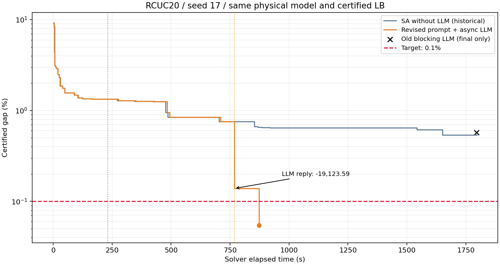

# RCUC20 修复提示词后的完整 SA＋LLM 冷启动实验

完整原始证据见 [v0.32.0 Release](https://github.com/SadPull/LLM-benders-SUC/releases/tag/v0.32.0) 的 `rcuc20-experiments-v0.32.0.zip`。解压后将 `rcuc20/` 下内容恢复到仓库根目录，文中 `results/` 链接即可访问；紧凑结果与图表直接保存在 Git。

**本次达到 0.1% 目标：873.64 秒返回 CONVERGED，认证 gap 为 0.054364%。** UB=3069995.672249，LB=3068326.701550。全过程只调用一次 LLM，4 个原始候选全部可行、零修复。

## 协议与运行边界

RCUC20、种子 17、总预算 1800 秒、目标 gap 0.1%；3 小时分块、全天二元/三元联合 SA、独立强化 LB；LLM 为 gpt-6-astra/max，最多 3 次、每次上限 1200 秒，预留 60 秒。三个完整 SA 轮次改善不足时触发，每次只有一个请求在途，SA 在等待期间继续搜索。

从项目 JSON 和原有数值初始化冷启动，没有导入提示词小试验候选、历史方案、割、上下界或参考解。初始化整数投影未使用。独立证明模型哈希与历史运行一致；整数认证只反馈 LB。本轮没有修改生产求解器或提示词，没有追加另一组完成实验或其他种子。

启动时发现记录脚本会在汇总时重复传入 status，故将约一分钟的早期运行中止，保留为 [记录脚本中止证据](../experiments/rcuc20-llm-rerun-20261017/aborted-preflight.json)。该运行尚未触发 LLM，未形成完整成绩，不用于比较；随后从零重新开始本次正式运行。修正仅涉及记录脚本，并验证了汇总构造逻辑。

## 与已保存结果比较

| 运行 | 主算法耗时 | 最终 UB | 认证 gap | 状态 |
|---|---:|---:|---:|---|
| 历史旧流程＋串行 LLM | 1795.06 秒 | 3085950.423452 | 0.571095% | TIME_LIMIT |
| 已修复 SA，不启用 LLM | 1796.14 秒 | 3084945.846520 | 0.538718% | TIME_LIMIT |
| 本次修复提示词＋后台 LLM | 873.64 秒 | 3069995.672249 | 0.054364% | CONVERGED |

本次最终成本比无 LLM 运行低 **14950.174271**，比历史串行 LLM 运行低 **15954.751203**。两组历史运行都未达到目标，因此不能据此计算“达到目标的加速倍数”。前两组没有在本轮重新运行。

## LLM 的实际贡献

- 请求于 231.50 秒发起，快照 UB=3110005.330708。
- 调用耗时 536.31 秒，于 768.70 秒消费回复。期间 SA 调用数从 144 增至 477，新增 **333 次**，证明真实请求没有阻塞搜索。
- 回复时 SA 已把 UB 降到 3091714.027453。按候选顺序接收后，LLM 把 UB 进一步降到 3072590.441877，实际贡献 **19123.585576**，gap 达到约 0.138767%。
- 随后数值搜索再降低 **2594.769628**；最后改善来源为 `joint_sa`，在 873.64 秒达到 0.1% 以下。

| LLM 候选 | 原始方案成本 | 顺序接收时实际新增降本 | 修复位数 | 独立校验 |
|---|---:|---:|---:|---|
| 1 | 3083652.540657 | 8061.486796 | 0 | 通过 |
| 2 | 3091310.215506 | 0.000000 | 0 | 通过 |
| 3 | 3072590.441877 | 11062.098780 | 0 | 通过 |
| 4 | 3111661.888566 | 0.000000 | 0 | 通过 |

4 个原始候选均未改动固定状态，也没有已识别的离散时序违规。第 2 个候选虽然优于回复前的 UB，但不优于第 1 个候选已刷新的 UB；第 4 个候选可行但成本更高。因此不能把所有候选相对请求快照的降本相加。

后台调用时长与 SA 耗时重叠，不能加到主算法耗时上。总上界下降按实际来源为：块 SA 88885.370526，块回填 15774.069266，联合 SA 22087.318837，LLM 19123.585576；合计等于初始 UB 到最终 UB 的下降。

## 验证与结论边界

最终方案序列化后再次独立验证通过，最大物理残差 4.55e-13 MW、费用残差 0。原始 LLM 候选在运行结束后另做连续调度复核，所有结果均通过；这些事后复核没有回填本次求解。输入、运行时源码快照、请求、提示词、回复和结果文件哈希均核验。CLI 退出码 0，事件中未发现工具调用；启动诊断 error 项与工具调用分别处理。

观察上，本次完整流程明显优于已保存的两组结果，并且 LLM 对当时 incumbent 的直接改善可以定位到具体候选。**这仍是单种子、一次完成运行的证据，不能单独证明提示词修改的普适因果收益。** 与旧串行 LLM 对比还包含搜索邻域和后台调度变化；与无 LLM 运行对比也不是本轮重新配对的重复实验。QUBO 构建仍耗费 719.26 秒（约 82.3%），这一性能瓶颈没有消失。

## 交付文件

- [运行脚本](../experiments/rcuc20-llm-rerun-20261017/run_validation.py)
- [实验摘要](../experiments/rcuc20-llm-rerun-20261017/summary.json)
- [对照与贡献数据](../experiments/rcuc20-llm-rerun-20261017/comparison.json)
- [文件审计](../experiments/rcuc20-llm-rerun-20261017/artifact-audit.json)
- [最终完整调度方案](../experiments/rcuc20-llm-rerun-20261017/solution.json)
- [LLM 原始候选复核](../experiments/rcuc20-llm-rerun-20261017/llm-raw-audit.json)
- [实际提示词](../experiments/rcuc20-llm-rerun-20261017/llm-prompt.txt)
- [实际回复](../experiments/rcuc20-llm-rerun-20261017/llm-reply.json)
- [运行时源码与输入快照](../results/rcuc20-llm-rerun-20261017-221011-a97316db/source.zip)

全部原始采样和诊断保存在运行目录的 result.json，约 348.5 MiB。完整 JSON 保存与事后审计在主算法预算之外；主算法保留原有结束预留，未延长 1800 秒预算。
