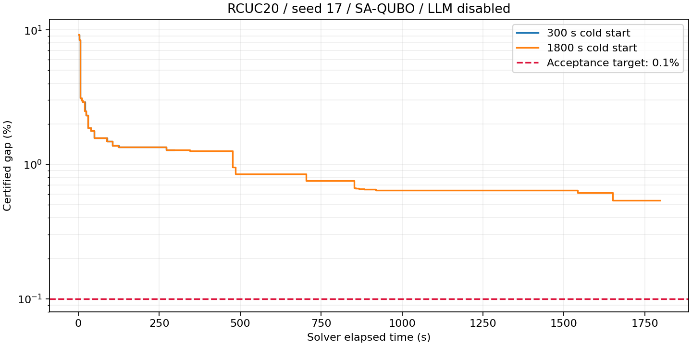

# RCUC20 上界搜索修复：实现与验收结果

完整原始证据见 [v0.32.0 Release](https://github.com/SadPull/LLM-benders-SUC/releases/tag/v0.32.0) 的 `rcuc20-experiments-v0.32.0.zip`。解压后将 `rcuc20/` 下内容恢复到仓库根目录，文中 `results/` 链接即可访问；紧凑结果与图表直接保存在 Git。

**实现已完成，但 0.1% 收敛验收未通过。** 两次实测均为种子 17、关闭 LLM 的独立冷启动；没有追加种子、预算或算法分支。

## 实测结果

| 预算 | 主算法耗时 | 可行 UB | 认证 LB | 认证 gap | 状态 |
|---|---:|---:|---:|---:|---|
| 300 秒诊断 | 295.29 秒 | 3108222.975922 | 3068326.701550 | 1.283572% | TIME_LIMIT |
| 1800 秒验收 | 1796.14 秒 | 3084945.846520 | 3068326.701550 | 0.538718% | TIME_LIMIT |

间隙为 `(UB-LB)/max(1,abs(UB))`。当前下界对应目标 UB ≤ 3071398.099649，正式终点尚需降本 **13547.746870**。记录的主算法时间包含搜索、建模和校验；完整诊断 JSON 保存发生在预算外。核心保留原有 5 秒结束预留。两次物理与费用独立复核通过，正式最大物理残差 4.55e-13 MW，费用残差为 0。

历史增强组 300 秒的认证 gap 为 0.782862%，本次短时结果更差；该历史对照不是本次同预算重新配对实验，不能据此推广跨算例结论。此次没有无 LLM 的旧版本 1800 秒对照，也没有在线 LLM 或多种子实验。

## 已实现与验证的变化

- 四变量硬约束传播涵盖状态转移；全天固定状态映射到各时间块。可动机组准确为 1、4、7、9、14、17、18、19、20，固定状态不进入自由搜索位。
- 每个时间块后执行两批全天小机组联合 SA，以当前 incumbent 固定其他机组。二元/三元组合按种子轮转，改善不重置游标；两次运行均覆盖 36 个二元组合和 84 个三元组合。
- 块原始样本先调度并学习有效割；联合候选先重建 v/w 并检查原始方案，必要时再修复。修复不构成无依据的排除割；越出选定机组的修复被拒绝。
- 缓存保留可复用的割，联合割池继续保持 incumbent 割加至多 15 条近期割。块割仍按价格环境重建。
- LLM 请求改为单请求在途的非阻塞轮询；明确提供可达性约束、保留请求快照、按最新 UB 评价回复、支持取消与连续失败暂停，并迁移旧恢复状态。
- 原始物理模型、输入和独立认证模型保持不变；认证模型哈希与历史实验一致。两次运行均未使用初始化整数投影；搜索不调用整数邻域求解，认证仅反馈 LB，参考方案及历史证据不导入搜索。

## 剩余瓶颈：不能把机制修复当成收敛成功

| 指标 | 300 秒 | 1800 秒 |
|---|---:|---:|
| 块 / 联合 SA 调用 | 71 / 122 | 378 / 739 |
| 首次验证可行方案数（不含初始化） | 52 | 249 |
| 新可行方案 / 主算法秒 | 0.1761 | 0.1386 |
| 原始固定状态违规位数（块与联合） | 0 | 0 |
| 联合原始方案离散违规率 | 100% | 100% |
| 联合修复后重复率 | 93.75% | 94.01% |
| QUBO 构建耗时 | 242.96 秒 | 1465.36 秒 |
| QUBO 构建占比 | 82.28% | 81.58% |
| 退火耗时 | 25.32 秒 | 176.95 秒 |

“修复后重复率”按通过离散检查的提案及其唯一方案身份计算；“原始方案离散违规率”按原始 u 重建 v/w 后的全天规则计算，不是冻结位违规率。300 秒样本复核发现，原始联合 u/v/w 存在状态转移违规，重建 v/w 后仍有最小开停机时间及末小时停机违规。即使冻结位错误和组合遗漏已经消除，SA 候选仍依赖较大修复且高度重复。当前方案未充分解决时序可行候选生成及 QUBO 构建成本。

本次按约定停止于两次运行，不新增 Hamming 罚项、代理成本模型、整数邻域或额外预算。后续若继续，需针对这两项剩余瓶颈制定独立变更和验收；本结果不标记为“缺陷修复通过”。

## 验证与证据

离线回归命令：`py -3.10 -m pytest -m "not integration" -q --tb=short`，结果 **310 passed, 3 deselected**。覆盖四变量传播、块边界固定状态、首小时停机例外、单向启停、完整组合覆盖、原始候选割、缓存割恢复、禁止整数搜索、跨块替换、恢复兼容，以及可控延迟 LLM 与 SA 重叠、旧快照回复、超时和取消。3 项真实 SDK 集成测试未运行；两次约定实测使用真实 Kaiwu SA。在线 LLM 未测。

- [实验入口与配置](../experiments/rcuc20-upper-search-20261017/run_validation.py)
- [汇总与版本/输入哈希](../experiments/rcuc20-upper-search-20261017/summary.json)
- [离线测试输出](../experiments/rcuc20-upper-search-20261017/offline-tests.txt)
- [文件与源代码快照核验](../experiments/rcuc20-upper-search-20261017/artifact-audit.json)
- [300 秒摘要](../results/rcuc20-upper-search-20261017-202912-907244d7/300/summary.json)
- [1800 秒摘要](../results/rcuc20-upper-search-20261017-202912-907244d7/1800/summary.json)
- [运行时源代码及输入快照](../results/rcuc20-upper-search-20261017-202912-907244d7/source.zip)

完整 `result.json`、原始采样及修复记录、`curve.jsonl`、独立证明矩阵和日志保存在各运行目录。正式 `result.json` 约 719.2 MiB；优先查看小型摘要。未覆盖原有未提交的传输层改动或修改输入数据。
