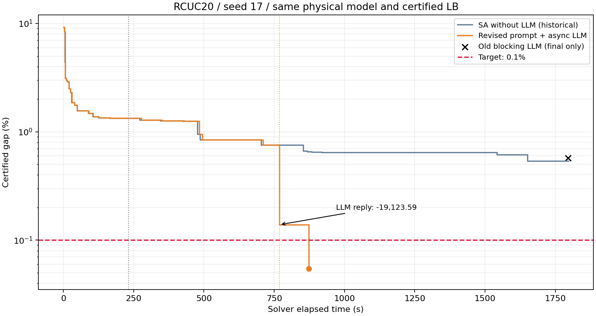

# v0.32.0：RCUC20 上界搜索与 LLM 改动总结

本次完整冷启动在 **873.64 秒达到 CONVERGED，认证 gap 0.054364%**，通过 0.1% 目标。最终 UB=3069995.672249，LB=3068326.701550。输入、物理模型与认证模型保持一致，改善来自上界搜索。

## 改动前后

| 环节 | 修改前 | 修改后 | 本次可验证的结果 |
|---|---|---|---|
| 可达性 | 只传播至多三变量的硬约束，漏掉四变量状态转移 | 全天传播固定 u/v/w 并投影到各块，提示词共享固定状态 | 正确识别 9 台可动机组，固定状态违规翻转为 0 |
| 搜索邻域 | 3 小时块为主，停滞后按经济排序选 2/3/5 台，冻结机组可能占位 | 从首轮参与全天二元/三元联合 SA，确定性覆盖组合并固定其余机组 | 36 个二元、84 个三元组合均覆盖；最终达标的一步来自联合 SA |
| 候选学习 | 修复后才评估，原始候选信息和淘汰割容易丢失 | 原始样本先评估有效割，缓存可恢复近期割；不添加无依据排除割 | 保留真实反馈，避免将“修复发生”等同于不可行证明 |
| 提示词 | 给了参数和泛化爬坡提醒，没有明确启停公式及固定状态；梯度含不可能停机的机会 | 明确无条件爬坡、初始/终端时序和编号；固定开/停清单、过滤梯度、具体违规反馈 | 冻结快照从历史 0/4 可行改善为 3/3 原始可行；正式运行 4/4 原始可行、零修复 |
| 调度与归因 | 等待 LLM 时暂停 SA，容易把相对旧快照的降本误作实际收益 | 单请求后台执行，在安全边界消费回复，按最新 UB 记账 | LLM 等待的 536.31 秒中 SA 继续 333 次；实际 LLM 降本 19123.585576 |

这些改动不是独立的单因素消融。尤其是搜索修复单独运行时没有达到目标，300 秒表现还劣于历史增强组；因此不能把每一项代码变化都称为已经证明的独立性能提升。

## 实验链与结果对比

所有完整求解均为 RCUC20、种子 17、同一物理模型。认证 gap 定义为 `(UB-LB)/max(1,abs(UB))`，下表不是相对参考最优成本的误差。

| 实验 | 预算 | 实际主算法时间 | UB | 认证 gap | 结果 |
|---|---:|---:|---:|---:|---|
| 历史增强搜索、无 LLM（v0.31.0） | 300 秒 | 295.24 秒 | 3092537.003463 | 0.782862% | TIME_LIMIT |
| 本版搜索修复、无 LLM：诊断 | 300 秒 | 295.29 秒 | 3108222.975922 | 1.283572% | TIME_LIMIT |
| 本版搜索修复、无 LLM：验收 | 1800 秒 | 1796.14 秒 | 3084945.846520 | 0.538718% | TIME_LIMIT |
| 历史旧流程＋串行 LLM | 1800 秒 | 1795.06 秒 | 3085950.423452 | 0.571095% | TIME_LIMIT |
| **本版搜索＋修复提示词＋后台 LLM** | **1800 秒** | **873.64 秒** | **3069995.672249** | **0.054364%** | **CONVERGED** |

另有一次固定快照提示词小试验：沿用历史第 2 次请求的起点 3089357.244811，新请求产生 3 个原始可行、零修复候选，最佳成本 3078300.583061，降本 11056.661750。调用耗时由历史 273.61 秒增加到 579.51 秒；候选质量改善不等于等待效率提升。这份候选没有导入最后的冷启动运行。

## 收敛过程中的可定位贡献

1. 231.50 秒发起 LLM，请求时 UB=3110005.330708。
2. 等待期间，SA 自行把 UB 降至 3091714.027453。此段收益不计入 LLM。
3. 768.70 秒消费 LLM 回复：四个原始候选全部通过物理/费用验证且修复位数为 0，按返回顺序实际降本 19123.585576，UB 降至 3072590.441877，gap 约 0.138767%。
4. 后续联合 SA 再降 2594.769628；873.64 秒结束时 UB=3069995.672249，gap=0.054364%。

最终成本较无 LLM 的 1800 秒运行低 14950.174271，较历史串行 LLM 运行低 15954.751203。没有提高 LB、导入历史证据或参考解；初始化整数投影未使用，整数认证过程只反馈 LB。

## 结论边界与可复核性

本次证明了该固定算例、种子和协议下可以在预算内达到 0.1%。它没有证明多种子稳定性、跨算例普适性，或提示词单独造成全部改进。旧串行 LLM 与本版还同时存在邻域和调度变化；历史对照未在本轮重跑。QUBO 构建仍占正式运行约 82.3%，该性能瓶颈尚未消除。

记录脚本的一次早期错误导致约一分钟的运行被中止，当时尚未调用 LLM。该日志单独保存，不当作完成的实验，不隐藏或计入成功结果。正式运行重新冷启动完成。

- [无 LLM 修复诊断与验收](rcuc20-upper-search-20261017.md)
- [单请求提示词小试验](rcuc20-prompt-pilot-20261017.md)
- [最终完整冷启动与贡献报告](rcuc20-llm-rerun-20261017.md)
- [最终调度方案](../experiments/rcuc20-llm-rerun-20261017/solution.json)
- [实际提示词](../experiments/rcuc20-llm-rerun-20261017/llm-prompt.txt)与[实际回复](../experiments/rcuc20-llm-rerun-20261017/llm-reply.json)
- [发布索引](../releases/v0.32.0.json)与[Release 附件](https://github.com/SadPull/LLM-benders-SUC/releases/tag/v0.32.0)

原始请求、采样、修复、完整结果、证明模型、失败记录及运行时源码保存在 Release 的 `rcuc20-experiments-v0.32.0.zip`，包含逐文件 SHA256。发布源码另从 Git 标签构建，不能将发布后的文档或版本号回写到历史运行快照。配置、凭据和许可证保持本地。

发布验证：独立待发布源码树 294 项离线回归通过，3 项真实 SDK 集成测试未重跑；用该源码树再次复核最终调度，物理/费用校验通过，模型指纹一致。既有传输提取重构未纳入提交，并通过展开后的 AST 等价检查；实验时源码在证据包中原样保留。
