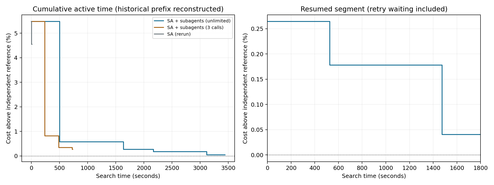

# 种子 7：取消子代理调用次数上限后的恢复实验

本批次已完成。SA+子代理相对本次纯 SA 降本 **4.3112%**；相对旧三次调用实验的 SA+子代理成本变化为 **0.2283%**（正值表示降本）。

## 实验设置

- 随机 RTS-24，32 台机组、24 小时、3 个场景；种子 7；D/7 → A/7 串行，两组同为 3442.668 秒累计时间上限，保存参数仅 llm_enabled 不同。
- 取消全局子代理调用次数上限（llm_max_calls=None）；单线程环境、数据、采样参数、停滞条件、每次触发最多连续请求 3 次、每次最多 4 个候选、内外层 20 次及原停止规则保留。
- 用户暂停后要求重试超时的第 2 次请求，并批准追加 1800 秒。暂停点已有 1642.668 秒，本次恢复段 1800 秒包含重试等待；原失败请求的 600 秒保留，暂停及重试完成后等待预算回复的时间排除。
- 通过归档响应重放前三次请求，重建割、缓存及搜索状态；请求输入和暂停方案哈希、成本均匹配后才继续。前段曲线时间由归档请求耗时重建，不能视为原始逐候选精确时间戳。
- 第 4 次搜索调用使用第 2 次超时请求的重试响应：模型输入沿用原第 2 次上下文，在恢复后的当前方案上重新修复、调度和校验；后续新请求使用最新方案及反馈。
- 每次请求使用全新、无对话继承的 Astra/max 子代理，通过文件交换响应和完成回执；HTTP 未参与候选生成。独立参考和旧实验解不进入子代理输入。
- 总时间预算仍有效，包括上下文、子代理等待、候选修复与调度；预检和事后独立复核另行计时。

## 结果

| 实验 | 方法 | 成本 | 相对参考成本差 | 自身下界间隙 | 累计有效秒数 | SA 调用 | 子代理尝试/成功/新增可行候选 |
|---|---|---:|---:|---:|---:|---:|---:|
| 本次 | 纯 SA | 925317.577290 | 4.5478% | 9.0716% | 11.23 | 20 | 0/0/0 |
| 本次 | SA+子代理 | 885425.011365 | 0.0405% | 4.9748% | 3442.68 | 9 | 7/5/18 |
| 旧三次上限 | 纯 SA | 925317.577290 | 4.5478% | 9.0716% | 11.13 | 20 | 0/0/0 |
| 旧三次上限 | SA+子代理 | 887451.058316 | 0.2694% | 5.1918% | 737.36 | 20 | 3/3/10 |

沿用暂停前已独立验证的 Gurobi 参考：885066.704430，状态 `OPTIMAL`，求解与复核耗时 94.61 秒；单线程、种子 7、600 秒上限、MIPGap=1e-6。输入数据及模型哈希未变，参考文件哈希已核对。参考成本差以独立参考为分母，自身下界间隙以各组成本为分母，两者不可混用。

曲线在各组实际有效搜索停止时结束；暂停时间排除。恢复段逐次评估见 `curves.csv`，历史前段为重建时序。

D/7 诊断中的历史前段分项耗时来自重放时钟，初始化等字段会显示 0；原耗时已经包含在历史累计预算中。这些字段只能用于恢复段及累计计时核对，不能用于精确剖析原历史计算阶段。每次请求的真实等待耗时见下表。

## 子代理调用与额外改善

| 次数 | 类型 | 内层迭代 | 状态 | 请求至接收/超时秒数 | 提案 | 新增可行 | 本轮后成本 | 直接降本 |
|---:|---|---:|---|---:|---:|---:|---:|---:|
| 1 | 历史请求 | 3 | OK | 505.74 | 4 | 4 | 890156.066827 | 43366.148539 |
| 2 | 历史请求 | 3 | FAILED | 600.01 | 0 | 0 | 890156.066827 | 0.000000 |
| 3 | 历史请求 | 3 | OK | 533.07 | 4 | 4 | 887405.248070 | 2750.818757 |
| 4 | 重试第2次 | 6 | OK | 525.84 | 4 | 4 | 886642.989521 | 762.258549 |
| 5 | 新请求 | 6 | OK | 518.01 | 4 | 2 | 886642.989521 | 0.000000 |
| 6 | 新请求 | 6 | OK | 430.06 | 4 | 4 | 885425.011365 | 1217.978156 |
| 7 | 新请求 | 9 | TIME_LIMIT | 323.79 | 0 | 0 | 885425.011365 | 0.000000 |

第 4 次及之后调用合计直接降本 **1980.236705**。每轮原始提案、修复、重复、物理验收、回执及反馈保存在 `D-7/calls/`；成功返回不等于改善。

SA 连续迭代中未请求子代理的最长段：旧实验 17 次，本次 2 次；最后一次请求后的 SA 尾段：旧实验 17 次，本次 0 次。

- D-7：停止状态 `TIME_LIMIT`，初始化成本 933522.215366；直接降本来源 {'llm': 48097.20400062436}；独立重调度与物理复核 `PASSED`。
- A-7：停止状态 `INNER_NOT_CONVERGED`，初始化成本 933522.215366；直接降本来源 {'sa': 8204.638075834257}；独立重调度与物理复核 `PASSED`。

## 结论与限制

取消全局调用次数上限后，本次实际尝试 7 次子代理请求，其中 5 次完整返回；额外请求的成本贡献如上表。最终改善与额外耗时应同时评价。
本次同时取消次数上限、增加时间预算并重试失败请求；新旧响应也独立生成，因此新旧最终成本差不能全部归因于次数上限变化。第 4 次及之后的直接改善只证明额外调用在本次轨迹中的作用。
SA 提前停止，两组实际耗时相差较大；结果描述这个种子与原停止规则下的成本改善和时间代价。
恢复段相对暂停点直接降本 1980.236705；原失败等待与新增等待均保留。
停止状态描述算法实际结束原因；可行且接近独立参考不等于算法自身收敛。只有截止前完成修复、调度和校验的候选计分，迟到或失败请求不更新成绩。
这是种子 7 的一次重跑及一次历史配对比较，不证明统计显著性、普遍速度优势或 SA 与子代理双向协同。
69 项离线测试通过；真实 Kaiwu 检查及搜索已运行。源码与数据快照、参数差异、状态重建、时间截止、单线程环境和凭据扫描见 `manifest.json`、`restoration.json`、`protocol_audit.json`、`validation.txt`。
