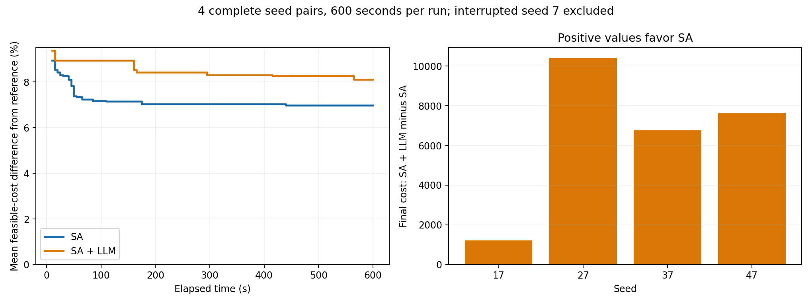

# LLM 辅助 SA：实验结论（2026-10-01）

**当前部署配置未显示收益。** 四组完整配对中，SA+LLM 的600秒最终成本全部高于纯SA，平均高出6,503.98；共同达到的预设成本阈值，首次达到时的SA调用节省均为0%。

## 可行成本结果

|种子|SA成本|SA+LLM成本|LLM−SA|
|---|---:|---:|---:|
|17|612,037.00|613,255.83|1,218.83|
|27|608,825.94|619,235.54|10,409.60|
|37|611,205.61|617,959.39|6,753.78|
|47|611,204.62|618,838.35|7,633.73|

四组平均：SA为610,818.29，SA+LLM为617,322.28；相对同一Gurobi参考目标的差距分别为6.9708%与8.1098%。这里是可行解成本差距，不是论文使用的下界gap。配对成本差的中位数为7,193.76，胜/平/负为0/0/4。

## 达到相同质量的SA调用

完整样本中，参考目标上方10%的阈值，两组均4/4达到；8%的阈值，SA为4/4、SA+LLM为1/4；6%及更严格阈值两组均未达到。共同达到的阈值上，首次达标的SA调用次数相同。不能用结束时的总SA次数31–34对5，声称LLM节省了调用；那些额外调用包括达标后的继续搜索。逐次首次达到时间及次数见report.md和summary.json。

## 服务实际行为及结论边界

请求使用deepseek-v4.1-flash、reasoning_effort=max、max_tokens=65536。预检返回HTTP 200并符合小型JSON格式，但正式请求均未产生可用候选。四条完整LLM轨迹共20次请求：16次完成的响应均报告length、32,000个completion/reasoning token及零正文，4次在600秒截止时尚未完成。包括种子7的部分轨迹，总计23次请求，18次返回具有同样特征，另5次未完成。未完成请求的最终服务端token开销不可从日志确定。

这提示服务存在有效输出/推理预算约束或映射问题；模型元数据未说明限制来源，不能确认具体原因，也不能仅凭请求参数确认后端实际推理强度。发现现象后曾停止检查，经用户明确选择，保留接口和参数继续剩余实验，将截断计为该配置的失败。未尝试降低推理强度、增加重试或追加优化预算。

由于没有有效LLM候选进入真实优化，结果评价的是当前部署配置的端到端效果，不能据此否定有效LLM调度建议的潜力。候选进入割、缓存、修复与完整验证的代码路径已通过模拟接口和微型集成测试。

## 中断、预算与验证

计划五个种子、每组600秒。种子7的SA进程中断，最后完整事件约在515.9秒；其LLM轨迹随后在接口检查时被停止。两条都保留为interrupted，未重跑、未补足时间。其600秒列只能视为中断时已知的部分结果，不是完整600秒成绩。最终有效样本为种子17/27/37/47的四组配对，共8次完整预算运行；报告另列种子7的部分观察。原始报告达到数按计划5次列示，本结论段按4次完整运行列示。

所有计分候选都在截止前完成三场景验证；开始但未完成的SA/LLM调用仍计数。Gurobi参考只用于报告，未反馈给求解器或LLM。没有调用真机、独立减开机、随机候选或精确整数求解后门。完整回归132项通过，随后扩充的效率模块10项通过。共175个完整候选（含中断轨迹中的候选）通过独立物理与成本核验，最大物理残差1.5916157281026244e-12。完成后恢复验证跳过全部10条已有轨迹，事件哈希不变。

优化期间未并行运行回归测试；检查进度只读取日志。导入和许可证初始化在计时之前，其后建模、SA、网络等待、推理、修复、调度及验证均计入。该实验没有追加计算以追求改善。

实现源快照、配置、版本、逐事件轨迹、脱敏请求响应、完整调度、参考及其来源清单均保存在归档中。
