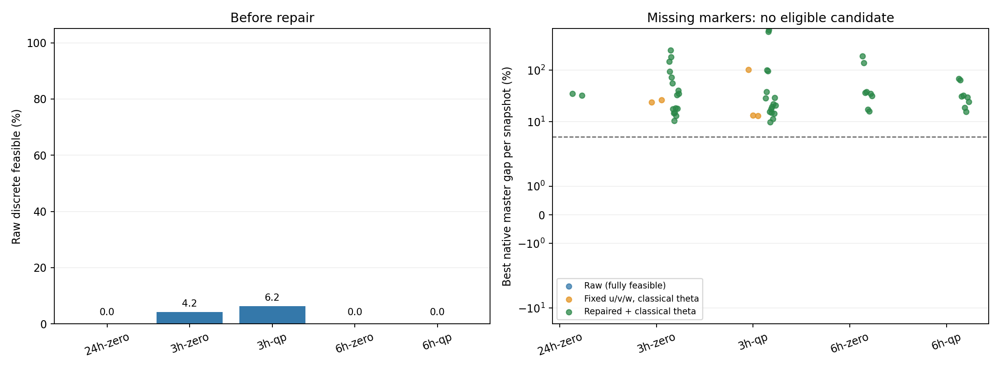

# 分块 SA 主问题微基准：完成结果与复核

**3 小时分块出现有限改善，但 3 小时、6 小时都未通过预先设定的工程筛查。**
缩小 QUBO 降低了修复距离，尚不足以可靠求解块内主问题；本轮结果支持先排查编码尺度和约束残差。

原批次于 2026-10-05 13:03–13:08（北京时间）完成，共 25 条经典轨迹、50 个不同冻结快照、
150 次 SA 调用、2400 条候选记录，运行及输出总耗时 294.00 秒，低于 3600 秒上限。
本次接续完成逐样本复核和结论整理，没有新增采样或改动原始归档。

| 块长 | 快照 | 原始离散可行率 | 完整主问题可行 | 平均修复比例 | 修复后重复率 | ≤5% 固定开停机命中快照 |
|---|---:|---:|---:|---:|---:|---:|
| 24h | 2 | 0/96 = 0% | 0/96 | 12.73% | 85.42% | 0/2 |
| 3h | 32 | 80/1536 = 5.21% | 0/1536 | 8.59% | 93.75% | 0/32 |
| 6h | 16 | 0/768 = 0% | 0/768 | 10.10% | 93.49% | 0/16 |

修复比例按块内 `u` 开机位计算；`v/w` 由原修复规则重新派生。完整可行同时要求原生主问题、
量化残差和辅助关系通过，不能只看开停机约束。≤5% 命中允许固定全部 `u/v/w` 后用经典计算重算目标变量，
该列属于经典后处理，不能计入 SA 原始结果。

## 分块是否让 SA 更容易产生原始可行解？

3h 的原始离散可行率从全时域的 0% 上升至 5.21%；零价格、QP 价格两层分别为 4.17%、6.25%。
6h 两层均为 0%。3h 的 80 条可行记录分布在 5/32 个快照中；在各快照内去重后，合计只有 15 个不同方案。
候选池内重复记录不能作为独立实验重复。

QUBO 实际位数从全时域的 2865–2978 降至 3h 的 375–516、6h 的 733–873。
规模下降已有实测依据，但 3h 的可行率仍远低于预设 50% 门槛；全部组均没有完整编码可行的原始样本。

## 改善来自开停机搜索，还是修复与经典后处理？

3h 的 80 条原始离散可行记录说明开停机搜索有局部改善。然而固定这些记录的全部 `u/v/w`，
仅经典重算最小可行目标变量，最好的同快照目标差仍为 **13.01%**，没有快照达到 5% 门槛。
因此不能把剩余问题全部归因于目标或松弛辅助位：开停机搜索质量本身也不足。

3h 有 16 条记录通过原生主问题检查，但没有记录通过全部编码辅助关系；辅助变量仍是额外障碍。
原生主问题可行与完整编码可行已分别保存在逐样本数据中。

原规则修复后，所有候选都可计算原生主问题值，但修复后重复率由全时域的 85.42% 升至
3h 的 93.75%、6h 的 93.49%。这与修复距离下降同时发生，说明“小改动”并不意味着形成更多不同优质候选。
修复加经典目标重算后的最小目标差分别为 24h 的 32.73%、3h 的 9.85%、6h 的 15.74%，仍均超过 5%。
这些是不同主问题中的组内最小值，不构成全天成本的可比改善。

## 哪一种块长更值得继续？

若下一轮只诊断块内搜索，3h 更值得保留：它是唯一产生原始离散可行记录的块长，修复比例更低，QUBO 也更小。
本轮没有运行完整外层协调，尚不能判断 3h 的搜索收益能否抵消更多块和跨块约束带来的协调负担。
6h 本轮没有体现原始离散可行率收益。

剩余违反集中在启停转换、最短停机和容量约束：3h 分别有 1010、678、944 条记录违反这些类别；
6h 的 768 条记录全部违反至少一条启停转换约束。各类别可重叠，这些数量不是互斥分类。

编码记录还显示，矩阵归一化后的一个目标步长仍仅为约 `9.0e-15–1.1e-14`（3h），
全时域约 `1.1e-15`、6h 约 `4.5e-15–5.1e-15`。分块改善了这个比例，但仍有很大的尺度差。
这是继续做单独尺度/约束诊断的证据，尚不能证明失败的唯一原因。本轮保持原罚项和退火参数，没有调参。

## 哪些参考未认证，哪些快照超时或缺失？

按预定 Gurobi `MIPGap <= 1e-6` 口径，50/50 个参考均认证；实际最大 MIPGap 为 `9.5951e-7`。
25 条轨迹和 50 个采样快照全部完成，没有未认证、超时或缺失条目。
这里的认证是指定数值精度下的求解器状态，不能把所有参考称为精确算术下的最优值。

复核另发现一个数值边界：`h03-b02-qp-k5` 的参考目标变量违反一条最优性割约 `2.1986e-6`，
略高于 SA 原生检查的 `1e-6`。固定参考开停机后重算目标，差值也仅为 `2.1986e-6`。
审计对经典参考目标变量单独使用 `1e-5` 容差并明确记录此项，SA 判据和原始统计保持不变。
若按严格原生残差判据排除此参考，3h 认证覆盖为 31/32 = 96.875%，仍超过 80%，≤5% 命中仍为零，筛查结论不变。

## 验证与交付

源码开发阶段完整回归 123 项通过；冻结源码运行前的 27 项正确性检查通过。
接续审计核对了 541 个原归档文件哈希、53 个冻结源码/输入文件、50 个快照身份、
2400 条保存的原始比特与解码/残差记录、经典后处理值、修复距离、JSON/CSV 和分组统计。
复核通过，经典参考的上述数值边界已单列。原实验文件和原校验清单保持不变。

- [原始分组报告与分项耗时](report.md)
- [可行率及目标差图](quality.png)
- [逐样本 CSV](samples.csv)、[快照摘要 CSV](snapshot-summary.csv)
- [冻结协议及源码哈希](manifest.json)、[原归档校验清单](SHA256SUMS.txt)
- [审计结果](review/audit.json)、[审计脚本](review/verify.py)、[审计日志](review/verify.log)
- [冻结前置测试日志](preflight.log)、[开发完整回归日志副本](review/development-tests.log)

筛查要求认证覆盖 ≥80%、原始离散可行率 ≥50%、至少 80% 认证快照有 ≤5% 固定开停机候选，
并且修复比例和修复后重复率同时下降。两种分块长度均未满足。
依原计划，本轮完成后保留结果，建议先另行制定尺度消融；未扩展运行完整全天外层协调。

