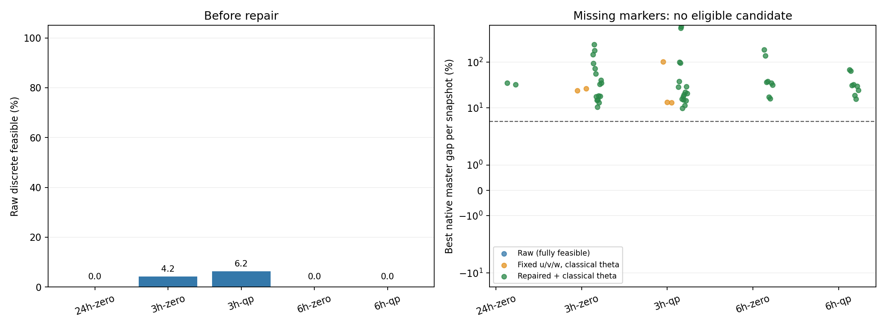

# 经典价格下的分块 SA 主问题微基准

全部预定工作完成：True；冻结快照 50 个；SA 调用 150 次。

本实验固定经典乘子与 Benders 主问题，比较 24/3/6 小时块。没有 LLM，没有完整外层协调或全天可行解恢复，不构成全天收敛、最终成本或加速证明。
保留现有罚系数、量化和 SA 参数。每快照每种子只采样一次，种子为 7/17/27，候选池 16。经典参考与 SA 使用同一个原生主问题，编码边界在当前整数参考求解前冻结。

| 块长 | 快照 | 认证覆盖 | 原始离散可行率 | 完整主问题可行数 | 平均修复位比例 | 修复后重复率 | ≤5% 未改开停机命中 | 门槛通过 |
|---|---:|---:|---:|---:|---:|---:|---:|---|
| 24h | 2 | 100.00% | 0.00% | 0/96 | 12.73% | 85.42% | 0/2 | 对照 |
| 3h | 32 | 100.00% | 5.21% | 0/1536 | 8.59% | 93.75% | 0/32 | False |
| 6h | 16 | 100.00% | 0.00% | 0/768 | 10.10% | 93.49% | 0/16 | False |

## 按乘子状态分层

| 组别 | 样本 | 原始离散可行率 | 完整主问题可行数 | ≤5% 未改开停机命中 |
|---|---:|---:|---:|---:|
| 24h-zero | 96 | 0.00% | 0 | 0/2 |
| 3h-zero | 768 | 4.17% | 0 | 0/16 |
| 3h-qp | 768 | 6.25% | 0 | 0/16 |
| 6h-zero | 384 | 0.00% | 0 | 0/8 |
| 6h-qp | 384 | 0.00% | 0 | 0/8 |

## 分项时间（秒）

| 块长 | 经典轨迹与参考 | QUBO 构建 | SA | 原规则修复 | 固定开停机目标重算 |
|---|---:|---:|---:|---:|---:|
| 24h | 36.589 | 21.365 | 4.904 | 4.876 | 2.023 |
| 3h | 6.554 | 6.735 | 11.692 | 17.409 | 2.497 |
| 6h | 16.805 | 10.396 | 8.264 | 14.686 | 2.875 |

## 口径与边界

原始离散可行性含块内启停、最短时间及容量；完整主问题还要求原生割和所有编码辅助关系成立。量化约束残差另外保存，不能用量化可行冒充原生可行。
classical_fixed_raw_* 是固定全部 u/v/w 后重新计算最小可行目标变量的经典后处理，绝不是 SA 原始目标。gap 分母为 max(1, abs(参考目标))，同时保留绝对目标值和常数；未认证参考的 gap 留空。
修复沿用原全时域算法：非本块小时填入共同初始方案，再修复并投影回块；块外改动单列。修复后目标同样经过目标变量重算。不同块或乘子状态不混用缓存与割。
重复率在每个快照的三个种子候选合集中计算；修复距离按本块开停机位数归一化。结果按快照与价格分别保存，不把重复样本视作独立统计重复。
乘子状态及时间块改变了主问题，跨组结果是可解性筛查，不是相同数学问题上的严格配对；两种经典后处理均明确分栏。
至少 80% 参考认证覆盖、原始离散可行率 50%、至少 80% 认证快照找到 ≤5% 未改开停机候选、修复位比例及重复率同时下降，才通过工程筛查。通过不自动启动下一阶段。

未认证快照：[]。未完成轨迹：[]。未完成采样快照：[]。

逐样本数据见 samples.csv 与 snapshots/*/samples.json；QUBO 矩阵、变量、约束、割、原生参考和原始比特样本均保存在对应快照目录。

