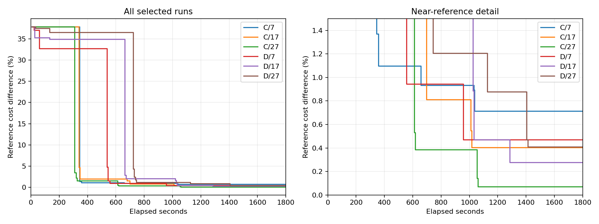

# C/D 缺失重复补跑

三个补跑已结束；合并六次的数值审计：True；六次均收齐三次响应：True。新增模型会话 9/9 次。

每次 1800 秒，最多三次 Astra/max 全新桌面端子代理调用、每次最多四个候选；等待和交接计入预算。仅补跑 D/27、D/17、C/7，按预先指定结果替换，不按成本筛选。

| 方法/种子 | 本次补跑 | 最佳成本 | 参考差 | 完整响应/请求 | LLM 后 SA/完整评估 | SA 新增降本 |
|---|---|---:|---:|---:|---:|---:|
| C/7 | 是 | 891387.714393 | 0.7142% | 3/3 | 0/0 | 0.000000 |
| C/17 | 否 | 888637.876431 | 0.4035% | 3/3 | 0/0 | 0.000000 |
| C/27 | 否 | 885702.966552 | 0.0719% | 3/3 | 0/0 | 0.000000 |
| D/7 | 否 | 889216.936103 | 0.4689% | 3/3 | 5/4 | 0.000000 |
| D/17 | 是 | 887514.171067 | 0.2765% | 3/3 | 5/0 | 0.000000 |
| D/27 | 是 | 888679.050863 | 0.4081% | 3/3 | 4/2 | 0.000000 |

本批只改变桌面端协调和本地连续观测，不改变搜索算法。监测每两秒记录一次状态，文件写出不等于模型完成；仍须桌面端真实完成事件后签发回执。

保留前批全部 273 个清单文件并复核 273 个哈希。前批失败仍保留；本批与前批的时刻不同，本地种子不控制 LLM 随机性，配对不构成统计显著性或跨实例结论。

合并数据见 [combined-summary.json](combined-summary.json)、[combined-curves.csv](combined-curves.csv)；本次三项详细候选和耗时见 [report.md](report.md)；复核见 [final-verification.json](final-verification.json)。

