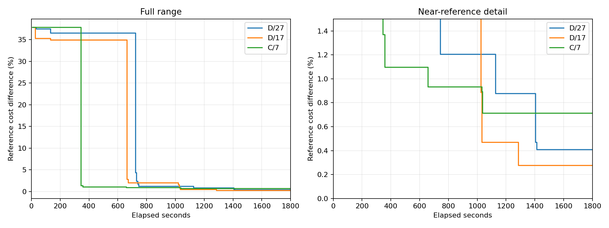

# C/D 桌面端子代理重跑

运行完成：True；数值审计通过：True；三次补跑均收齐三次响应：True。

每次 1800 秒，从初始化计时；Astra/max、全新桌面端子代理、最多三次调用，每次最多四个候选。等待、交接及验证计入预算，迟到结果排除。
参考成本 885066.704431，仅用于事后比较；参考差不是本算法认证的最优间隙。

| 方法/种子 | 状态 | 最佳成本 | 参考差 | 请求/响应 | ≤1% 秒 | ≤0.5% 秒 | LLM 后 SA/完整评估 | SA 新增降本 |
|---|---|---:|---:|---:|---:|---:|---:|---:|
| C/7 | LLM_CALL_LIMIT | 891387.714 | 0.7142% | 3/3 | 658.025 | — | 0/0 | 0.000 |
| D/17 | TIME_LIMIT | 887514.171 | 0.2765% | 3/3 | 1025.693 | 1032.154 | 5/0 | 0.000 |
| D/27 | TIME_LIMIT | 888679.051 | 0.4081% | 3/3 | 1126.142 | 1404.508 | 4/2 | 0.000 |

## 固定时刻成本

| 方法/种子 | 300 秒 | 600 秒 | 900 秒 | 1800 秒 |
|---|---:|---:|---:|---:|
| D/27 | 1208296.468 | 1208296.468 | 895744.235 | 888679.051 |
| D/17 | 1194310.042 | 1194310.042 | 903138.430 | 887514.171 |
| C/7 | 1220423.773 | 894781.047 | 893337.482 | 891387.714 |

## 候选质量

| 方法/种子/来源 | 提案 | 原始离散可行率 | 平均修复位 | 修复后重复率 | 完整评估 | 调度可行率 | 改进率 |
|---|---:|---:|---:|---:|---:|---:|---:|
| D/27/sa | 160 | 0.00% | 99.975 | 89.38% | 13 | 100.00% | 15.38% |
| D/27/llm | 12 | 8.33% | 2.455 | 36.36% | 7 | 100.00% | 100.00% |
| D/17/sa | 192 | 0.00% | 105.151 | 89.58% | 12 | 100.00% | 16.67% |
| D/17/llm | 12 | 33.33% | 2.000 | 8.33% | 11 | 100.00% | 54.55% |
| C/7/llm | 12 | 25.00% | 2.917 | 16.67% | 10 | 100.00% | 50.00% |

## 耗时与交接

分项耗时、每次派发延迟、文件至回执延迟见 summary.json 的 timings/handoffs。LLM 耗时包含桌面端协调与文件交接，未知 token 用量保留 null。

| 方法/种子 | QUBO 秒 | SA 秒 | LLM 等待秒 | 完整调度秒 | 超时开销秒 |
|---|---:|---:|---:|---:|---:|
| D/27 | 626.765 | 14.930 | 983.813 | 188.906 | 57.662 |
| D/17 | 730.210 | 13.813 | 919.820 | 158.783 | 78.331 |
| C/7 | 0.000 | 0.000 | 965.662 | 68.622 | 0.000 |

## 本批配对与历史对照

| 种子 | 本批 D−C 成本 | 双方均收齐三次响应 |
|---|---:|---|

历史表来自紧接本批之前的桌面端六次实验；本报告单列三次补跑，最终合并表另见 README.md。

| 方法/种子 | 历史成本 | 本批成本 |
|---|---:|---:|
| D/27 | 889089.384 | 888679.051 |
| D/17 | 1194310.042 | 887514.171 |
| C/7 | 1220423.773 | 891387.714 |
| C/27 | 885702.967 | — |
| C/17 | 888637.876 | — |
| D/7 | 889216.936 | — |

三个种子只用于初步筛查，不能证明统计显著性或跨实例优势。D 没有后续 SA 时间与 SA 执行后没有收益分别解释。

