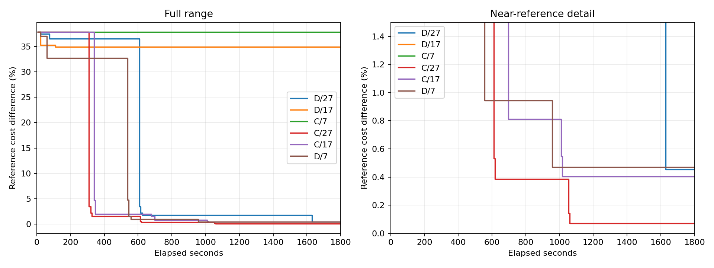

# C/D 桌面端子代理重跑

**交接与监测限制：D/17、C/7 的模型输出未在截止前完成回执交接，均未计分；本批未全程达到每分钟持续监测要求。数值审计通过不代表无故障比较，详见 [结果与限制](README.md)。**

运行完成：True；数值审计通过：True；六次均收齐三次响应：False。

每次 1800 秒，从初始化计时；Astra/max、全新桌面端子代理、最多三次调用，每次最多四个候选。等待、交接及验证计入预算，迟到结果排除。
参考成本 885066.704431，仅用于事后比较；参考差不是本算法认证的最优间隙。

| 方法/种子 | 状态 | 最佳成本 | 参考差 | 请求/响应 | ≤1% 秒 | ≤0.5% 秒 | LLM 后 SA/完整评估 | SA 新增降本 |
|---|---|---:|---:|---:|---:|---:|---:|---:|
| C/7 | TIME_LIMIT | 1220423.773 | 37.8906% | 1/0 | — | — | 0/0 | 0.000 |
| C/17 | LLM_CALL_LIMIT | 888637.876 | 0.4035% | 3/3 | 697.098 | 1016.029 | 0/0 | 0.000 |
| C/27 | LLM_CALL_LIMIT | 885702.967 | 0.0719% | 3/3 | 611.481 | 617.807 | 0/0 | 0.000 |
| D/7 | TIME_LIMIT | 889216.936 | 0.4689% | 3/3 | 556.671 | 956.166 | 5/4 | 0.000 |
| D/17 | TIME_LIMIT | 1194310.042 | 34.9401% | 1/0 | — | — | 0/0 | 0.000 |
| D/27 | TIME_LIMIT | 889089.384 | 0.4545% | 3/2 | 1628.990 | 1628.990 | 0/0 | 0.000 |

## 固定时刻成本

| 方法/种子 | 300 秒 | 600 秒 | 900 秒 | 1800 秒 |
|---|---:|---:|---:|---:|
| D/27 | 1208296.468 | 1208296.468 | 900656.495 | 889089.384 |
| D/17 | 1194310.042 | 1194310.042 | 1194310.042 | 1194310.042 |
| C/7 | 1220423.773 | 1220423.773 | 1220423.773 | 1220423.773 |
| C/27 | 1220423.773 | 898394.544 | 888480.356 | 885702.967 |
| C/17 | 1220423.773 | 902429.061 | 892249.553 | 888637.876 |
| D/7 | 1174508.055 | 893415.003 | 893415.003 | 889216.936 |

## 候选质量

| 方法/种子/来源 | 提案 | 原始离散可行率 | 平均修复位 | 修复后重复率 | 完整评估 | 调度可行率 | 改进率 |
|---|---:|---:|---:|---:|---:|---:|---:|
| D/27/sa | 96 | 0.00% | 98.583 | 88.54% | 11 | 100.00% | 18.18% |
| D/27/llm | 8 | 50.00% | 1.000 | 0.00% | 8 | 100.00% | 50.00% |
| D/17/sa | 112 | 0.00% | 107.268 | 89.29% | 12 | 100.00% | 16.67% |
| C/27/llm | 12 | 33.33% | 1.917 | 8.33% | 11 | 100.00% | 63.64% |
| C/17/llm | 12 | 25.00% | 1.909 | 9.09% | 10 | 100.00% | 70.00% |
| D/7/sa | 160 | 0.00% | 105.144 | 86.25% | 17 | 100.00% | 11.76% |
| D/7/llm | 12 | 8.33% | 1.833 | 33.33% | 8 | 100.00% | 50.00% |

## 耗时与交接

分项耗时、每次派发延迟、文件至回执延迟见 summary.json 的 timings/handoffs。LLM 耗时包含桌面端协调与文件交接，未知 token 用量保留 null。

| 方法/种子 | QUBO 秒 | SA 秒 | LLM 等待秒 | 完整调度秒 | 超时开销秒 |
|---|---:|---:|---:|---:|---:|
| D/27 | 118.540 | 4.922 | 1542.420 | 122.230 | 0.183 |
| D/17 | 153.462 | 5.793 | 1548.449 | 81.159 | 0.164 |
| C/7 | 0.000 | 0.000 | 1793.305 | 6.371 | 0.107 |
| C/27 | 0.000 | 0.000 | 989.466 | 73.480 | 0.000 |
| C/17 | 0.000 | 0.000 | 945.464 | 67.802 | 0.000 |
| D/7 | 629.622 | 11.327 | 989.673 | 165.677 | 78.341 |

## 本批配对与历史对照

| 种子 | 本批 D−C 成本 | 双方均收齐三次响应 |
|---|---:|---|
| 7 | -331206.837 | False |
| 17 | 305672.165 | False |
| 27 | 3386.418 | False |

历史表来自 2026-10-04 恢复批次汇总（包含旧桌面端和独立后台调度）；仅作描述性比较，不混入本批六次结果。

| 方法/种子 | 历史成本 | 本批成本 |
|---|---:|---:|
| C/7 | 886412.340 | 1220423.773 |
| C/17 | 885788.179 | 888637.876 |
| C/27 | 885781.572 | 885702.967 |
| D/7 | 890427.143 | 889216.936 |
| D/17 | 889420.379 | 1194310.042 |
| D/27 | 885963.836 | 889089.384 |

三个种子只用于初步筛查，不能证明统计显著性或跨实例优势。D 没有后续 SA 时间与 SA 执行后没有收益分别解释。

