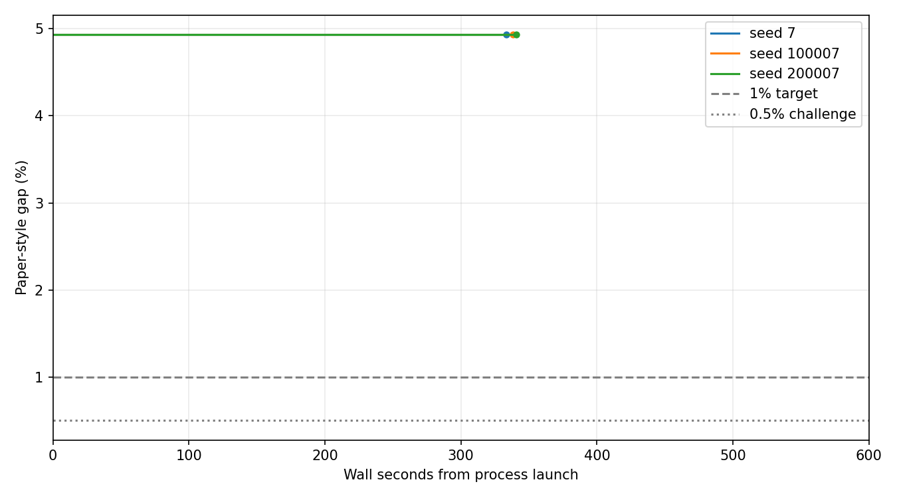
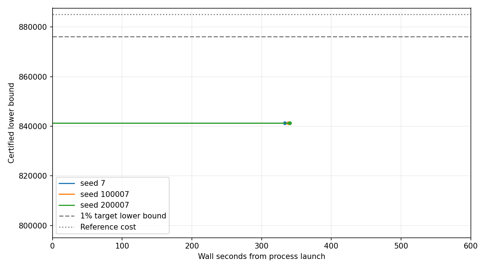

> GitHub 展示目录仅保留报告、输入、参考与最佳方案。完整冻结源码、日志、割快照和原始校验清单在 [v0.20.0 Release](https://github.com/SadPull/LLM-benders-SUC/releases/tag/v0.20.0) 的 `rts24-gap-closure-20261006.zip` 中；重建报告请先解压完整包。

# RTS-24 SUC Gap 补足实验交付

主目标（三个固定种子的 600 秒预算均 ≤1%）：False；挑战目标（均 ≤0.5%）：False。
独立随机参考 R=885066.7044303413，MIPGap=0；固定选择 1h 分块。

| 种子 | 实际运行秒 | 状态 | 可行成本 | 认证下界 | 论文口径 Gap | 经典调用 | 完整外层 |
|---:|---:|---|---:|---:|---:|---:|---:|
| 7 | 333.19 | INNER_NOT_CONVERGED | 903789.9469 | 841376.5240 | 4.936371% | 66 | 0 |
| 100007 | 338.40 | INNER_NOT_CONVERGED | 903789.9469 | 841376.5240 | 4.936371% | 66 | 0 |
| 200007 | 340.46 | INNER_NOT_CONVERGED | 903599.1903 | 841376.5240 | 4.936371% | 66 | 0 |

完整逐运行结果和贡献见 [revised/README.md](revised/README.md)、[summary.json](summary.json)；逐块与时间曲线见 CSV。

经典点改善了局部界与可行成本，但确认运行未完成第一块的内层收敛，也未完成外层对偶协调。认证下界仍由初始连续松弛提供；这不是已证明的分解对偶上限。
纯 SA 返回的大量样本只有少量去重后局部可行点；混合方法随割增加，QUBO 构建和退火开销明显增加。经典长运行则仍主要耗时于完整日候选评估。

原尝试因完整日评估占九成以上耗时而中断。用户批准将评估移到块求解结束后的前 16 个候选池；旧尝试实际用时完整扣减，随机参考仅在模型和输入相同并再次通过物理校验后复用。
原尝试 770.278004 秒；修订运行（含报告）4878.330344 秒；累计 5648.608348 秒。复核明细见 final-audit.json，含压缩归档的最终预算记录见 ../rts24-gap-closure-20261006.execution-audit.json。总预算 7200 秒，开发与回归不计入。

旧尝试原样见 original/；修订后的完整日志、冻结源码与输入、参考和检查点见 revised/；每次最佳方案单独见 best-schedules/。全部失败及未达标运行保留。
开发分支 codex/gap-closure；执行源码提交 1c16bdd01213c56f8925255753794a08d3fa10ee，从 0d90bd1 开始。实施前 154 项回归、实施后 168 项回归均通过。

重建报告：在 revised/source 目录使用同一 Python 依赖执行 `python -m suc_benders.gap_closure_experiment --output-dir <revised 的绝对路径> --report-only`。冻结代码重建后的 summary.json 数值已逐项核对一致。

交付图将最后一个有效认证下界延用到实际停止时刻；终点圆点表示运行停止，不代表新增证书。三个种子下界相同，曲线重合；横轴保留完整 600 秒预算。原始认证事件曲线及数据保持在 revised/。

## 候选来源贡献及兜底耗时

改进额按完整方案来源分组；不同来源的间接作用不由此表分离。独立认证器仍提供下界。

| 种子 | SA 来源改进额 | 经典来源改进额 | 混合来源改进额 | 经典候选调用 | 经典候选耗时秒 |
|---:|---:|---:|---:|---:|---:|
| 7 | 0.0000 | 29732.2685 | 0.0000 | 66 | 6.370825 |
| 100007 | 0.0000 | 29732.2685 | 0.0000 | 66 | 6.847323 |
| 200007 | 0.0000 | 29923.0251 | 0.0000 | 66 | 5.871979 |

三次确认各采样 200 次、返回 3200 个原始样本，均在第一块因 200 次内层上限停止；经典点改善了局部界和完整方案成本，但没有产生更高的全局认证下界。

| 种子 | 第一块下界 | 第一块上界 | 局部界差 | 末轮 QUBO 位数 | QUBO 构建秒 | 退火秒 | 独立认证秒 |
|---:|---:|---:|---:|---:|---:|---:|---:|
| 7 | 13996.1734 | 14096.4327 | 100.2593 | 2289 | 116.1253 | 86.3730 | 18.8350 |
| 100007 | 14004.9461 | 14096.4327 | 91.4866 | 2375 | 109.1421 | 86.7129 | 20.0920 |
| 200007 | 13958.3604 | 14085.2280 | 126.8676 | 2424 | 114.2401 | 89.9494 | 17.3150 |

达到 1% 需要全局认证下界至少 876216.0374，当前还差 34839.5133。600 秒经典确认只完成 6 个块，完整日调度约 536 秒，仍未完成协调。

后续应先推进完整的经典对偶协调以判定分解上限，再依据这些结果调整块内迭代与评估预算，并压缩 QUBO 构建开销。本次证据尚不能证明目标理论不可达。
