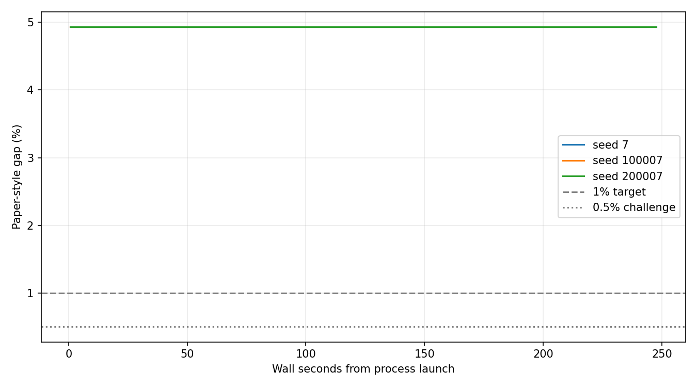
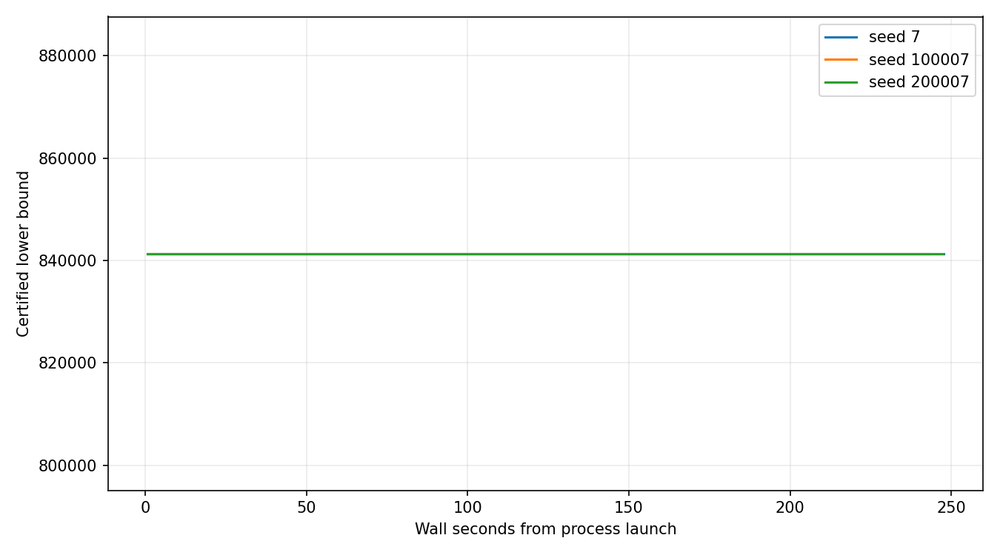

> GitHub 展示目录仅保留报告、输入、参考与最佳方案。完整冻结源码、日志、割快照和原始校验清单在 [v0.20.0 Release](https://github.com/SadPull/LLM-benders-SUC/releases/tag/v0.20.0) 的 `rts24-gap-closure-20261006.zip` 中；重建报告请先解压完整包。

# RTS-24 随机 SUC Gap 补足实验

主目标（三次 600 秒均 ≤1%）：False；挑战目标（均 ≤0.5%）：False。
选择分块：1h；控制状态：completed。

论文口径 Gap=(独立参考可行成本−认证下界)/参考成本。参考方案和成本没有进入搜索；截止后事件不计分。
全部运行串行、单线程；正式 40 次外层／200 次内层，容差 1e-4；SA 参数及数据未调优。

| 阶段 | 方法/种子 | h | 状态 | 成本 | 认证下界 | 论文gap | 成本高于参考 | 原问题gap | 外层完成 | 经典调用/接受 | 来源 |
|---|---|---:|---|---:|---:|---:|---:|---:|---:|---:|---|
| sanity | sa_only/7 | 1 | DUAL_CONVERGED | 125314.71241648376 | 125314.71241636081 | 0.0000% | -0.0000% | 0.0000% | 7 | 0/0 | sa |
| sanity | sa_only/100007 | 1 | DUAL_CONVERGED | 125314.71241648376 | 125314.71241636081 | 0.0000% | -0.0000% | 0.0000% | 7 | 0/0 | sa |
| sanity | sa_only/200007 | 1 | DUAL_CONVERGED | 125314.71241648376 | 125314.71241636081 | 0.0000% | -0.0000% | 0.0000% | 7 | 0/0 | sa |
| sanity | sa_fallback/7 | 1 | DUAL_CONVERGED | 125314.71241648376 | 125314.71241636081 | 0.0000% | -0.0000% | 0.0000% | 7 | 4/4 | sa |
| sanity | sa_fallback/100007 | 1 | DUAL_CONVERGED | 125314.71241648376 | 125314.71241636557 | 0.0000% | -0.0000% | 0.0000% | 7 | 6/4 | native_master |
| sanity | sa_fallback/200007 | 1 | DUAL_CONVERGED | 125314.71241648376 | 125314.71241636081 | 0.0000% | -0.0000% | 0.0000% | 7 | 8/8 | native_master |
| deterministic | native_only/7 | 1 | TIME_LIMIT | 317687.7519317601 | 312830.6269884008 | 0.4804% | 1.0648% | 1.5289% | 1 | 208/208 | native_master |
| deterministic | native_only/7 | 1 | INNER_NOT_CONVERGED | 883727.892202252 | 815439.9031862689 | 2.0702% | 6.1308% | 7.7273% | 0 | 200/200 | relaxation_rounding |
| screening | native_only/7 | 1 | TIME_LIMIT | 903408.4504501729 | 841376.5240214842 | 4.9364% | 2.0724% | 6.8664% | 0 | 362/362 | native_master |
| screening | native_only/7 | 2 | INNER_NOT_CONVERGED | 904570.6906384228 | 841376.5240214842 | 4.9364% | 2.2037% | 6.9861% | 0 | 200/200 | native_master |
| screening | native_only/7 | 3 | INNER_NOT_CONVERGED | 904577.1712988078 | 841376.5240214842 | 4.9364% | 2.2044% | 6.9868% | 0 | 200/200 | native_master |
| screening | native_only/7 | 5 | TIME_LIMIT | 905400.9976522108 | 841376.5240214842 | 4.9364% | 2.2975% | 7.0714% | 0 | 200/200 | native_master |
| native_confirmation | native_only/7 | 1 | TIME_LIMIT | 903408.4504501729 | 841376.5240214842 | 4.9364% | 2.0724% | 6.8664% | 0 | 424/424 | native_master |
| comparison | sa_only/7 | 1 | INNER_NOT_CONVERGED | 905650.2613467714 | 841376.5240214842 | 4.9364% | 2.3257% | 7.0970% | 0 | 0/0 | sa |
| comparison | sa_only/100007 | 1 | INNER_NOT_CONVERGED | 910928.7509333009 | 841376.5240214842 | 4.9364% | 2.9220% | 7.6353% | 0 | 0/0 | sa |
| comparison | sa_only/200007 | 1 | INNER_NOT_CONVERGED | 905373.7365121312 | 841376.5240214842 | 4.9364% | 2.2944% | 7.0686% | 0 | 0/0 | sa |
| comparison | sa_fallback/7 | 1 | TIME_LIMIT | 903789.9469054416 | 841376.5240214842 | 4.9364% | 2.1155% | 6.9057% | 0 | 66/66 | native_master |
| comparison | sa_fallback/100007 | 1 | TIME_LIMIT | 903789.9469054413 | 841376.5240214842 | 4.9364% | 2.1155% | 6.9057% | 0 | 66/66 | native_master |
| comparison | sa_fallback/200007 | 1 | TIME_LIMIT | 903599.1902541857 | 841376.5240214842 | 4.9364% | 2.0939% | 6.8861% | 0 | 66/66 | native_master |
| comparison | native_only/7 | 1 | TIME_LIMIT | 903408.4504501729 | 841376.5240214842 | 4.9364% | 2.0724% | 6.8664% | 0 | 362/362 | native_master |
| confirmation | sa_fallback/7 | 1 | INNER_NOT_CONVERGED | 903789.9469054416 | 841376.5240214842 | 4.9364% | 2.1155% | 6.9057% | 0 | 66/66 | native_master |
| confirmation | sa_fallback/100007 | 1 | INNER_NOT_CONVERGED | 903789.9469054413 | 841376.5240214842 | 4.9364% | 2.1155% | 6.9057% | 0 | 66/66 | native_master |
| confirmation | sa_fallback/200007 | 1 | INNER_NOT_CONVERGED | 903599.1902541857 | 841376.5240214842 | 4.9364% | 2.0939% | 6.8861% | 0 | 66/66 | native_master |

经典点经原局部调度及全日恢复验证；来源 native_master／mixed_native 单列。
原始样本可行数、经典耗时、贡献金额、截止后事件及失败原因见 summary.json；每个块和每组乘子分别记录。
达到论文口径目标与 DUAL_CONVERGED 分开判断；超时不等于理论对偶上限。

源码、输入、历史参考和逐文件 SHA256 随实验冻结；--report-only 可重建报告。
