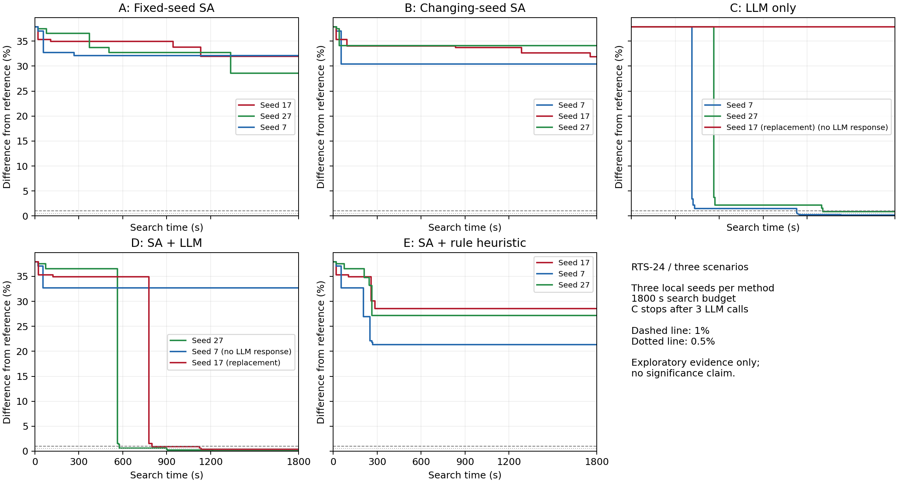
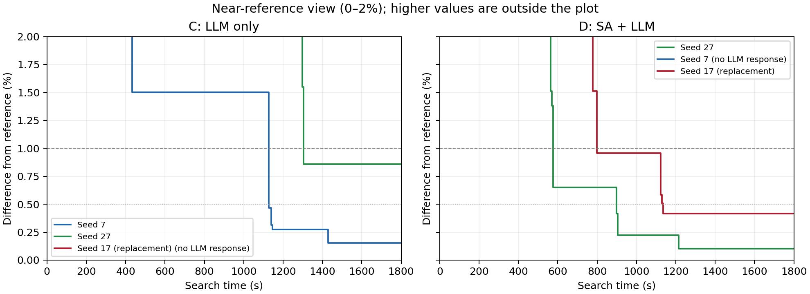

# RTS-24 最小必要性实验：最终结果

最终分析集数值验收：True。

**当前证据不足以证明 SA 与 LLM 的双向协同，也不足以支持 SA 的必要性或相对 Gurobi 的加速主张。**
已完成原批次及两次授权补跑，共 17 次搜索尝试和一次独立参考；最终保留 15 个预定组别/种子结果。运行结束不等于有效模型重复已补齐。
六次入选 C/D 运行中，4 次至少接收了一次模型响应，2 次接收了全部三次响应；C/D 两侧均接收到模型响应的配对种子为 [27]。
种子 27 的 D 最终参考差为 0.1014%，低于 C 的 0.8568%，但只有这一对同时接收到模型响应，且 C 第三次调用超时、D 三次均接收，不能据此识别 SA 本身的贡献。
D／27 在首次 LLM 改善后又执行 7 次 SA、完成 2 次完整评估，未进一步降低最佳成本。D／17 补跑没有执行后续 SA；D／7 没有接收 LLM 响应。这些记录不能替代充分的 SA 后续贡献实验。
收到响应的 C/D 运行达到 0.1014%–0.8568% 参考差；A/B 为 28.5462%–34.0872%，E 为 21.2999%–28.5622%。它们支持在本算例和当前实现中继续研究经验证的 LLM 候选，但不证明一般传统启发式无法替代 LLM。
全部尝试共启动 18 次模型请求，低于授权总上限 24 次；未用完的额度不表示已批准额外运行。

原 D／17 的控制进程和工作进程意外退出，第三次模型输出未被调度验证；原始部分结果完整保留。
用户授权在原批次结束后，以同一冻结源码和配置补跑 D／17，模型调用总上限由 18 调整为 21。
C／17 首次请求被认领后，截止前没有模型输出或回执，原因未知；原始记录保留。用户另行批准补跑 C／17，总调用上限提高到 24。
下表使用 15 次有正常结束记录的运行；D／17、C／17 使用明确标记的替代运行。全部 17 次尝试及失败记录见 final-summary.json。
数值审计通过仅说明记录、约束、成本和预算核对通过，不表示全部模型调用成功；C／27 的第三次调用仍因截止未计分。
D／7 的首次输出未在截止前完成回执交接，整次运行没有接收任何 LLM 响应；其 32.7028% 参考差反映交接失败后的端到端结果，不能解释为模型候选质量。该运行保留在预定分析集中，并明确标记。

D／17 补跑的第三次输出同样没有在截止前交回；C／17 补跑的首次请求在认领前等待约 1175 秒，随后输出虽已写入，截止前仍没有完成通知或回执，最终只保留初始解。两次补跑仍受到中断、模型会话及交接延迟影响，不能视为无故障的算法测量。

| 方法 | 结束记录数 | 参考差中位数 | 最小–最大参考差 | ≤1% 达标 | ≤0.5% 达标 |
|---|---:|---:|---|---:|---:|
| A Fixed-seed SA | 3 | 31.9843% | 28.5462%–32.0774% | 0/3 | 0/3 |
| B Changing-seed SA | 3 | 31.8755% | 30.4416%–34.0872% | 0/3 | 0/3 |
| C LLM only | 3 | 0.8568% | 0.1520%–37.8906% | 2/3 | 1/3 |
| D SA + LLM | 3 | 0.4152% | 0.1014%–32.7028% | 2/3 | 2/3 |
| E SA + rule heuristic | 3 | 27.1451% | 21.2999%–28.5622% | 0/3 | 0/3 |

## 逐次结果

LLM 请求次数包含未成功返回的请求；成功接收不保证所有候选都赶上完整调度验证。

| 方法/种子 | 运行目录 | 成本 | 参考差 | ≤1% 秒 | ≤0.5% 秒 | SA 次数 | LLM 请求/接收 | LLM 交接状态 | LLM 后 SA 降本 |
|---|---|---:|---:|---:|---:|---:|---:|---|---:|
| A/7 | A-7 | 1168973.171 | 32.0774% | — | — | 21 | 0/0 | 不适用 | 0.000 |
| A/17 | A-17 | 1168149.121 | 31.9843% | — | — | 25 | 0/0 | 不适用 | 0.000 |
| A/27 | A-27 | 1137719.304 | 28.5462% | — | — | 23 | 0/0 | 不适用 | 0.000 |
| B/7 | B-7 | 1154494.899 | 30.4416% | — | — | 23 | 0/0 | 不适用 | 0.000 |
| B/17 | B-17 | 1167186.075 | 31.8755% | — | — | 25 | 0/0 | 不适用 | 0.000 |
| B/27 | B-27 | 1186761.322 | 34.0872% | — | — | 24 | 0/0 | 不适用 | 0.000 |
| C/7 | C-7 | 886412.340 | 0.1520% | 1126.94 | 1126.94 | 0 | 3/3 | 三次接收 | 0.000 |
| C/17 | replacements/C-17 | 1220423.773 | 37.8906% | — | — | 0 | 1/0 | 无响应 | 0.000 |
| C/27 | C-27 | 892650.356 | 0.8568% | 1304.94 | — | 0 | 3/2 | 部分接收 | 0.000 |
| D/7 | D-7 | 1174508.055 | 32.7028% | — | — | 5 | 1/0 | 无响应 | 0.000 |
| D/17 | replacements/D-17 | 888741.225 | 0.4152% | 798.36 | 1136.00 | 7 | 3/2 | 部分接收 | 0.000 |
| D/27 | D-27 | 885963.836 | 0.1014% | 576.81 | 898.49 | 13 | 3/3 | 三次接收 | 0.000 |
| E/7 | E-7 | 1073584.897 | 21.2999% | — | — | 18 | 0/0 | 不适用 | 0.000 |
| E/17 | E-17 | 1137861.507 | 28.5622% | — | — | 21 | 0/0 | 不适用 | 0.000 |
| E/27 | E-27 | 1125319.309 | 27.1451% | — | — | 18 | 0/0 | 不适用 | 0.000 |

## 配对比较

下表为 D 成本减去对照成本，负数表示 D 更好；配对仅按本地种子，不代表模型随机性受控。

| 种子 | D − C | D − B | D − E | LLM 改进后 SA 调用/完整评估 | D 首次 LLM 改进后 SA 新增降本 |
|---|---:|---:|---:|---:|---:|
| 7 | 288095.715 | 20013.156 | 100923.159 | 0/0 | 0.000 |
| 17 | -331682.548 | -278444.850 | -249120.281 | 0/0 | 0.000 |
| 27 | -6686.520 | -300797.486 | -239355.473 | 7/2 | 0.000 |

## 固定时间检查点

| 方法/种子 | 300 秒 | 600 秒 | 900 秒 | 1800 秒 |
|---|---:|---:|---:|---:|
| A/7 | 1168973.171 | 1168973.171 | 1168973.171 | 1168973.171 |
| A/17 | 1194310.042 | 1194310.042 | 1194310.042 | 1168149.121 |
| A/27 | 1208296.468 | 1174804.385 | 1174804.385 | 1137719.304 |
| B/7 | 1154494.899 | 1154494.899 | 1154494.899 | 1154494.899 |
| B/17 | 1186246.428 | 1186246.428 | 1183536.701 | 1167186.075 |
| B/27 | 1186761.322 | 1186761.322 | 1186761.322 | 1186761.322 |
| C/7 | 1220423.773 | 898366.750 | 898366.750 | 886412.340 |
| C/17 | 1220423.773 | 1220423.773 | 1220423.773 | 1220423.773 |
| C/27 | 1220423.773 | 904622.300 | 904622.300 | 892650.356 |
| D/7 | 1174508.055 | 1174508.055 | 1174508.055 | 1174508.055 |
| D/17 | 1194310.042 | 1194310.042 | 893536.628 | 888741.225 |
| D/27 | 1208296.468 | 890810.403 | 888741.225 | 885963.836 |
| E/7 | 1073584.897 | 1073584.897 | 1073584.897 | 1073584.897 |
| E/17 | 1137861.507 | 1137861.507 | 1137861.507 | 1137861.507 |
| E/27 | 1125319.309 | 1125319.309 | 1125319.309 | 1125319.309 |

## 候选质量（各组内合并计数）

| 方法/来源 | 进入处理的提案数 | 处理前可行率 | 平均修复位数 | 修复后重复率 | 完整评估数 | 完整调度可行率 | 有效改进率 |
|---|---:|---:|---:|---:|---:|---:|---:|
| A/sa | 1089 | 0.00% | 104.50 | 89.44% | 77 | 100.00% | 15.58% |
| B/sa | 1152 | 0.00% | 102.56 | 89.84% | 86 | 100.00% | 10.47% |
| C/llm | 20 | 40.00% | 1.90 | 15.00% | 17 | 100.00% | 64.71% |
| D/sa | 385 | 0.00% | 102.17 | 87.79% | 38 | 100.00% | 15.79% |
| D/llm | 20 | 30.00% | 1.37 | 0.00% | 19 | 100.00% | 57.89% |
| E/sa | 912 | 0.00% | 106.30 | 89.80% | 45 | 100.00% | 13.33% |
| E/rule | 831 | 0.12% | 17.31 | 95.67% | 36 | 100.00% | 27.78% |

上表以实际进入提案处理记录的候选为分母；SA 在截止后返回的样本以及来不及进入修复的样本另列如下。规则为了获得四个不同候选而尝试的失败或重复修复均计入；完整评估列只统计该来源在预算内实际完成的不同方案。

| 方法 | SA 返回样本总数 | 返回样本原始可行率 | 截止后返回样本数 | 进入修复的样本数 |
|---|---:|---:|---:|---:|
| A | 1104 | 0.00% | 0 | 1089 |
| B | 1152 | 0.00% | 0 | 1152 |
| D | 400 | 0.00% | 0 | 385 |
| E | 912 | 0.00% | 0 | 912 |

## 时间分项（每组中位数，秒）

| 方法 | QUBO 构建 | SA | 上下文 | LLM 等待及解析 | 规则计算 | 修复 | 块级调度 | 完整调度 | 物理复核 | 超时开销 |
|---|---:|---:|---:|---:|---:|---:|---:|---:|---:|---:|
| A | 1559.49 | 27.07 | 0.00 | 0.00 | 0.00 | 17.89 | 101.37 | 174.11 | 0.04 | 92.36 |
| B | 1475.06 | 26.12 | 0.00 | 0.00 | 0.00 | 18.61 | 99.95 | 201.81 | 0.05 | 18.75 |
| C | 0.00 | 0.00 | 0.02 | 1741.75 | 0.00 | 0.02 | 1.89 | 56.17 | 0.01 | 0.20 |
| D | 224.88 | 8.32 | 0.02 | 1376.16 | 0.00 | 7.47 | 18.52 | 154.21 | 0.03 | 0.08 |
| E | 1504.63 | 22.72 | 0.02 | 0.00 | 0.37 | 16.09 | 114.29 | 179.31 | 0.04 | 63.31 |

## 模型交接明细（全部尝试）

认领至文件生成包含模型、工具及运行环境开销，不能视为纯模型推理时间；无回执或未被消费的输出不计分。

| 调用目录 | 请求至认领/秒 | 认领至文件/秒 | 文件至回执/秒 | 求解器接收状态 |
|---|---:|---:|---:|---|
| C-17\calls\001 | 1506.89 | — | — | deadline |
| C-27\calls\001 | 105.79 | 340.73 | 103.05 | completed |
| C-27\calls\002 | 219.51 | 397.55 | 92.40 | completed |
| C-27\calls\003 | 153.10 | 282.44 | — | deadline |
| C-7\calls\001 | 65.61 | 139.78 | 194.99 | completed |
| C-7\calls\002 | 277.07 | 317.54 | 93.93 | completed |
| C-7\calls\003 | 44.53 | 180.12 | 51.52 | completed |
| D-17\calls\001 | 79.60 | 205.97 | 59.58 | completed |
| D-17\calls\002 | 39.79 | 234.03 | 73.25 | completed |
| D-17\calls\003 | 124.80 | 179.44 | 83.85 | 未接收 |
| D-27\calls\001 | 53.29 | 232.93 | 72.29 | completed |
| D-27\calls\002 | 43.02 | 207.01 | 58.81 | completed |
| D-27\calls\003 | 43.01 | 198.38 | 48.92 | completed |
| D-7\calls\001 | 793.25 | 714.26 | — | deadline |
| replacements\C-17\calls\001 | 1174.61 | 440.73 | — | deadline |
| replacements\D-17\calls\001 | 23.51 | 315.68 | 71.01 | completed |
| replacements\D-17\calls\002 | 0.35 | 253.85 | 53.82 | completed |
| replacements\D-17\calls\003 | 0.43 | 308.92 | — | deadline |

模型 token 用量未知。LLM 分项含文件交接和调度等待，不能解释为纯模型推理耗时。各分项中位数不保证相加等于总耗时中位数。

请求认领及结果回执存在可观、变化较大的调度延迟；逐调用拆分见 final-summary.json 的 handoff_timings。C／27 第三次及 D／7 首次输出未在截止前完成交接验证，未计入成绩。
原 C／17 的请求约等待 1507 秒才被认领，并且没有输出或回执；其 37.8906% 参考差只是初始解，不能作为正常 LLM 能力测量。
补跑位于预定顺序之外，补齐运行结束记录，但不保证全部模型调用成功，也不消除调度与时间顺序带来的混杂因素。
因此本批次的达标时间与截止成本反映实际端到端流程，不能把跨组时间差或调度导致的调用超时直接解释为 SA 协同或纯模型推理优势。

## 推断范围

是否支持协同，应结合 D 对 C/B/E 的配对差异、达标时间和 LLM 后 SA 的新增收益一起判断。
E 是本协议规定的有限轮单块规则启发式，只能排除这一具体对照；不能据此断言所有传统启发式均不能替代 LLM。
A/B/D/E 的搜索时限相同；C 在模型调用额度耗尽后提前结束，曲线延续其最后有效成本。
参考求解独立进行，搜索没有使用其解。参考成本 885066.704431，下界 885066.704430；求解器耗时 95.679 秒，建模与求解合计 108.511 秒，独立调度复核另用 6.019 秒。
QUBO 构建时间包含当前实现的开销，不能将该配置下的弱 SA 结果外推为 SA 或经典优化方法的一般上限；本批次不能支持相对独立 Gurobi 参考的加速主张。
三个重复用于筛查，不足以支持统计显著性或跨实例结论；后续消融是否值得开展需依本批次结果决定。

下一阶段应先修复协调会话中断时的模型请求与完成回执交接，另行登记补齐 C／17、D／7 等缺失的有效重复；再决定是否开展上下文、反馈与割更新消融。不能通过事后接收迟到输出、删除失败尝试或把等待时间从既定预算中扣除来改变本批次成绩。

