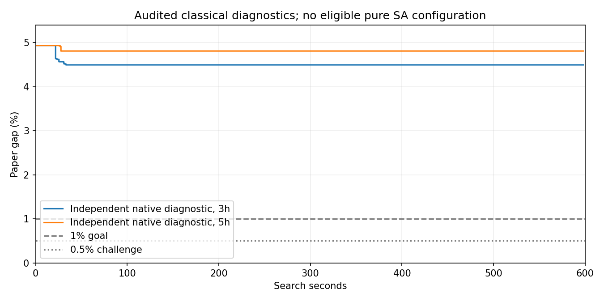

# Pure SA Gap v3 实验结果解读

实现及固定筛查已完成；三种子 1200 秒确认未运行，不能宣称达到论文相近 Gap 量级。四种分块的纯 SA 筛查均未通过数值审计，依据排除规则无法选择后续配置。后续 11 个槽位明确标记为 skipped，未用节省预算追加试验。

分支 codex/pure-sa-gap-v3；冻结提交 6f5b0d58bd5d860757d0d580aa8a3e42f1bfd297；标签 pure-sa-gap-v3-source-20261006-154410。旧源码与结果保留。改动前 168 项、改动后 184 项测试通过。

独立随机参考 R=885066.7044303413，输入哈希及物理成本校验通过。1% 目标要求 L>=876216.0373860378。

| 纯 SA 筛查分块 | 完整外层 | SA 调用 | 新调度候选 | SA 最优性/可行性割 | 审计 |
|---|---:|---:|---:|---:|---|
| 1h | 5 | 1012 | 1550 | 1543/7 | 失败：final/outer=4:local witness cost mismatch；final/outer=5:local witness cost mismatch |
| 2h | 2 | 224 | 103 | 103/0 | 失败：final/outer=3:cut excludes a saved feasible local witness；outer=3/block=4/inner=1/relaxation |
| 3h | 8 | 539 | 80 | 80/0 | 失败：final/outer=4:local witness cost mismatch；final/outer=5:local witness cost mismatch；final/outer=6:local witness cost mismatch；final/outer=7:local witness cost mismatch |
| 5h | 13 | 547 | 0 | 0/0 | 失败：final/outer=3:cut excludes a saved feasible local witness |

四组在线整数主问题调用均为零；完整可行方案均通过独立物理与成本校验，成本为 933522.2153666164，来源为连续松弛初始化。纯 SA 未改善完整成本，也未产生高于初始连续下界 841376.5240214842 的有效认证下界。被审计排除的运行不列 Gap 成绩。

1h 第4轮乘子最大约5.94e12，局部成本约-7.30e14，同一点重算差0.125；3h也出现大乘子和成本不一致。2h有连续松弛失败及割排除局部见证，5h也有割见证冲突。大乘子导致浮点抵消是已定位的风险；不能通过放宽审计阈值宣称达标。

样本过滤：1h 的16192个原始样本中1550个接受、4496个重复、7414个硬约束失败、2728个超出候选配额、4个截止后样本；2h 的3584个样本中2816个硬约束失败；3h 的8624个样本中8281个硬约束失败；5h 的8752个样本全部硬约束失败。各组初始化和跨轮重定价产生的割与SA新割分别保留，不能把总割数全部归功于SA。

有效经典诊断：3h 的 L=845275.9609916063，Gap=4.495790%，完整外层26；5h 的 L=842492.6380846946，Gap=4.810266%，完整外层21。均未对偶收敛，有效协调上界高于0.99R，不能据此认定目标不可达。1h数值认证失败；2h截止时缺少有限ObjBound，报告保守排除整次成绩，已保存的早期界仍留档。

当前证据证明外层推进机制有效，但不支持“SA已降低32机组Gap”。三机组的三个种子达到约0.771638%的独立认证Gap，只能作为小算例兼容结果。由于消融被跳过，不能分别量化压缩与多样性的因果贡献。

下一版应先处理协调LP的乘子退化与成本数值尺度，再改善硬约束可行样本率。可研究在协调LP最优面上用连续辅助LP选择较小范数乘子，并保持原无限制协调上界；直接截断乘子不能作为全局分解上限认证。本轮未实施或追加这些试验。

正式确认图为空，因为确认槽位均跳过。下面图只展示通过审计的独立经典诊断，所有逐运行、逐块与原始时间曲线仍在正式CSV中。

完整原始交付：[README](rts24-pure-sa-gap-v3-20261006/README.md)、[runs.csv](rts24-pure-sa-gap-v3-20261006/runs.csv)、[ZIP](rts24-pure-sa-gap-v3-20261006.zip)。报告重建数值对象及CSV/PNG一致，JSON仅字段顺序变化；原归档报告字节已恢复。

预算复核：正式控制器与归档墙钟 3410.28s；含补充复核 3746.37s，未超过14400s。正式审计64.14s；含人工补充复核的审计 400.23s，超过300s阶段配额，单独标记为协议偏差。未追加求解试验。
