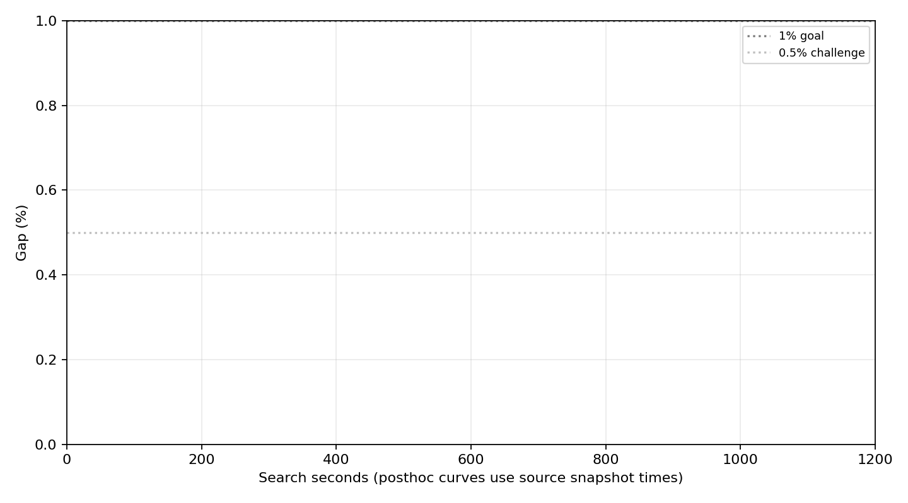
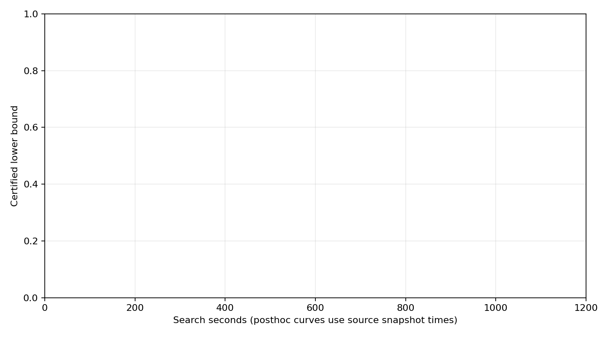

> GitHub 展示目录仅保留报告、输入、参考与最佳方案。完整冻结源码、日志、割快照和原始校验清单在 [v0.20.0 Release](https://github.com/SadPull/LLM-benders-SUC/releases/tag/v0.20.0) 的 `rts24-pure-sa-gap-v3-20261006.zip` 中；重建报告请先解压完整包。

# 纯 SA 主问题 Benders：Gap v3 实验

三种子 1200 秒搜索主目标 ≤1%：False；挑战 ≤0.5%：False；600 秒快照 ≤1%：False。
固定分块：Noneh；固定版本：None。

整数主问题候选由 SA 产生；Gurobi 求连续子问题、连续松弛及协调 LP。整数认证在搜索结束后独立进行。
下界及 Gap 的实线为事后认证，横轴回溯到搜索快照；虚线为搜索期间可用的连续下界。认证结果不反馈搜索。

| 阶段 | 方法/种子 | h | 状态 | 搜索秒 | 认证秒 | 可行成本 | 认证下界 | Gap | 600秒Gap | 完整外层 | 在线整数调用 |
|---|---|---:|---|---:|---:|---:|---:|---:|---:|---:|---:|
| sanity | sa_full/7 | 1 | TIME_LIMIT | 58.4208 | 1.5010 | 125314.7124 | 124347.7365 | 0.7716% | NA | 4 | 0 |
| sanity | sa_full/100007 | 1 | TIME_LIMIT | 58.3984 | 1.4275 | 125314.7124 | 124347.7365 | 0.7716% | NA | 4 | 0 |
| sanity | sa_full/200007 | 1 | TIME_LIMIT | 58.4418 | 1.4881 | 125314.7124 | 124347.7365 | 0.7716% | NA | 4 | 0 |
| sanity | sa_full/7 | 1 | TIME_LIMIT | 88.6724 | 3.4583 | 363755.7347 | 310639.1481 | 1.1776% | NA | 3 | 0 |
| diagnostic | native_diagnostic/7 | 1 | CERTIFICATION_FAILED | 191.2624 | 0.0000 | 933522.2154 | 841807.7318 | NA | NA | 10 | 1968 |
| diagnostic | native_diagnostic/7 | 2 | TIME_LIMIT | 599.0790 | 0.0000 | 933522.2154 | 842345.2812 | NA | NA | 30 | 3656 |
| diagnostic | native_diagnostic/7 | 3 | TIME_LIMIT | 598.8985 | 0.0000 | 916997.8625 | 845275.9610 | 4.4958% | NA | 26 | 2305 |
| diagnostic | native_diagnostic/7 | 5 | TIME_LIMIT | 598.7864 | 0.0000 | 924621.8393 | 842492.6381 | 4.8103% | NA | 21 | 1425 |
| screening | sa_full/7 | 1 | TIME_LIMIT | 299.7257 | 13.5859 | 933522.2154 | 841376.5240 | NA | NA | 5 | 0 |
| screening | sa_full/7 | 2 | RELAXATION_FAILED | 98.5596 | 2.9522 | 933522.2154 | 841376.5240 | NA | NA | 2 | 0 |
| screening | sa_full/7 | 3 | TIME_LIMIT | 300.0107 | 8.4207 | 933522.2154 | 841376.5240 | NA | NA | 8 | 0 |
| screening | sa_full/7 | 5 | TIME_LIMIT | 300.0803 | 5.7538 | 933522.2154 | 841376.5240 | NA | NA | 13 | 0 |
| ablation | sa_strict/7 | None | skipped | NA | 0.0000 | NA | NA | NA | NA | 0 | 0 |
| ablation | sa_flow/7 | None | skipped | NA | 0.0000 | NA | NA | NA | NA | 0 | 0 |
| ablation | sa_compact/7 | None | skipped | NA | 0.0000 | NA | NA | NA | NA | 0 | 0 |
| ablation | sa_full/7 | None | skipped | NA | 0.0000 | NA | NA | NA | NA | 0 | 0 |
| comparison | selected/7 | None | skipped | NA | 0.0000 | NA | NA | NA | NA | 0 | 0 |
| comparison | selected/100007 | None | skipped | NA | 0.0000 | NA | NA | NA | NA | 0 | 0 |
| comparison | selected/200007 | None | skipped | NA | 0.0000 | NA | NA | NA | NA | 0 | 0 |
| comparison | native_diagnostic/7 | None | skipped | NA | 0.0000 | NA | NA | NA | NA | 0 | 0 |
| confirmation | selected/7 | None | skipped | NA | 0.0000 | NA | NA | NA | NA | 0 | 0 |
| confirmation | selected/100007 | None | skipped | NA | 0.0000 | NA | NA | NA | NA | 0 | 0 |
| confirmation | selected/200007 | None | skipped | NA | 0.0000 | NA | NA | NA | NA | 0 | 0 |

Gap=(独立参考成本−认证下界)/独立参考成本。可行成本相对参考、原问题 Gap 及对偶收敛分别列于 runs.csv。
近似协调只使用经过验证的局部可行点形成上支撑平面；内层配额耗尽不记为内层收敛。
独立经典对照用于诊断分解上限；超时和未收敛表示尚未判定。候选来源改进金额是轨迹归类，不表示独立因果贡献。

所有失败、中断、迟到事件及未达标运行保留。完整认证覆盖、局部点、割、来源与快照见各运行目录。
源码、输入和参考哈希见 manifest.json；全部交付哈希见 SHA256SUMS.txt。--report-only 可重建数值报告。
