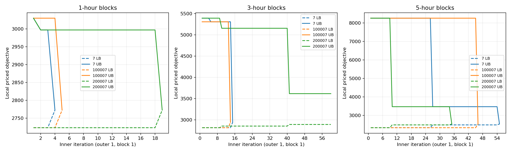
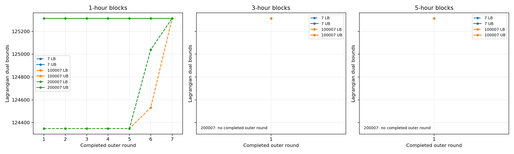

# 固定三机组：1／3／5 小时分块收敛实验

固定 RTS 机组 3、9、20；24 小时，单场景，零备用；每次进程预算 90 秒，内层 60 次、外层 20 次。
三个基础种子逐次变化；不调参、不追加运行。5 小时分块为 5+5+5+5+4。

执行基于 `d3ef53bf81f3bff77bbb1c81c9c7365c0edb853c`；具体执行源码及未提交路径记录在 manifest.json，源码副本和 SHA256 均保存。
本轮 Gurobi 参考：125,314.71；已认证：True。

| 分块 | 种子 | 状态 | 最终成本 | SA加恢复降本 | 高于参考 | 原问题gap | 论文口径gap | 首轮完成块 | 外层完成轮 | 乘子更新 | 秒 |
|---|---|---|---:|---:|---:|---:|---:|---:|---:|---:|---:|
| 1h | 7 | DUAL_CONVERGED | 125,314.71 | 10,725.12 | -0.0000% | 0.0000% | 0.0000% | 24/24 | 7 | 6 | 24.26 |
| 1h | 100007 | DUAL_CONVERGED | 125,314.71 | 10,725.12 | -0.0000% | 0.0000% | 0.0000% | 24/24 | 7 | 6 | 19.25 |
| 1h | 200007 | DUAL_CONVERGED | 125,314.71 | 10,725.12 | -0.0000% | 0.0000% | 0.0000% | 24/24 | 7 | 6 | 20.27 |
| 3h | 7 | DUAL_CONVERGED | 125,314.71 | 10,725.12 | -0.0000% | 0.0000% | 0.0000% | 8/8 | 1 | 0 | 7.48 |
| 3h | 100007 | DUAL_CONVERGED | 125,314.71 | 10,725.12 | -0.0000% | 0.0000% | 0.0000% | 8/8 | 1 | 0 | 5.12 |
| 3h | 200007 | INNER_NOT_CONVERGED | 136,039.83 | 0.00 | 8.5585% | 15.9767% | 8.7855% | 0/8 | 0 | 0 | 8.41 |
| 5h | 7 | DUAL_CONVERGED | 125,314.71 | 10,725.12 | -0.0000% | 0.0000% | 0.0000% | 5/5 | 1 | 0 | 15.13 |
| 5h | 100007 | DUAL_CONVERGED | 125,314.71 | 10,725.12 | -0.0000% | 0.0000% | 0.0000% | 5/5 | 1 | 0 | 8.66 |
| 5h | 200007 | INNER_NOT_CONVERGED | 125,314.71 | 10,725.12 | -0.0000% | 0.1427% | 0.1427% | 4/5 | 0 | 0 | 12.15 |

| 分块 | 对偶收敛 | 达到参考最优 | 成本中位数 | 最差成本 | 耗时中位数 | 最长耗时 |
|---|---:|---:|---:|---:|---:|---:|
| 1h | 3/3 | 3/3 | 125,314.71 | 125,314.71 | 20.27 | 24.26 |
| 3h | 2/3 | 2/3 | 125,314.71 | 136,039.83 | 7.48 | 8.41 |
| 5h | 2/3 | 3/3 | 125,314.71 | 125,314.71 | 12.15 | 15.13 |

1 小时基线复现：True。所有返回的方案均通过独立物理及成本校验。
DUAL_CONVERGED 仅表示对偶收敛；达到原问题最优还要求物理校验及与已认证参考目标一致。
三种 gap 分开报告。参考缺失为 NA；未完成外层不补零；不同块和不同乘子下的内层界不连接。
三个种子仅用于初筛；时间或迭代上限不能解释为方法永远不收敛。成本改进属于 SA 加全日恢复流程。

逐块记录见 blocks.csv；逐种子指标见 runs.csv；完整事件及方案在 end_to_end/。
重建：python -m suc_benders.three_unit_block_experiment --report-only --output-dir <本目录>
